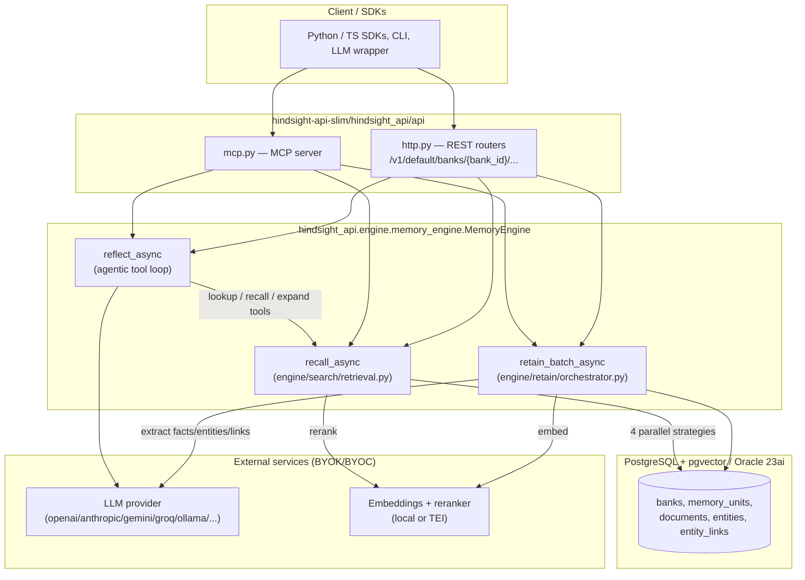

Relevant source files

The following files were used as context for generating this wiki page:
- [README.md](README.md)
- [CLAUDE.md](CLAUDE.md)
- [pyproject.toml](pyproject.toml)
- [package.json](package.json)
- [hindsight-api-slim/hindsight_api/main.py](hindsight-api-slim/hindsight_api/main.py)
- [hindsight-api-slim/hindsight_api/engine/memory_engine.py](hindsight-api-slim/hindsight_api/engine/memory_engine.py)
- [hindsight-api-slim/hindsight_api/engine/retain/orchestrator.py](hindsight-api-slim/hindsight_api/engine/retain/orchestrator.py)
- [hindsight-api-slim/hindsight_api/engine/search/retrieval.py](hindsight-api-slim/hindsight_api/engine/search/retrieval.py)
- [hindsight-api-slim/hindsight_api/api/http.py](hindsight-api-slim/hindsight_api/api/http.py)

# Technical Orientation

This page orients new contributors to the `hindsight` monorepo: what the system does, how the repository is laid out, the retain/recall/reflect mental model that underlies every operation, and how the rest of the developer reference builds on this foundation. Read this first — every other page assumes the vocabulary introduced here.

No prior wiki pages, `docs/solutions/` notes, or `STRATEGY.md` exist in this checkout, so this page is grounded entirely in the current source tree (README, CLAUDE.md, and the engine/API implementation).

## What Hindsight Is

Hindsight is an agent memory system focused on making agents *learn*, rather than simply replay conversation history. Instead of flat vector-search RAG, it organizes memory into three biomimetic categories, all scoped to an isolated **bank** (one memory store per user/agent):

- **World facts** — general knowledge (e.g., "The sky is blue")
- **Experience facts** — first-person events (e.g., "I visited Paris in 2023")
- **Mental models** — knowledge synthesized/consolidated from many raw facts (e.g., "User prefers functional programming patterns")

Three operations are exposed over both an HTTP API and a Model Context Protocol server: **retain** (store), **recall** (retrieve), and **reflect** (reason). The engine is provider-neutral — it does not hard-code a specific LLM, embedding, or reranking vendor; provider choice is a runtime/config decision (see `HINDSIGHT_API_LLM_PROVIDER`, `HINDSIGHT_API_EMBEDDINGS_PROVIDER`, `HINDSIGHT_API_RERANKER_PROVIDER` in `CLAUDE.md`), so the same architecture works whether you bring your own hosted API key or point at a local model runtime.

Sources: [README.md:19-26](), [README.md:189-201](), [CLAUDE.md:1-10]()

## Monorepo Layout

The workspace is split across a Python `uv` workspace and an npm workspace, declared respectively in `pyproject.toml` and `package.json`.

| Directory | Role |
|---|---|
| `hindsight-api-slim/` | Core FastAPI server and memory engine (Python, `uv`) — the system of record for retain/recall/reflect |
| `hindsight-api/`, `hindsight-all/`, `hindsight-all-slim/`, `hindsight-embed/` | Packaging variants (full/slim/embedded distributions) built on the same engine |
| `hindsight-control-plane/` | Admin UI (Next.js) |
| `hindsight-cli/` | CLI tool (Rust, generated API client via `progenitor`) |
| `hindsight-clients/` | Generated SDK clients — `python/`, `typescript/`, `rust/`, `go/` |
| `hindsight-docs/` | Docusaurus documentation site (`docs/developer`, `docs/sdks`) |
| `hindsight-integrations/` | Framework integrations — CrewAI, LangGraph, Pydantic AI, AG2, LiteLLM, Claude Code, n8n, and ~30 more, each a self-contained package with its own tests/CI job |
| `hindsight-dev/` | Development tools and benchmarks (LongMemEval, LOCOMO) |
| `hindsight-mcp-server/`, `hindsight-tools/` | MCP server packaging and auxiliary tools |

The Python side is a single `uv.workspace` with members `hindsight-all`, `hindsight-api`, `hindsight-api-slim`, `hindsight-all-slim`, `hindsight-dev`, `hindsight-mcp-server`, `hindsight-clients/python`, and `hindsight-embed`; the Node side is an npm workspace covering `hindsight-clients/typescript`, `hindsight-control-plane`, `hindsight-docs`, `hindsight-all-npm`, and `hindsight-tools/hindsight-agent-sdk`.

Sources: [pyproject.toml:1-8](), [package.json:1-10](), [CLAUDE.md:20-30]()

## The Retain / Recall / Reflect Mental Model

### Retain

`MemoryEngine.retain_batch_async` (`hindsight-api-slim/hindsight_api/engine/retain/orchestrator.py:557`) is the batch entry point; `retain_async` (`memory_engine.py:3210-3254`) is a single-item convenience wrapper around it. The pipeline extracts facts, temporal data, entities, and relationships from raw content via an LLM, then normalizes them into canonical entities, embeddings, and search indexes. Content is addressed by `bank_id`, optional `document_id` (upserts existing documents), `context`, and `event_date`; `fact_type_override` can force classification into `world` or `experience`.

Sources: [hindsight-api-slim/hindsight_api/engine/memory_engine.py:3210-3269](), [hindsight-api-slim/hindsight_api/engine/retain/orchestrator.py:557]()

### Recall

`MemoryEngine.recall_async` (`memory_engine.py:4012-4043`) runs **N fact types × 4 retrieval strategies in parallel** — semantic vector similarity, BM25 keyword matching, graph activation (entity/temporal/causal links), and temporal graph traversal (`retrieve_all_fact_types_parallel` in `engine/search/retrieval.py:707`). Results are merged via reciprocal rank fusion, reranked (cross-encoder by default, selectable via the `reranking` parameter), diversified with MMR, and trimmed to a `max_tokens` budget. Optional parameters (`include_entities`, `include_chunks`, `include_source_facts`, `tags`/`tag_groups`, `created_after`/`created_before`) control what auxiliary context is attached to results.

Sources: [hindsight-api-slim/hindsight_api/engine/memory_engine.py:4012-4081](), [hindsight-api-slim/hindsight_api/engine/search/retrieval.py:95-108](), [hindsight-api-slim/hindsight_api/engine/search/retrieval.py:707]()

### Reflect

`MemoryEngine.reflect_async` (`memory_engine.py:8899-8956`) is an **agentic, read-only loop**: the agent starts with empty context and must call tools — `lookup` (mental models), `recall` (facts), observation search, and `expand` (chunk/document context) — to gather information, with tools removed on the final iteration to force a text answer. It persists nothing; it only synthesizes a response from what's already stored. Disposition traits (skepticism, literalism, empathy) and a bank's `reflect_mission` shape reflect's reasoning but never affect recall.

Sources: [hindsight-api-slim/hindsight_api/engine/memory_engine.py:8899-8956](), [hindsight-api-slim/hindsight_api/engine/memory_engine.py:860-875](), [CLAUDE.md:169-175]()

## API Surface

`hindsight-api-slim/hindsight_api/main.py` is the CLI/process entry point (`hindsight-api`): it loads `HindsightConfig` from the environment, optionally daemonizes, constructs a single `MemoryEngine`, and mounts it into a FastAPI app via `create_app(...)` with both the HTTP router and the MCP server enabled by default (`mcp_mount_path="/mcp"`).

All REST routes are scoped per bank under `/v1/default/banks/{bank_id}/...`, defined in `hindsight-api-slim/hindsight_api/api/http.py`:

| Route | Purpose |
|---|---|
| `POST /v1/default/banks/{bank_id}/memories` | Retain — store content |
| `GET /v1/default/banks/{bank_id}/memories/list` | List memories |
| `POST /v1/default/banks/{bank_id}/memories/recall` | Recall — 4-way parallel retrieval |
| `POST /v1/default/banks/{bank_id}/reflect` | Reflect — agentic reasoning |
| `GET/PATCH /v1/default/banks/{bank_id}/memories/{memory_id}` | Inspect / edit a single memory |
| `GET /v1/default/banks/{bank_id}/entities`, `/entities/graph` | Entity graph views |
| `GET/POST /v1/default/banks/{bank_id}/mental-models` | Mental model CRUD/refresh |
| `GET /v1/default/banks/{bank_id}/stats`, `/health/llm` | Bank stats and health checks |

Every endpoint operates on a single bank; orchestrating across multiple banks is left to the client. The Next.js control plane (`hindsight-control-plane/src/app/api/`) proxies to this same set of routes and must be updated in lockstep whenever a dataplane parameter changes (see `CLAUDE.md`'s "Control Plane API Routes" checklist).

Sources: [hindsight-api-slim/hindsight_api/main.py:261-284](), [hindsight-api-slim/hindsight_api/api/http.py:3579-4034](), [hindsight-api-slim/hindsight_api/api/http.py:6699](), [CLAUDE.md:150-165]()

## Storage and Configuration

Persistence is PostgreSQL with `pgvector`, or Oracle 23ai for enterprise deployments, managed through Alembic migrations that run automatically on startup (`run_migrations_on_startup`, threaded through `main.py:262-265`). Every migration dispatches through `run_for_dialect` to keep the PostgreSQL and Oracle code paths explicit rather than silently drifting. Key tables are `banks`, `memory_units`, `documents`, `entities`, and `entity_links`.

Configuration is hierarchical: **global (env vars) → tenant (via extension) → bank (database)**. Fields are marked either *hierarchical* (LLM provider/model/keys, retain mode, feature flags — overridable per bank or tenant) or *static* (database URL, port, global limits — server-level only), as enforced by `_CONFIGURABLE_FIELDS` in `config.py`. This split is what keeps the architecture provider-neutral: LLM, embedding, and reranker provider/model/key are all bank-overridable configuration rather than compiled-in choices, so a given deployment can mix providers per bank or tenant without code changes.

Sources: [CLAUDE.md:230-260](), [hindsight-api-slim/hindsight_api/main.py:261-266]()

## Where the Rest of the Reference Goes Deeper

This page is the map; it intentionally stops at the boundary of each subsystem rather than detailing internals. Follow-on developer-reference pages should each own one of the following, all rooted in `hindsight-api-slim/hindsight_api/engine/`:

- **Retain pipeline** — fact extraction, entity/link creation, delta/streaming retain (`engine/retain/`: `fact_extraction.py`, `link_creation.py`, `entity_processing.py`, `orchestrator.py`)
- **Recall pipeline** — the four retrieval strategies, fusion, and reranking (`engine/search/`: `retrieval.py`, `fusion.py`, `graph_retrieval.py`, `link_expansion_retrieval.py`, `reranking.py`)
- **Reflect** — the agentic tool loop and disposition/mission resolution (`engine/reflect/`, `memory_engine.py` disposition helpers)
- **Database and migrations** — schema, dual PostgreSQL/Oracle dispatch, tenant schemas (`engine/db/`, `alembic/versions/`)
- **API and integrations layer** — HTTP/MCP routers, the control-plane proxy contract, and the ~30 framework integrations under `hindsight-integrations/`
- **Clients and CLI** — generated SDKs (`hindsight-clients/`) and the Rust CLI (`hindsight-cli/`)

Because the engine is explicitly BYOK/BYOC (any LLM/embedding/reranker provider, PostgreSQL or Oracle storage), pages describing new capabilities — including any Grok-Wiki integration surface — should describe configuration as a config-resolver concern (env → tenant → bank), not assume a specific vendor, hosted connector, or proprietary API is required to reproduce the architecture.

## Related pages

- page-deployment-and-config
- page-memory-engine

## Source files

- `README.md`
- `CLAUDE.md`
- `pyproject.toml`
- `package.json`
- `hindsight-api-slim/hindsight_api/main.py`
- `hindsight-api-slim/hindsight_api/engine/memory_engine.py`
