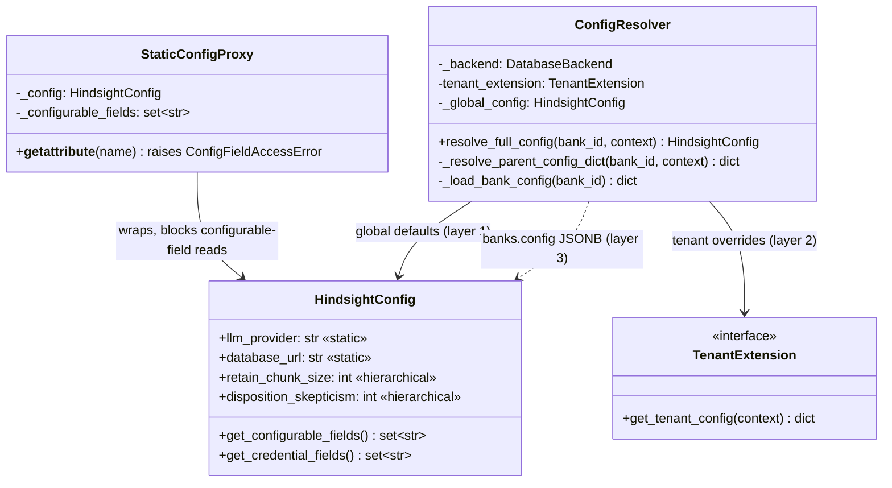

<details>
<summary>Relevant source files</summary>
The following files were used as context for generating this wiki page:

- [hindsight-api-slim/hindsight_api/config.py](hindsight-api-slim/hindsight_api/config.py)
- [hindsight-api-slim/hindsight_api/config_resolver.py](hindsight-api-slim/hindsight_api/config_resolver.py)
- [hindsight-api-slim/hindsight_api/migrations.py](hindsight-api-slim/hindsight_api/migrations.py)
- [hindsight-api-slim/hindsight_api/pg0.py](hindsight-api-slim/hindsight_api/pg0.py)
- [hindsight-api-slim/hindsight_api/main.py](hindsight-api-slim/hindsight_api/main.py)
- [hindsight-api-slim/hindsight_api/alembic/_dialect.py](hindsight-api-slim/hindsight_api/alembic/_dialect.py)
- [hindsight-api-slim/hindsight_api/alembic/versions/5a366d414dce_initial_schema.py](hindsight-api-slim/hindsight_api/alembic/versions/5a366d414dce_initial_schema.py)
- [hindsight-api-slim/hindsight_api/alembic/versions/e4f5a6b7c8d9_add_webhooks_tables.py](hindsight-api-slim/hindsight_api/alembic/versions/e4f5a6b7c8d9_add_webhooks_tables.py)
- [.env.example](.env.example)
- [docker/docker-compose/external-pg/docker-compose.yaml](docker/docker-compose/external-pg/docker-compose.yaml)
- [docker/standalone/Dockerfile](docker/standalone/Dockerfile)
- [docker/standalone/start-all.sh](docker/standalone/start-all.sh)
- [scripts/dev/start.sh](scripts/dev/start.sh)
- [scripts/dev/start-api.sh](scripts/dev/start-api.sh)
- [hindsight-docs/docs/developer/configuration.md](hindsight-docs/docs/developer/configuration.md)
</details>

# Deployment Modes & Hierarchical Configuration

Hindsight ships as a single container image (`docker/standalone/Dockerfile`) that can run the API alone, the Control Plane alone, or both, against either an embedded PostgreSQL instance (`pg0`) or an external PostgreSQL/Oracle 23ai database. All runtime behavior is driven by environment variables loaded through a centralized `HindsightConfig` dataclass, and a subset of "behavioral" settings can be overridden per-tenant and per-bank at request time without a redeploy. This page covers how the process starts, how the database is selected and migrated, and how the global → tenant → bank configuration hierarchy resolves at runtime.

## Running Hindsight

### Local development

`scripts/dev/start.sh` starts both services for local iteration: it launches `start-api.sh` in the background, polls `/health` until the API responds, then starts the Control Plane pointed at that API URL via `HINDSIGHT_CP_DATAPLANE_API_URL` (scripts/dev/start.sh:57-93). `start-api.sh` simply sources the repo-root `.env` file and execs `uv run hindsight-api` (scripts/dev/start-api.sh:6-20) — all configuration flows through environment variables, no CLI flags are required for a basic run.

### Standalone Docker image

`docker/standalone/Dockerfile` builds a multi-stage image with build args `INCLUDE_API`, `INCLUDE_CP`, `INCLUDE_LOCAL_MODELS`, and `PRELOAD_ML_MODELS`, so the same Dockerfile produces an API-only image, a Control-Plane-only image, or a combined standalone image (docker/standalone/Dockerfile:1-24). At runtime, `start-all.sh` is the container entrypoint: it validates the embedded `pg0` data directory is writable by the rootless container user, optionally waits for external dependencies (`HINDSIGHT_WAIT_FOR_DEPS=true`), starts `hindsight-api` and/or the Control Plane's `node server.js` as background processes gated by `HINDSIGHT_ENABLE_API`/`HINDSIGHT_ENABLE_CP`, and traps `SIGTERM` to forward a graceful shutdown to both children so `pg0` can flush its WAL before the container exits (docker/standalone/start-all.sh:186-244, docker/standalone/start-all.sh:264-283).

### Docker Compose examples

`docker/docker-compose/` contains scenario-specific compose files rather than one canonical file — e.g. `external-pg` (pgvector-backed Postgres), plus `alloydb`, `timescale`, `vchord`, `pgroonga`, `pg_search`, `pg_textsearch`, `s3-file-storage`, `local-llm`, `custom-models`, `nginx`, and `claude-code`. The `external-pg` example runs the prebuilt `ghcr.io/vectorize-io/hindsight` image against a sidecar `pgvector/pgvector` Postgres container, wiring `HINDSIGHT_API_DATABASE_URL` to the compose-internal `db` service and requiring `HINDSIGHT_DB_PASSWORD` / `OPENAI_API_KEY` at compose time (docker/docker-compose/external-pg/docker-compose.yaml:18-49). Deployers can swap the compose scenario to match their own vector/search extension or file-storage backend of choice — the API layer is provider-neutral by design (see the LLM/embeddings/reranker provider tables in `.env.example`), so nothing about the deployment path locks the system into a particular model or cloud vendor.

```text
┌───────────────────────────────────────────────────────────────┐
│ docker/standalone/Dockerfile  (single image, build-arg gated)  │
│                                                                 │
│  api-builder stage ──▶ hindsight-api  (INCLUDE_API)            │
│  cp-builder  stage ──▶ control-plane  (INCLUDE_CP)             │
│                                                                 │
│  entrypoint: start-all.sh                                      │
│    ├─ checks pg0 data dir writability (embedded mode only)     │
│    ├─ starts hindsight-api  → waits on /health                 │
│    ├─ starts node server.js → Control Plane                    │
│    └─ traps SIGTERM → graceful child shutdown (pg0 WAL flush)  │
└───────────────────────────────────────────────────────────────┘
```

Sources: [docker/standalone/Dockerfile:1-24](), [docker/standalone/start-all.sh:52-100](), [docker/standalone/start-all.sh:186-283](), [scripts/dev/start.sh:57-107](), [scripts/dev/start-api.sh:1-20]()

## Database Backends: Embedded pg0 vs. External PostgreSQL/Oracle

`HINDSIGHT_API_DATABASE_URL` defaults to the literal string `"pg0"` (`DEFAULT_DATABASE_URL = "pg0"`, config.py:685), which is not a real connection string but a sentinel telling `hindsight_api/pg0.py` to boot an embedded PostgreSQL server via the `pg0-embedded` Python package (hindsight_api/pg0.py:8-45). This is the zero-config path used by local dev and the standalone Docker image when no external database is supplied — data persists under `~/.pg0` inside the container, so a named Docker volume (not a host bind mount, which risks UID-ownership permission errors) is the recommended way to persist it (docker/standalone/start-all.sh:52-77).

For production, `HINDSIGHT_API_DATABASE_BACKEND` selects the engine (`postgresql` default, or `oracle` for Oracle 23ai), and `HINDSIGHT_API_DATABASE_URL` is set to a real `postgresql://` or `oracle+oracledb://` connection string (config.py:684, hindsight-docs/docs/developer/configuration.md:28-32). Two additional URLs support production topologies without changing the primary connection:

| Variable | Purpose |
|---|---|
| `HINDSIGHT_API_DATABASE_URL` | Primary read/write connection string (or `pg0` for embedded) |
| `HINDSIGHT_API_READ_DATABASE_URL` | Optional read-replica URL; recall's semantic/BM25/graph/temporal queries route here to offload the primary |
| `HINDSIGHT_API_MIGRATION_DATABASE_URL` | Direct (non-pooled) URL for running migrations, bypassing PgBouncer — needed because PgBouncer transaction mode breaks session-level advisory locks |
| `HINDSIGHT_API_DATABASE_SCHEMA` | Target PostgreSQL schema (default `public`); lets multiple tenants or a shared Postgres instance isolate Hindsight's tables |

Sources: [hindsight-api-slim/hindsight_api/config.py:125-131,684-686](), [hindsight-api-slim/hindsight_api/pg0.py:8-45](), [hindsight-docs/docs/developer/configuration.md:19-32]()

## Database Migrations via Alembic

Migrations live in `hindsight-api-slim/hindsight_api/alembic/versions/` (87 revision files at the time of writing) and run automatically on API startup by default, controlled by `HINDSIGHT_API_RUN_MIGRATIONS_ON_STARTUP` (`DEFAULT_RUN_MIGRATIONS_ON_STARTUP = True`, config.py:1038), which `main.py` passes straight into `MemoryEngine(run_migrations=config.run_migrations_on_startup)` (hindsight-api-slim/hindsight_api/main.py:262-266).

### Dual-dialect dispatch

Because the same Alembic tree targets both PostgreSQL and Oracle 23ai, every migration file avoids Alembic's dialect-agnostic op layer for anything nontrivial and instead defines a `_pg_upgrade()`/`_oracle_upgrade()` pair (plus matching downgrades), routed through `run_for_dialect()`:

```python
# hindsight-api-slim/hindsight_api/alembic/_dialect.py
def run_for_dialect(*, pg: DialectFn | None = None, oracle: DialectFn | None = None) -> None:
    name = op.get_bind().dialect.name
    if name not in _SUPPORTED:          # ("postgresql", "oracle")
        raise RuntimeError(...)
    fn = {"postgresql": pg, "oracle": oracle}[name]
    if fn is not None:
        fn()
```

`run_for_dialect` inspects the live connection's dialect and calls the matching function; passing `None` for a slot (e.g. `run_for_dialect(pg=_pg_upgrade)` with no `oracle=` kwarg) is a deliberate no-op for that backend — used when a change genuinely doesn't apply to one dialect, such as enabling `pg_trgm`. A pytest lint (`tests/test_migration_shape.py`, referenced in CLAUDE.md) fails CI if a migration's `upgrade()`/`downgrade()` skip the dispatcher entirely. `e4f5a6b7c8d9_add_webhooks_tables.py` is a representative example: its `_pg_upgrade()` creates the `webhooks` table and an `async_operations.next_retry_at` column via raw `op.execute()` SQL, schema-qualified through `context.config.get_main_option("target_schema")` for multi-tenant schema isolation.

### Concurrent multi-tenant migration and safety

`run_migrations()` in `migrations.py` is safe to call from multiple distributed API replicas simultaneously: on PostgreSQL it takes a session-level advisory lock so only one worker migrates a given schema at a time while others wait and then verify completion; it also tolerates a database that is already ahead of the running code's known revisions (expected during rolling deployments) by logging a warning and returning instead of failing (hindsight-api-slim/hindsight_api/migrations.py:220-231). The Oracle path skips the advisory lock and pgvector-specific logic entirely, relying on Oracle 23ai's `IF NOT EXISTS` semantics and swallowing "already exists" errors (ORA-955) to stay idempotent under concurrent workers (migrations.py:304-309). `HINDSIGHT_API_MIGRATION_CONCURRENCY` (default `1`, `DEFAULT_MIGRATION_CONCURRENCY`, config.py:1042) controls how many tenant schemas migrate in parallel processes — each worker costs ~1-2s startup and ~3 DB connections, so it only pays off with tens of schemas or more.

### Creating a new migration

New files follow `<12-hex-revision>_<description>.py` in `alembic/versions/`, set `down_revision` to the prior head, and implement `_pg_upgrade`/`_oracle_upgrade` (+ downgrades) dispatched via `upgrade()`/`downgrade()` calling `run_for_dialect(...)`. Locally, `uv run hindsight-admin run-db-migration` applies the base schema plus all tenant schemas; `--schema tenant_xyz` targets one tenant.

Sources: [hindsight-api-slim/hindsight_api/alembic/_dialect.py:1-42](), [hindsight-api-slim/hindsight_api/alembic/versions/e4f5a6b7c8d9_add_webhooks_tables.py:1-58](), [hindsight-api-slim/hindsight_api/migrations.py:220-309](), [hindsight-api-slim/hindsight_api/config.py:1038-1042]()

## Hierarchical Configuration: Global → Tenant → Bank

Every environment variable in `config.py` maps to a field on the `HindsightConfig` dataclass, loaded once at process start by `HindsightConfig.from_env()` via `_get_raw_config()`. Each field is tagged, via the `hierarchical(...)`/`static(...)` field-metadata helpers, as either overridable per-tenant/bank or fixed at the server level (config.py:66-83). A field only becomes overridable through the API if it's *also* explicitly listed in `_CONFIGURABLE_FIELDS` — the set is a manual allowlist (retention/chunking behavior, entity-label vocab, consolidation/observations knobs, reflect mission, recall budget mapping, disposition traits, Gemini safety settings, memory-defense policy, MCP tool allowlist), deliberately excluding credentials, provider/model selection, and infrastructure/performance settings (config.py:2063-2117).



### Resolution order

`ConfigResolver.resolve_full_config(bank_id, context)` builds the effective config in three layers (config_resolver.py:101-150):

1. **Global** — `asdict(self._global_config)`, i.e. every env-var-derived default.
2. **Tenant** — if a `TenantExtension` is loaded, `tenant_extension.get_tenant_config(context)` returns a dict of overrides; keys are normalized (env-var or Python field name accepted) and filtered to only `_configurable_fields` before merging.
3. **Bank** — `_load_bank_config(bank_id)` reads the `banks.config` JSONB column and merges on top, so a bank-level override wins over both tenant and global.

The multi-LLM chain fields (`llm_members`, `llm_strategy`, and their per-operation variants) are explicitly restored from the *global* config after the merge, because `asdict()` flattens their nested dataclasses into plain dicts — these routing chains are never tenant/bank-overridable (config_resolver.py:130-145). After merging, `validate_retain_chunking_config` re-validates chunk-size invariants so a bad per-bank override can't silently corrupt the retain pipeline.

### Enforced access boundary

To prevent code from accidentally reading a global default where a bank-specific value should be used, `StaticConfigProxy` wraps the raw config and raises `ConfigFieldAccessError` if any code tries to read a field that is in `_CONFIGURABLE_FIELDS` directly from the global object (config.py:34-63). Application code must instead call `ConfigResolver.resolve_full_config(bank_id, context)` for anything hierarchical; only static fields (`host`, `port`, `database_url`, `llm_provider`, `llm_max_concurrent`, etc.) are safe to read via `get_config()` directly.

| Layer | Source | Example fields | Enforcement |
|---|---|---|---|
| Global | `HINDSIGHT_API_*` env vars, `.env` | `llm_provider`, `database_url`, defaults for all hierarchical fields | `HindsightConfig.from_env()` |
| Tenant | `TenantExtension.get_tenant_config(context)` | Any field in `_CONFIGURABLE_FIELDS` | Filtered to configurable set; normalized key format |
| Bank | `banks.config` JSONB, set via `PATCH /v1/default/banks/{bank_id}/config` | `retain_chunk_size`, `disposition_*`, `enable_observations`, `mcp_enabled_tools` | Filtered to configurable set; validated on write |

`HINDSIGHT_API_ENABLE_BANK_CONFIG_API` (default `true`, `DEFAULT_ENABLE_BANK_CONFIG_API`, config.py:932) toggles whether the bank-level config API is exposed at all; `HINDSIGHT_API_DEFAULT_BANK_TEMPLATE` can seed newly-created banks with an initial set of per-bank overrides (applied once, not re-applied after explicit user edits).

Sources: [hindsight-api-slim/hindsight_api/config.py:34-83,932,2063-2158](), [hindsight-api-slim/hindsight_api/config_resolver.py:35-150](), [hindsight-docs/docs/developer/configuration.md:1839-1925]()

## Key Environment Variables by Category

| Category | Representative variables | Layer |
|---|---|---|
| LLM | `HINDSIGHT_API_LLM_PROVIDER`, `_API_KEY`, `_MODEL`, `_BASE_URL` | Static |
| Per-operation LLM overrides | `HINDSIGHT_API_RETAIN_LLM_*`, `_REFLECT_LLM_*`, `_CONSOLIDATION_LLM_*` | Static |
| Database | `HINDSIGHT_API_DATABASE_URL`, `_DATABASE_BACKEND`, `_DATABASE_SCHEMA`, `_MIGRATION_DATABASE_URL` | Static |
| Migrations | `HINDSIGHT_API_RUN_MIGRATIONS_ON_STARTUP`, `_MIGRATION_CONCURRENCY` | Static |
| Retain behavior | `HINDSIGHT_API_RETAIN_CHUNK_SIZE`, `_RETAIN_EXTRACTION_MODE`, `_RETAIN_MISSION` | Hierarchical |
| Disposition | `HINDSIGHT_API_DISPOSITION_SKEPTICISM/_LITERALISM/_EMPATHY` | Hierarchical |
| Observations/Consolidation | `HINDSIGHT_API_ENABLE_OBSERVATIONS`, `_ENABLE_AUTO_CONSOLIDATION`, `_OBSERVATIONS_MISSION` | Hierarchical |
| Feature toggles | `HINDSIGHT_API_ENABLE_BANK_CONFIG_API`, `_ENABLE_DRY_RUN_EXTRACT`, `_ENABLE_BANK_LLM_HEALTH` | Static |
| Embeddings/Reranker | `HINDSIGHT_API_EMBEDDINGS_PROVIDER`, `_RERANKER_PROVIDER` (and per-provider credentials) | Static |

`.env.example` is the single source of truth for the template shipped to new environments — `scripts/dev/setup.sh` copies it to `.env`, and it must be kept in sync with a bundled copy under `hindsight-embed/hindsight_embed/env.example` (enforced by a sync test).

Sources: [.env.example:1-231](), [hindsight-api-slim/hindsight_api/config.py:124-682]()

## Summary

Hindsight's deployment surface separates two concerns cleanly: *where the data lives* (embedded `pg0` for zero-config dev, or an external PostgreSQL/Oracle 23ai instance for production, migrated via a dual-dialect Alembic pipeline dispatched through `run_for_dialect`) and *how behavior is tuned* (a three-layer global → tenant → bank configuration hierarchy enforced at the type level via `StaticConfigProxy` and resolved per-request via `ConfigResolver`). Because provider selection (LLM, embeddings, reranker) and connection details are always static, server-level env vars rather than hierarchical fields, the same deployment topology works unchanged regardless of which model or infrastructure provider a given install chooses — the hierarchy governs *behavioral* knobs (chunking, mission text, disposition, consolidation), not vendor wiring.

## Related pages

- page-overview
- page-extensions-tenancy
- page-operations-and-next-steps


## Source files

- `hindsight-api-slim/hindsight_api/config.py`
- `.env.example`
- `hindsight-api-slim/hindsight_api/alembic/versions`
- `docker/docker-compose`
- `scripts/dev/start.sh`
- `scripts/dev/start-api.sh`
