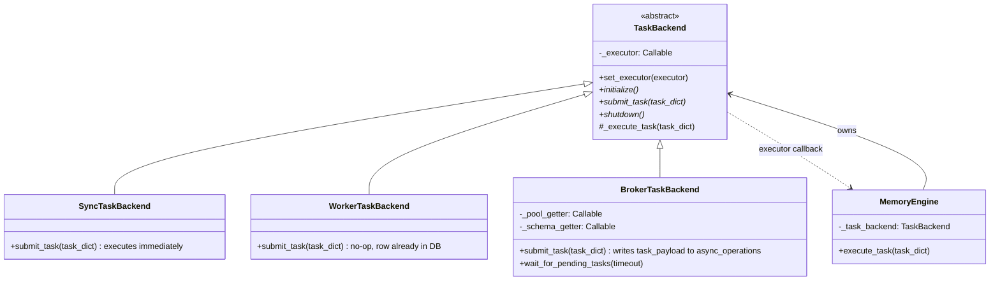
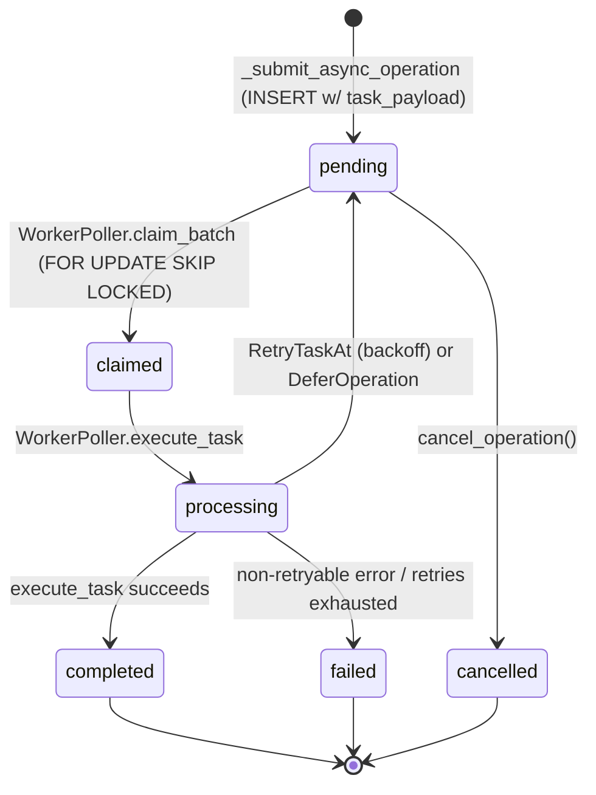
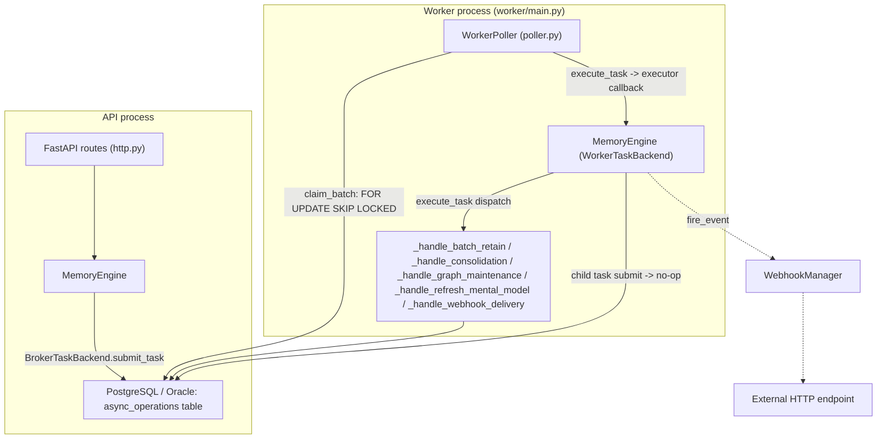

<details>
<summary>Relevant source files</summary>
The following files were used as context for generating this wiki page:
- [hindsight-api-slim/hindsight_api/engine/memory_engine.py](hindsight-api-slim/hindsight_api/engine/memory_engine.py)
- [hindsight-api-slim/hindsight_api/engine/interface.py](hindsight-api-slim/hindsight_api/engine/interface.py)
- [hindsight-api-slim/hindsight_api/engine/task_backend.py](hindsight-api-slim/hindsight_api/engine/task_backend.py)
- [hindsight-api-slim/hindsight_api/worker/main.py](hindsight-api-slim/hindsight_api/worker/main.py)
- [hindsight-api-slim/hindsight_api/worker/poller.py](hindsight-api-slim/hindsight_api/worker/poller.py)
- [hindsight-api-slim/hindsight_api/worker/stage.py](hindsight-api-slim/hindsight_api/worker/stage.py)
</details>

# MemoryEngine — Central Orchestrator

`MemoryEngine` (`hindsight-api-slim/hindsight_api/engine/memory_engine.py:878`) is the single class that implements Hindsight's public API surface — retain, recall, reflect, bank management, document/entity/mental-model CRUD — and doubles as the router for every background task the system runs (batch retain, consolidation, graph maintenance, mental-model refresh, webhook delivery). It owns the PostgreSQL/Oracle connection pool(s), the LLM providers, the embeddings/reranker models, the webhook manager, and the task backend abstraction that lets the exact same engine code run inline (embedded/CLI), inside the API process, or as a horizontally-scaled worker fleet. This page covers its construction, initialization/shutdown lifecycle, the retain/recall/reflect entry points, the async-operation and task-execution model, webhook firing, and how it hands off work to the standalone worker poller.

## Class Shape and the Public Interface

`MemoryEngine` implements the abstract `MemoryEngineInterface` (`hindsight-api-slim/hindsight_api/engine/interface.py:19-612`), which is the contract HTTP endpoints and host applications are expected to code against rather than the concrete class. The interface declares the core operations (`retain_batch_async`, `recall_async`, `reflect_async`), bank management (`list_banks`, `get_bank_profile`, `update_bank_disposition`, `delete_bank`), and operation/document/entity accessors — all requiring a `RequestContext` for authentication when a `TenantExtension` is configured.

```python
# hindsight-api-slim/hindsight_api/engine/interface.py:19-25
class MemoryEngineInterface(ABC):
    """
    Abstract interface for the Memory Engine.

    This defines the public API that should be used by HTTP endpoints and extensions.
    All methods require a RequestContext for authentication.
    """
```

`MemoryEngine.__init__` (`hindsight-api-slim/hindsight_api/engine/memory_engine.py:889-921`) takes a large set of optional parameters — DB URL, per-operation LLM overrides (retain/reflect/consolidation each can use a different provider/model), embeddings, cross-encoder, query analyzer, pool sizing, a `TaskBackend`, an `OperationValidatorExtension`, and a `TenantExtension`. All of these fall back to environment-driven config (`hindsight_api.config`) when omitted, so the same class serves the embedded/CLI use case, the FastAPI process, and the standalone worker with only the `task_backend` and extension wiring differing between them.

Sources: [hindsight-api-slim/hindsight_api/engine/memory_engine.py:878-921](), [hindsight-api-slim/hindsight_api/engine/interface.py:19-135]()

## Initialization and Shutdown Lifecycle

`initialize()` (`hindsight-api-slim/hindsight_api/engine/memory_engine.py:2633`) is idempotent (`if self._initialized: return`) and performs, largely in parallel via `asyncio`:
- Starting an embedded pg0 Postgres instance if `db_url` resolves to `pg0`/`pg0://...` (`start_pg0`).
- Loading the embeddings model, cross-encoder model, and query analyzer, offloading local (CPU-bound) providers to a thread pool executor so the event loop isn't blocked.
- Verifying LLM connectivity for every distinct provider/model configuration in use (default, retain, reflect, consolidation) — failures are logged as warnings, not raised, so the server still starts and can process queued work once a provider recovers (`hindsight-api-slim/hindsight_api/engine/memory_engine.py:2683-2732`).
- Creating the `DatabaseBackend` (`self._backend = create_database_backend(...)`, line 1235) and calling `backend.initialize(...)` with pool sizing, timeouts, and a `_init_connection` callback that applies session GUCs and a server-side `statement_timeout` safety net (lines 2905-2913).
- Optionally standing up a **separate read backend** pointed at `HINDSIGHT_API_READ_DATABASE_URL` for recall queries, falling back to the primary backend when no replica is configured (lines 2920-2935).
- Constructing the `EntityResolver`, `ConfigResolver` (hierarchical bank/tenant config), file storage backend, and the `FileParserRegistry` (markitdown, Iris, LlamaParse — registered conditionally based on config).
- Constructing the `WebhookManager` from DB-stored webhooks plus one optional environment-configured global webhook, and a long-lived `httpx.AsyncClient` for webhook delivery HTTP calls (lines 2992-3019).
- Wiring `self._task_backend.set_executor(self.execute_task)` and calling `task_backend.initialize()` (line 3022) — this is the hand-off point that lets the task backend later route claimed/submitted tasks back into the engine.
- Starting `MaintenanceLoop` (line 3030), a background loop for cross-tenant retention sweeps and consolidation reconciliation.

`close()` (`hindsight-api-slim/hindsight_api/engine/memory_engine.py:3092-3143`) unwinds this in roughly reverse order: stops the maintenance loop, unregisters the LLM trace span hook, shuts down the task backend, closes the HTTP client, shuts down the read backend (if distinct) and then the primary backend, cleans up each LLM provider (e.g., to stop a llamacpp subprocess), and stops pg0 if this engine instance started it.

`_get_pool()`, `_get_backend()`, and `_get_read_backend()` (lines 3036-3055) all lazily call `initialize()` if the engine hasn't been initialized yet, so callers never need to sequence initialization manually. `_acquire_connection()` (line 3057) is a thin async-generator wrapper around `backend.acquire()`. `health_check()` (line 3067) reports `unhealthy`/`not_initialized` until `initialize()` has completed, then does a live `SELECT 1` round-trip.

Sources: [hindsight-api-slim/hindsight_api/engine/memory_engine.py:2633-3151]()

## Connection and Pool Management

```text
MemoryEngine
 ├─ self._backend        : DatabaseBackend (primary, read+write)   ── self._pool = backend.get_pool()
 ├─ self._read_backend    : DatabaseBackend (replica, read-only)    ── falls back to self._backend
 ├─ self._config_resolver : ConfigResolver (bank/tenant hierarchical config)
 ├─ self._file_storage    : FileStorage (local/S3/etc., pool_getter=self._backend)
 ├─ self._webhook_manager : WebhookManager (DB + env-configured webhooks)
 ├─ self._task_backend    : TaskBackend (Sync | Broker | Worker)
 └─ self._maintenance_loop: MaintenanceLoop (retention sweeps, consolidation reconcile)
```

The engine is backend-agnostic (`DatabaseBackend` abstracts PostgreSQL vs. Oracle 23ai, per `CLAUDE.md`'s dual-dialect migration requirement). `self._pool` is kept only "for backward compatibility with consumers that still use `pool.acquire()` / `acquire_with_retry(pool)` directly" (comment at line 2915-2917); new code is meant to go through `self._backend.acquire()`. Writes must never go through `_get_read_backend()` — the docstring on that method states this explicitly (line 3044-3046).

Sources: [hindsight-api-slim/hindsight_api/engine/memory_engine.py:2905-2959](), [hindsight-api-slim/hindsight_api/engine/memory_engine.py:3036-3055]()

## Core Operations: Retain, Recall, Reflect

| Method | Sync/Async | Purpose |
|---|---|---|
| `retain()` | sync wrapper | Runs `retain_async` via `asyncio.run`, for non-async callers |
| `retain_async()` | async | Single-item convenience wrapper around `retain_batch_async` |
| `retain_batch_async()` | async | Ingests a batch of content dicts, extracts facts/entities, submits post-insert consolidation maintenance |
| `recall_async()` | async | N-fact-type × 4-strategy parallel retrieval (semantic, BM25, graph, temporal) + fusion + rerank + token-budget filtering |
| `reflect_async()` | async | Agentic loop with read-only tools (lookup mental models, recall, search observations, expand chunks) that synthesizes an answer without writing anything |

`retain()` (line 3179) is explicitly documented as a synchronous convenience wrapper — "For best performance, use `retain_async()` directly." `retain_async()` (line 3210) builds a single-item `RetainContentDict` and delegates to `retain_batch_async` "to avoid code duplication" (line 3245-3246).

`recall_async()` (`hindsight-api-slim/hindsight_api/engine/memory_engine.py:4012-4322`) documents its own algorithm in its docstring: for each requested fact type, run 4 parallel retrieval strategies, merge via Reciprocal Rank Fusion, rerank (cross-encoder by default, selectable via the `reranking` parameter), diversify with MMR, then trim to `max_tokens`. It accepts tag filtering (`tags`, `tags_match`, `tag_groups`), temporal filters (`created_after`/`created_before`), a `Budget` enum controlling graph-traversal size (low/mid/high), and `prefer_observations` to deduplicate raw facts already folded into a returned observation.

`reflect_async()` (`hindsight-api-slim/hindsight_api/engine/memory_engine.py:8899-8956`) is read-only: "Reflect is read-only: it synthesizes an answer from the bank's stored memories and persists nothing." It runs an agentic tool loop (`lookup`, `recall`, `search observations`, `expand`) that starts with empty context, and on its final iteration removes tools to force a text response.

Sources: [hindsight-api-slim/hindsight_api/engine/memory_engine.py:3179-3255](), [hindsight-api-slim/hindsight_api/engine/memory_engine.py:4012-4071](), [hindsight-api-slim/hindsight_api/engine/memory_engine.py:8899-8956]()

## Task Backend Abstraction

`TaskBackend` (`hindsight-api-slim/hindsight_api/engine/task_backend.py:26-93`) is the abstraction that decouples "how a task gets executed" from "what the task does." Every implementation stores an `_executor` callback (set to `MemoryEngine.execute_task` during `initialize()`) and exposes `submit_task(task_dict)` plus `initialize()`/`shutdown()`.



Three concrete backends exist:

- **`SyncTaskBackend`** (line 95): executes tasks immediately/inline. Used for tests and embedded/CLI usage where no background workers exist.
- **`WorkerTaskBackend`** (line 126): used by standalone worker processes. `submit_task` is a documented no-op — "the row already exists in `async_operations` (with `task_payload`) by `_submit_async_operation` — so `submit_task` is a no-op." When engine code running inside a worker task submits a *child* task (e.g., retain triggering consolidation), that child is picked up by a poller on its next cycle instead of executing inline, "which avoids blocking the parent task."
- **`BrokerTaskBackend`** (line 153): used by API processes to persist tasks. It either `UPDATE`s an existing `async_operations` row's `task_payload` (guarded by `WHERE task_payload IS NULL` so it never clobbers a payload already written atomically at INSERT time) or `INSERT`s a brand-new row for tasks without a pre-created record. It also exposes `wait_for_pending_tasks()`, a polling helper used by tests when the API is configured to process its own tasks.

Sources: [hindsight-api-slim/hindsight_api/engine/task_backend.py:1-299]()

## execute_task: The Task Router

`execute_task()` (`hindsight-api-slim/hindsight_api/engine/memory_engine.py:1880-2063`) is the single entry point every task backend eventually calls. It:

1. Pops `_schema` from the task dict and sets the `_current_schema` contextvar plus `self._ext_ctx.current_schema`, so multi-tenant execution lands in the right schema.
2. If the task carries an `operation_id`, checks the row's current `status` and skips execution entirely if it was `cancelled`.
3. Wraps execution in `audit_context(...)` for audit logging, and calls `set_stage(f"task.{task_type}")` (see [Stage Tracking](#stage-tracking-and-observability)) before dispatching.
4. Dispatches on `task_dict["type"]` to one of: `_handle_batch_retain`, `_handle_file_convert_retain`, `_handle_import_documents`, `_handle_consolidation`, `_handle_graph_maintenance`, `_handle_refresh_mental_model`, `_handle_webhook_delivery`. An unrecognized type logs an error and deletes the operation record (not retried).
5. On success, marks the operation completed — except `consolidation`, which additionally fires its webhook atomically in the same transaction via `_mark_operation_completed_and_fire_webhook`, and `file_convert_retain`, which self-manages completion inside its own transaction.

Failure handling distinguishes several cases (lines 1964-2062):
- `ProviderRateLimitResetError` → re-raised as `DeferOperation` so the poller reschedules at the provider's reset time without treating it as a failure.
- `RetryTaskAt` / `DeferOperation` raised by the handler itself → passed through untouched ("task-owned retry/defer").
- `file_convert_retain` errors → always non-retryable (OCR/corruption failures won't improve on retry) and marked failed immediately.
- Deterministic failures (`_is_non_retryable_task_error`, e.g. integrity violations, invalid embedding dimensions) → marked failed without retry; consolidation still fires a failure webhook first.
- Consolidation-specific transient errors → deduplicated against other pending consolidations for the same bank (to avoid a retry storm consuming independent retry budgets), then retried indefinitely with capped exponential backoff (`_consolidation_retry_backoff_seconds`) — "Transient outages... must eventually recover; the alternative... silently dead-letters the bank's backlog."
- All other retryable errors → `RetryTaskAt` while `_retry_count` is under `config.worker_max_retries`, else re-raised for the poller to mark failed.

Sources: [hindsight-api-slim/hindsight_api/engine/memory_engine.py:1880-2063]()

## Async Operation Lifecycle

Long-running work is tracked in an `async_operations` table. `_submit_async_operation()` (`hindsight-api-slim/hindsight_api/engine/memory_engine.py:12273-...`) is the generic helper used by consolidation, mental-model refresh, batch retain, and import-documents submission paths. It builds the full task payload *before* the `INSERT` so the row's `task_payload` is populated atomically — the docstring/comment explains this fixes a prior bug where a crash between a payload-less INSERT and a follow-up UPDATE could leave a row a worker's claim query (`WHERE task_payload IS NOT NULL`) would never pick up. When `dedupe_by_bank=True`, it takes a `FOR NO KEY UPDATE` lock on the bank row (chosen specifically over `FOR UPDATE` so it doesn't block the `FOR KEY SHARE` locks every other async-op FK insert takes) to serialize concurrent submits and avoid duplicate pending consolidations (issue referenced in-code: #1842).

Operation state transitions are managed by a family of small helpers:
- `_write_operation_progress()` (line 2293) — best-effort heartbeat that merges a `{"stage", "processed", "total", "detail"}` snapshot into `result_metadata->progress`, swallowing all errors since "a failed heartbeat must never fail the underlying job."
- `_mark_operation_failed()` (line 2336) / `_mark_operation_completed()` (line 2372) — both run inside a transaction and call `_maybe_update_parent_operation()` to propagate completion/failure up to a parent operation when all child/sibling operations are done (used for fan-out batch retains and grouped document imports).
- `_mark_operation_completed_and_fire_webhook()` (line 2446) — atomically marks the operation completed **and** queues the `consolidation.completed` webhook delivery row in the same DB transaction (a transactional outbox pattern), so a crash between "mark completed" and "fire webhook" cannot happen.
- `_delete_operation_record()` / `_check_op_alive()` — used for unknown-task cleanup and cooperative cancellation checks.



Sources: [hindsight-api-slim/hindsight_api/engine/memory_engine.py:2264-2503](), [hindsight-api-slim/hindsight_api/engine/memory_engine.py:12273-12346]()

## Webhook Firing

The `WebhookManager` (constructed in `initialize()`, lines 2992-3016) is invoked from two places:

- **`_fire_consolidation_webhook()`** (line 2064): builds a `WebhookEvent` of type `CONSOLIDATION_COMPLETED` and calls `webhook_manager.fire_event(...)`. Documented as "Non-fatal - logs errors but does not raise," so a webhook delivery failure never breaks the consolidation task itself.
- **`_build_retain_outbox_callback()` / `_build_retain_outbox_callback_factory()`** (lines 2099-2173): implement a transactional-outbox pattern for `retain.completed` events — the callback queues one webhook delivery row per content item using the *same connection* as the retain transaction (`fire_event_with_conn`), so the webhook is only queued if the retain commit itself succeeds. The factory variant lets grouped/batched retains share one `operation_id` across their per-document events.

Actual HTTP delivery is a separate task type, `webhook_delivery`, handled by `_handle_webhook_delivery()` (line 2197) using the long-lived `self._http_client`; `_update_webhook_delivery_metadata()` (line 2175) persists the last HTTP status code/response body into `result_metadata` for observability, wrapped in a best-effort try/except.

Sources: [hindsight-api-slim/hindsight_api/engine/memory_engine.py:2064-2264](), [hindsight-api-slim/hindsight_api/engine/memory_engine.py:2992-3019]()

## The Standalone Worker: poller.py and main.py

While the API process can execute tasks inline (`SyncTaskBackend`) or self-serve queued tasks, production deployments run one or more standalone **worker** processes built around `WorkerPoller` (`hindsight-api-slim/hindsight_api/worker/poller.py:144`). `hindsight-worker`'s `main()` (`hindsight-api-slim/hindsight_api/worker/main.py:126-383`) constructs a `MemoryEngine` with `task_backend=WorkerTaskBackend()` and `run_migrations=False`, calls `memory.initialize()`, then builds a `WorkerPoller(backend=memory._backend, executor=memory.execute_task, ...)` — this is the concrete wiring that connects the poller's claim/execute loop back into `MemoryEngine.execute_task`.



Key mechanics inside `WorkerPoller`:

- **Slot reservations** (`_get_available_slots`, `hindsight-api-slim/hindsight_api/worker/poller.py:373-403`): `max_slots` is split into per-operation-type reserved pools (default `{"consolidation": 2}`) plus a shared pool. A type can't be starved out by other work up to its reservation, while unreserved capacity is shared first-come-first-served.
- **Fair multi-tenant claiming** (`claim_batch`, lines 431-539): schemas are scanned cheaply via `EXISTS` first, then claimed round-robin — a first "fairness pass" caps each active schema at 1 claim per pool so no single busy tenant starves others, followed by a "capacity pass" that backfills remaining slots from schemas that had work. The rotation offset (`_next_schema_idx`) advances each poll so a different tenant starts first next time.
- **`FOR UPDATE SKIP LOCKED`** claiming (`_claim_batch_for_schema_inner`, lines 553-596) delegates to `backend.ops.claim_tasks(...)` for backend-specific SQL (e.g., an Oracle `ORA-02014` workaround), so multiple workers can claim disjoint task sets without conflicting.
- **Fire-and-forget execution** (`execute_task`, lines 758-802): each claimed task becomes an `asyncio.create_task(self._execute_task_inner(...))`, tracked in `self._active_tasks` (an `ActiveTaskInfo` per operation) with a `StageHolder` bound into that task's own contextvar scope so engine code can report progress via `stage.set_stage(...)`.
- **`_execute_task_inner`** (lines 803-869) calls the registered `executor` (i.e., `memory_engine.execute_task`) and maps outcomes: success → `_mark_completed`; `DeferOperation` → `_defer_operation`; `RetryTaskAt` → `_schedule_retry`; any other exception → `_mark_failed`. It also records a Prometheus operation-result metric on terminal outcomes only.
- **Main loop** (`run()`, lines 989-1077): claims a batch, spawns each as background work, runs `_cleanup_terminal_operations_if_due()` (retention sweep) after spawning so a saturated queue can't starve cleanup, then loops immediately if it claimed anything or sleeps `poll_interval_ms` otherwise.
- **Graceful shutdown** (`shutdown_graceful`, line 1079) is invoked from `worker/main.py`'s signal handler on SIGINT/SIGTERM, waiting up to a timeout for in-flight tasks before the process exits; a second signal forces immediate exit.

Sources: [hindsight-api-slim/hindsight_api/worker/poller.py:144-1078](), [hindsight-api-slim/hindsight_api/worker/main.py:126-383]()

## Stage Tracking and Observability

`worker/stage.py` (`hindsight-api-slim/hindsight_api/worker/stage.py:1-60`) implements a lightweight contextvar-based breadcrumb mechanism. The poller binds a `StageHolder` into each task's own async context (`bind_holder`); engine code anywhere in the call chain calls `set_stage("retain.facts.llm")`-style labels at phase boundaries, and the poller's periodic `WORKER_STATS`/`WORKER_TASK` log lines read the holder to show what each in-flight task is currently doing — useful for diagnosing stuck long-running operations (`_maybe_dump_stuck_stack` in poller.py). Outside a worker context (sync HTTP requests, tests, CLI), the contextvar is unset and `set_stage` is a safe no-op, so the same engine code paths (e.g., `execute_task`'s `set_stage(f"task.{task_type}")` call) work whether or not a poller is present.

Sources: [hindsight-api-slim/hindsight_api/worker/stage.py:1-60](), [hindsight-api-slim/hindsight_api/engine/memory_engine.py:1923-1925]()

## Summary

`MemoryEngine` is deliberately the single seam where all of Hindsight's persistent state, model providers, and background work converge: it exposes the `MemoryEngineInterface` contract for callers, owns pool/backend lifecycle for both primary and optional read-replica databases, and routes every task type through one `execute_task` dispatcher with unified cancellation checks, audit logging, stage tracking, and a carefully layered retry/defer/fail policy. The `TaskBackend` abstraction (`Sync`/`Broker`/`Worker`) is what lets that identical engine and dispatcher run embedded, inline in the API process, or scaled out behind `WorkerPoller`'s slot-reserved, multi-tenant-fair `FOR UPDATE SKIP LOCKED` claim loop — with the transactional-outbox pattern in `_mark_operation_completed_and_fire_webhook` and `_build_retain_outbox_callback` ensuring webhook delivery is never queued for work that didn't actually commit.

## Related pages

- page-retain-pipeline
- page-search-retrieval
- page-reflect-mental-models
- page-http-api


## Source files

- `hindsight-api-slim/hindsight_api/engine/memory_engine.py`
- `hindsight-api-slim/hindsight_api/engine/interface.py`
- `hindsight-api-slim/hindsight_api/engine/task_backend.py`
- `hindsight-api-slim/hindsight_api/worker/main.py`
- `hindsight-api-slim/hindsight_api/worker/poller.py`
- `hindsight-api-slim/hindsight_api/worker/stage.py`
