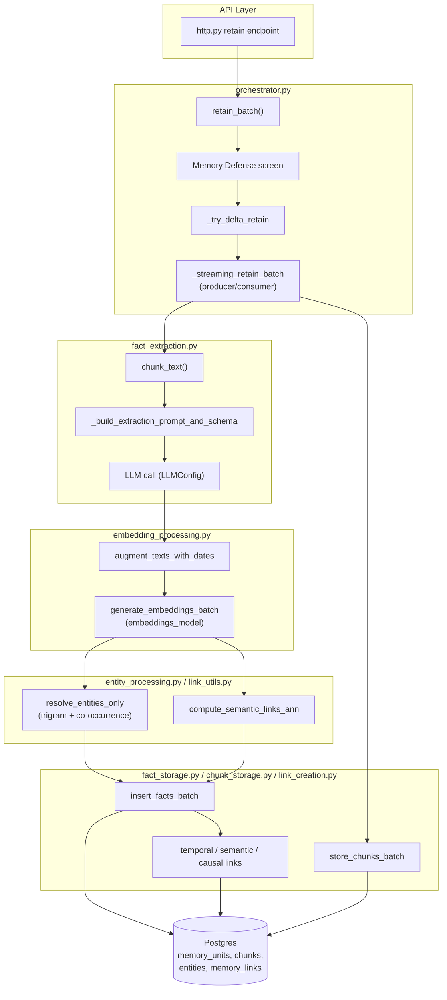
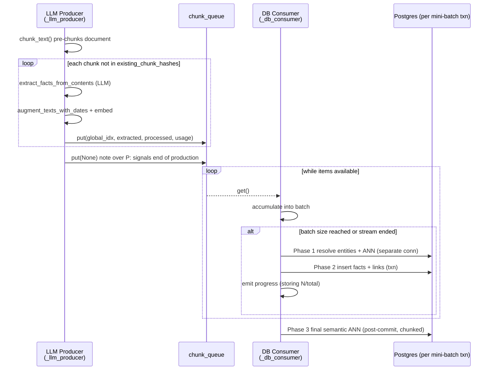

Relevant source files

The following files were used as context for generating this wiki page:

- [hindsight-api-slim/hindsight_api/engine/retain/orchestrator.py](hindsight-api-slim/hindsight_api/engine/retain/orchestrator.py)
- [hindsight-api-slim/hindsight_api/engine/retain/fact_extraction.py](hindsight-api-slim/hindsight_api/engine/retain/fact_extraction.py)
- [hindsight-api-slim/hindsight_api/engine/retain/entity_processing.py](hindsight-api-slim/hindsight_api/engine/retain/entity_processing.py)
- [hindsight-api-slim/hindsight_api/engine/retain/link_creation.py](hindsight-api-slim/hindsight_api/engine/retain/link_creation.py)
- [hindsight-api-slim/hindsight_api/engine/retain/chunk_storage.py](hindsight-api-slim/hindsight_api/engine/retain/chunk_storage.py)
- [hindsight-api-slim/hindsight_api/engine/retain/embedding_processing.py](hindsight-api-slim/hindsight_api/engine/retain/embedding_processing.py)
- [hindsight-api-slim/hindsight_api/engine/retain/types.py](hindsight-api-slim/hindsight_api/engine/retain/types.py)
- [hindsight-api-slim/hindsight_api/engine/retain/link_utils.py](hindsight-api-slim/hindsight_api/engine/retain/link_utils.py)
- [hindsight-api-slim/hindsight_api/engine/retain/fact_storage.py](hindsight-api-slim/hindsight_api/engine/retain/fact_storage.py)

# Retain Pipeline — Ingestion, Extraction & Linking

The retain pipeline is how Hindsight turns raw text (conversation turns, documents, logs) into structured, queryable memory. A single call to `retain_batch` in `orchestrator.py` drives the whole path: screening the content, chunking it, extracting facts via an LLM, embedding those facts, resolving named entities, and writing facts plus temporal/semantic/causal links to Postgres. This page documents that pipeline module by module and shows how the pieces compose to make retain both idempotent and resumable for very large documents.

The pipeline is deliberately provider-neutral: fact extraction and embedding both go through pluggable abstractions (`LLMConfig`, an injected `embeddings_model`) rather than a hardcoded vendor SDK, so the same orchestration works against any configured LLM/embeddings backend (`HINDSIGHT_API_LLM_PROVIDER`, `HINDSIGHT_API_EMBEDDINGS_PROVIDER`).

## Module Map

| Module | Responsibility |
|---|---|
| `orchestrator.py` | Coordinates the full retain flow: screening, chunking, delta detection, the 3-phase write, and the streaming producer/consumer pipeline for large documents. |
| `fact_extraction.py` | LLM prompt construction per extraction mode, response schemas, chunking algorithms (JSON/JSONL/plain-text aware), and the retry/output-splitting logic around LLM calls. |
| `entity_processing.py` | Thin wrapper that prepares per-fact entity lists (LLM-extracted + user-provided) and delegates canonical-ID resolution to `link_utils`. |
| `link_creation.py` | Thin wrappers around `link_utils` for temporal, semantic, and causal link batch creation during the write transaction. |
| `link_utils.py` | Implementation of entity resolution (trigram + co-occurrence scoring) and link computation (temporal windows, semantic ANN, causal graph writes). |
| `chunk_storage.py` | Persists `chunks` rows, computes content hashes for delta dedup, and cascades chunk/link deletes in a deadlock-safe order. |
| `embedding_processing.py` | Augments fact text with human-readable dates/entities before embedding, then batches the embedding calls. |
| `fact_storage.py` | Batch-inserts `ProcessedFact` rows into `memory_units`. |
| `types.py` | Shared dataclasses (`RetainContent`, `ExtractedFact`, `ProcessedFact`, `ChunkMetadata`, `Phase1Result`, …) that flow through every stage. |

Sources: [hindsight-api-slim/hindsight_api/engine/retain/orchestrator.py:240-256](), [hindsight-api-slim/hindsight_api/engine/retain/types.py:1-284]()

## Entry Point and Pre-Processing

`retain_batch()` (`orchestrator.py:557`) is the single entry point for all retain calls. Before any extraction happens it:

1. **Resolves the bank profile and narrator.** `_resolve_narrator` (`orchestrator.py:263-279`) suppresses the "Narrator: {name}" priming line in extraction prompts when the bank's `name` still equals its `bank_id` (i.e. it was auto-created from a routing key), since embedding a routing key into fact text pollutes downstream consolidation.
2. **Splits multi-document batches.** If contents carry more than one distinct `document_id` and no batch-level `document_id` was given, `retain_batch` groups by `document_id` and recurses per group (`orchestrator.py:626-681`), keeping each document's chunk indexing independent.
3. **Runs Memory Defense screening.** Each content item is passed to `memory_defense_extension.screen()`; a `REDACT` decision mutates the item in place, a `BLOCK` decision drops it from the batch (or raises `MemoryDefenseAllBlockedError` if everything is blocked) (`orchestrator.py:683-755`).
4. **Resolves/records the effective `document_id`,** recovering it from a prior operation's `result_metadata` on retry so re-submitted work reuses the same document row (`orchestrator.py:757-812`).
5. **Handles `update_mode="append"`** by prepending the existing document body (fetched via `fact_storage.get_document_content`) so the full document is reprocessed and delta retain can skip unchanged chunks (`orchestrator.py:814-876`).
6. **Performs a stale-request check** — if the document's `updated_at` is already newer than this request's start time, the whole call is skipped so an older/slower request can't clobber a newer one (`orchestrator.py:877-900`).
7. **Attempts delta retain** (`_try_delta_retain`, first batch only) to reuse unchanged chunks (see [Delta Retain](#delta-retain-and-recovery) below).

Sources: [hindsight-api-slim/hindsight_api/engine/retain/orchestrator.py:557-928]()

## Chunking

Chunking happens twice: once up front to size the streaming batches, and once per-chunk inside the LLM producer. `fact_extraction.chunk_text()` (`fact_extraction.py:494-551`) is structure-aware:

- If the input parses as a **JSON array of turn dicts**, `_chunk_conversation` packs whole turns into chunks so no single turn is split across a chunk boundary (`fact_extraction.py:554-604`).
- If it parses as **JSONL** (2+ lines, each a JSON object), `_chunk_jsonl` packs whole lines the same way (`fact_extraction.py:607-671`).
- Otherwise it falls back to **sentence-aware plain-text splitting** via `RecursiveCharacterTextSplitter` with a preference order of paragraph → line → sentence → word → character boundaries (`fact_extraction.py:461-491`).
- A turn/line that alone exceeds `structured_chunk_size` is force-split via `_split_oversized_unit`.

Chunking is idempotent by design: re-chunking any chunk this function returns yields that chunk unchanged, which matters because the streaming pipeline pre-chunks a document once and then re-chunks each piece again inside `_extract_and_embed` — a non-idempotent splitter would silently duplicate/collide `chunk_id`s (issue #2301, noted in the docstring at `fact_extraction.py:504-507`).

`chunk_size` (`retain_chunk_size`, default 3000) governs the target chunk size; `retain_structured_chunk_size` independently bounds how large a single turn/line can grow before being force-split.

Sources: [hindsight-api-slim/hindsight_api/engine/retain/fact_extraction.py:494-671]()

## Fact Extraction

### Extraction Modes and Schemas

`_build_extraction_prompt_and_schema()` (`fact_extraction.py:1053-1169`) selects among four extraction modes driven by `config.retain_extraction_mode`:

| Mode | Prompt | Response schema | Notes |
|---|---|---|---|
| `concise` (default) | `CONCISE_FACT_EXTRACTION_PROMPT` | `ExtractedFact` / `ExtractedFactNoCausal` | Selective — skips greetings/filler, consolidates related statements. |
| `custom` | `CUSTOM_FACT_EXTRACTION_PROMPT` | same as concise | Injects `config.retain_custom_instructions` in place of the built-in guidelines. |
| `verbose` | `VERBOSE_FACT_EXTRACTION_PROMPT` | `ExtractedFactVerbose` | Maximal detail, requires day-of-week dates, legacy mode. |
| `verbatim` | `VERBATIM_FACT_EXTRACTION_PROMPT` | `VerbatimExtractedFact` | Omits `what` entirely — original chunk text becomes the stored fact text; the LLM only extracts metadata (entities, dates, who/where). |

Every fact carries a `fact_type` of `"world"` (objective facts, including user preferences/rules/corrections even when stated during an interaction) or `"assistant"` (actions/observations the agent itself performed) — this is what `fact_type_override` in `retain_batch` can force uniformly. Causal relations (`causal_relations`, max 2 per fact, `caused_by` only, index must reference an earlier fact) are appended to the schema when `config.retain_extract_causal_links` is set (`fact_extraction.py:939-952`, `1104-1116`).

When `entity_labels` is configured, `_build_labels_prompt_section` + `build_labels_model` dynamically extend the Pydantic schema with a `labels` field for classification attributes and structured "map" entity types (key:field:value entities), enforced via JSON-schema `response_format` (`fact_extraction.py:974-1169`).

### Prompt Assembly and LLM Call

`_build_user_message()` builds the per-chunk user turn: sanitized chunk text, chunk position (`i/total`), the event date resolved to an absolute weekday/date string, context, metadata, and — when applicable — the narrator clause telling the model how to attribute first-person statements (`fact_extraction.py:1192-1247`). The bank's `retain_mission` (if set) is prepended to the user message rather than baked into the system prompt, specifically so the system prompt stays bank-agnostic and a single provider-side cached prefix (`get_or_create_cached_prefix`) can serve every bank instead of one cache per bank (`fact_extraction.py:1067-1075`, `1339-1358`).

`_extract_facts_from_chunk()` (`fact_extraction.py:1297+`) issues the LLM call with retry/backoff (`retain_llm_max_retries`, `retain_llm_initial_backoff`/`max_backoff`, falling back to the global `llm_*` config when unset), and `_split_chunk_for_output_retry` can bisect an oversized chunk (structure-aware for JSON arrays/objects) and retry in halves if the model's output is truncated.

### Chunk → Embedding

Once `extract_facts_from_contents` returns raw `ExtractedFact`s, `_extract_and_embed()` in the orchestrator (`orchestrator.py:511-554`) applies `fact_type_override` if set, then calls `embedding_processing.augment_texts_with_dates()` to append a human-readable "(happened in <date>)" clause and bracketed entity names to each fact's text before embedding — improving temporal/entity recall without polluting the text actually stored in the DB (`embedding_processing.py:15-46`). `embedding_processing.generate_embeddings_batch()` then batches the embedding-model calls. The result is wrapped as `ProcessedFact.from_extracted_fact()` (`types.py:190-228`), pairing each fact with its embedding vector.

Sources: [hindsight-api-slim/hindsight_api/engine/retain/fact_extraction.py:117-234,678-1052,1192-1358](), [hindsight-api-slim/hindsight_api/engine/retain/embedding_processing.py:1-66](), [hindsight-api-slim/hindsight_api/engine/retain/types.py:108-228]()

## Entity Resolution and Link Creation

The write path is split into three phases to avoid holding row locks during expensive reads:

- **Phase 1 — `_pre_resolve_phase1`** (`orchestrator.py:315-375`), run on a separate, non-transactional connection:
  - `entity_processing.resolve_entities()` merges LLM-extracted entities with any user-supplied entities per content item (`entity_processing.py:15-100`) and calls `link_utils.resolve_entities_only()`, which runs a trigram GIN scan + co-occurrence scoring to map entity mentions to canonical entity IDs, INSERTing new entities idempotently (`ON CONFLICT DO NOTHING`) so IDs exist before the write transaction (`link_utils.py:297-370`).
  - `compute_semantic_links_ann()` runs HNSW ANN probes against existing memory to find semantically similar units — skipped in streaming mode (`skip_semantic_ann=True`) and deferred to a final post-commit pass to avoid O(bank_size) slowdown on later batches.
  - Both use **placeholder unit IDs** (`str(i)`) since real UUIDs don't exist until Phase 2 inserts the facts; `_remap_phase1_results` (`orchestrator.py:378-412`) swaps placeholders for real IDs afterward.

- **Phase 2 — `_insert_facts_and_links`** (`orchestrator.py:415-508`), inside a single DB transaction for atomicity of everything retrieval depends on:
  1. `fact_storage.insert_facts_batch()` writes `memory_units` rows and returns real unit IDs.
  2. Phase 1 results are remapped to those IDs; `entity_resolver.link_units_to_entities_batch()` inserts `unit_entities` pairs (carrying `fact_date`, not ingest time, so `entity_cooccurrences.last_cooccurred` tracks the event timeline).
  3. `link_creation.create_temporal_links_batch()` → `link_utils.create_temporal_links_batch_per_fact()` links facts whose `event_date`s fall within a 24-hour window, using a LATERAL push-down query to fetch only the top-N neighbors per new unit rather than the whole time-window result set (`link_utils.py:373-513`).
  4. `link_creation.create_semantic_links_batch()` links facts using the batch's own embeddings plus the Phase 1 pre-computed ANN results (skippable via `skip_semantic_links` when deferred to the final ANN pass).
  5. `link_creation.create_causal_links_batch()` writes the `caused_by` edges the LLM attached to each fact.
  - Entity **edges** for UI graph visualization are *not* written here — they're derived on demand from `unit_entities` by the `/graph` endpoint; retrieval itself uses the `unit_entities` self-join, not `memory_links` entity rows.

- **Phase 3 — post-commit, best-effort:** entity links for visualization and the final semantic-ANN pass (`_run_final_semantic_ann`, `orchestrator.py:1000-1094`) run after all streaming batches commit, processing committed units in parallel chunks of `_ANN_CHUNK_SIZE=1000` bounded by `_ANN_PARALLELISM=4` concurrent connections.

Sources: [hindsight-api-slim/hindsight_api/engine/retain/orchestrator.py:315-508,1000-1094](), [hindsight-api-slim/hindsight_api/engine/retain/entity_processing.py:52-101](), [hindsight-api-slim/hindsight_api/engine/retain/link_creation.py:15-100](), [hindsight-api-slim/hindsight_api/engine/retain/link_utils.py:297-513]()

## Streaming Pipeline for Large Documents

For any document (even a small one — the same code path is always used, per `orchestrator.py:929-932`), content is pre-chunked and processed through `_streaming_retain_batch()` (`orchestrator.py:1102+`) as a **producer/consumer pipeline**: an LLM producer extracts+embeds chunks concurrently while a DB consumer drains completed results in mini-batches of `retain_chunk_batch_size` (default 100) and commits each mini-batch before the next starts. This bounds memory usage for documents with tens of thousands of chunks that would otherwise OOM if extracted all at once.

Key mechanics:
- **Recovery detection.** Before extraction starts, if a `documents` row exists with a matching `content_hash`, previously committed chunk hashes are loaded (`chunk_storage.load_existing_chunks`) so the producer can skip chunks already extracted on a prior (crashed) attempt (`orchestrator.py:1160-1201`).
- **Bounded queue.** `chunk_queue` buffers up to `2 * chunk_batch_size` enriched items so the producer can stay ahead of the consumer without unbounded memory growth (`orchestrator.py:1227`).
- **Chunk index offset.** `chunk_index_offset` continues a document's global chunk-index sequence across sequential sub-batches sliced from one oversized item, preventing `chunk_id` collisions between sub-batches that would otherwise overwrite each other's chunks (issue #1888, `orchestrator.py:589-595`, `1386-1390`).
- **Concurrent-takeover abort.** If another request takes over the same document mid-stream (content-hash mismatch detected inside the write transaction), `pipeline_aborted` is set and the consumer discards further in-flight batches rather than writing stale data (`orchestrator.py:1231-1234`, `1345-1353`).
- **Progress reporting.** After each committed mini-batch, `_emit_chunk_progress` writes a best-effort heartbeat (`stage="storing"`, `processed`/`total` chunk counts) via `progress_callback`, so long-running retains expose incremental progress instead of one opaque tick.

Sources: [hindsight-api-slim/hindsight_api/engine/retain/orchestrator.py:1102-1394]()

## Delta Retain and Recovery

`_try_delta_retain` (invoked only on the first batch, `orchestrator.py:903-927`) and the recovery check inside `_streaming_retain_batch` both hinge on **content hashing**: `chunk_storage.compute_chunk_hash()` SHA-256-hashes each chunk's text, and the document row's `content_hash` (computed over the sanitized combined content) tells the pipeline whether this submission matches a previously stored document. When it does, chunks whose hash already exists in `chunks` are skipped entirely — their facts, entities, and links are left untouched — so only genuinely changed portions of a document are re-extracted and re-embedded. This makes retries after a crash cheap (already-committed chunks aren't re-billed or re-processed) and makes re-submitting an unchanged document a near no-op.

`chunk_storage.delete_chunks_by_ids()` handles the opposite case — removing stale chunks (e.g. on `update_mode="replace"`) — by explicitly deleting `memory_links` rows in a deterministic total order (`LEAST`/`GREATEST` unit-id ordering) before deleting `chunks`, which avoids deadlocks between concurrent chunk deletes that would otherwise lock overlapping links in opposite orders (`chunk_storage.py:58-116`).

Sources: [hindsight-api-slim/hindsight_api/engine/retain/orchestrator.py:902-927,1155-1201](), [hindsight-api-slim/hindsight_api/engine/retain/chunk_storage.py:18-116]()

## Data Types Carried Through the Pipeline

`types.py` defines the dataclasses that move data between stages without any stage needing raw dicts:

- **`RetainContent`** — the normalized input unit (`content`, `context`, `event_date`, `metadata`, user-provided `entities`, `tags`, `observation_scopes`).
- **`ExtractedFact`** — raw LLM output per fact (`fact_text`, `fact_type`, `entities: list[str]`, `occurred_start/end`, `causal_relations`, plus provenance fields `content_index`/`chunk_index`).
- **`ProcessedFact`** — extraction output plus its `embedding`, resolved `EntityRef` list, and DB-assigned `unit_id`; `is_duplicate` is `True` whenever `unit_id` is still `None` after insertion.
- **`ChunkMetadata`** — links a stored chunk's text to its `content_index`/`chunk_index` and `fact_count`.
- **`Phase1Result`** / **`EntityResolutionResult`** — carry Phase 1's entity-resolution and semantic-ANN output across to Phase 2's remap step.

Sources: [hindsight-api-slim/hindsight_api/engine/retain/types.py:14-284]()

## Configuration Touchpoints

| Config field | Effect on retain |
|---|---|
| `retain_extraction_mode` | Selects `concise` / `custom` / `verbose` / `verbatim` prompt+schema. |
| `retain_custom_instructions` | Extraction guidelines injected in `custom` mode. |
| `retain_extract_causal_links` | Enables the `causal_relations` field and prompt section. |
| `retain_mission` | Bank-specific extraction focus, injected per-request (not cached). |
| `retain_chunk_size` / `retain_structured_chunk_size` | Target chunk size / max size for a single JSON turn or JSONL line kept whole. |
| `retain_chunk_batch_size` | Mini-batch size for the streaming producer/consumer pipeline. |
| `retain_llm_max_retries`, `retain_llm_initial_backoff`, `retain_llm_max_backoff` | Retain-specific overrides of the global LLM retry policy. |
| `retain_max_completion_tokens` | Caps LLM output size for extraction calls. |
| `llm_temperature_retain` | Temperature used for extraction calls (omitted entirely when `None`, for models that reject explicit temperatures). |
| `entity_labels` | Enables structured label/entity-type classification in the extraction schema. |
| `store_document_text` | When disabled, chunk text is stored as empty while `content_hash` is still computed from the real text, preserving delta-dedup without persisting content. |
| `memory_defense` | Policy consulted before extraction to redact/block sensitive content. |

These are hierarchical fields resolvable per-bank/tenant per the configuration system described in the project's `CLAUDE.md`; retain always resolves them via the bank's `ConfigResolver` before calling into `orchestrator.py`.

Sources: [hindsight-api-slim/hindsight_api/engine/retain/orchestrator.py:933-935,1263-1268](), [hindsight-api-slim/hindsight_api/engine/retain/fact_extraction.py:1064-1066,1250-1285]()

## Summary

The retain pipeline turns arbitrary text into linked, embedded memory through a deliberately staged flow: structure-aware chunking feeds an LLM extraction step (mode-selectable, schema-validated, cache-friendly), whose output is embedded and then resolved against existing entities and neighboring facts across two isolated phases — read-heavy resolution outside any transaction, then an atomic write of facts and retrieval-critical links inside one. Large documents flow through a bounded producer/consumer pipeline with hash-based delta dedup and crash recovery, while entity-graph visualization edges and the final cross-document semantic ANN pass are deferred to a best-effort post-commit phase. The result is a pipeline that is both resumable (via content/chunk hashing) and safe under concurrent writers (via content-hash ownership checks and deterministic lock ordering on delete).

## Related pages

- page-memory-engine
- page-search-retrieval
- page-consolidation-maintenance

## Source files

- `hindsight-api-slim/hindsight_api/engine/retain/orchestrator.py`
- `hindsight-api-slim/hindsight_api/engine/retain/fact_extraction.py`
- `hindsight-api-slim/hindsight_api/engine/retain/entity_processing.py`
- `hindsight-api-slim/hindsight_api/engine/retain/link_creation.py`
- `hindsight-api-slim/hindsight_api/engine/retain/chunk_storage.py`
- `hindsight-api-slim/hindsight_api/engine/retain/embedding_processing.py`
