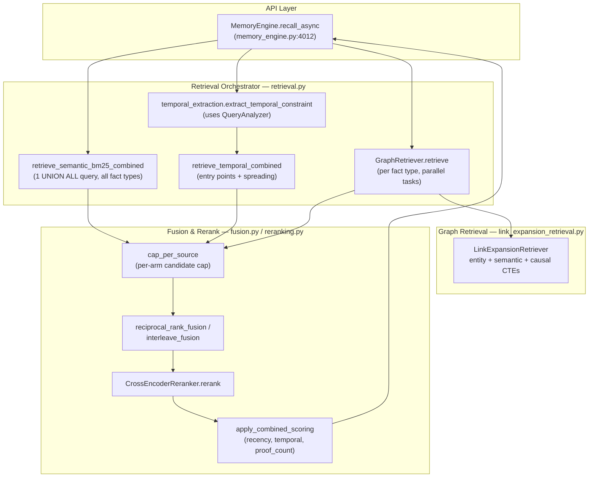
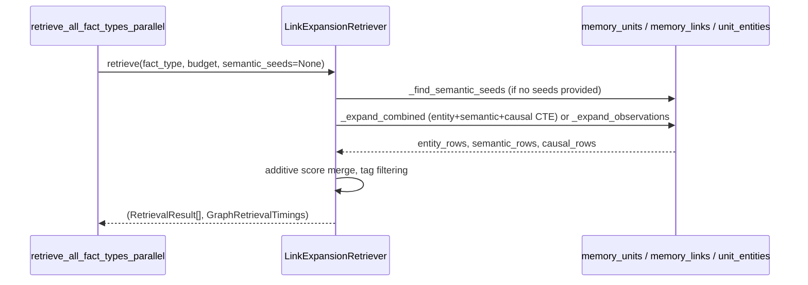
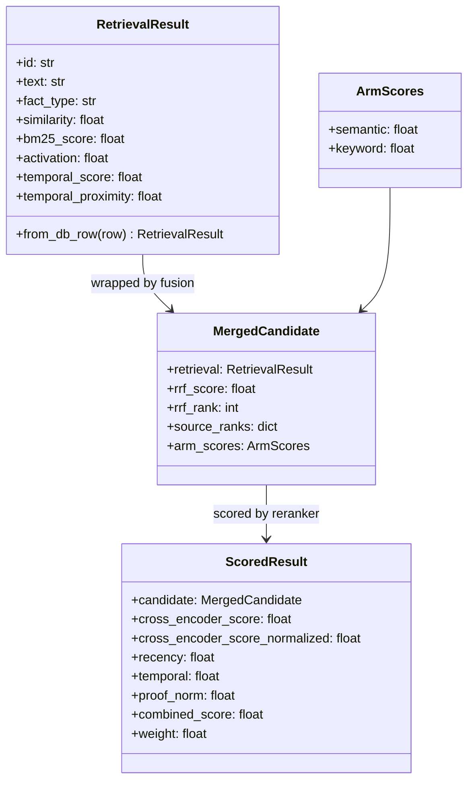

<details>
<summary>Relevant source files</summary>
The following files were used as context for generating this wiki page:
- [hindsight-api-slim/hindsight_api/engine/search/retrieval.py](hindsight-api-slim/hindsight_api/engine/search/retrieval.py)
- [hindsight-api-slim/hindsight_api/engine/search/fusion.py](hindsight-api-slim/hindsight_api/engine/search/fusion.py)
- [hindsight-api-slim/hindsight_api/engine/search/reranking.py](hindsight-api-slim/hindsight_api/engine/search/reranking.py)
- [hindsight-api-slim/hindsight_api/engine/search/graph_retrieval.py](hindsight-api-slim/hindsight_api/engine/search/graph_retrieval.py)
- [hindsight-api-slim/hindsight_api/engine/search/link_expansion_retrieval.py](hindsight-api-slim/hindsight_api/engine/search/link_expansion_retrieval.py)
- [hindsight-api-slim/hindsight_api/engine/query_analyzer.py](hindsight-api-slim/hindsight_api/engine/query_analyzer.py)
- [hindsight-api-slim/hindsight_api/engine/search/types.py](hindsight-api-slim/hindsight_api/engine/memory_engine.py)
- [hindsight-api-slim/hindsight_api/config.py](hindsight-api-slim/hindsight_api/config.py)
</details>

# Recall Pipeline — Multi-Strategy Retrieval & Fusion

Recall is Hindsight's read path: given a natural-language query and a bank, it returns the memory units most relevant to that query. Instead of relying on a single retrieval signal, the pipeline runs four independent strategies in parallel — semantic (vector), BM25 (keyword), graph (link traversal), and temporal (time-aware spreading) — then merges their outputs, reranks them with a cross-encoder, and applies secondary scoring boosts. This page walks through each stage in the order the code executes it, from query analysis through the final combined score.

## Pipeline Overview

The orchestrator is `retrieve_all_fact_types_parallel` in `retrieval.py`, called from `MemoryEngine.recall_async` in `memory_engine.py`. It runs once per recall request across all requested fact types (`world`, `experience`, `observation`, ...) using batched, per-fact-type UNION ALL queries rather than one query per fact type, to minimize DB round trips.



Sources: [hindsight-api-slim/hindsight_api/engine/search/retrieval.py:707-891](), [hindsight-api-slim/hindsight_api/engine/memory_engine.py:4444-4485](), [hindsight-api-slim/hindsight_api/engine/memory_engine.py:4539-4560]()

## Query Intent Analysis

Before any DB query runs, `extract_temporal_constraint` (invoked from `retrieve_all_fact_types_parallel`) uses a `QueryAnalyzer` implementation to detect whether the query text contains a temporal expression ("last week", "in June 2024", "yesterday"). This is CPU-only work done before acquiring a connection so the pipeline can skip the temporal retrieval arm entirely when no constraint is found.

Two `QueryAnalyzer` implementations exist:

| Implementation | Mechanism | Notes |
|---|---|---|
| `DateparserQueryAnalyzer` | `dateparser.search.search_dates`, 200+ languages | Filters false positives (e.g. "may", "march" as words); wraps calls defensively since dateparser can raise internally |
| `TransformerQueryAnalyzer` | Rule-based regex first (yesterday, last week/month/year/weekday, "Month Year"), falls back to a `google/flan-t5-small` generative model for unusual patterns | Rules cover ~90%+ of cases before paying for a model call |

Both return a `QueryAnalysis` with an optional `TemporalConstraint(start_date, end_date)`. If a constraint is detected, `retrieve_all_fact_types_parallel` runs `retrieve_temporal_combined`; otherwise the temporal arm is skipped and `ParallelRetrievalResult.temporal` is `None`.

Sources: [hindsight-api-slim/hindsight_api/engine/query_analyzer.py:82-187](), [hindsight-api-slim/hindsight_api/engine/query_analyzer.py:189-321](), [hindsight-api-slim/hindsight_api/engine/search/retrieval.py:753-761]()

## The Four Retrieval Strategies

### 1. Semantic + BM25 (combined query)

`retrieve_semantic_bm25_combined` builds a single `UNION ALL` SQL statement with one arm per fact type per method (semantic, and BM25 when the query tokenizes to non-empty terms). Each arm has its own `ORDER BY ... LIMIT`, which lets Postgres use the per-fact-type partial HNSW indexes (`idx_mu_emb_world`, `idx_mu_emb_observation`, `idx_mu_emb_experience`) instead of a full scan. Because HNSW is approximate, semantic arms over-fetch 5x (minimum 100) and are trimmed back to `limit` in Python.

```python
# hindsight-api-slim/hindsight_api/engine/search/retrieval.py:206-220
arms = [
    dialect.build_semantic_arm(
        table=table, cols=cols, fact_type=ft,
        embedding_param="$1", bank_id_param="$2",
        fetch_limit=hnsw_fetch, min_similarity=sem_min,
        tags_clause=tags_clause, groups_clause=groups_clause,
        extra_where=created_range_clause,
    )
    for ft in fact_types
]
```

If Oracle's `CONTAINS` text index fails (`DRG-10599`/`ORA-30600`/`ORA-29902`, e.g. the CTXSYS index hasn't synced), the query is rebuilt with the BM25 arms dropped and falls back to semantic-only rather than failing the whole recall.

Score floors — `semantic_min_similarity` (default `0.3`) and `bm25_min_score` (default `0.0`) — are applied inside the SQL arms themselves (pruned before fusion), and can be overridden per request via `min_scores.semantic` / `min_scores.keyword`.

Sources: [hindsight-api-slim/hindsight_api/engine/search/retrieval.py:95-325](), [hindsight-api-slim/hindsight_api/config.py:791-799]()

### 2. Temporal retrieval (entry points + spreading)

`retrieve_temporal_combined` selects **entry points** by similarity within the detected time window (not by recency — an earlier "most recent 50" approach degraded to full scans and biased toward the window's end on banks with degenerate/near-uniform dates). For each fact type it:

1. Fetches an ANN-ranked pool of `_TEMPORAL_POOL_SIZE` (60) candidates whose `occurred_start`/`occurred_end`/`mentioned_at` overlaps `[start_date, end_date]`.
2. Narrows the pool to `_TEMPORAL_ENTRY_POINTS` (10) via `_select_with_temporal_coverage`, which splits the window into `_TEMPORAL_COVERAGE_BUCKETS` (8) time-buckets and round-robins the best-similarity item from each populated bucket, so entry points spread across the window rather than clustering.
3. Spreads from those entry points through `memory_links` of type `temporal`, `causes`, `caused_by`, `enables`, `prevents` — up to `max_iterations` (5) BFS hops, bounded by a node `budget`, using a per-source neighbor cap (`per_source_limit = 10`) via a `LATERAL` join.

Each result carries `temporal_score` (propagated causal/temporal proximity, boosted 2.0x for causal links, 1.5x for enables/prevents) and `temporal_proximity` (distance from the window midpoint). Spreading is skipped on backends without `unnest` support (Oracle) — entry points are still returned.

Sources: [hindsight-api-slim/hindsight_api/engine/search/retrieval.py:328-386](), [hindsight-api-slim/hindsight_api/engine/search/retrieval.py:388-704]()

### 3. Graph retrieval (link expansion)

`GraphRetriever` (`graph_retrieval.py`) is an abstract interface so retrieval strategies can be swapped; the configured default (`config.graph_retriever`, default `"link_expansion"`) is `LinkExpansionRetriever`.

`LinkExpansionRetriever.retrieve` expands from semantic/temporal seeds through three parallel signals stored in `memory_links`:

| Signal | Source | Score |
|---|---|---|
| Entity links | Query-time self-join through `unit_entities`; `COUNT(DISTINCT entity_id)` shared between seeds and candidates, LATERAL-capped at `link_expansion_per_entity_limit` (default 200) | `tanh(count × 0.5)` — saturates: 1→0.46, 2→0.76, 3→0.91, 4→0.96 |
| Semantic links | Precomputed kNN graph (top-5 most similar facts at insert time, similarity ≥ 0.7), checked both directions | Link weight ∈ [0.7, 1.0] |
| Causal links | Explicit `causes`/`caused_by`/`enables`/`prevents` chains | Link weight + 1.0 boost (highest-quality signal) |

For non-observation fact types, all three expansions run as a **single CTE query** (`_expand_combined`) with a `source` discriminator column, bounded by `link_expansion_timeout` (default 10s) — if entity expansion times out, it falls back to semantic+causal only. Observations use a different path (`_expand_observations`) because they aren't directly entity-linked; they traverse `source_memory_ids → world facts → entities → other world facts → their observations`.

Final scores are additive across signals (entity + semantic + causal ∈ [0, 3]) so facts with convergent evidence across multiple signals rank higher; the merged, sorted, budget-truncated list is stored on `RetrievalResult.activation`.



Sources: [hindsight-api-slim/hindsight_api/engine/search/graph_retrieval.py:19-71](), [hindsight-api-slim/hindsight_api/engine/search/link_expansion_retrieval.py:103-274](), [hindsight-api-slim/hindsight_api/engine/search/link_expansion_retrieval.py:276-398](), [hindsight-api-slim/hindsight_api/config.py:946-947]()

## Fusion: Reciprocal Rank Fusion & Interleave

After the four arms return, `memory_engine.py` caps each source independently via `cap_per_source` (config: `recall_max_candidates_per_source`, default disabled) so one over-expanding backend can't crowd out the reranker's candidate budget. Results are then merged with one of two strategies from `fusion.py`:

- **`reciprocal_rank_fusion`** (default): `score(doc) = Σ 1/(k + rank)` across the arms it appears in (`k=60`). A doc's per-arm raw scores are preserved separately in `ArmScores` (`semantic`, `keyword`) for the recall response and `min_scores` filtering.
- **`interleave_fusion`**: round-robin across arms in priority order (semantic, bm25, graph, temporal) — arm #1s first, then #2s, etc. This exists specifically for consolidation dedup recall: RRF averages down a candidate that's rank #1 in one arm but weak elsewhere, which was observed to bury the near-duplicate "twin" fact below the recall budget and cause the LLM to create a duplicate instead of merging into it.

Both produce `MergedCandidate` objects; `reranking == "interleave"` selects `interleave_fusion`, otherwise `reciprocal_rank_fusion`.

Sources: [hindsight-api-slim/hindsight_api/engine/search/fusion.py:29-177](), [hindsight-api-slim/hindsight_api/engine/memory_engine.py:4694-4724](), [hindsight-api-slim/hindsight_api/engine/memory_engine.py:4539-4560]()

## Reranking: Cross-Encoder & Combined Scoring

`CrossEncoderReranker.rerank` (`reranking.py`) takes the merged candidates (pre-filtered to `reranker_max_candidates`, default 300, sorted by boosted RRF score if the pool is larger) and scores each `[query, doc_text]` pair with a cross-encoder model (default local `cross-encoder/ms-marco-MiniLM-L-6-v2`; `doc_text` is prefixed with context and a formatted occurrence date when available). Scores already in `[0, 1]` (calibrated external rerankers like Cohere/Jina) pass through as-is; otherwise a sigmoid maps logits to `[0, 1]`.

`apply_combined_scoring` then applies three **multiplicative** boosts on top of the normalized cross-encoder score, each bounded to at most ±(alpha/2):

```
recency_boost     = 1 + recency_alpha     * (recency     - 0.5)   # α=0.2 → ±10%
temporal_boost    = 1 + temporal_alpha    * (temporal    - 0.5)   # α=0.2 → ±10%
proof_count_boost = 1 + proof_count_alpha * (proof_norm  - 0.5)   # α=0.1 → ±5%
combined_score    = CE_normalized × recency_boost × temporal_boost × proof_count_boost
```

- `recency` uses a configurable decay curve (`"linear"` default: 1.0→0.1 floor over 365 days; `"exponential"`: half-life 90 days; `"none"`: always neutral 0.5) over the memory's effective time (`occurred_start` → `mentioned_at` → `occurred_end`).
- `temporal` is neutral (0.5) unless the result came from temporal retrieval's spreading (`temporal_proximity`).
- `proof_norm` log-normalizes `proof_count` (observations only): `0.5 + log(count)/10`, clamped to `[0, 1]`.

When the configured cross-encoder is a passthrough (`RRFPassthroughCrossEncoder`, used by slim deployments), every raw CE score is identical and would let the boosts become the *only* ranking signal (a pure recency sort). `is_passthrough_reranker` detects this and seeds `cross_encoder_score_normalized` from RRF rank instead, so the boosts modulate a meaningful base rather than replacing it.

`reranking == "interleave"` skips this rescoring entirely — the interleave order is authoritative for dedup recall, and re-sorting by recency/temporal is exactly what would bury the twin again. `reranking == "rrf"` skips the cross-encoder call but still applies `apply_combined_scoring` with `is_passthrough=True`.

Sources: [hindsight-api-slim/hindsight_api/engine/search/reranking.py:36-192](), [hindsight-api-slim/hindsight_api/engine/search/reranking.py:250-337](), [hindsight-api-slim/hindsight_api/engine/memory_engine.py:4746-4830]()

## Data Model Across Stages



`RetrievalResult` is the raw per-arm output; `MergedCandidate` adds RRF/interleave bookkeeping (`rrf_score`, `source_ranks`, `arm_scores`); `ScoredResult` adds cross-encoder and combined-scoring fields and is the final unit truncated to `thinking_budget * 2` before token-budget filtering.

Sources: [hindsight-api-slim/hindsight_api/engine/search/types.py:31-204]()

## Configuration Reference

| Setting | Default | Effect |
|---|---|---|
| `graph_retriever` | `link_expansion` | Selects the `GraphRetriever` implementation |
| `semantic_min_similarity` | `0.3` | Floor applied inside the semantic SQL arm |
| `bm25_min_score` | `0.0` | Floor applied inside the BM25 SQL arm |
| `link_expansion_per_entity_limit` | `200` | LATERAL cap per entity in graph entity expansion |
| `link_expansion_timeout` | `10.0`s | Timeout before falling back to semantic+causal-only expansion |
| `recall_max_candidates_per_source` | `0` (disabled) | Per-arm cap applied before fusion |
| `reranker_max_candidates` | `300` | Pool size fed to the cross-encoder; larger pools are pre-filtered by boosted RRF score |
| `recall_budget_fixed_{low,mid,high}` | `100 / 300 / 1000` | `thinking_budget` (node/result budget for graph traversal and retrieval limits) mapped from the request's `Budget` enum |

These are hierarchical/bank-overridable settings resolved via `ConfigResolver`, consistent with the project's global → tenant → bank configuration model.

Sources: [hindsight-api-slim/hindsight_api/config.py:790-802](), [hindsight-api-slim/hindsight_api/config.py:941-947](), [hindsight-api-slim/hindsight_api/config.py:1081-1083]()

## Summary

The recall pipeline trades a single "best" retrieval method for breadth: semantic, BM25, graph, and temporal each surface candidates a competing method would miss, RRF (or interleave, for dedup-sensitive callers) merges them without letting one arm dominate, and a cross-encoder plus multiplicative recency/temporal/proof-count boosts produce the final ranking. Every stage is parallelized or batched at the SQL level (single UNION ALL queries per fact-type group, per-fact-type asyncio tasks for graph retrieval) to keep round-trips and connection pressure bounded even as the number of fact types grows.

## Related pages

- page-memory-engine
- page-llm-providers
- page-reflect-mental-models


## Source files

- `hindsight-api-slim/hindsight_api/engine/search/retrieval.py`
- `hindsight-api-slim/hindsight_api/engine/search/fusion.py`
- `hindsight-api-slim/hindsight_api/engine/search/reranking.py`
- `hindsight-api-slim/hindsight_api/engine/search/graph_retrieval.py`
- `hindsight-api-slim/hindsight_api/engine/search/link_expansion_retrieval.py`
- `hindsight-api-slim/hindsight_api/engine/query_analyzer.py`
