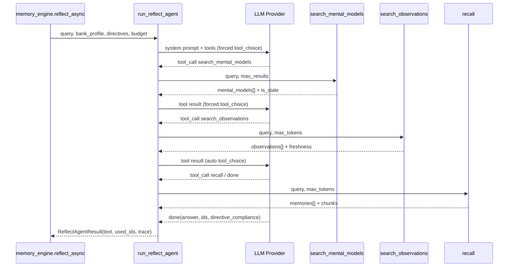
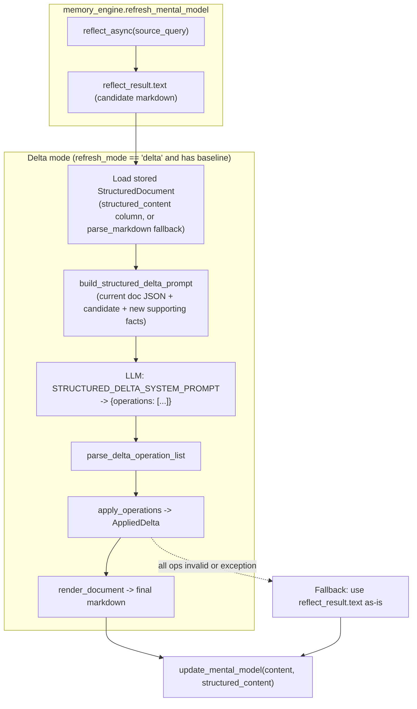

<details>
<summary>Relevant source files</summary>
The following files were used as context for generating this wiki page:
- [hindsight-api-slim/hindsight_api/engine/reflect/agent.py](hindsight-api-slim/hindsight_api/engine/reflect/agent.py)
- [hindsight-api-slim/hindsight_api/engine/reflect/delta_ops.py](hindsight-api-slim/hindsight_api/engine/reflect/delta_ops.py)
- [hindsight-api-slim/hindsight_api/engine/reflect/structured_doc.py](hindsight-api-slim/hindsight_api/engine/reflect/structured_doc.py)
- [hindsight-api-slim/hindsight_api/engine/reflect/tools.py](hindsight-api-slim/hindsight_api/engine/reflect/tools.py)
- [hindsight-api-slim/hindsight_api/engine/reflect/tools_schema.py](hindsight-api-slim/hindsight_api/engine/reflect/tools_schema.py)
- [hindsight-api-slim/hindsight_api/engine/reflect/prompts.py](hindsight-api-slim/hindsight_api/engine/reflect/prompts.py)
- [hindsight-api-slim/hindsight_api/engine/reflect/models.py](hindsight-api-slim/hindsight_api/engine/reflect/models.py)
- [hindsight-api-slim/hindsight_api/engine/directives/models.py](hindsight-api-slim/hindsight_api/engine/directives/models.py)
- [hindsight-api-slim/hindsight_api/engine/memory_engine.py](hindsight-api-slim/hindsight_api/engine/memory_engine.py)
</details>

# Reflect — Disposition-Aware Reasoning & Mental Models

Reflect is Hindsight's synthesis operation: given a natural-language question, it runs an agentic tool-calling loop over a bank's stored memories and returns a reasoned, cited answer. Unlike recall, which is a single retrieval call, reflect lets the LLM decide what to search, in what order, and when it has enough evidence — while a set of guardrails (forced tool ordering, ID validation, evidence requirements) keep it from hallucinating. Reflect also powers a second workflow: refreshing pinned **mental models**, Hindsight's consolidated-knowledge documents, either by full regeneration or via structured **delta operations** that touch only the sections a refresh actually changes.

This page covers the reflect agent loop (`agent.py`), its tool surface (`tools.py`, `tools_schema.py`), the prompt construction that encodes disposition traits and directives (`prompts.py`), and the structured-document/delta-operation machinery used for non-destructive mental model updates (`structured_doc.py`, `delta_ops.py`).

## The Reflect Agent Loop

`run_reflect_agent` in `agent.py` drives a bounded iteration loop (`DEFAULT_MAX_ITERATIONS = 10`, scaled by budget) that calls the LLM with native tool calling. Each iteration either invokes tools or the terminal `done` tool.



### Hierarchical retrieval and forced tool ordering

The loop enforces a hierarchy — `search_mental_models` → `search_observations` → `recall` — via `tool_choice` forced to a specific function name for the first N iterations, where N is the length of the enabled `forced_sequence`. Only after this sequence (or once a fresh, usable mental model short-circuits it) does `tool_choice` switch to `"auto"`, letting the LLM decide freely, including calling `expand` or `done`.

Sources: [hindsight-api-slim/hindsight_api/engine/reflect/agent.py:729-746](), [hindsight-api-slim/hindsight_api/engine/reflect/agent.py:398-413]()

A deterministic short-circuit (`_all_mental_models_are_usable_and_fresh`) skips lower-level forcing without an extra LLM call: if every mental model returned by a forced `search_mental_models` call is explicitly `is_stale == False` and has non-empty content, `stop_forcing_from_iteration` is set and subsequent iterations run under `"auto"` tool choice — for budgets other than `"high"`.

Sources: [hindsight-api-slim/hindsight_api/engine/reflect/agent.py:1124-1142]()

### Guardrails

| Guardrail | Mechanism | Location |
|---|---|---|
| Anti-hallucinated tool calls | Tool names not in `enabled_tools` are rejected with an error message fed back to the LLM instead of executed | `agent.py:1040-1053`, `_execute_tool` at `agent.py:1379-1383` |
| Evidence-before-done | `done()` is rejected with an error tool result if no memory/mental-model/observation IDs have been gathered yet | `agent.py:988-1013` |
| ID hallucination | `done()`'s `memory_ids` / `mental_model_ids` / `observation_ids` are filtered against IDs actually returned by prior tool calls | `_process_done_tool`, `agent.py:1258-1260` |
| Context-window overflow | Token-estimated message size checked each iteration; on overflow (or a caught context-length error), the loop forces a final synthesis call from gathered evidence instead of continuing | `agent.py:662-724`, `_is_context_overflow_error` at `agent.py:380-395` |
| Answer-length cap | If a short-circuited text answer exceeds `max_tokens`, a follow-up rewrite call compresses it | `agent.py:873-906` |
| Leaked tool-call text | `_clean_answer_text` / `_clean_done_answer` strip `done({...})` JSON that some providers emit as plain text instead of a real tool call | `agent.py:112-219` |
| Cooperative cancellation | `cancel_check()` (bound to `request_context.raise_if_cancelled`) is checked at the top of every iteration | `agent.py:600-601` |

Each non-`done` tool call in an iteration is executed concurrently via `asyncio.gather`, and results (or exceptions) are converted into `tool` role messages before the next LLM call.

Sources: [hindsight-api-slim/hindsight_api/engine/reflect/agent.py:1081-1166]()

### Tool surface

`get_reflect_tools` in `tools_schema.py` assembles the OpenAI-format tool list conditionally, based on what the bank has available: `search_mental_models` (only if the bank has mental models), `search_observations` (unless a `fact_types` filter excludes `"observation"`), `recall`, `expand` (excluded entirely when `store_document_text` is disabled, since it only reads back raw chunk/document text), and always `done`.

Sources: [hindsight-api-slim/hindsight_api/engine/reflect/tools_schema.py:230-276]()

| Tool | Backing function (`tools.py`) | Purpose |
|---|---|---|
| `search_mental_models` | `tool_search_mental_models` | Embedding similarity search over curated mental models; computes per-model `is_stale` via `compute_mental_model_is_stale` |
| `search_observations` | `tool_search_observations` | Wraps `recall_async(fact_type=["observation"])` on an internal (non-billed) request context; returns `freshness` (`up_to_date` / `slightly_stale` / `stale`) based on `pending_consolidation` count |
| `recall` | `tool_recall` | Ground-truth retrieval over `world`/`experience` facts, with optional raw chunk text |
| `expand` | `tool_expand` | Batch-resolves memory IDs to their source chunk and/or document text |

Sources: [hindsight-api-slim/hindsight_api/engine/reflect/tools.py:59-157](), [hindsight-api-slim/hindsight_api/engine/reflect/tools.py:160-239](), [hindsight-api-slim/hindsight_api/engine/reflect/tools.py:308-448]()

The `done` tool schema is generated dynamically: when directives are active, `_build_done_tool_with_directives` adds a required `directive_compliance` field forcing the LLM to state, per directive, how its answer complies — before it's allowed to finish.

Sources: [hindsight-api-slim/hindsight_api/engine/reflect/tools_schema.py:171-227]()

## Prompt Construction: Disposition and Directives

`build_system_prompt_for_tools` in `prompts.py` assembles the loop's system prompt from several composable pieces, in this fixed order: anti-hallucination rule → directives (mandatory, at the top) → mission/role → language rule → reasoning rules (temporal supersession, conflict handling, "showing your reasoning" scaffolding) → hierarchical retrieval strategy text (built only for the tools actually enabled) → budget-dependent research-depth guidance → workflow steps → output-format rules → bank identity and **disposition traits** → directives reminder (repeated at the end for recency effect).

Sources: [hindsight-api-slim/hindsight_api/engine/reflect/prompts.py:96-421]()

### Disposition traits

Each bank profile can carry a `disposition` dict with three integer traits — `skepticism`, `literalism`, `empathy` — which are rendered verbatim into the prompt as `Disposition: skepticism=N, literalism=N, empathy=N` and injected into the system prompt, the intermediate agent prompt, and the final-synthesis prompt alike, so disposition is visible to whichever LLM call ultimately writes the answer.

```python
disposition = bank_profile.get("disposition", {})
if disposition:
    traits = []
    if "skepticism" in disposition:
        traits.append(f"skepticism={disposition['skepticism']}")
    ...
    parts.append(f"Disposition: {', '.join(traits)}")
```
Sources: [hindsight-api-slim/hindsight_api/engine/reflect/prompts.py:401-412](), [hindsight-api-slim/hindsight_api/engine/reflect/prompts.py:442-452]()

Disposition values are resolved hierarchically in `memory_engine.py`: bank-level config (`disposition_skepticism`, `disposition_literalism`, `disposition_empathy`) overlays the legacy `banks.disposition` column when set, via `_overlay_bank_config_disposition_mission`.

Sources: [hindsight-api-slim/hindsight_api/engine/memory_engine.py:855-875]()

Per the project's API design conventions, disposition traits only affect `reflect`, not `recall` — recall is a pure retrieval call with no LLM reasoning to steer.

### Directives — hard behavioral rules

A `Directive` (`directives/models.py`) is a user-defined rule — e.g. "Always respond in formal English" — stored per bank with `priority`, `is_active`, and `tags` for scoping. Reflect loads active directives via `list_directives(..., isolation_mode=True)` before building the loop, scoped by the same `tags`/`tags_match` as the reflect call itself.

Sources: [hindsight-api-slim/hindsight_api/engine/directives/models.py:9-37](), [hindsight-api-slim/hindsight_api/engine/memory_engine.py:9135-9150]()

Directives are injected twice in the system prompt — once near the top (`## DIRECTIVES (MANDATORY)`, right after the anti-hallucination rule, "highest priority" placement) and once again at the very end as a `## REMINDER: MANDATORY DIRECTIVES` block, exploiting LLM recency bias. The same directive text is independently re-injected into the *separate* final-synthesis system prompt (`build_final_system_prompt`), because that call has its own system prompt and does not inherit the agent loop's context — omitting this repetition was a known cause of directive drift ("flaky multilingual reflect tests").

Sources: [hindsight-api-slim/hindsight_api/engine/reflect/prompts.py:34-93](), [hindsight-api-slim/hindsight_api/engine/reflect/prompts.py:607-644]()

When directives are present, the `done` tool schema requires a `directive_compliance` argument (see Tool surface above), and the agent loop treats a directive-guided but evidence-free text answer as risky: if `directives` are set but no evidence has been gathered, a short-circuited text response is discarded in favor of falling through to the final-prompt path, to avoid the LLM echoing directive content verbatim as if it were an answer.

Sources: [hindsight-api-slim/hindsight_api/engine/reflect/agent.py:855-862]()

### Budget-controlled research depth

The `budget` parameter (`low` / `mid` / `high`) both scales `max_iterations` (multipliers 0.5x / 1x / 2x in `memory_engine.py`) and injects distinct "RESEARCH DEPTH" prompt guidance — shallow ("stop at first reasonable answer"), moderate, or deep ("use `expand()`, verify across levels, multiple query variations").

Sources: [hindsight-api-slim/hindsight_api/engine/reflect/prompts.py:316-354](), [hindsight-api-slim/hindsight_api/engine/memory_engine.py:9011-9018]()

## Mental Models: Structured Documents and Delta Operations

A mental model is a pinned, persisted reflect answer tied to a `source_query`, refreshed periodically via `refresh_mental_model`. The naive approach — re-running reflect and overwriting the stored markdown — causes prose drift: an LLM asked to "preserve unchanged content" while regenerating a whole document will still paraphrase, reorder, or restyle text it wasn't meant to touch, because generation is inherently next-token synthesis, not verbatim copying.

### StructuredDocument schema

`structured_doc.py` defines an authoritative, typed representation that markdown is only a deterministic *rendering* of:

```python
class StructuredDocument(BaseModel):
    version: Literal[1] = 1
    sections: list[Section]   # each: id (stable slug), heading, level, blocks

Block = Union[ParagraphBlock, BulletListBlock, OrderedListBlock, CodeBlock]
```

`render_document` is byte-stable (same structure → same markdown), and `parse_markdown` is a lenient, non-CommonMark parser tuned to round-trip its own output and tolerate typical LLM-generated markdown, falling back to a `ParagraphBlock` rather than dropping unrecognized content.

Sources: [hindsight-api-slim/hindsight_api/engine/reflect/structured_doc.py:78-104](), [hindsight-api-slim/hindsight_api/engine/reflect/structured_doc.py:157-165](), [hindsight-api-slim/hindsight_api/engine/reflect/structured_doc.py:245-301]()

### Delta operations

Rather than asking the LLM to output a new document, delta refreshes ask it for a list of *operations* to apply — `delta_ops.py`. Eight operation types cover block- and section-level edits:

| Operation | Effect |
|---|---|
| `append_block` | Add a block at the end of a section |
| `insert_block` | Insert a block at a given index |
| `replace_block` | Replace the block at an index |
| `remove_block` | Remove the block at an index |
| `add_section` | Insert a new section (optionally after an existing one) |
| `remove_section` | Delete a section entirely |
| `replace_section_blocks` | Replace all blocks of a section at once |
| `rename_section` | Change a section's heading (id unchanged) |

Sources: [hindsight-api-slim/hindsight_api/engine/reflect/delta_ops.py:55-134]()

`apply_operations` applies the list against a deep copy of the document; unknown `section_id`, out-of-range `index`, and similar issues cause that individual op to be **skipped** (recorded with a reason), not the whole batch to fail. Sections and blocks untouched by any operation are physically copied through unchanged — making "no drift" structural rather than a prompt instruction.

Sources: [hindsight-api-slim/hindsight_api/engine/reflect/delta_ops.py:302-429]()

A distinct failure mode is guarded explicitly: if the LLM emits operations but *all* of them fail schema validation, `_finalize_operations` raises `DeltaAllOpsInvalidError` rather than silently returning zero applied ops — because zero valid ops from a nonempty list would drop the refresh's new facts entirely, whereas raising lets the caller fall back to full-document regeneration.

Sources: [hindsight-api-slim/hindsight_api/engine/reflect/delta_ops.py:179-193]()



`refresh_mental_model` selects delta mode only when the mental model has existing, non-placeholder content **and** its `source_query` is unchanged since the last refresh (a topic change forces a full rebuild). In delta mode, `recall` inside the nested `reflect_async` call is additionally scoped with `created_after=last_refreshed_at`, so only genuinely new memories are retrieved as `supporting_facts` for the delta prompt — and if there are none, the refresh short-circuits, preserving existing content without an LLM call.

Sources: [hindsight-api-slim/hindsight_api/engine/memory_engine.py:10547-10574](), [hindsight-api-slim/hindsight_api/engine/memory_engine.py:10630-10639](), [hindsight-api-slim/hindsight_api/engine/memory_engine.py:10741-10756]()

If the structured-delta LLM call or op application throws, the code falls back to `reflect_result.text` (the full candidate synthesis) unmodified, logging the exception — and an empty final render is refused outright: the previous DB content is preserved and `MentalModelRefreshError` is raised so callers see the failure rather than silently losing the document.

Sources: [hindsight-api-slim/hindsight_api/engine/memory_engine.py:10800-10839]()

A non-structured, whole-document delta prompt (`DELTA_SYSTEM_PROMPT` / `build_delta_prompt`) also exists in `prompts.py` as a byte-for-byte-preservation instruction to the LLM; the structured-operations path is the stronger, structurally-enforced alternative used by `refresh_mental_model`.

Sources: [hindsight-api-slim/hindsight_api/engine/reflect/prompts.py:871-927]()

## Result Shape

`ReflectAgentResult` (`models.py`) carries the final `text`, optional `structured_output` (when a JSON `response_schema` was supplied and extracted via a follow-up LLM call), the validated `used_memory_ids` / `used_mental_model_ids` / `used_observation_ids`, a full `tool_trace` and `llm_trace` for observability, aggregate `TokenUsageSummary` (including cached and reasoning/thoughts token subtotals), and `directives_applied` for audit.

Sources: [hindsight-api-slim/hindsight_api/engine/reflect/models.py:109-133]()

## Summary

Reflect combines a tool-calling agent loop with forced hierarchical retrieval, evidence and hallucination guardrails, and disposition/directive-aware prompting to produce grounded, citable answers from a bank's memories. For mental models, that same reflect loop feeds a structured-document delta system that turns "update this consolidated knowledge doc" from a lossy full-regeneration problem into a set of auditable, validated, section-scoped operations — falling back safely to full synthesis whenever the structured path can't be trusted.

## Related pages

- page-search-retrieval
- page-consolidation-maintenance
- page-http-api


## Source files

- `hindsight-api-slim/hindsight_api/engine/reflect/agent.py`
- `hindsight-api-slim/hindsight_api/engine/reflect/delta_ops.py`
- `hindsight-api-slim/hindsight_api/engine/reflect/structured_doc.py`
- `hindsight-api-slim/hindsight_api/engine/reflect/tools.py`
- `hindsight-api-slim/hindsight_api/engine/reflect/prompts.py`
- `hindsight-api-slim/hindsight_api/engine/directives/models.py`
