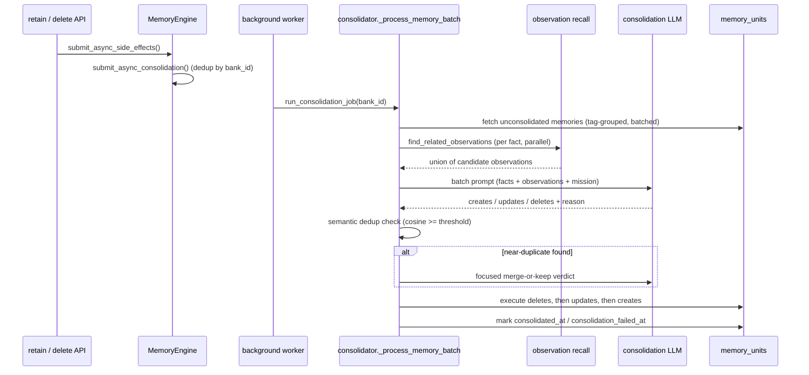

<details>
<summary>Relevant source files</summary>
The following files were used as context for generating this wiki page:
- [hindsight-api-slim/hindsight_api/engine/consolidation/consolidator.py](hindsight-api-slim/hindsight_api/engine/consolidation/consolidator.py)
- [hindsight-api-slim/hindsight_api/engine/consolidation/prompts.py](hindsight-api-slim/hindsight_api/engine/consolidation/prompts.py)
- [hindsight-api-slim/hindsight_api/engine/graph_maintenance.py](hindsight-api-slim/hindsight_api/engine/graph_maintenance.py)
- [hindsight-api-slim/hindsight_api/engine/maintenance.py](hindsight-api-slim/hindsight_api/engine/maintenance.py)
- [hindsight-api-slim/hindsight_api/engine/bank_stats_cache.py](hindsight-api-slim/hindsight_api/engine/bank_stats_cache.py)
- [hindsight-api-slim/hindsight_api/engine/memory_engine.py](hindsight-api-slim/hindsight_api/engine/memory_engine.py)
- [hindsight-api-slim/hindsight_api/engine/retain/fact_storage.py](hindsight-api-slim/hindsight_api/engine/retain/fact_storage.py)
- [hindsight-api-slim/hindsight_api/config.py](hindsight-api-slim/hindsight_api/config.py)
</details>

# Consolidation & Graph Maintenance

Hindsight keeps two background systems running behind every retain/delete call: **consolidation**, which distills raw facts into durable "observations" (the bottom-up half of the memory hierarchy described in `memory_engine.py`), and **graph maintenance**, which repairs the temporal/semantic link graph and entity index after deletes. A third component, the **maintenance loop**, is the single periodic task that recovers stranded work for both systems and drives scheduled mental-model refresh and data retention. A fourth, the **bank stats cache**, is a small but important piece of housekeeping that keeps the per-bank statistics widget cheap to query. This page covers how these four pieces fit together, since none of them run synchronously with the request that triggers them.

## Consolidation Pipeline

Consolidation turns raw `memory_units` (fact_type `experience` or `world`) into `memory_units` with fact_type `observation` — LLM-synthesized, evidence-backed statements distinct from user-pinned mental models (`consolidator.py:8-16`). It is submitted asynchronously by `MemoryEngine._submit_async_side_effects` after every retain or document import, gated on `enable_observations` and `enable_auto_consolidation` (`memory_engine.py:3655-3657`), and deduplicated per bank so a second submission while one is pending just returns the existing operation id (`memory_engine.py:12719-12770`).

### Batch processing flow

`_run_consolidation_job` (`consolidator.py:808-1367`) fetches unconsolidated memories (`consolidated_at IS NULL AND consolidation_failed_at IS NULL`), in pages of `consolidation_batch_size` (default 50). Within a page it:

1. **Groups memories by exact tag set** — memories with different tags must never share an LLM call, a hard security boundary (`consolidator.py:983-988`).
2. **Splits each tag group into LLM batches** of `consolidation_llm_batch_size` (default 8 facts/call) (`consolidator.py:990-995`).
3. **Dispatches groups**, optionally in parallel up to `consolidation_llm_parallelism`, using per-scope `asyncio.Lock`s acquired in a total order so overlapping observation scopes serialize while disjoint ones run concurrently — deadlock-free by construction (`consolidator.py:1264-1297`, `_scope_sort_key` at `consolidator.py:444-451`).
4. Inside each LLM batch, `_process_memory_batch` (`consolidator.py:1492-1621+`) recalls related existing observations per fact in parallel, unions them, checks the scope's observation cap, and issues **one LLM call** with all facts + candidate observations, returning `creates`/`updates`/`deletes` (`_ConsolidationBatchResponse`).
5. On LLM failure, the sub-batch is **adaptively halved and retried**, down to a single memory; a lone memory that still fails is marked `consolidation_failed_at` rather than blocking the batch (`consolidator.py:1029-1112`).



If a round hits `consolidation_max_memories_per_round`, the job re-submits itself via `submit_async_consolidation` rather than silently leaving work stranded — a deliberate fix for prior "swallowed failure" behavior (`consolidator.py:1316-1333`).

Sources: [hindsight-api-slim/hindsight_api/engine/consolidation/consolidator.py:759-1367](), [hindsight-api-slim/hindsight_api/engine/consolidation/consolidator.py:1492-1621](), [hindsight-api-slim/hindsight_api/engine/memory_engine.py:3640-3662](), [hindsight-api-slim/hindsight_api/engine/memory_engine.py:12719-12770]()

### Prompting: mission, processing rules, and output contract

The LLM prompt (`prompts.py`) has three parts:

- **MISSION** — a per-bank customizable statement of what to track, defaulting to "Track anything notable... names, numbers, dates, places, events, decisions, claims, relationships, and recurring patterns" (`prompts.py:10-13`). It explicitly overrides the built-in rules when they conflict (`_MISSION_PRIORITY_NOTE`, `prompts.py:15-18`).
- **PROCESSING RULES** — nine fixed rules: prefer UPDATE over CREATE for the same canonical fact, one observation per distinct facet, match by entity/facet not topic, concise state-change updates, cascade a state change to every affected observation, resolve vague references, preserve history (never delete a significant past event), no arithmetic/derivation, and keep distinct topics distinct (`prompts.py:20-38`).
- **OUTPUT FORMAT** — a JSON object of `creates`/`updates`/`deletes`, each entry carrying a mandatory `reason` field used to audit duplicate creates, plus the rule that **at most one UPDATE per `observation_id`** may appear in a response (`prompts.py:93-142`).

For the "cached split" call path, the stable rules/format live in a bank-agnostic system prefix (`build_consolidation_system_prompt`) so a single provider-side prompt cache serves every bank; only the mission and the per-batch facts/observations ride in the user message (`build_consolidation_input`) (`prompts.py:178-227`).

Sources: [hindsight-api-slim/hindsight_api/engine/consolidation/prompts.py:1-227]()

### Observation caps and semantic dedup

Two independent controls limit observation growth per tag scope:

| Control | Config field | Behavior |
|---|---|---|
| Bank-wide cap | `max_observations_per_scope` (default `-1`, unlimited) | Once a scope hits its cap, `remaining_observation_slots == 0` and the LLM is told only updates/deletes are allowed (`consolidator.py:1572-1586`) |
| Per-scope override | `observation_scope_limits` (glob rules) | First rule whose tag-glob pattern **exact-covers** the concrete scope wins over the bank-wide cap (`consolidator.py:601-678`) |
| Semantic dedup | `consolidation_dedup_threshold` (default `0.97`, PostgreSQL only) | When enabled (threshold `< 1.0` and not Oracle), any CREATE or UPDATE probes its nearest existing observations by embedding cosine similarity; a focused 1-by-1 LLM verdict (`_DEDUP_PROMPT`) decides merge vs. keep (`consolidator.py:152-354`) |

The dedup guard runs at two points: at CREATE time (folds the new source facts into an existing twin and skips the CREATE) and at UPDATE time (an UPDATE rewrites+re-embeds an observation, which can drift its vector within threshold of a *different* existing observation — the create-time guard cannot see this, so the UPDATE path re-probes and, on merge, deletes the now-redundant row) (`consolidator.py:285-354`).

Sources: [hindsight-api-slim/hindsight_api/engine/consolidation/consolidator.py:130-354](), [hindsight-api-slim/hindsight_api/engine/consolidation/consolidator.py:601-678](), [hindsight-api-slim/hindsight_api/config.py:1004-1032]()

## Graph Maintenance

Graph maintenance repairs `memory_links` and the entity index after deletes, and runs as three passes on every worker invocation (`graph_maintenance.py:1-32`):

1. **Relink top-up** — drains `graph_maintenance_queue`. For each queued "victim" unit (one whose outgoing temporal/semantic link pointed at a now-deleted unit), it counts current outgoing links per type; if below the per-unit cap (`MAX_TEMPORAL_LINKS_PER_UNIT`, `MAX_SEMANTIC_LINKS_PER_UNIT = 50`), it re-runs the same neighbor probes retain-time linking uses (`fetch_temporal_neighbors`, `compute_semantic_links_ann`) and bulk-inserts the missing links; `ON CONFLICT DO NOTHING` makes re-probing idempotent (`graph_maintenance.py:60-357`).
2. **Orphan entity prune** — deletes `entities` rows in the bank that no longer have any `unit_entities` reference; the FK `ON DELETE CASCADE` removes dependent `entity_cooccurrences` automatically (`graph_maintenance.py:210-219`).
3. **Stale cooccurrence prune** — a defensive sweep for cooccurrence rows where both entities still exist but no live memory unit witnesses them together anymore (`graph_maintenance.py:216-226`).

```text
delete transaction (fact_storage.py / memory_engine.py)
  │  enqueue_relink_victims() runs BEFORE the cascade fires
  │  (join needs the doomed rows to still exist)
  ▼
graph_maintenance_queue  ──►  submit_async_graph_maintenance()
                                (no-op if queue empty; dedup per bank)
  ▼
run_graph_maintenance_job()
  ├─ Pass 1: claim batch (_DRAIN_BATCH_SIZE=50) → relink temporal + semantic
  ├─ Pass 2: prune orphan entities (bank-wide sweep)
  └─ Pass 3: prune stale cooccurrences (bank-wide sweep)
```

`enqueue_relink_victims` must run inside the same transaction as the delete, *before* the FK cascade removes the rows — the join that discovers victims otherwise finds nothing (`graph_maintenance.py:88-150`). It is called from the fact-revision path in `retain/fact_storage.py:331-333` and from several delete paths in `memory_engine.py` (memory delete, document delete, unit revision). Entity links are intentionally excluded from the relink pass — they are already scheduled for removal via the entity prune. `run_graph_maintenance_job` guards against runaway backlogs with a 10,000-iteration cap, and the semantic ANN probe runs on its own connection because it opens a nested transaction (`SET LOCAL hnsw.ef_search` + a temp table), which would otherwise commit the outer write transaction early (`graph_maintenance.py:314-345`).

Sources: [hindsight-api-slim/hindsight_api/engine/graph_maintenance.py:1-358](), [hindsight-api-slim/hindsight_api/engine/retain/fact_storage.py:331-333](), [hindsight-api-slim/hindsight_api/engine/memory_engine.py:3661-3662]()

## The Maintenance Loop

`MaintenanceLoop` (`maintenance.py`) is a single `asyncio` task per `MemoryEngine` that drives three independent, differently-paced jobs off one 60-second tick, avoiding a separate task per concern (`maintenance.py:1-52`). It is **PostgreSQL-only** — Oracle is skipped outright because the retention sweeps target PG-only tables and the reconcile queries rely on PG-only PL/pgSQL routines (`maintenance.py:70-76`).

| Job | Default interval | Purpose |
|---|---|---|
| Retention sweeps | 3600s (hourly, fixed) | Delete expired `audit_log`/`llm_requests` rows across every tenant schema via `public.schemas_with_expired_rows()` (`maintenance.py:152-179`) |
| Consolidation reconcile | `consolidation_reconcile_interval_seconds` = 300s | Re-schedule consolidation for banks with eligible-but-unscheduled facts (facts stranded after a terminally-failed consolidation op), discovered via `public.banks_needing_consolidation()` (`maintenance.py:183-238`) |
| Scheduled mental model refresh | `mental_model_refresh_tick_seconds` = 60s (check cadence, not the actual schedule) | Refresh mental models whose `trigger.refresh_cron` is due **and** actually stale, via `public.mental_models_with_cron()` + `croniter` for due-ness and `compute_mental_model_is_stale` to skip a wasted LLM call (`maintenance.py:242-347`) |

Each job runs "at start, then on interval" independently (`_is_due`, `maintenance.py:118-125`), so adding jobs with different cadences doesn't burst CPU on a shared schedule. Cross-tenant discovery is a single round-trip server-side routine per job rather than a per-schema query storm — the doc comment cites "thousands of tenants" as the motivating scale (`maintenance.py:22-27`). Both the reconcile and refresh jobs re-check the tenant's config gates (`enable_observations`/`enable_auto_consolidation` for reconcile; per-model staleness for refresh) before re-enqueueing work, and skip schemas the worker doesn't recognize as a live tenant to avoid enqueuing an operation that would never be claimed.

Sources: [hindsight-api-slim/hindsight_api/engine/maintenance.py:1-348]()

## Bank Stats Cache

`get_bank_stats` aggregates over `memory_links` joined to `memory_units`, which can be a multi-second scan on banks with millions of rows; since the result only feeds a UI widget and a staleness hint inside `reflect`, caching it briefly is safe (`bank_stats_cache.py:1-11`). Two implementations share the same `get_or_load`/`invalidate`/`clear` contract:

- **`BankStatsCache`** — an in-process `OrderedDict` TTL+LRU cache, used on Oracle. Concurrent misses on the same key are coalesced onto a single in-flight `asyncio.Future` so N simultaneous callers trigger one query, not N (`bank_stats_cache.py:30-155`).
- **`DistributedBankStatsCache`** — table-backed (`bank_stats_cache` table, per schema) on PostgreSQL, so one worker's computation is visible to every other worker and survives restarts. A cache hit is a single primary-key `SELECT`; concurrent misses are *not* coalesced across processes (each computes and `UPSERT`s, last write wins) (`bank_stats_cache.py:157-255`).

`MemoryEngine` picks the implementation based on `_database_backend_type` at startup (`memory_engine.py:1325-1338`), with default TTL `DEFAULT_BANK_STATS_CACHE_TTL_SECONDS = 60.0`. Every cache read/write is best-effort — a cache-table failure degrades to computing uncached rather than breaking `get_bank_stats` (`bank_stats_cache.py:216-231`). Operations that change the underlying counts (consolidation creates/updates/deletes, memory/document deletes) explicitly call `invalidate` so the next stats read is not served stale data for the full TTL window (e.g. `memory_engine.py:5712`, `5890`, `5990`, `6230`).

Sources: [hindsight-api-slim/hindsight_api/engine/bank_stats_cache.py:1-255](), [hindsight-api-slim/hindsight_api/engine/memory_engine.py:1325-1338](), [hindsight-api-slim/hindsight_api/engine/memory_engine.py:9777-9807]()

## Summary

Consolidation, graph maintenance, the maintenance loop, and the bank stats cache together keep a bank's derived state (observations, link graph, entity index, and reported statistics) eventually consistent without blocking the request path: retain/delete operations only enqueue cheap markers (`consolidated_at IS NULL` rows, `graph_maintenance_queue` entries, cache invalidation), and the actual repair work — LLM-driven synthesis, ANN relinking, cross-tenant sweeps — runs asynchronously on the worker, with the maintenance loop acting as the safety net that recovers anything a failed or short-circuited operation left stranded.

## Related pages

- page-retain-pipeline
- page-reflect-mental-models
- page-memory-engine


## Source files

- `hindsight-api-slim/hindsight_api/engine/consolidation/consolidator.py`
- `hindsight-api-slim/hindsight_api/engine/consolidation/prompts.py`
- `hindsight-api-slim/hindsight_api/engine/graph_maintenance.py`
- `hindsight-api-slim/hindsight_api/engine/maintenance.py`
- `hindsight-api-slim/hindsight_api/engine/bank_stats_cache.py`
