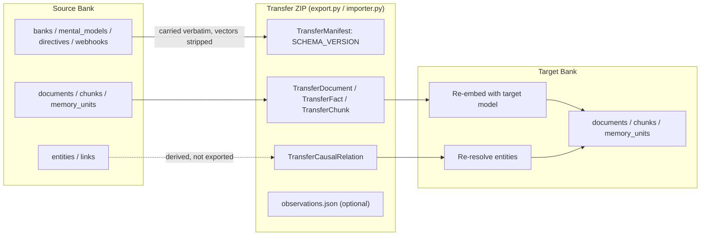

<details>
<summary>Relevant source files</summary>
The following files were used as context for generating this wiki page:
- [hindsight-api-slim/hindsight_api/api/http.py](hindsight-api-slim/hindsight_api/api/http.py)
- [hindsight-api-slim/hindsight_api/engine/response_models.py](hindsight-api-slim/hindsight_api/engine/response_models.py)
- [hindsight-api-slim/hindsight_api/engine/schema.py](hindsight-api-slim/hindsight_api/engine/schema.py)
- [hindsight-api-slim/hindsight_api/engine/transfer/importer.py](hindsight-api-slim/hindsight_api/engine/transfer/importer.py)
- [hindsight-api-slim/hindsight_api/engine/transfer/export.py](hindsight-api-slim/hindsight_api/engine/transfer/export.py)
- [hindsight-api-slim/hindsight_api/models.py](hindsight-api-slim/hindsight_api/models.py)
</details>

# HTTP API Surface

This page covers the single FastAPI application defined in `hindsight-api-slim/hindsight_api/api/http.py` — the dataplane HTTP surface for Hindsight. Every REST endpoint the control plane, CLI, and integrations use is registered here, on one `FastAPI` instance, under `/v1/default/banks/{bank_id}/...` (plus a few global routes like `/health` and `/version`). Understanding this file is a prerequisite for adding any new API parameter or endpoint, since request/response Pydantic models, route wiring, auth, audit logging, and error translation all live in this one module.

The file is large (~7,300 lines) and self-contained: the first ~3,000 lines define the request/response Pydantic models used by the routes, and the remainder (`create_app` / `_register_routes`) wires up the FastAPI app and its ~75 route handlers.

## Application Assembly

`create_app(memory, initialize_memory, http_extension)` (`hindsight-api-slim/hindsight_api/api/http.py:3038-3245`) builds the `FastAPI` instance:

- A `lifespan` context manager initializes OpenTelemetry metrics/tracing, calls `memory.initialize()` (which also runs Alembic migrations if enabled), starts the `WorkerPoller` for async operations when the backend supports it, and calls tenant/HTTP extension startup hooks.
- `app.router.route_class = ExcludeNoneRoute` is set before any route registration so `null` fields are stripped from JSON responses everywhere (`http.py:100-118`, `:3218`).
- `app.state.memory` and `app.state.audit_logger` are set immediately (not just in `lifespan`) so the app still works when mounted as a sub-application, where lifespan events may not fire (`http.py:3220-3223`).
- `GZipMiddleware` is added, and the generated OpenAPI schema is patched so `ValidationError` includes Pydantic v2's `input`/`ctx`/`url` fields, keeping generated clients (Python/TypeScript/Rust) in sync with actual 422 payloads (`http.py:3225-3245`).
- A `@app.middleware("http")` hook detects unknown query params / body fields and surfaces them via response headers rather than silently ignoring them (`http.py:3248` onward).

`_register_routes(app)` (`http.py:3366`) then registers every endpoint. It defines three cross-cutting building blocks used by nearly all routes:

- **`get_request_context`**: a FastAPI dependency that reads the `Authorization` header (`Bearer <key>` or a bare key) and returns a `RequestContext(api_key=...)` (`http.py:3372-3388`). `RequestContext` (`hindsight-api-slim/hindsight_api/models.py:14-40`) also carries `tenant_id`, `internal`, `mcp_authenticated`, `allowed_bank_ids`, `retry_count`, and a cooperative cancellation token — fields populated later by tenant-auth and the worker, not by this dependency itself.
- **`precheck_for(operation)`**: builds a `Depends(...)` that authenticates the tenant and, if an `OperationValidator` extension is configured, runs its `precheck` *before* the request body is deserialized — e.g. to reject a request with HTTP 402 when a tenant's balance is exhausted, without materializing the payload in memory (`http.py:3390-3450`).
- **`audited(action, request_param=...)`**: a decorator (built by `_make_audited_http`, `http.py:2972-3036`) that wraps a handler with fire-and-forget `AuditEntry` logging (action, bank_id, request/response JSON, timing) whenever the bank's audit logger has that action enabled.

A global `@app.exception_handler(AuthenticationError)` maps authentication failures to HTTP 401 (`http.py:3453-3460`).

```text
create_app()
 ├─ lifespan: memory.initialize() → migrations, worker poller, tenant/HTTP extension hooks
 ├─ app.state.memory / app.state.audit_logger  (set eagerly, survives sub-app mounting)
 ├─ middleware: GZip, unknown-param detection, OpenAPI ValidationError patch
 └─ _register_routes(app)
     ├─ get_request_context   → Depends(...) on every route (auth header → RequestContext)
     ├─ precheck_for(op)      → Depends(...) on billable routes (tenant auth + extension precheck)
     └─ audited("action")     → decorator on write/read routes needing audit trail
```

Sources: [hindsight-api-slim/hindsight_api/api/http.py:3038-3245](), [hindsight-api-slim/hindsight_api/api/http.py:3366-3460](), [hindsight-api-slim/hindsight_api/api/http.py:2972-3036](), [hindsight-api-slim/hindsight_api/models.py:14-40]()

## Error Handling Pattern

Nearly every handler follows the same `try/except` structure: catch `OperationValidationError` and re-raise as `HTTPException(e.status_code, e.reason)`, pass through `AuthenticationError`/`HTTPException` unchanged, catch domain-specific `ValueError`s as 400s, and fall back to a 500 with a full traceback logged server-side (e.g. `http.py:6836-6872` in the retain handler, `http.py:5957-5966` in bank-template export). Several endpoints add a domain-specific branch first — e.g. `retain` converts `MemoryDefenseAllBlockedError` into a 422 with structured `violations` (`http.py:6850-6854`), and `document-transfer` import converts archive/schema errors into 400s (`http.py:6072-6074`).

## Route Map

All routes below are mounted on the single `FastAPI` app; paths are relative to the server root (subject to `root_path`/`config.base_path`).

### Monitoring (global, not bank-scoped)

| Method | Path | Purpose |
|---|---|---|
| GET | `/health` | DB connectivity health check, 200/503 (`http.py:3462-3478`) |
| GET | `/version` | API version + `FeaturesInfo` feature flags (`http.py:3480-3518`) |
| GET | `/metrics` | Prometheus scrape endpoint (`http.py:3520-3532`) |
| GET | `/v1/bank-template-schema` | JSON schema for the bank template manifest (`http.py:6086`) |

### Banks

| Method | Path | Purpose |
|---|---|---|
| GET | `/v1/default/banks` | List banks (`http.py:4179`) |
| PUT / PATCH / DELETE | `/v1/default/banks/{bank_id}` | Create-or-replace, partial update, delete a bank (`http.py:5655`, `5711`, `5776`) |
| GET | `/v1/default/banks/{bank_id}/stats` | Bank statistics (`http.py:4201`) |
| GET | `/v1/default/banks/{bank_id}/stats/memories-timeseries` | Memory counts bucketed over time (`http.py:4299`) |
| POST | `/v1/default/banks/{bank_id}/health/llm` | Test the bank's configured LLM connection (`http.py:4260`) |
| GET / PUT | `/v1/default/banks/{bank_id}/profile` | Disposition traits + mission (`http.py:5534`, `5580`) |
| POST | `/v1/default/banks/{bank_id}/background` | Append background context (`http.py:5625`) |
| GET / PATCH / DELETE | `/v1/default/banks/{bank_id}/config` | Hierarchical config overrides (global → tenant → bank) (`http.py:6222`, `6269`, `6332`) |

### Memory (Recall / Retain / Reflect)

| Method | Path | Purpose |
|---|---|---|
| POST | `/v1/default/banks/{bank_id}/memories/recall` | Multi-strategy recall with trace (`http.py:3832`) |
| POST | `/v1/default/banks/{bank_id}/memories` | Retain memory items (sync or `async=true`) (`http.py:6698`) |
| POST | `/v1/default/banks/{bank_id}/files/retain` | Convert uploaded files into memories (`http.py:6874`) |
| DELETE | `/v1/default/banks/{bank_id}/memories` | Bulk delete (`http.py:7047`) |
| GET | `/v1/default/banks/{bank_id}/memories/list` | Paginated listing with full-text search (`http.py:3578`) |
| GET / PATCH | `/v1/default/banks/{bank_id}/memories/{memory_id}` | Fetch / update one memory unit (`http.py:3707`, `3742`) |
| GET | `/v1/default/banks/{bank_id}/memories/{memory_id}/history` | Consolidation/edit history (`http.py:3799`) |
| DELETE | `/v1/default/banks/{bank_id}/memories/{memory_id}/observations` | Clear observations sourced from a memory (`http.py:6185`) |
| POST | `/v1/default/banks/{bank_id}/reflect` | Disposition-aware reasoning over memories/mental models (`http.py:4033`) |
| POST | `/v1/default/banks/{bank_id}/memories/dry-run-extract` | Preview fact extraction without persisting (`http.py:3652`) |
| GET | `/v1/default/banks/{bank_id}/graph` | Graph data for visualization (`http.py:3534`) |
| DELETE | `/v1/default/banks/{bank_id}/observations` | Bulk-clear observations for a scope (`http.py:6098`) |
| GET | `/v1/default/banks/{bank_id}/observations/scopes` | List observation visibility scopes (`http.py:6127`) |
| POST | `/v1/default/banks/{bank_id}/consolidate` / `.../consolidation/recover` | Trigger/recover consolidation (`http.py:6381`, `6156`) |

`recall` and `retain` both accept a `RequestContext` cancellation path: `run_cancellable_on_disconnect` ties the engine call to the HTTP request so client disconnects abort in-flight work at stage boundaries instead of running to completion (`http.py:3906-3933`, `4069-4089`).

Sources: [hindsight-api-slim/hindsight_api/api/http.py:3832-3945](), [hindsight-api-slim/hindsight_api/api/http.py:6698-6873]()

### Entities, Mental Models, Directives

| Method | Path | Purpose |
|---|---|---|
| GET | `/v1/default/banks/{bank_id}/entities` , `.../entities/graph` , `.../entities/{entity_id}` | Entity listing/graph/detail (`http.py:4337`, `4373`, `4403`) |
| POST | `/v1/default/banks/{bank_id}/entities/{entity_id}/regenerate` | Re-synthesize an entity's state (`http.py:4444`) |
| GET / POST / PATCH / DELETE | `/v1/default/banks/{bank_id}/mental-models[/{id}]` | CRUD for manually configured mental models (`http.py:4469-4765`) |
| POST | `.../mental-models/{id}/refresh` , `.../clear` | Force a refresh / clear a mental model's summary (`http.py:4642`, `4682`) |
| GET / POST / PATCH / DELETE | `/v1/default/banks/{bank_id}/directives[/{id}]` | CRUD for reflect directives (`http.py:4805-4959`) |

### Documents, Chunks, Tags

| Method | Path | Purpose |
|---|---|---|
| GET | `/v1/default/banks/{bank_id}/documents` | List documents (`http.py:4993`) |
| GET / PATCH / DELETE | `.../documents/{document_id:path}` | Detail / update / delete a document (`http.py:5140`, `5275`, `5325`) |
| GET | `.../documents/{document_id:path}/chunks` | Chunks belonging to a document (`http.py:5047`) |
| POST | `.../documents/{document_id:path}/reprocess` | Re-run extraction on a document (`http.py:5093`) |
| GET | `/v1/default/chunks/{chunk_id:path}` | Fetch one chunk directly (`http.py:5244`) |
| GET | `/v1/default/banks/{bank_id}/tags` | List tags in use (`http.py:5174`) |

The `{document_id:path}` / `{chunk_id:path}` converters allow slashes in ids; the document-transfer routes are deliberately placed on a separate top-level path (not nested under `/documents/`) to avoid this greedy path converter capturing `"export"`/`"import"` as a document id (`http.py:5972-5975`, noted explicitly in the code comment).

### Operations (Async Task Tracking)

| Method | Path | Purpose |
|---|---|---|
| GET | `/v1/default/banks/{bank_id}/operations` | List async operations (`http.py:5372`) |
| GET | `.../operations/{operation_id}` | Status, progress, `result_metadata` (`http.py:5423`) |
| DELETE | `.../operations/{operation_id}` | Cancel (`http.py:5465`) |
| POST | `.../operations/{operation_id}/retry` | Retry a failed operation (`http.py:5500`) |

Async retain/import endpoints return an `operation_id` (or `operation_ids` when items are split by extraction strategy, `http.py:6761-6784`) that clients poll via this group.

### Bank Templates (Config + Mental Models + Directives as one manifest)

| Method | Path | Purpose |
|---|---|---|
| POST | `/v1/default/banks/{bank_id}/import` | Apply a `BankTemplateManifest` (creates bank if missing; supports `dry_run`) (`http.py:5812`) |
| GET | `/v1/default/banks/{bank_id}/export` | Export current config/mental-models/directives as a manifest (`http.py:5884`) |

This is distinct from Document Transfer below: it moves *configuration* (bank config overrides, mental model definitions, directives), matched by `id`/`name` on import so re-import updates existing entries rather than duplicating them (`http.py:5816-5818`).

### Document Transfer (Whole-Content Migration Between Banks)

| Method | Path | Purpose |
|---|---|---|
| GET | `/v1/default/banks/{bank_id}/document-transfer` | Export documents (facts, entities, causal links, chunks) as a ZIP archive (`http.py:5972`) |
| POST | `/v1/default/banks/{bank_id}/document-transfer` | Submit a ZIP archive for async import (`http.py:6035`) |

Both are gated by feature flags (`enable_document_export_api` / `enable_document_import_api`) returning 404 with a hint to the enabling env var when disabled (`http.py:5998-6003`, `6057-6062`). Import is always asynchronous (`status_code=202`, returns `operation_id`) and accepts `on_conflict=skip|replace|new-id` for existing document ids (`http.py:6038-6075`).

The archive format is defined in `hindsight_api/engine/transfer/export.py` and `.../transfer/importer.py`:
- Embeddings and database-internal ids are **never** exported — the importer re-embeds with the target bank's model and re-resolves entities on import (`transfer/export.py:1-8`).
- Tables fall into fixed buckets enforced by a coverage test (`test_export_bank_covers_schema`): `_REPLAYED_TABLES` (documents, chunks, memory_units, entities, links — rebuilt by replaying the payload), `_BANK_ROW_TABLES` (banks, mental_models, directives, webhooks — carried as JSON with vectors stripped), `_CARRIED_HISTORY_TABLES` (mental_model_history), `_HISTORY_TABLES` (audit_log, llm_requests, only with `include_history=True`), and `_SKIP_TABLES` (in-flight operations, transient queues, raw file storage, the curation archive) which are intentionally never exported (`transfer/export.py:37-90`).
- Consolidated observations are excluded by default and only written to `observations.json` when `include_observations=true` is passed — regenerated on import with fresh ids since there's no stable id to reattach history to (`transfer/export.py:59-65`).



Sources: [hindsight-api-slim/hindsight_api/api/http.py:5972-6085](), [hindsight-api-slim/hindsight_api/engine/transfer/export.py:1-90]()

### Webhooks

| Method | Path | Purpose |
|---|---|---|
| POST | `/v1/default/banks/{bank_id}/webhooks` | Register a webhook (secret never echoed back) (`http.py:6422`) |
| GET | `.../webhooks` | List webhooks for a bank (`http.py:6484`) |
| PATCH / DELETE | `.../webhooks/{webhook_id}` | Update / remove (`http.py:6571`, `6538`) |
| GET | `.../webhooks/{webhook_id}/deliveries` | Delivery history (`http.py:6654`) |

Webhook rows store `event_types` and `http_config` as JSON; handlers normalize both possible storage representations (string vs. dict) before building the response, and always null out `secret` in output (`http.py:6451-6474`).

### Audit Logs & LLM Traces

| Method | Path | Purpose |
|---|---|---|
| GET | `/v1/default/banks/{bank_id}/audit-logs` | Paginated audit entries, filterable by `action`/`transport`/date range (`http.py:7088`) |
| GET | `.../audit-logs/stats` | Counts bucketed by time period for charting (`http.py:7131`) |
| GET | `/v1/default/banks/{bank_id}/llm-requests` | Traced LLM calls, filterable by `status`/`operation`/`scope`/`provider`/`trace_id`/`document_id`/`memory_id`, with a `group=true` mode to paginate whole operation runs instead of individual calls (`http.py:7166-7212`) |
| GET | `.../llm-requests/stats` | LLM call counts bucketed by time + status (`http.py:7226`) |

LLM request tracing requires `HINDSIGHT_API_LLM_TRACE_ENABLED`; audit logging is controlled per-action via the audit logger's `is_enabled(action)` check inside the `audited` decorator (`http.py:2994`).

## Response Model Layering

Two distinct model layers exist by design, documented in `response_models.py`'s module docstring: **core engine models** (`MemoryFact`, `RecallResult`, `ReflectResult`, `EntityState`, `MentalModel`, `TokenUsage`, etc., in `hindsight_api/engine/response_models.py`) versus **API response models** defined inline in `http.py` (`RecallResponse`, `ReflectResponse`, `EntityDetailResponse`, ...). The API layer converts from core models so internal engine changes don't automatically break API stability — visible in `api_recall`'s `_fact_to_result` helper, which maps `MemoryFact` fields into the API's `RecallResult` explicitly rather than re-using the model (`http.py:3936-3945`).

Key shared building blocks in the core layer:
- `MemoryFact.scores` (`RecallScores`) exposes per-stage recall scoring — `semantic`, `keyword`, `reranker`, `final` — with `MinScores` letting a recall request set floors at either the retrieval stage (pruning inside the SQL arms) or post-query (filtering already-reranked results) (`response_models.py:175-213`).
- `TokenUsage` supports `__add__` so handlers can aggregate usage across multiple LLM calls within one request (e.g. retain's strategy-group loop, `http.py:6803-6825`; `response_models.py:119-127`).
- `ExtractedFact` / `DryRunExtractionResult` back the `dry-run-extract` endpoint — a deliberate subset of the persisted memory-unit shape since nothing is stored (`response_models.py:130-155`).

Sources: [hindsight-api-slim/hindsight_api/engine/response_models.py:1-8](), [hindsight-api-slim/hindsight_api/engine/response_models.py:175-213](), [hindsight-api-slim/hindsight_api/api/http.py:3936-3945]()

## Multi-Tenant Schema Qualification

`hindsight_api/engine/schema.py` provides `fq_table(table_name)`, the single helper used across the engine to schema-qualify raw SQL table references. On PostgreSQL it prefixes the table with the active schema from a context variable (`get_current_schema()`), supporting per-tenant schemas; on Oracle the schema is set at the session level via `ALTER SESSION SET CURRENT_SCHEMA`, so the bare table name is returned unchanged (`engine/schema.py:16-27`). A second helper, `fq_table_explicit`, is used by code paths that don't have access to the context variable (task backend, worker poller) and instead pass the schema explicitly (`engine/schema.py:30-41`). This underpins the hierarchical config model referenced by the bank `/config` endpoints and the tenant-scoped auth performed by `_authenticate_tenant` before most handlers touch the database.

## Summary

The HTTP API surface is one large, flat FastAPI application rather than a tree of `APIRouter`s: all Pydantic models and all route handlers for banks, memory (recall/retain/reflect), entities, mental models, directives, documents/chunks/tags, async operations, bank templates, document transfer, webhooks, and audit/LLM-trace observability live in `hindsight_api/api/http.py`, sharing three composable dependencies (`get_request_context`, `precheck_for`, `audited`) and one error-handling convention. Extending this surface — per `CLAUDE.md`'s "Control Plane API Routes" guidance — means adding the route and model here, then mirroring any new parameter into the Next.js control plane's proxy routes and `lib/api.ts` types, and regenerating the OpenAPI spec and client SDKs.

## Related pages

- page-memory-engine
- page-mcp-server
- page-sdk-clients
- page-control-plane


## Source files

- `hindsight-api-slim/hindsight_api/api/http.py`
- `hindsight-api-slim/hindsight_api/engine/response_models.py`
- `hindsight-api-slim/hindsight_api/engine/schema.py`
- `hindsight-api-slim/hindsight_api/engine/transfer/importer.py`
- `hindsight-api-slim/hindsight_api/engine/transfer/export.py`
