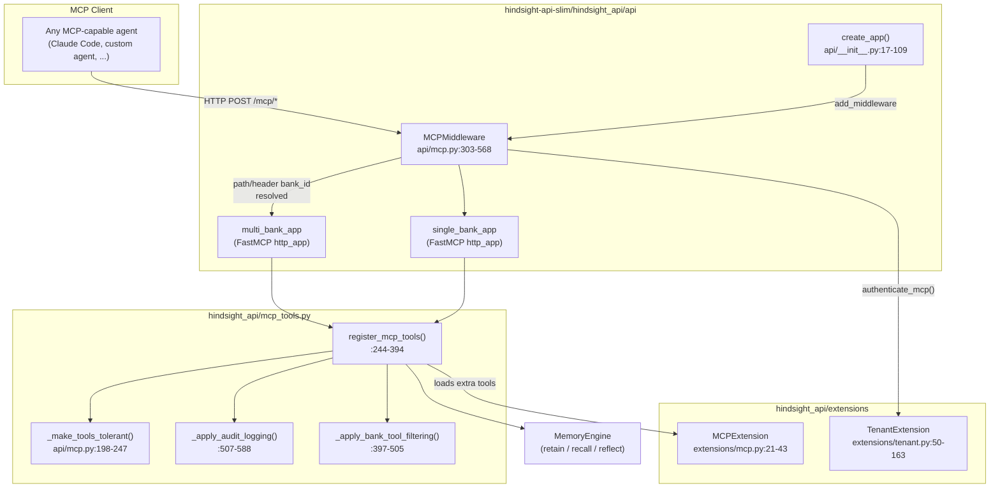
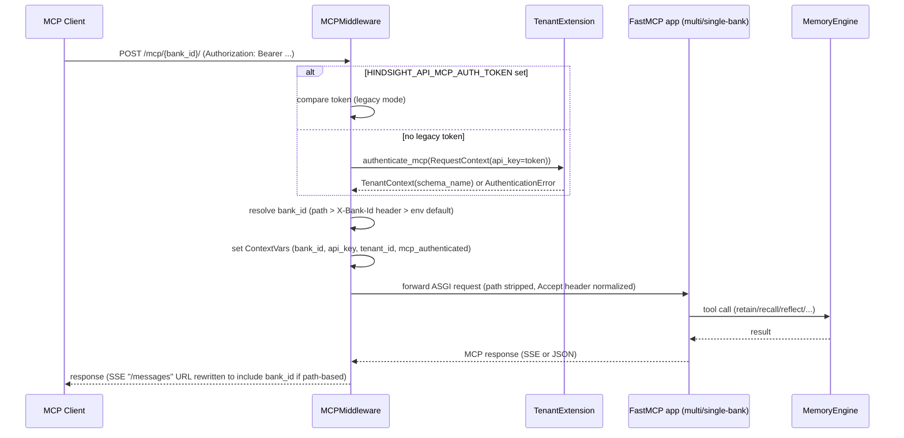

<details>
<summary>Relevant source files</summary>
The following files were used as context for generating this wiki page:
- [hindsight-api-slim/hindsight_api/api/mcp.py](hindsight-api-slim/hindsight_api/api/mcp.py)
- [hindsight-api-slim/hindsight_api/mcp_tools.py](hindsight-api-slim/hindsight_api/mcp_tools.py)
- [hindsight-api-slim/hindsight_api/extensions/mcp.py](hindsight-api-slim/hindsight_api/extensions/mcp.py)
- [hindsight-api-slim/hindsight_api/extensions/context.py](hindsight-api-slim/hindsight_api/extensions/context.py)
- [hindsight-api-slim/hindsight_api/extensions/tenant.py](hindsight-api-slim/hindsight_api/extensions/tenant.py)
- [hindsight-api-slim/hindsight_api/api/__init__.py](hindsight-api-slim/hindsight_api/api/__init__.py)
- [hindsight-api-slim/hindsight_api/config.py](hindsight-api-slim/hindsight_api/config.py)
- [hindsight-api-slim/hindsight_api/main.py](hindsight-api-slim/hindsight_api/main.py)
</details>

# Model Context Protocol (MCP) Server

Hindsight exposes its `retain`/`recall`/`reflect` memory operations as MCP tools so that any MCP-capable agent — Claude Code, a custom LangGraph agent, or any other client speaking the protocol — can read and write memory without depending on a specific LLM provider or SDK. The MCP surface lives alongside the HTTP REST API in `hindsight-api-slim/hindsight_api/api/`, sharing the same `MemoryEngine` instance and tenant/authentication machinery, but is reachable over the MCP HTTP transport at `/mcp`.

This page covers how the MCP server is constructed and mounted, how bank scoping and authentication are resolved per request, how tool arguments from imperfect LLM callers are made tolerant, and how deployments can extend the tool set through the extension system — all while keeping the design provider-neutral (BYOK/BYOC): nothing in this layer assumes a particular model vendor.

## Architecture Overview

The MCP server is built on `fastmcp.FastMCP` and is composed of three layers: an ASGI middleware that handles routing/auth, a `FastMCP` app per mode that owns the MCP protocol, and a shared tool-registration module that implements the actual memory operations against `MemoryEngine`.



Sources: [hindsight-api-slim/hindsight_api/api/mcp.py:94-179](), [hindsight-api-slim/hindsight_api/api/__init__.py:17-109](), [hindsight-api-slim/hindsight_api/mcp_tools.py:244-394]()

## Server Construction: Multi-bank vs. Single-bank Mode

`create_mcp_server()` builds one `FastMCP` instance per mode. Multi-bank mode exposes every tool, including bank-management tools (`list_banks`, `create_bank`, `delete_bank`, ...) and adds a `bank_id` parameter to bank-scoped tools. Single-bank mode restricts the tool set to `_SINGLE_BANK_TOOLS` (retain/recall/reflect and bank-scoped CRUD, but no cross-bank management) and omits `bank_id` entirely because it is implied by the connection URL.

```python
# hindsight-api-slim/hindsight_api/api/mcp.py:144-168
base_tools: frozenset[str] | None = None if multi_bank else _SINGLE_BANK_TOOLS

# Apply global mcp_enabled_tools filter (env-level allowlist)
if global_config.mcp_enabled_tools is not None:
    allowed = frozenset(global_config.mcp_enabled_tools)
    base_tools = (base_tools if base_tools is not None else _ALL_TOOLS) & allowed
...
config = MCPToolsConfig(
    bank_id_resolver=get_current_bank_id,
    api_key_resolver=get_current_api_key,
    tenant_id_resolver=get_current_tenant_id,
    api_key_id_resolver=get_current_api_key_id,
    mcp_authenticated_resolver=get_current_mcp_authenticated,
    include_bank_id_param=multi_bank,
    tools=base_tools,
    retain_description=retain_description,
    recall_description=recall_description,
)
register_mcp_tools(mcp, memory, config)
```

`create_mcp_servers()` creates both `FastMCP` instances and their Starlette `http_app()`s up front, honoring `mcp_stateless` (stateful supports GET/SSE, stateless is POST-only); `create_app()` in `api/__init__.py` then chains both apps' ASGI lifespans into the main FastAPI app's lifespan before mounting `MCPMiddleware`.

Sources: [hindsight-api-slim/hindsight_api/api/mcp.py:94-179](), [hindsight-api-slim/hindsight_api/api/mcp.py:571-590](), [hindsight-api-slim/hindsight_api/api/__init__.py:48-107]()

## Request Routing: Bank Resolution and Auth

`MCPMiddleware` is an ASGI middleware wrapping the whole FastAPI app; it only intercepts requests whose path matches the configured prefix (default `/mcp`) and passes everything else straight through.

| Bank ID source | Priority | Resulting mode |
|---|---|---|
| URL path segment, e.g. `/mcp/{bank_id}/` | 1 (highest) | Single-bank app, no `bank_id` param, scoped tools only |
| `X-Bank-Id` header | 2 | Multi-bank app, `bank_id` param available |
| `HINDSIGHT_MCP_BANK_ID` env var (default `"default"`) | 3 (fallback) | Multi-bank app |

Authentication runs before bank resolution. Two paths exist:
1. **Legacy static token** — if `HINDSIGHT_API_MCP_AUTH_TOKEN` is set, the `Authorization: Bearer <token>` header must match exactly; on success the request is flagged `mcp_pre_authenticated=True` so the tenant extension does not re-validate it.
2. **Tenant extension** — otherwise, `TenantExtension.authenticate_mcp()` is called with a `RequestContext(api_key=auth_token)`. The default implementation just calls `authenticate()`, but extensions can override `authenticate_mcp()` for MCP-specific behavior (e.g. `DefaultTenantExtension` requires no auth for local dev, `ApiKeyTenantExtension` validates against an env var).



The middleware also normalizes the `Accept` header (some clients omit `text/event-stream`, which the MCP SDK requires) and, for path-based single-bank connections, rewrites the SSE `data: /messages` endpoint event to `data: /{bank_id}/messages` so subsequent client requests keep routing to the right app. `_current_schema` (from `memory_engine.py`) is also set from `tenant_context.schema_name` so downstream DB queries use the authenticated tenant's schema.

Sources: [hindsight-api-slim/hindsight_api/api/mcp.py:381-533](), [hindsight-api-slim/hindsight_api/extensions/tenant.py:11-17](), [hindsight-api-slim/hindsight_api/extensions/tenant.py:146-163]()

## Tool Registration and Argument Tolerance

`register_mcp_tools()` in `mcp_tools.py` is the shared implementation used by both the HTTP MCP server (`api/mcp.py`) and the stdio transport (`mcp_local.py`, used by Claude Code). It conditionally registers each tool from `_ALL_TOOLS` (retain, sync_retain, recall, reflect, bank/mental-model/directive/memory/document/operation/tag CRUD) based on `MCPToolsConfig.tools`, then layers two cross-cutting behaviors on top of every registered tool:

- **`_apply_bank_tool_filtering()`** — narrows `tools/list` and tool invocation per request using the bank's `mcp_enabled_tools` config plus an optional `OperationValidatorExtension.filter_mcp_tools()` hook, which can only *narrow* the bank's allowed set, never expand it.
- **`_apply_audit_logging()`** — wraps tools in `_AUDITABLE_MCP_TOOLS` with `AuditLogger`, recording an `AuditEntry` (`transport="mcp"`, bank_id, request/response) around each call, compatible with both FastMCP 2.x (`_tool_manager`) and 3.x (`call_tool`) internals.

Each tool resolves its `RequestContext` via `_get_request_context()`, which reads `api_key`, `tenant_id`, `api_key_id`, and `mcp_authenticated` from resolver callbacks — these are populated from the `ContextVar`s that `MCPMiddleware` set during authentication, propagating auth/usage-metering state from the ASGI layer into `MemoryEngine` calls.

```python
# hindsight-api-slim/hindsight_api/mcp_tools.py:591-623 (retain tool, multi-bank mode)
@mcp.tool(description=description, annotations=_tool_annotations("retain"))
async def retain(
    content: str,
    context: str = "general",
    ...
    bank_id: str | None = None,
    strategy: str | None = None,
    update_mode: str | None = None,
) -> dict:
    target_bank = bank_id or config.bank_id_resolver()
    if target_bank is None:
        return {"status": "error", "message": "No bank_id configured"}
    ...
    result = await memory.submit_async_retain(
        bank_id=target_bank, contents=[content_dict], request_context=request_context,
    )
```

Tools are annotated via `_tool_annotations()` as read-only, destructive, or plain-write (based on the `_READ_ONLY_TOOLS` / `_DESTRUCTIVE_TOOLS` sets), which surfaces MCP `ToolAnnotations` hints (`readOnlyHint`, `destructiveHint`) to clients.

Separately, `create_mcp_server()` calls `_make_tools_tolerant()` on the fully assembled `FastMCP` instance. This addresses two real-world LLM tool-calling failure modes:
- **Unknown extra arguments** (e.g. an `"explanation"` field some models add) are stripped before Pydantic validation, which otherwise rejects them because `FunctionTool` uses `extra='forbid'`.
- **String-encoded JSON** for array/object parameters (e.g. `tags='["a","b"]'` instead of a native list) is detected via each tool's JSON Schema (including `anyOf`/`oneOf` unions) and parsed back into native types with `_coerce_string_json()`.

```python
# hindsight-api-slim/hindsight_api/api/mcp.py:226-241
async def _tolerant_run(arguments, _allowed=allowed, _orig=original_run, ...):
    extra_keys = set(arguments.keys()) - _allowed
    if extra_keys:
        arguments = {k: v for k, v in arguments.items() if k in _allowed}
    arguments = _coerce_string_json(arguments, _array_params, _object_params)
    return await _orig(arguments)
```

This wrapping is applied via `object.__setattr__(tool, "run", _tolerant_run)` because FastMCP's `FunctionTool` is a Pydantic model with `extra='forbid'`, so the tool's own `run` attribute cannot be reassigned through the normal setter.

Sources: [hindsight-api-slim/hindsight_api/mcp_tools.py:34-118](), [hindsight-api-slim/hindsight_api/mcp_tools.py:210-394](), [hindsight-api-slim/hindsight_api/api/mcp.py:198-300]()

## Extending the Tool Set

Deployments (e.g. hosted/cloud variants) can register additional MCP tools without forking this module by implementing `MCPExtension`:

```python
# hindsight-api-slim/hindsight_api/extensions/mcp.py:21-42
class MCPExtension(Extension):
    @abstractmethod
    def register_tools(self, mcp: FastMCP, memory: MemoryEngine) -> None:
        """Register additional MCP tools. e.g.:
        @mcp.tool()
        async def my_custom_tool(query: str) -> str: ...
        """
```

`create_mcp_server()` loads this via `load_extension("MCP", MCPExtension)` (env var `HINDSIGHT_API_MCP_EXTENSION`) and calls `register_tools(mcp, memory)` after the built-in tools are registered, but before `_make_tools_tolerant()` runs — so extension-registered tools also get the argument-tolerance wrapping. Because the extension only receives the `FastMCP` instance and `MemoryEngine`, and not raw database/config internals, it stays decoupled from a specific provider or hosting model — the same pattern used by `TenantExtension` and `OperationValidatorExtension`.

Extensions needing infrastructure access (schema migrations, the memory-engine interface) go through `ExtensionContext` rather than touching `MemoryEngine` internals directly:

```python
# hindsight-api-slim/hindsight_api/extensions/context.py:37-73
class ExtensionContext(ABC):
    async def run_migration(self, schema: str) -> None: ...
    def get_memory_engine(self) -> "MemoryEngineInterface": ...
```

`DefaultExtensionContext` is the built-in implementation, running `run_migrations()` off the event loop thread (`asyncio.to_thread`) to avoid deadlocking `CREATE INDEX CONCURRENTLY` against in-flight asyncpg transactions in single-process deployments.

Sources: [hindsight-api-slim/hindsight_api/extensions/mcp.py:1-43](), [hindsight-api-slim/hindsight_api/extensions/context.py:11-171](), [hindsight-api-slim/hindsight_api/api/mcp.py:170-179]()

## Configuration

| Env var | Field | Default | Effect |
|---|---|---|---|
| `HINDSIGHT_API_MCP_ENABLED` | `mcp_enabled` | provider default | Mounts the MCP server at all (`create_app(..., mcp_api_enabled=...)`) |
| `HINDSIGHT_API_MCP_ENABLED_TOOLS` | `mcp_enabled_tools` | `None` (all tools) | Comma-separated server-wide tool allowlist, intersected with mode's base tool set |
| `HINDSIGHT_API_MCP_STATELESS` | `mcp_stateless` | `False` | `False` = stateful HTTP (supports GET/SSE); `True` = stateless (POST-only) |
| `HINDSIGHT_API_MCP_INSTRUCTIONS` | `mcp_instructions` | `None` | Appended as "Additional instructions" suffix to the default retain/recall tool descriptions |
| `HINDSIGHT_API_MCP_AUTH_TOKEN` | (module-level, `mcp.py`) | unset | Legacy static bearer-token auth, checked before `TenantExtension.authenticate_mcp()` |
| `HINDSIGHT_MCP_BANK_ID` | `DEFAULT_BANK_ID` | `"default"` | Fallback bank when neither URL path nor `X-Bank-Id` header supplies one |
| `HINDSIGHT_API_MCP_EXTENSION` | (extension loader) | unset | Import path to an `MCPExtension` subclass, e.g. `pkg.module:MyMCPExtension` |

Bank-level `mcp_enabled_tools` (resolved per request through `MemoryEngine._config_resolver.get_bank_config()`) can further restrict tools below the server-wide allowlist, and an `OperationValidatorExtension.filter_mcp_tools()` hook can narrow it further still — this three-layer allowlist (server env → bank config → operation validator) is intersection-only, so no layer can re-enable a tool a stricter layer disabled.

Sources: [hindsight-api-slim/hindsight_api/config.py:444-447](), [hindsight-api-slim/hindsight_api/config.py:930-931](), [hindsight-api-slim/hindsight_api/config.py:1786-1788](), [hindsight-api-slim/hindsight_api/config.py:2745-2750](), [hindsight-api-slim/hindsight_api/mcp_tools.py:397-431]()

## Summary

The MCP server is a thin, provider-neutral adapter: `MCPMiddleware` owns transport-level concerns (routing `/mcp/{bank_id}/` vs. `/mcp` + `X-Bank-Id`, authentication via `TenantExtension` or a legacy static token, SSE header rewriting), while `mcp_tools.register_mcp_tools()` owns the actual tool implementations shared with the stdio transport used by Claude Code (`mcp_local.py`). Argument tolerance (`_make_tools_tolerant`) and layered tool filtering/audit logging are applied uniformly regardless of which MCP client or model provider is calling in, and the `MCPExtension`/`ExtensionContext` seam lets deployments add tools or infrastructure hooks without depending on a specific hosting stack. Because bank scoping, auth, and tool visibility are all resolved per-request through `ContextVar`s and pluggable extensions rather than hardcoded assumptions, the same server binary supports single-tenant local dev and multi-tenant hosted deployments alike.

Sources: [hindsight-api-slim/hindsight_api/api/mcp.py:1-591](), [hindsight-api-slim/hindsight_api/mcp_tools.py:1-70]()

## Related pages

- page-http-api
- page-extensions-tenancy
- page-integrations-library


## Source files

- `hindsight-api-slim/hindsight_api/api/mcp.py`
- `hindsight-api-slim/hindsight_api/extensions/mcp.py`
- `hindsight-api-slim/hindsight_api/extensions/context.py`
