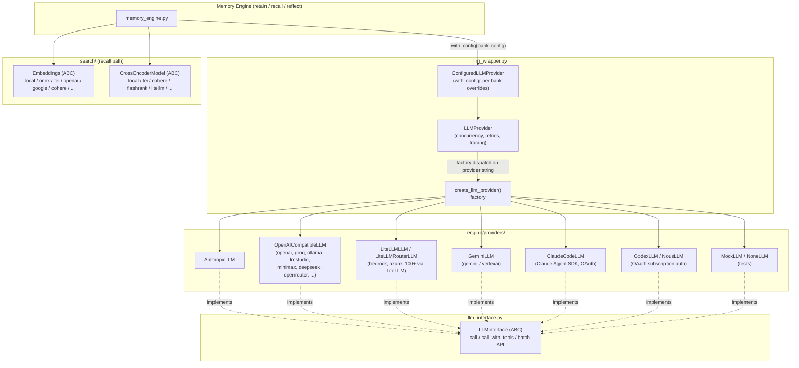
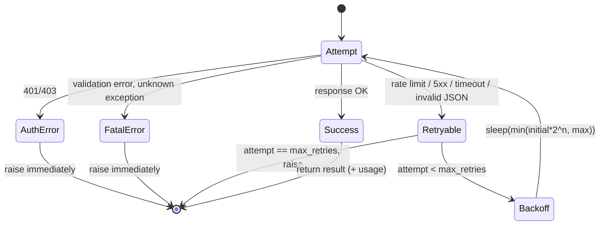

<details>
<summary>Relevant source files</summary>
The following files were used as context for generating this wiki page:
- [hindsight-api-slim/hindsight_api/engine/llm_wrapper.py](hindsight-api-slim/hindsight_api/engine/llm_wrapper.py)
- [hindsight-api-slim/hindsight_api/engine/llm_interface.py](hindsight-api-slim/hindsight_api/engine/llm_interface.py)
- [hindsight-api-slim/hindsight_api/engine/providers/__init__.py](hindsight-api-slim/hindsight_api/engine/providers/__init__.py)
- [hindsight-api-slim/hindsight_api/engine/providers/anthropic_llm.py](hindsight-api-slim/hindsight_api/engine/providers/anthropic_llm.py)
- [hindsight-api-slim/hindsight_api/engine/providers/litellm_llm.py](hindsight-api-slim/hindsight_api/engine/providers/litellm_llm.py)
- [hindsight-api-slim/hindsight_api/engine/providers/claude_code_llm.py](hindsight-api-slim/hindsight_api/engine/providers/claude_code_llm.py)
- [hindsight-api-slim/hindsight_api/engine/embeddings.py](hindsight-api-slim/hindsight_api/engine/embeddings.py)
- [hindsight-api-slim/hindsight_api/engine/cross_encoder.py](hindsight-api-slim/hindsight_api/engine/cross_encoder.py)
</details>

# LLM Wrapper, Providers & Embeddings

Hindsight is model-agnostic by design: every call to a language model, embedding model, or reranker goes through an internal abstraction layer rather than a hard-coded SDK. This page covers the three pieces that make that possible — the `LLMProvider` wrapper that every part of the engine calls, the `LLMInterface` contract that concrete providers implement (OpenAI-compatible, Anthropic, LiteLLM, Claude Code, and a dozen others), and the parallel `Embeddings`/`CrossEncoderModel` abstractions used for recall. The design is explicitly BYOK/BYOC (bring your own key/compute): nothing in the core engine assumes a specific vendor, and local-only deployments (Ollama, LM Studio, local SentenceTransformers) are first-class, not fallbacks.

## Architecture Overview



`LLMProvider` is the single entry point the rest of the engine uses; it never talks to a vendor SDK directly. It resolves configuration, applies concurrency limits, retries, and tracing, then delegates to a concrete `LLMInterface` implementation chosen by `create_llm_provider()`.

Sources: [hindsight-api-slim/hindsight_api/engine/llm_wrapper.py:249-519](), [hindsight-api-slim/hindsight_api/engine/llm_wrapper.py:521-769](), [hindsight-api-slim/hindsight_api/engine/providers/__init__.py:1-31]()

## The `LLMProvider` Wrapper

`LLMProvider` (aliased as `LLMConfig` for backward compatibility) is a facade that every caller in the engine uses uniformly regardless of the underlying vendor. Its constructor validates the `provider` name against a fixed allowlist, fills in provider-specific default base URLs (e.g. Groq, Ollama, DeepSeek, OpenRouter, Z.ai, Nous), and then delegates actual instantiation to `create_llm_provider()`.

Key responsibilities layered on top of the raw provider call:

- **Concurrency control**: a global `asyncio.Semaphore` (`HINDSIGHT_API_LLM_MAX_CONCURRENT`) caps total in-flight LLM calls, and optional per-operation semaphores (retain/reflect/consolidation) let operators reserve headroom without a second global cap — a call acquires both its per-op semaphore (if configured) and the global one.
- **Retry policy resolution**: `max_retries` / `initial_backoff` / `max_backoff` are resolved in a chain — explicit per-call argument, then the provider's configured per-operation/global default, then a hardcoded fallback (10 retries / 1.0s / 60.0s for `call()`, 5 / 1.0s / 30.0s for `call_with_tools()`).
- **Strict schema flag**: OR's the per-call `strict_schema` argument with the server-level `HINDSIGHT_API_LLM_STRICT_SCHEMA` flag so grammar-enforced structured output can be turned on globally.
- **Tracing/observability**: wraps every call with `get_span_recorder().record_llm_call(...)`, attaching provider-reported token usage even on error paths (parse/validation failures that occur after the provider has already billed tokens).
- **Stage breadcrumbs**: calls `set_stage(f"llm.{provider}.{scope}...")` so a stuck worker's current LLM call is visible in logs.

```python
# hindsight-api-slim/hindsight_api/engine/llm_wrapper.py:817-831
async def call(
    self,
    messages: list[dict[str, str]],
    response_format: Any | None = None,
    max_completion_tokens: int | None = None,
    temperature: float | None = None,
    scope: str = "memory",
    ...
) -> Any:
```

Sources: [hindsight-api-slim/hindsight_api/engine/llm_wrapper.py:42-107](), [hindsight-api-slim/hindsight_api/engine/llm_wrapper.py:817-978](), [hindsight-api-slim/hindsight_api/engine/llm_wrapper.py:601-768]()

### Bank-scoped configuration: `ConfiguredLLMProvider`

`LLMProvider.with_config(config, bank_id=..., operation=...)` returns a `ConfiguredLLMProvider` — a thin proxy that applies per-bank overrides (currently Gemini safety settings) via a `ContextVar` around each call, and binds an `LLMTraceContext` so that every LLM call made through it is attributed to the right bank/operation in trace rows. Attribute access falls through to the wrapped `LLMProvider` via `__getattr__`, so callers reading `llm.provider` / `llm.model` see no difference.

Sources: [hindsight-api-slim/hindsight_api/engine/llm_wrapper.py:1213-1254](), [hindsight-api-slim/hindsight_api/engine/llm_wrapper.py:1350-1435]()

## The Provider Abstraction: `LLMInterface`

Every concrete provider subclasses the `LLMInterface` ABC (`hindsight_api/engine/llm_interface.py`), which defines the contract `LLMProvider` delegates to:

| Method | Purpose |
|---|---|
| `call(messages, response_format, ...)` | Single-turn completion; optional Pydantic `response_format` for structured output |
| `call_with_tools(messages, tools, tool_choice, ...)` | Tool/function calling in OpenAI tool-schema format |
| `verify_connection()` | Startup health check — makes one real, cheap call |
| `supports_batch_api()` / `submit_batch()` / `get_batch_status()` / `retrieve_batch_results()` | Optional 50%-cheaper async batch API (Anthropic, OpenAI-compatible providers that support it) |
| `supports_prompt_caching()` / `get_or_create_cached_prefix()` | Optional prefix caching; each provider picks its own strategy (see below) |
| `cleanup()` | Close SDK clients / stop subprocesses |

The `cached_prefix` mechanism is worth calling out: the engine decides *what* is cacheable (stable, bank-agnostic system instructions vs. per-request data), and each provider decides *how*:
- **Explicit-cache providers** (Gemini `CachedContent`): create a cache object, return a handle; the engine passes it back on the next call.
- **Automatic-cache providers** (OpenAI-compatible): no handle needed, since a stable leading prompt block is cached transparently server-side.
- **Inline-marker providers** (Anthropic): mark the prefix in-place with `cache_control` on every call rather than needing a handle.

Sources: [hindsight-api-slim/hindsight_api/engine/llm_interface.py:1-108](), [hindsight-api-slim/hindsight_api/engine/llm_interface.py:151-198]()

### Registered Providers

`create_llm_provider()` in `llm_wrapper.py` is the single dispatch point mapping a `provider` string to a concrete class:

| Provider string(s) | Implementation | Notes |
|---|---|---|
| `openai`, `groq`, `ollama`, `ollama-cloud`, `lmstudio`, `minimax`, `deepseek`, `volcano`, `openrouter`, `requesty`, `zai`, `opencode-go`, `atlas` | `OpenAICompatibleLLM` | Shared OpenAI-wire-format client; default base URLs auto-filled per provider |
| `anthropic` | `AnthropicLLM` | Native Anthropic Messages API, prompt caching, forced-tool structured output, Message Batches API |
| `litellm` | `LiteLLMLLM` | Routes through the LiteLLM SDK (`litellm.acompletion`) — 100+ providers (Azure, Together AI, etc.) |
| `litellmrouter` | `LiteLLMRouterLLM` | LiteLLM `Router`-backed multi-deployment routing/fallback; requires `litellmrouter_config` |
| `bedrock` | `LiteLLMLLM` (alias) | Auto-prefixes model with `bedrock/`; reuses the LiteLLM path |
| `gemini`, `vertexai` | `GeminiLLM` | Native `google.genai` SDK; supports safety settings, service tiers, prompt caching |
| `claude-code` | `ClaudeCodeLLM` | Uses Claude Pro/Max subscription via the Claude Agent SDK — no API key |
| `openai-codex` | `CodexLLM` | ChatGPT Plus/Pro OAuth via Codex's `auth.json` |
| `nous` | `NousLLM` | Nous Portal, rotating JWT auth from `~/.hermes/auth.json` |
| `llamacpp` | `LlamaCppLLM` | In-process `llama.cpp` subprocess for local GGUF models |
| `fireworks` | `FireworksLLM` | Adds Fireworks' native batch API on top of its OpenAI-compatible online path |
| `mock`, `none` | `MockLLM`, `NoneLLM` | Deterministic providers used in tests |

Providers that don't require an API key (`ollama`, `lmstudio`, `llamacpp`, `openai-codex`, `claude-code`, `mock`, `none`, `vertexai`, `litellm`, `litellmrouter`, `bedrock`, `nous`) are tracked in `_PROVIDERS_WITHOUT_API_KEY` and checked via `requires_api_key()`.

Sources: [hindsight-api-slim/hindsight_api/engine/llm_wrapper.py:215-235](), [hindsight-api-slim/hindsight_api/engine/llm_wrapper.py:249-518](), [hindsight-api-slim/hindsight_api/engine/providers/__init__.py:1-31]()

### Provider Deep Dive: Anthropic, LiteLLM, Claude Code

These three illustrate the range of integration strategies the abstraction supports:

**`AnthropicLLM`** ([anthropic_llm.py](hindsight-api-slim/hindsight_api/engine/providers/anthropic_llm.py)) talks to the native Messages API. It converts OpenAI-style `messages` (with a `system` role) into Anthropic's `system` + `messages` split, and for structured output prefers a **forced tool_use** call (`strict_schema=True`) over injecting the JSON schema into the prompt and parsing text — this gives native constrained decoding instead of a fragile "hope the JSON parses" retry loop. It also implements the Message Batches API (`submit_batch`/`get_batch_status`/`retrieve_batch_results`) for the 50% batch discount, translating between the OpenAI-JSONL shape the engine uses and Anthropic's native batch format.

```python
# hindsight-api-slim/hindsight_api/engine/providers/anthropic_llm.py:250-256
if use_forced_tool:
    call_params["tools"] = [
        {"name": _tool_name, "description": "Return the structured response.", "input_schema": schema}
    ]
    call_params["tool_choice"] = {"type": "tool", "name": _tool_name}
```

**`LiteLLMLLM`** ([litellm_llm.py](hindsight-api-slim/hindsight_api/engine/providers/litellm_llm.py)) is the "universal" adapter — it calls `litellm.acompletion()`, letting LiteLLM normalize parameters across 100+ backends (Bedrock, Azure OpenAI, Together AI, Fireworks). It sets `litellm.drop_params = True` so unsupported parameters (e.g. `tool_choice` on some Bedrock models) are silently dropped instead of erroring, caps `max_completion_tokens` per-model using LiteLLM's own token registry (`litellm.get_max_tokens`), and wraps every completion in a hard `asyncio.wait_for(timeout=...)` because LiteLLM/httpx don't always honor their own `timeout=` parameter — this is the backstop that prevents one hung call from pinning a worker slot indefinitely. `LiteLLMRouterLLM` (a subclass) overrides the completion call to go through `litellm.Router` for multi-deployment routing/fallback.

**`ClaudeCodeLLM`** ([claude_code_llm.py](hindsight-api-slim/hindsight_api/engine/providers/claude_code_llm.py)) is the odd one out: it doesn't call an HTTP API at all. It spawns the Claude Agent SDK's `query()` against a CLI authenticated via `claude auth login` (Claude Pro/Max subscription auth, no API key). It isolates the subprocess with a dedicated `CLAUDE_CONFIG_DIR` and empty `CLAUDE_SECURESTORAGE_CONFIG_DIR`, specifically to stop operator-installed plugins (e.g. a Hindsight memory plugin) with `Stop` hooks from firing inside the LLM-call subprocess and recursively retaining the subprocess's own transcript back into the same bank. Since the SDK doesn't report exact token counts, it estimates usage as `len(text) // 4`. Tool calling uses `ClaudeSDKClient` with a dynamically built SDK MCP server (`create_sdk_mcp_server`) rather than `query()`, because custom tools are only supported through the client interface.

```python
# hindsight-api-slim/hindsight_api/engine/providers/claude_code_llm.py:39-49
def _get_isolated_claude_env() -> dict[str, str]:
    """Return a process-lifetime env dict that isolates the spawned CLI from user plugins."""
    ...
    _isolated_claude_env = {
        "CLAUDE_CONFIG_DIR": path,
        "CLAUDE_SECURESTORAGE_CONFIG_DIR": "",
    }
```

Sources: [hindsight-api-slim/hindsight_api/engine/providers/anthropic_llm.py:222-256](), [hindsight-api-slim/hindsight_api/engine/providers/anthropic_llm.py:702-793](), [hindsight-api-slim/hindsight_api/engine/providers/litellm_llm.py:97-108](), [hindsight-api-slim/hindsight_api/engine/providers/litellm_llm.py:170-190](), [hindsight-api-slim/hindsight_api/engine/providers/litellm_llm.py:252-267](), [hindsight-api-slim/hindsight_api/engine/providers/claude_code_llm.py:26-49](), [hindsight-api-slim/hindsight_api/engine/providers/claude_code_llm.py:375-421]()

## Retry and Error Handling Pattern

Every provider's `call()` implements the same shape: a bounded retry loop (`for attempt in range(max_retries + 1)`) with exponential backoff (`min(initial_backoff * 2**attempt, max_backoff)`, plus jitter in some providers), fast-failing on auth errors (401/403) rather than burning retry budget, and re-raising after retries are exhausted.



A recurring subtlety across providers (Anthropic, LiteLLM, Claude Code) is **usage-before-parse**: token usage is stashed via `stash_response_usage()` immediately after the provider responds, *before* JSON parsing or Pydantic validation runs — because a local parse/validation failure can occur even though the provider already billed for the tokens, and the error trace should reflect that real cost rather than zero.

Sources: [hindsight-api-slim/hindsight_api/engine/providers/anthropic_llm.py:263-410](), [hindsight-api-slim/hindsight_api/engine/providers/litellm_llm.py:246-399]()

## Embeddings Abstraction

The `Embeddings` ABC ([embeddings.py](hindsight-api-slim/hindsight_api/engine/embeddings.py)) defines `provider_name`, `dimension`, `initialize()`, and `encode()`, plus optional `encode_query()`/`encode_documents()` overrides for providers with asymmetric (query vs. document) embeddings. The embedding dimension is **auto-detected** at initialization (via a test embedding or the model's known dimension table) and the database schema adapts to match — there is no hardcoded dimension.

| Provider | Class | Notes |
|---|---|---|
| `local` (default) | `LocalSTEmbeddings` | SentenceTransformers, auto GPU/MPS/XPU detection, `BAAI/bge-small-en-v1.5` default |
| `onnx` | `OnnxEmbeddings` | In-process ONNX Runtime, avoids a sidecar server; supports E5-style query/passage prefixes |
| `tei` | `RemoteTEIEmbeddings` | HuggingFace Text Embeddings Inference HTTP server |
| `openai` | `OpenAIEmbeddings` | `text-embedding-3-small/large`, supports Azure via query-param base URLs |
| `openai-codex` | `CodexOAuthEmbeddings` | Reuses the Codex/ChatGPT OAuth token for OpenAI's embeddings endpoint |
| `google` | `GeminiEmbeddings` | Gemini API or Vertex AI; forces batch_size=1 for aggregating models (`gemini-embedding-2*`) |
| `cohere` | `CohereEmbeddings` | Supports Matryoshka `output_dimensions` via the v2 API |
| `zeroentropy` | `ZeroEntropyEmbeddings` | Non-OpenAI-compatible `/v1/models/embed`; explicit `encode_query`/`encode_documents` |
| `litellm` / `litellm-sdk` | `LiteLLMEmbeddings` / `LiteLLMSDKEmbeddings` | Proxy or direct-SDK access to LiteLLM's embedding providers |

`create_embeddings_from_env()` reads `HINDSIGHT_API_EMBEDDINGS_PROVIDER` (via `get_config()`) and instantiates the matching class, raising a `ValueError` listing supported providers for anything unrecognized.

Sources: [hindsight-api-slim/hindsight_api/engine/embeddings.py:79-129](), [hindsight-api-slim/hindsight_api/engine/embeddings.py:1564-1721]()

## Reranking (Cross-Encoder) Abstraction

`CrossEncoderModel` ([cross_encoder.py](hindsight-api-slim/hindsight_api/engine/cross_encoder.py)) mirrors the embeddings pattern: `provider_name`, `initialize()`, and `predict(pairs: list[tuple[query, doc]]) -> list[float]`. Recall's reranking stage uses this to re-score the fused candidate set from the four parallel retrieval strategies.

| Provider | Class | Notes |
|---|---|---|
| `local` (default) | `LocalSTCrossEncoder` | `cross-encoder/ms-marco-MiniLM-L-6-v2`; dedicated `ThreadPoolExecutor` to bound CPU concurrency; optional bucket-batching (36-54% speedup) and FP16 |
| `tei` | `RemoteTEICrossEncoder` | TEI `/rerank`; requests grouped by query, global semaphore backpressure across all recall operations |
| `flashrank` | `FlashRankCrossEncoder` | CPU-only, no PyTorch dependency, ideal for serverless cold starts |
| `cohere` | `CohereCrossEncoder` | Native SDK, or Cohere-compatible HTTP client when `base_url` is set (e.g. Azure AI Foundry) |
| `zeroentropy`, `siliconflow` | `ZeroEntropyCrossEncoder`, `SiliconFlowCrossEncoder` | Both reuse `_CohereCompatibleRerankClient` — a shared internal HTTP client for the Cohere-wire-format `/rerank` endpoint |
| `litellm` / `litellm-sdk` | `LiteLLMCrossEncoder` / `LiteLLMSDKCrossEncoder` | Proxy or SDK access to LiteLLM's rerank providers (Bedrock, Voyage, Jina, Together AI, ...) |
| `jina-mlx` | `JinaMLXCrossEncoder` | Apple Silicon MLX-native listwise reranker, no PyTorch |
| `google` | `GoogleCrossEncoder` | Google Discovery Engine Ranking REST API |
| `rrf` | `RRFPassthroughCrossEncoder` | Disables neural reranking; returns neutral 0.5 scores so upstream RRF fusion ranking is preserved as-is |

A shared internal client, `_CohereCompatibleRerankClient`, is a good example of the codebase's reuse discipline: rather than three near-duplicate HTTP implementations, ZeroEntropy, SiliconFlow, and custom-base-URL Cohere all compose the same request/response translation.

Sources: [hindsight-api-slim/hindsight_api/engine/cross_encoder.py:89-124](), [hindsight-api-slim/hindsight_api/engine/cross_encoder.py:559-637](), [hindsight-api-slim/hindsight_api/engine/cross_encoder.py:841-874]()

## Design Notes: BYOK/BYOC and Portability

The architecture keeps three properties consistent across all three abstractions (LLM, embeddings, reranker):

1. **No provider is privileged in the core engine.** `memory_engine.py` and the retrieval/retain pipelines call `LLMProvider`, `Embeddings`, and `CrossEncoderModel` only through their abstract interfaces; provider selection is entirely a config/env-var concern (`HINDSIGHT_API_LLM_PROVIDER`, `HINDSIGHT_API_EMBEDDINGS_PROVIDER`, `HINDSIGHT_API_RERANKER_PROVIDER`).
2. **Local-first is a real option, not a stub.** `local` embeddings and reranking run in-process with no network dependency (SentenceTransformers/ONNX), and `ollama`/`lmstudio`/`llamacpp` give a fully local LLM path — useful for air-gapped or cost-sensitive deployments (`HINDSIGHT_API_LLM_MAX_CONCURRENT=1` is recommended for local LLM servers per the module docstring).
3. **Config resolution stays out of the constructors.** Per `LLMProvider.__init__`'s docstring, the constructor uses every argument exactly as passed and never reads global `HindsightConfig` itself — the caller (`MemoryEngine`, `LLMProvider.from_env()`, or a per-bank config resolver) is responsible for resolving hierarchical (global → tenant → bank) defaults before constructing it. This keeps a provider's effective settings a pure function of its arguments, which is what lets a multi-LLM chain configure each member independently.

This separation is what makes the system portable across file-based, self-hosted, and hosted catalog sources for models: swapping a provider is a configuration change, not a code change, and no part of the retain/recall/reflect pipeline needs to know which vendor answered a given call.

Sources: [hindsight-api-slim/hindsight_api/engine/llm_wrapper.py:42-45](), [hindsight-api-slim/hindsight_api/engine/llm_wrapper.py:593-600]()

## Related pages

- page-search-retrieval
- page-retain-pipeline
- page-deployment-and-config


## Source files

- `hindsight-api-slim/hindsight_api/engine/llm_wrapper.py`
- `hindsight-api-slim/hindsight_api/engine/providers/anthropic_llm.py`
- `hindsight-api-slim/hindsight_api/engine/providers/litellm_llm.py`
- `hindsight-api-slim/hindsight_api/engine/providers/claude_code_llm.py`
- `hindsight-api-slim/hindsight_api/engine/embeddings.py`
- `hindsight-api-slim/hindsight_api/engine/cross_encoder.py`
