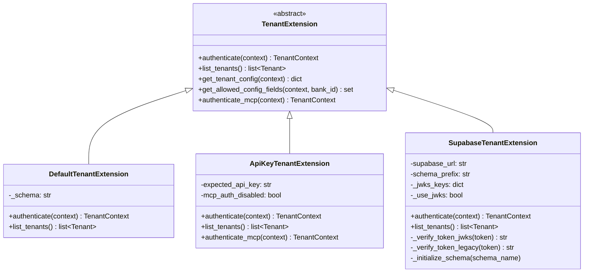
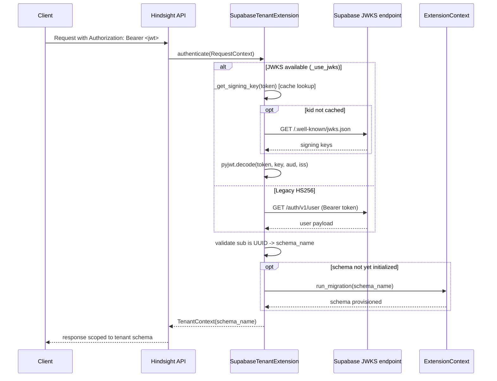
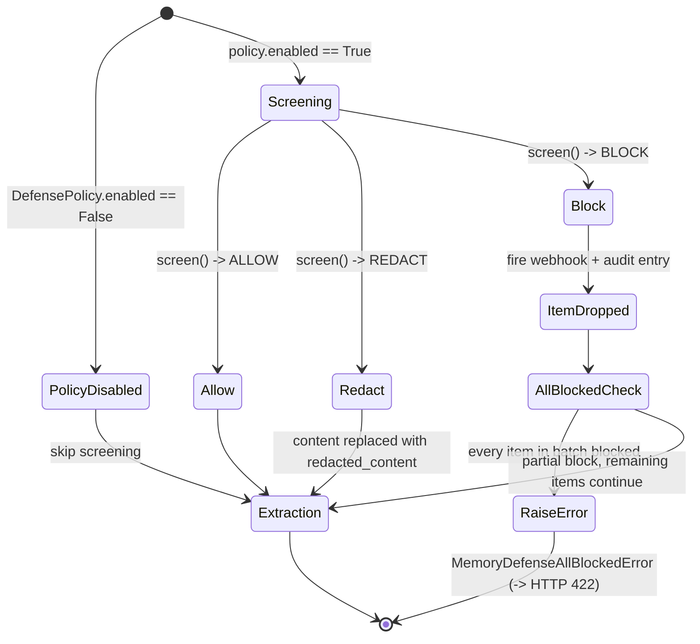

<details>
<summary>Relevant source files</summary>
The following files were used as context for generating this wiki page:
- [hindsight-api-slim/hindsight_api/extensions/base.py](hindsight-api-slim/hindsight_api/extensions/base.py)
- [hindsight-api-slim/hindsight_api/extensions/tenant.py](hindsight-api-slim/hindsight_api/extensions/tenant.py)
- [hindsight-api-slim/hindsight_api/extensions/loader.py](hindsight-api-slim/hindsight_api/extensions/loader.py)
- [hindsight-api-slim/hindsight_api/extensions/memory_defense.py](hindsight-api-slim/hindsight_api/extensions/memory_defense.py)
- [hindsight-api-slim/hindsight_api/extensions/operation_validator.py](hindsight-api-slim/hindsight_api/extensions/operation_validator.py)
- [hindsight-api-slim/hindsight_api/extensions/context.py](hindsight-api-slim/hindsight_api/extensions/context.py)
- [hindsight-api-slim/hindsight_api/extensions/http.py](hindsight-api-slim/hindsight_api/extensions/http.py)
- [hindsight-api-slim/hindsight_api/extensions/mcp.py](hindsight-api-slim/hindsight_api/extensions/mcp.py)
- [hindsight-api-slim/hindsight_api/extensions/builtin/supabase_tenant.py](hindsight-api-slim/hindsight_api/extensions/builtin/supabase_tenant.py)
- [hindsight-api-slim/hindsight_api/extensions/builtin/tenant.py](hindsight-api-slim/hindsight_api/extensions/builtin/tenant.py)
- [hindsight-api-slim/hindsight_api/extensions/builtin/memory_defense_regex.py](hindsight-api-slim/hindsight_api/extensions/builtin/memory_defense_regex.py)
- [hindsight-api-slim/hindsight_api/main.py](hindsight-api-slim/hindsight_api/main.py)
- [hindsight-api-slim/hindsight_api/engine/memory_engine.py](hindsight-api-slim/hindsight_api/engine/memory_engine.py)
- [hindsight-api-slim/hindsight_api/engine/retain/orchestrator.py](hindsight-api-slim/hindsight_api/engine/retain/orchestrator.py)
- [hindsight-api-slim/hindsight_api/config.py](hindsight-api-slim/hindsight_api/config.py)
</details>

# Extensions & Multi-Tenancy

Hindsight ships as a single-tenant, no-auth server by default, but production deployments need custom authentication, per-tenant database isolation, request-level policy enforcement, and content screening. Rather than forking core code, Hindsight exposes an **extension-point system**: a small set of abstract base classes that a deployment implements and wires in purely through environment variables. Extensions are discovered and instantiated by a generic loader, given a restricted `ExtensionContext` (not raw internals), and invoked at well-defined points in the retain/recall/reflect pipeline.

This page covers the extension contract (`Extension`, `ExtensionContext`, the loader), the two extension types most relevant to multi-tenancy and safety (`TenantExtension`, `MemoryDefenseExtension`), and their built-in implementations (`SupabaseTenantExtension`, `ApiKeyTenantExtension`/`DefaultTenantExtension`, `MemoryDefenseRegexExtension`). `OperationValidatorExtension`, `HttpExtension`, and `MCPExtension` are also part of the same system and are covered for completeness.

## The Extension Contract

All extension types derive from `Extension` (`hindsight_api/extensions/base.py`), which defines:

- `__init__(self, config: dict[str, str])` — receives configuration collected from prefixed environment variables (keys lowercased, prefix stripped).
- `set_context` / `context` — a `context` property that raises `RuntimeError` until the loader calls `set_context()`, giving extensions a controlled API (`ExtensionContext`) instead of direct engine/database access.
- `on_startup()` / `on_shutdown()` — async lifecycle hooks, no-ops by default.

Sources: [hindsight-api-slim/hindsight_api/extensions/base.py:10-82]()

`ExtensionContext` (`hindsight_api/extensions/context.py`) is the abstract, restricted API surface extensions get instead of direct access to `MemoryEngine` internals. It exposes two operations:

- `run_migration(schema)` — provisions/migrates a PostgreSQL schema (creates it if absent, uses advisory locks for coordination across distributed workers).
- `get_memory_engine()` — returns the `MemoryEngineInterface` for calling retain/recall/reflect from within an extension.

`DefaultExtensionContext` is the concrete implementation; it holds the database URL, an optional `MemoryEngine` reference, an optional `WebhookManager`, and the current schema, and its `run_migration` runs the (blocking) migration functions in a thread so the event loop stays free — a synchronous migration call would otherwise deadlock in-process workers waiting on `CREATE INDEX CONCURRENTLY`.

Sources: [hindsight-api-slim/hindsight_api/extensions/context.py:12-80]()

### Extension types

| Extension type | Purpose | Built-in implementation(s) |
|---|---|---|
| `TenantExtension` | Authenticate requests, resolve the PostgreSQL schema for tenant isolation, supply hierarchical tenant config | `DefaultTenantExtension`, `ApiKeyTenantExtension`, `SupabaseTenantExtension` |
| `MemoryDefenseExtension` | Screen retained content against a per-bank policy (allow/redact/block) | `MemoryDefenseRegexExtension` (default, always active) |
| `OperationValidatorExtension` | Pre/post hooks around retain/recall/reflect/consolidate/bank-management operations (quotas, permissions, audit, enrichment) | none |
| `HttpExtension` | Mount custom FastAPI routes under `/ext/` or at the app root | none |
| `MCPExtension` | Register additional MCP tools on the Hindsight MCP server | none |

Sources: [hindsight-api-slim/hindsight_api/extensions/tenant.py:50-164](), [hindsight-api-slim/hindsight_api/extensions/memory_defense.py:251-272](), [hindsight-api-slim/hindsight_api/extensions/operation_validator.py:1-60](), [hindsight-api-slim/hindsight_api/extensions/http.py:19-102](), [hindsight-api-slim/hindsight_api/extensions/mcp.py:21-43]()

## Loading Extensions

`load_extension()` (`hindsight_api/extensions/loader.py`) is the single generic entry point used for every extension type:

```python
# hindsight-api-slim/hindsight_api/extensions/loader.py:24-105
def load_extension(
    prefix: str,
    base_class: type[T],
    env_prefix: str = "HINDSIGHT_API",
    context: "ExtensionContext | None" = None,
) -> T | None:
```

1. Reads `{env_prefix}_{prefix}_EXTENSION` (e.g. `HINDSIGHT_API_TENANT_EXTENSION`). If unset, returns `None` (no extension configured).
2. Parses the value as `"module.path:ClassName"`, `importlib.import_module`s it, and resolves the class with `getattr`.
3. Validates the class `issubclass`s `base_class`, raising `ExtensionLoadError` otherwise.
4. Collects every environment variable starting with `{env_prefix}_{prefix}_` (excluding the `_EXTENSION` variable itself) into a `dict[str, str]`, stripping the prefix and lowercasing the key — this becomes the extension's `config`.
5. Instantiates `ext_class(config)` and, if a `context` was passed, calls `extension.set_context(context)`.

Because the "type" is just a `prefix` string, the same loader mechanism handles `TENANT`, `OPERATION_VALIDATOR`, `MEMORY_DEFENSE`, `HTTP`, and `MCP` extensions without type-specific loading code.

Sources: [hindsight-api-slim/hindsight_api/extensions/loader.py:24-125]()

```mermaid
flowchart TB
    subgraph EnvVars["Environment Variables"]
        EnvExt["HINDSIGHT_API_TENANT_EXTENSION=pkg.mod:MyTenant"]
        EnvCfg["HINDSIGHT_API_TENANT_SUPABASE_URL=...\nHINDSIGHT_API_TENANT_SCHEMA_PREFIX=..."]
    end

    subgraph Startup["main.py startup (hindsight-api-slim/hindsight_api/main.py:247-275)"]
        LoadOV["load_extension(\"OPERATION_VALIDATOR\", OperationValidatorExtension)"]
        LoadTenant["load_extension(\"TENANT\", TenantExtension)"]
        MakeEngine["MemoryEngine(operation_validator, tenant_extension, ...)"]
        SetCtx["tenant_extension.set_context(DefaultExtensionContext(...))"]
    end

    subgraph Engine["MemoryEngine.__init__ (engine/memory_engine.py:1286-1323)"]
        DefaultTenant["DefaultTenantExtension() if none supplied"]
        LoadDefense["load_extension(\"MEMORY_DEFENSE\", MemoryDefenseExtension, context=self._ext_ctx)"]
        DefaultDefense["MemoryDefenseRegexExtension() if none configured"]
    end

    subgraph Runtime["Per-request use"]
        Authenticate["tenant_extension.authenticate(RequestContext) -> TenantContext(schema_name)"]
        Screen["memory_defense.screen(policy, bank_id, content) -> DefenseDecision"]
        Validate["operation_validator.validate_retain/recall/reflect(ctx) -> ValidationResult"]
    end

    EnvVars --> LoadOV
    EnvVars --> LoadTenant
    LoadOV --> MakeEngine
    LoadTenant --> MakeEngine
    MakeEngine --> SetCtx
    MakeEngine --> DefaultTenant
    MakeEngine --> LoadDefense
    LoadDefense --> DefaultDefense
    SetCtx --> Authenticate
    DefaultDefense --> Screen
    LoadDefense --> Screen
    MakeEngine --> Validate
```

At startup (`main.py`), `load_extension` is called explicitly for the operation validator and tenant extension, and the resulting instances are passed into `MemoryEngine(...)`. If no `TenantExtension` is configured, `MemoryEngine.__init__` falls back to `DefaultTenantExtension`. The memory-defense extension is loaded lazily *inside* `MemoryEngine.__init__` itself (to avoid a circular import — `extensions/__init__.py` imports `MCPExtension`, which imports `MemoryEngine`), defaulting to `MemoryDefenseRegexExtension` when unconfigured — so memory defense is **always active**, unlike tenant/operation-validator extensions which are opt-in.

Sources: [hindsight-api-slim/hindsight_api/main.py:247-275](), [hindsight-api-slim/hindsight_api/engine/memory_engine.py:1286-1323]()

## Multi-Tenancy: `TenantExtension`

`TenantExtension` (`hindsight_api/extensions/tenant.py`) is the contract for authentication and tenant isolation. Every API request is authenticated through it, and its return value determines which PostgreSQL schema the request's queries run against.

```python
# hindsight-api-slim/hindsight_api/extensions/tenant.py:20-31
@dataclass
class TenantContext:
    schema_name: str
```

Required methods:
- `authenticate(context: RequestContext) -> TenantContext` — validates the request (e.g. API key, JWT) and raises `AuthenticationError(reason, headers=None)` on failure. `AuthenticationError.headers` is forwarded verbatim into both HTTP and MCP error responses (useful for `WWW-Authenticate`).
- `list_tenants() -> list[Tenant]` — used by the worker to discover every tenant schema it must poll for pending tasks. `Tenant` carries `schema` and an optional `tenant_id` used to key config overrides for background maintenance sweeps.

Optional overridable methods (all default to permissive no-ops):
- `get_tenant_config(context) -> dict[str, Any]` — returns tenant-level config overrides (Python field names, not env var names) consumed during hierarchical config resolution (`ConfigResolver`, built with `tenant_extension=self._tenant_extension` in `MemoryEngine`).
- `get_allowed_config_fields(context, bank_id) -> set[str] | None` — restricts which configurable fields a tenant/bank may modify via the bank config API (`None` = allow all).
- `authenticate_mcp(context)` — defaults to calling `authenticate()`; override to give MCP a different auth policy (e.g. disabling auth for backward compatibility, as `ApiKeyTenantExtension` does via its `mcp_auth_disabled` flag).

Sources: [hindsight-api-slim/hindsight_api/extensions/tenant.py:11-164](), [hindsight-api-slim/hindsight_api/engine/memory_engine.py:2944-2947]()

### Built-in tenant extensions



**`DefaultTenantExtension`** (`extensions/builtin/tenant.py:8-41`) — the implicit fallback when no `TENANT_EXTENSION` is configured. No authentication; always returns the single configured schema (`HINDSIGHT_API_DATABASE_SCHEMA`, default `public`).

**`ApiKeyTenantExtension`** (`extensions/builtin/tenant.py:44-91`) — validates a single static key against `HINDSIGHT_API_TENANT_API_KEY`; all authenticated requests share one schema. `HINDSIGHT_API_TENANT_MCP_AUTH_DISABLED=true` skips auth specifically for MCP endpoints. This is a single-schema tenant model, not per-user isolation — custom multi-schema logic requires a bespoke `TenantExtension`.

**`SupabaseTenantExtension`** (`extensions/builtin/supabase_tenant.py:89-434`) — validates Supabase JWTs and maps each authenticated user to its own PostgreSQL schema (`{prefix}_{user_id}`, hyphens replaced with underscores; default prefix `user`). Key behaviors:
- Verifies JWTs **locally** using JWKS public keys fetched from `{supabase_url}/auth/v1/.well-known/jwks.json` (`RS256`/`ES256`), cached for 600s (matching Supabase Edge's cache TTL), with a minimum 30s interval between forced refreshes triggered by an unknown `kid` (key-rotation handling).
- Falls back to calling `{supabase_url}/auth/v1/user` per request for legacy HS256 projects, which requires `HINDSIGHT_API_TENANT_SUPABASE_SERVICE_KEY`.
- Validates the JWT `sub` claim is a UUID (`_UUID_RE`) before it is interpolated into the schema name, and validates `schema_prefix` against `_SCHEMA_PREFIX_RE` — both are defense against schema-name injection.
- On first access for a schema, calls `self.context.run_migration(schema_name)` (via `ExtensionContext`) to provision it, caching the result in `_initialized_schemas` so `list_tenants()` (used by workers) can enumerate every provisioned schema.

```bash
HINDSIGHT_API_TENANT_EXTENSION=hindsight_api.extensions.builtin.supabase_tenant:SupabaseTenantExtension
HINDSIGHT_API_TENANT_SUPABASE_URL=https://your-project.supabase.co
HINDSIGHT_API_TENANT_SUPABASE_SERVICE_KEY=your-service-role-key   # optional, legacy HS256 / health check
HINDSIGHT_API_TENANT_SCHEMA_PREFIX=user                            # optional, default "user"
```

Sources: [hindsight-api-slim/hindsight_api/extensions/builtin/tenant.py:8-91](), [hindsight-api-slim/hindsight_api/extensions/builtin/supabase_tenant.py:89-434]()

### Authentication sequence (SupabaseTenantExtension)



Sources: [hindsight-api-slim/hindsight_api/extensions/builtin/supabase_tenant.py:273-411]()

## Memory Defense: `MemoryDefenseExtension`

`MemoryDefenseExtension` (`hindsight_api/extensions/memory_defense.py`) is the contract for screening content before it is retained. It is the same shape as `TenantExtension` and `OperationValidatorExtension` but purpose-built for the retain pipeline, and — unlike them — always has an active implementation (defaulting to the OSS regex extension).

```python
# hindsight-api-slim/hindsight_api/extensions/memory_defense.py:260-271
@abstractmethod
async def screen(
    self, *, policy: DefensePolicy, bank_id: str, document_id: str | None,
    content: str, tags: list[str],
) -> DefenseDecision: ...
```

Core types:
- `DefenseAction` — `ALLOW`, `REDACT`, `BLOCK`.
- `DefensePolicy` — `enabled: bool`, `rules: tuple[PolicyRule, ...]`; each `PolicyRule` maps a detector name (`on`) to an action. `parse_policy(raw)` parses the per-bank config dict (`HindsightConfig.memory_defense`, a `_CONFIGURABLE_FIELDS` entry validated on write) into this frozen structure, raising `ValueError` (→ HTTP 422) on invalid/missing `on` or unknown `action`.
- `DefenseDecision` — the extension's verdict: `action`, `detector`, `message`, `redacted_content`, `matched_types`, and `hits` (fingerprinted previews, never raw secret values).

The `on` detector name is **not** validated against a fixed list in this contract: the OSS extension only implements `sensitive_data`, while other names are silently no-ops here and are expected to be dispatched by whichever extension is actually loaded (e.g. a cloud extension with more detectors) — this keeps the OSS package from needing a version bump every time a downstream extension adds a detector.

Sources: [hindsight-api-slim/hindsight_api/extensions/memory_defense.py:24-131](), [hindsight-api-slim/hindsight_api/extensions/memory_defense.py:251-272](), [hindsight-api-slim/hindsight_api/config.py:1883-2116]()

### Built-in: `MemoryDefenseRegexExtension`

`MemoryDefenseRegexExtension` (`extensions/builtin/memory_defense_regex.py`) is the default extension always instantiated when `HINDSIGHT_API_MEMORY_DEFENSE_EXTENSION` is unset. Pure regex, no LLM call, no external dependency:

1. Returns `ALLOW` immediately if the bank's `DefensePolicy.enabled` is `False`.
2. Looks for a rule with `on == "sensitive_data"`; if absent or the rule's action is `ALLOW`, returns `ALLOW`.
3. Otherwise runs `apply_redaction(content)` against `_REDACTION_PATTERNS` — an ordered catalog of ~30 high-confidence secret/PII regexes (AI provider keys, cloud credentials, SCM tokens, payment processor keys, DB connection strings, PEM private keys, JWTs, credit cards, US SSNs). Pattern order matters: more specific prefixes (`sk-ant-...`, `sk-proj-...`) are matched before the generic `sk-...` pattern so they aren't partially consumed.
4. Each match is replaced with `[REDACTED:<label>]`, and a fingerprinted preview (`_fingerprint_value`) is recorded per hit — short values (<6 chars) become `[redacted]`, medium values keep 2 chars on each side of an ellipsis, longer values keep 4. The raw secret is never stored in `hits`.
5. Returns a `DefenseDecision` carrying the rule's configured action (`REDACT` or `BLOCK`), the redacted content (if `REDACT`), and the matched detector labels/hits.

```bash
# Default — no configuration needed, this is the fallback extension.
# To replace it with a custom/commercial implementation:
HINDSIGHT_API_MEMORY_DEFENSE_EXTENSION=mypackage.defense:MyDefenseExtension
```

Sources: [hindsight-api-slim/hindsight_api/extensions/builtin/memory_defense_regex.py:24-56](), [hindsight-api-slim/hindsight_api/extensions/memory_defense.py:144-248]()

### Enforcement in the retain pipeline

`retain_batch` (`engine/retain/orchestrator.py`) applies the loaded `MemoryDefenseExtension` per content item, before fact extraction:



For every non-`ALLOW` decision, the orchestrator fires a `memory_defense.triggered` webhook (when a `WebhookManager` is configured) and writes a fire-and-forget audit entry (`action="memory_defense"`). If **every** item in the batch is blocked, `retain_batch` raises `MemoryDefenseAllBlockedError`, which the HTTP layer turns into a 422; a partial block instead drops just the blocked items and continues processing the rest.

Sources: [hindsight-api-slim/hindsight_api/engine/retain/orchestrator.py:40-165](), [hindsight-api-slim/hindsight_api/engine/retain/orchestrator.py:683-749]()

## Other Extension Points (for completeness)

- **`OperationValidatorExtension`** (`extensions/operation_validator.py`) — hooks (`precheck`, `validate_retain`, `validate_recall`, `validate_reflect`, plus bank-management/consolidation/mental-model variants) that return a `ValidationResult` (`accept()`/`reject(reason)`), optionally enriching the request (injecting `tags`/`tag_groups`/modified `contents`). A validator can also raise `DeferOperation(exec_date, reason)` from a worker-side hook to requeue an operation for backpressure without treating it as a retry.
- **`HttpExtension`** (`extensions/http.py`) — `get_router(memory)` returns a FastAPI `APIRouter` mounted under `/ext/`; `get_root_router(memory)` (optional, defaults to `None`) mounts routes at the application root, for things like `/.well-known/...` endpoints.
- **`MCPExtension`** (`extensions/mcp.py`) — `register_tools(mcp: FastMCP, memory: MemoryEngine)` lets external packages add MCP tools to the Hindsight MCP server.

None of these three have a built-in implementation shipped in `hindsight-api-slim` — they exist purely as extension points for deployment-specific logic.

Sources: [hindsight-api-slim/hindsight_api/extensions/operation_validator.py:1-60](), [hindsight-api-slim/hindsight_api/extensions/http.py:19-102](), [hindsight-api-slim/hindsight_api/extensions/mcp.py:21-43]()

## Summary

Hindsight's extension system gives deployments a narrow, stable seam — `Extension` + `ExtensionContext` + `load_extension()` — for injecting custom authentication, tenancy, validation, and content-screening logic entirely through environment variables and `module.path:ClassName` references, without touching engine internals. The two extension types most central to running a multi-tenant deployment are `TenantExtension` (schema resolution and auth, satisfied out of the box by `DefaultTenantExtension`, `ApiKeyTenantExtension`, or the JWKS-based `SupabaseTenantExtension`) and `MemoryDefenseExtension` (per-bank content policy enforcement, satisfied by default by the pure-regex `MemoryDefenseRegexExtension`). Because the mechanism is provider-agnostic — any Python class importable at the configured module path — it is equally suited to bespoke JWT/OAuth schemes, first-party SaaS auth providers, or commercial add-ons layered on top of the same contract, without forking `hindsight-api-slim`.

## Related pages

- page-http-api
- page-mcp-server
- page-deployment-and-config


## Source files

- `hindsight-api-slim/hindsight_api/extensions/base.py`
- `hindsight-api-slim/hindsight_api/extensions/tenant.py`
- `hindsight-api-slim/hindsight_api/extensions/loader.py`
- `hindsight-api-slim/hindsight_api/extensions/memory_defense.py`
- `hindsight-api-slim/hindsight_api/extensions/builtin/supabase_tenant.py`
- `hindsight-api-slim/hindsight_api/extensions/builtin/memory_defense_regex.py`
