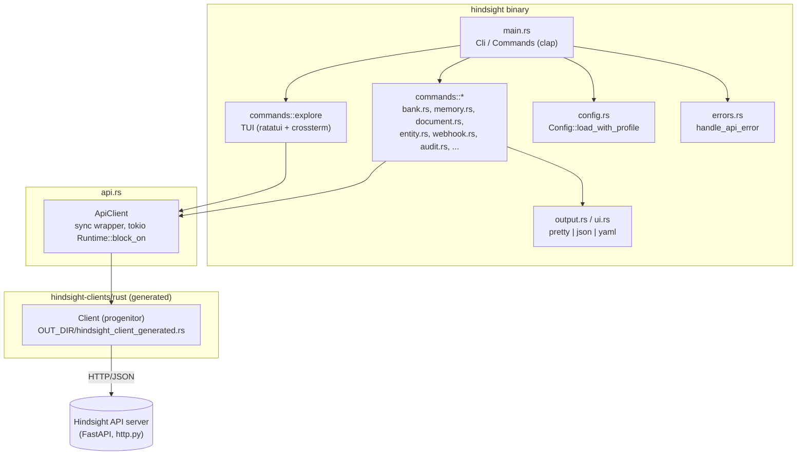
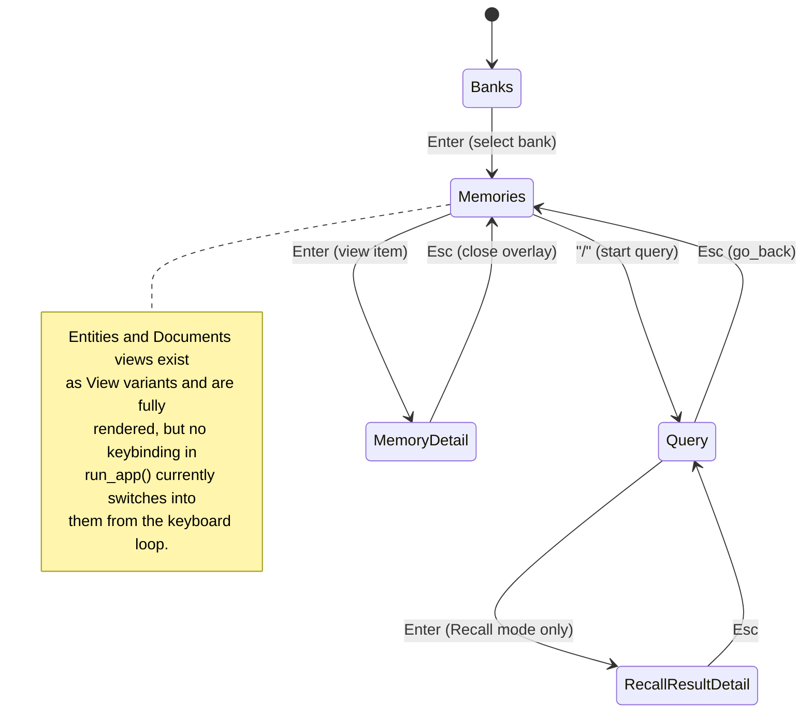

<details>
<summary>Relevant source files</summary>
The following files were used as context for generating this wiki page:

- [hindsight-cli/src/main.rs](hindsight-cli/src/main.rs)
- [hindsight-cli/src/api.rs](hindsight-cli/src/api.rs)
- [hindsight-cli/src/config.rs](hindsight-cli/src/config.rs)
- [hindsight-cli/src/ui.rs](hindsight-cli/src/ui.rs)
- [hindsight-cli/src/output.rs](hindsight-cli/src/output.rs)
- [hindsight-cli/src/commands/explore.rs](hindsight-cli/src/commands/explore.rs)
- [hindsight-cli/src/commands/mod.rs](hindsight-cli/src/commands/mod.rs)
- [hindsight-cli/src/commands/bank.rs](hindsight-cli/src/commands/bank.rs)
- [hindsight-cli/src/errors.rs](hindsight-cli/src/errors.rs)
- [hindsight-cli/Cargo.toml](hindsight-cli/Cargo.toml)
- [hindsight-clients/rust/src/lib.rs](hindsight-clients/rust/src/lib.rs)
- [hindsight-clients/rust/build.rs](hindsight-clients/rust/build.rs)
</details>

# Rust CLI (hindsight-cli)

`hindsight-cli` is the Rust command-line client for Hindsight, distributed as the `hindsight` binary (`hindsight-cli/Cargo.toml:1-9`). It exposes every REST resource of the Hindsight API as a `clap` subcommand tree (banks, memories, documents, entities, tags, chunks, operations, mental models, directives, webhooks, audit logs), plus an interactive, k9s-inspired terminal UI (`hindsight explore`) for browsing the same data live. This page covers the crate's module layout, its configuration/profile system, how it talks to the API, and how the TUI is structured.

No prior wiki pages, `docs/solutions/` notes, or a `STRATEGY.md` were present in this repository checkout, so this page is derived solely from the current `hindsight-cli` source.

## Crate Layout

```text
hindsight-cli/src/
├── main.rs        clap CLI definition + dispatch (Cli/Commands enums, run())
├── api.rs         ApiClient: sync-facing wrapper around the generated async client
├── config.rs      Config: layered API URL/key resolution + named profiles
├── output.rs      OutputFormat (pretty/json/yaml) + serialization helpers
├── ui.rs          Non-interactive pretty-print helpers (gradient text, spinners)
├── errors.rs      Human-friendly error classification (connection/timeout/404/…)
├── utils.rs       Misc CLI helpers
└── commands/      One module per resource: bank, memory, document, entity, tag,
                    chunk, operation, mental_model, directive, webhook, audit,
                    health, explore (the TUI)
```

Each `commands::<resource>` module holds free functions (`list`, `get`, `create`, …) that `main.rs` calls directly; there is no trait/dispatch abstraction — `main.rs`'s `run()` match arms translate parsed `clap` subcommands 1:1 into these function calls (`hindsight-cli/src/main.rs:1200-1867`).

### Module & Data-Flow Architecture



`main.rs` builds a single `ApiClient` per invocation from the resolved `Config` (`hindsight-cli/src/main.rs:1184-1197`) and passes a reference into whichever command function the parsed subcommand selects.

Sources: [hindsight-cli/src/main.rs:1-14](), [hindsight-cli/src/commands/mod.rs:1-13](), [hindsight-cli/src/main.rs:1184-1204]()

## Command Surface

`Cli` is the top-level `clap::Parser`; every resource group is a nested `#[command(subcommand)]` enum (`BankCommands`, `MemoryCommands`, `DocumentCommands`, etc.) defined in `main.rs` (`hindsight-cli/src/main.rs:74-1153`). Global flags apply to every subcommand:

| Flag | Purpose |
|---|---|
| `-o/--output <pretty\|json\|yaml>` | Output format, default `pretty` (`hindsight-cli/src/main.rs:41-42`) |
| `-v/--verbose` | Print raw request/response bodies for some calls (`hindsight-cli/src/main.rs:45-46`) |
| `-p/--profile <name>` (env `HINDSIGHT_PROFILE`) | Named connection profile to load (`hindsight-cli/src/main.rs:51`) |

Top-level command groups (`hindsight-cli/src/main.rs:74-152`):

| Group | Subcommands (representative) |
|---|---|
| `bank` | list, create, update, disposition, stats, name, mission, graph, delete, consolidate, clear-observations, config/set-config/reset-config, set-disposition, consolidation-recover, export-template/import-template/template-schema |
| `memory` | list, get, recall, reflect, retain, retain-files, delete, clear, history, clear-observations |
| `document` | list, get, delete, update (tags) |
| `entity` | list, get, regenerate |
| `tag` | list |
| `chunk` | get |
| `operation` | list, get, cancel, retry |
| `mental-model` | list, get, create, update, delete, refresh, history |
| `directive` | list, get, create, update, delete |
| `webhook` | list, create, update, delete, deliveries |
| `audit` | list, stats |
| top-level | `health`, `metrics`, `version`, `explore`/`tui`, `ui`, `configure`, `profile` |

`Commands::Configure`, `Commands::Profile`, and `Commands::Ui` are special-cased in `run()` to execute *before* a `Config`/`ApiClient` is constructed, since they either produce the config or don't need the API at all (`hindsight-cli/src/main.rs:1169-1183`). `Commands::Ui` shells out to `npx @vectorize-io/hindsight-control-plane --api-url <url>` (`hindsight-cli/src/main.rs:1958-2003`) to launch the Next.js control plane, rather than being a Rust-native UI.

Sources: [hindsight-cli/src/main.rs:74-152](), [hindsight-cli/src/main.rs:1155-1204]()

## Configuration & Profiles

`config.rs` implements a four-tier resolution order, checked once per invocation in `Config::load_with_profile` (`hindsight-cli/src/config.rs:51-78`):

1. **Environment variables** `HINDSIGHT_API_URL` / `HINDSIGHT_API_KEY` — highest priority, always wins if `HINDSIGHT_API_URL` is set.
2. **Named profile** — from `-p/--profile` or `$HINDSIGHT_PROFILE`, read from `~/.hindsight/cli-profiles/<name>.toml`.
3. **Local config file** — `~/.hindsight/config`, written by `hindsight configure`.
4. **Default** — `http://localhost:8888`.

At every tier, `HINDSIGHT_API_KEY` (if set) still overrides whatever key the profile/file supplies (`hindsight-cli/src/config.rs:52-73`). Profile files are written with `0600` permissions on Unix to protect embedded API keys (`hindsight-cli/src/config.rs:290-297`), and profile names are validated to reject path traversal, whitespace, and leading dots (`hindsight-cli/src/config.rs:325-341`).

```rust
// hindsight-cli/src/config.rs:51-78
pub fn load_with_profile(profile_name: Option<&str>) -> Result<Self> {
    let env_api_key = env::var("HINDSIGHT_API_KEY").ok();
    if let Ok(api_url) = env::var("HINDSIGHT_API_URL") {
        return Self::validate_and_create(api_url, env_api_key, ConfigSource::Environment);
    }
    let resolved_profile: Option<String> = profile_name
        .map(|s| s.to_string())
        .or_else(|| env::var(PROFILE_ENV_VAR).ok().filter(|s| !s.is_empty()));
    if let Some(name) = resolved_profile {
        let (api_url, file_api_key) = Self::load_profile(&name)?;
        let api_key = env_api_key.or(file_api_key);
        return Self::validate_and_create(api_url, api_key, ConfigSource::Profile(name));
    }
    if let Some((api_url, file_api_key)) = Self::load_from_file()? {
        let api_key = env_api_key.or(file_api_key);
        return Self::validate_and_create(api_url, api_key, ConfigSource::LocalFile);
    }
    Self::validate_and_create(DEFAULT_API_URL.to_string(), env_api_key, ConfigSource::Default)
}
```

`hindsight configure [--api-url] [--api-key]` writes to the config file (prompting interactively for the URL if omitted, `hindsight-cli/src/config.rs:344-359`); `hindsight profile create/list/show/delete` manage the `cli-profiles/` directory (`hindsight-cli/src/main.rs:2013-2122`).

Sources: [hindsight-cli/src/config.rs:39-225](), [hindsight-cli/src/main.rs:1878-2122]()

## API Client Wrapper (`api.rs`)

`ApiClient` bridges the CLI's synchronous command functions to the async, `progenitor`-generated `hindsight_client::Client`. It owns a `tokio::runtime::Runtime` wrapped in an `Arc` and drives every call through `self.runtime.block_on(async { ... })` (`hindsight-cli/src/api.rs:119-146`), so command code never has to be `async`.

Key responsibilities:
- **Headers**: sets a `hindsight-cli/<version>` `User-Agent` and, if configured, a `Bearer` `Authorization` header on every request (`hindsight-cli/src/api.rs:15-31`).
- **Error humanization**: `humanize_client_error` unwraps `progenitor`'s `ClientError` variants (`ErrorResponse`, `UnexpectedResponse`, `InvalidResponsePayload`) and surfaces the HTTP status *and* response body — the generated client's default `Display` omits the body entirely (`hindsight-cli/src/api.rs:33-63`).
- **Raw HTTP for endpoints the generated client can't model**: multipart file uploads (`file_retain`, `hindsight-cli/src/api.rs:282-346`) and the bank-template import endpoint (`import_bank_template`, `hindsight-cli/src/api.rs:1173-1200`) bypass the generated client and issue requests directly via a shared `reqwest::Client`, because the OpenAPI spec either declares `multipart/form-data` (filtered out at codegen time, see below) or omits a request body.
- **Polling**: `poll_operation` loops `list_operations` until an operation's status leaves `pending`/`processing` (`hindsight-cli/src/api.rs:350-403`), used by commands like `bank consolidate --wait`.
- **Shape adaptation**: some responses are re-parsed through `serde_json::Value` into locally-defined structs (`AgentStats`, `OperationsResponse`) because those shapes aren't in the OpenAPI spec yet (`hindsight-cli/src/api.rs:65-118`).

`ApiClient` implements every resource one method at a time across three `impl` blocks in the same file, covering banks, memories, documents, entities, tags, chunks, operations, mental models, directives, webhooks, audit logs, and bank templates — a comment notes this coverage is enforced by `cli-coverage-check` in `hindsight-dev` (`hindsight-cli/src/api.rs:1033-1037`).

Sources: [hindsight-cli/src/api.rs:119-346](), [hindsight-cli/src/api.rs:614-1312]()

### Generated Client (`hindsight-clients/rust`)

The Rust API client itself is generated at build time: `hindsight-clients/rust/build.rs` reads the repo's OpenAPI spec, downgrades `3.1` → `3.0.3`, strips `multipart/form-data` endpoints (unsupported by `progenitor`), and feeds the result to the `progenitor` code generator, whose output is `include!`d into `hindsight-clients/rust/src/lib.rs:23`. The crate also exposes `default_client()`/`client_with_user_agent()` helpers that set a non-default `User-Agent` so reverse proxies (e.g. Cloudflare) don't block requests (`hindsight-clients/rust/src/lib.rs:29-62`). `hindsight-cli` depends on this crate as a path dependency (`hindsight-cli/Cargo.toml:14-15`).

Sources: [hindsight-clients/rust/build.rs:1-40](), [hindsight-clients/rust/src/lib.rs:1-62]()

## Output Formatting

`OutputFormat` (`hindsight-cli/src/output.rs:4-21`) is a three-way enum (`Pretty`, `Json`, `Yaml`) parsed from the `-o` flag. `output::print_output` serializes `Json`/`Yaml` directly via `serde_json`/`serde_yaml`; `Pretty` is intentionally `unreachable!()` in `output.rs` (`hindsight-cli/src/output.rs:33-46`) because pretty-printing is resource-specific and lives in `ui.rs` instead — e.g. `ui::print_search_results`, `ui::print_think_response`, `ui::print_disposition`.

`ui.rs` also owns the CLI's visual identity: an RGB gradient (`#0074d9` → `#009296`) applied to text via raw ANSI escapes (`gradient`, `gradient_text`, `hindsight-cli/src/ui.rs:10-63`), a threaded `GradientSpinner` for long-running requests (`hindsight-cli/src/ui.rs:226-299`), and an `indicatif` progress bar helper for bulk operations (`create_progress_bar`, `hindsight-cli/src/ui.rs:301-311`). Every resource command in `commands/*` follows the same pattern seen in `commands::bank::list`: start a spinner, call `ApiClient`, stop the spinner, then branch on `output_format` to either call `ui::print_*` or `output::print_output` (`hindsight-cli/src/commands/bank.rs:6-34`).

Sources: [hindsight-cli/src/output.rs:1-47](), [hindsight-cli/src/ui.rs:1-63](), [hindsight-cli/src/commands/bank.rs:6-34]()

## Error Handling

`errors::handle_api_error` (called from `main.rs`'s top-level `result` match and from `ApiClient::new`'s failure path) pattern-matches the error's string representation against known failure classes — connection refused, timeout, DNS resolution, HTTP 404 (including a dedicated message when the bank-config API is server-disabled) — and prints a colored, actionable diagnostic instead of a raw Rust error (`hindsight-cli/src/errors.rs:3-80`, `hindsight-cli/src/main.rs:1195-1197,1870-1873`).

## Interactive TUI Explorer (`commands/explore.rs`)

`hindsight explore` (aliased `tui`) launches a `ratatui`/`crossterm` full-screen terminal app, explicitly modeled after `k9s`'s context-drilldown UX. `run()` enters the alternate screen and raw mode, builds an `App`, runs the event loop, then always restores the terminal on exit (`hindsight-cli/src/commands/explore.rs:1506-1532`).

### View Model

Navigation state is a single `View` enum, each variant (except `Banks`) carrying the `bank_id` it's scoped to:

```rust
// hindsight-cli/src/commands/explore.rs:29-55
enum View {
    Banks,
    Memories(String),
    Entities(String),
    Documents(String),
    Query(String), // combines recall and reflect
}
```

`App` (`hindsight-cli/src/commands/explore.rs:78-133`) holds one `Vec<T>` + `ListState` pair per resource (banks, memories, entities, documents, query results), a `view_history: Vec<View>` back-stack, an `InputMode` (`Normal` vs `Query`, for text entry), and a `query_receiver: Option<Receiver<QueryResult>>` used to run recall/reflect calls on a background `std::thread` so the UI thread keeps rendering (`execute_query`/`check_query_result`, `hindsight-cli/src/commands/explore.rs:300-411`).

### Navigation State Machine



Key transitions, all handled in `run_app`'s single `match key.code` block (`hindsight-cli/src/commands/explore.rs:1381-1493`):
- `Enter` calls `App::enter_view()`, which either drills into a child view (`Banks` → `Memories`, pushing the old view onto `view_history`) or opens a detail overlay (`viewing_memory`/`viewing_entity`/`viewing_document`/`viewing_recall_result`) for the selected row (`hindsight-cli/src/commands/explore.rs:518-586`).
- `Esc` calls `App::go_back()`, which closes an open detail overlay first if any, otherwise pops `view_history` and re-`refresh()`es (`hindsight-cli/src/commands/explore.rs:588-616`).
- `/` switches to `View::Query(bank_id)` (using `selected_bank_id`) and enters `InputMode::Query` for free-text entry; `m` toggles Recall↔Reflect, `b` cycles the thinking budget, `+`/`-` adjust `max_tokens` — all gated to only apply while `app.view` is `Query` (`hindsight-cli/src/commands/explore.rs:1407-1447`).
- `n`/`p` page memories forward/back (`load_more_memories`/`load_prev_memories`); `Delete` removes the selected document while in `View::Documents` (`hindsight-cli/src/commands/explore.rs:1450-1466`).
- `R` force-refreshes the current view; a separate `do_auto_refresh` check runs every loop iteration and re-fetches every 5 seconds if `auto_refresh_enabled` (`hindsight-cli/src/commands/explore.rs:211-231`).

Rendering is a straightforward `ui(f, app)` dispatcher: a header, `render_control_bar` (context info + a contextual shortcut legend keyed off `(view, input_mode)`, `hindsight-cli/src/commands/explore.rs:727-863`), a body that matches on `app.view` to call `render_banks`/`render_memories`/`render_entities`/`render_documents`/`render_query`, and a footer status/error line — plus a `render_help` overlay toggled by `?`.

Sources: [hindsight-cli/src/commands/explore.rs:1-234](), [hindsight-cli/src/commands/explore.rs:300-411](), [hindsight-cli/src/commands/explore.rs:518-651](), [hindsight-cli/src/commands/explore.rs:1367-1533]()

## Summary

`hindsight-cli` is a thin, direct mapping from `clap` subcommands to `ApiClient` methods, with all API surface auto-generated from the OpenAPI spec via `progenitor` and wrapped in a synchronous facade (`api.rs`) that adds better error messages and covers a few endpoints the generator can't express. Configuration flows through a layered `Config` resolver supporting environment variables, named profiles, and a config file, and every command supports pretty/JSON/YAML output through the same `OutputFormat` switch. The `explore` subcommand is a self-contained `ratatui` TUI with its own `View`-based navigation state machine and a background-thread query mechanism, independent from the rest of the command dispatch in `main.rs`.

## Related pages

- page-sdk-clients
- page-http-api
- page-control-plane


## Source files

- `hindsight-cli/src/main.rs`
- `hindsight-cli/src/api.rs`
- `hindsight-cli/src/config.rs`
- `hindsight-cli/src/ui.rs`
- `hindsight-cli/src/output.rs`
