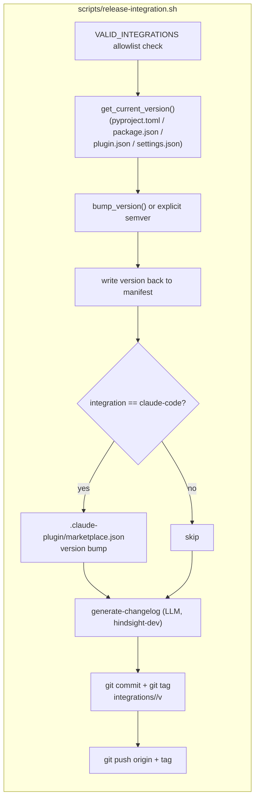

<details>
<summary>Relevant source files</summary>
The following files were used as context for generating this wiki page:
- [hindsight-integrations/README.md](hindsight-integrations/README.md)
- [hindsight-integrations/claude-code/README.md](hindsight-integrations/claude-code/README.md)
- [hindsight-integrations/litellm/README.md](hindsight-integrations/litellm/README.md)
- [hindsight-integrations/litellm/tests/test_integration.py](hindsight-integrations/litellm/tests/test_integration.py)
- [hindsight-integrations/langgraph/README.md](hindsight-integrations/langgraph/README.md)
- [hindsight-integrations/langgraph/tests/test_graph_flow.py](hindsight-integrations/langgraph/tests/test_graph_flow.py)
- [hindsight-integrations/pydantic-ai/tests/test_tools.py](hindsight-integrations/pydantic-ai/tests/test_tools.py)
- [scripts/release-integration.sh](scripts/release-integration.sh)
- [.github/workflows/test.yml](.github/workflows/test.yml)
- [CLAUDE.md](CLAUDE.md)
</details>

# Integrations Library — Adapters Across Agent Ecosystems

`hindsight-integrations/` is a monorepo-within-the-monorepo: a directory of first-party adapters that plug the Hindsight memory engine (retain/recall/reflect) into external coding agents, agent frameworks, and automation platforms. As of this writing the directory contains 47 subdirectories, each an independently versioned package with its own README, tests, and CI job. This page explains how those adapters are grouped by ecosystem, what shape each one takes, and the shared release/CI contract every integration must satisfy before it can be merged.

## Directory layout and categories

Every integration lives at `hindsight-integrations/<name>/` and is versioned independently (its own `pyproject.toml`, `package.json`, or `settings.json`). The README groups the ~40+ adapters into three informal categories:

| Category | Representative integrations | What they adapt |
| --- | --- | --- |
| Coding agents & CLIs | `claude-code`, `codex`, `cursor-cli`, `opencode`, `continue`, `github-copilot`, `devin-desktop`, `roo-code` | Hook scripts or MCP config wired into the agent's own lifecycle events (prompt submit, session stop) |
| Agent frameworks | `crewai`, `langgraph`, `pydantic-ai`, `ai-sdk`, `llamaindex`, `google-adk`, `strands`, `ag2`, `autogen`, `openai-agents`, `smolagents` | Library-level tools/nodes/adapters (`FunctionTool`, LangChain `@tool`, `BaseMemoryService`, etc.) that a developer wires into their own agent code |
| Proxy & automation platforms | `litellm`, `n8n`, `zapier`, `dify`, `flowise`, `vapi`, `cloudflare-oauth-proxy` | Callback hooks or workflow nodes that add memory to traffic passing through a proxy or no-code platform |

Sources: [hindsight-integrations/README.md:9-56]()

```text
hindsight-integrations/
├── claude-code/    (hooks + MCP server, Python stdlib)      ─┐
├── codex/          (Python hook scripts)                     │ coding-agent hooks
├── cursor-cli/     (Python hook scripts)                     │ (lifecycle events:
├── opencode/       (TS plugin)                                │  prompt-submit, stop,
├── continue/       (HTTP context provider + MCP)             ─┘  session-end)
│
├── crewai/         (long-term memory tools)                  ─┐
├── langgraph/      (tools / nodes / BaseStore adapter)         │ agent frameworks
├── pydantic-ai/    (dependency-injected memory)                │ (library code the
├── google-adk/     (BaseMemoryService)                         │  developer imports
├── ag2/, autogen/, openai-agents/, smolagents/, strands/ ...  ─┘  into their own agent)
│
├── litellm/        (proxy callbacks, zero code changes)       ─┐
├── n8n/            (community node)                            │ proxy / automation
├── zapier/         (actions + triggers)                         │ (memory attached to
├── dify/, flowise/, vapi/, cloudflare-oauth-proxy/ ...        ─┘  traffic/workflow runs)
```

## The shared contract

`CLAUDE.md` codifies a checklist that every new (or modified) integration must satisfy before merge — this is the load-bearing convention for the whole directory:

1. **Tests exercise the external system.** A pure unit test of a helper function is not sufficient — the test suite must mock the framework's own interfaces (e.g., a mocked LangGraph `StateGraph`, a mocked LiteLLM callback context) and verify the integration actually calls Hindsight's `retain`/`recall`/`reflect` correctly.
2. **A dedicated CI job.** Add a `test-<name>-integration` job to `.github/workflows/test.yml`, following the existing pattern, and register the integration's paths in the `detect-changes` job so the job only runs when its own files change.
3. **Release-script registration.** Add the integration's name to `VALID_INTEGRATIONS` in `scripts/release-integration.sh` so it can be versioned and tagged through the standard release flow.
4. **Code-standards compliance** per `.claude/skills/code-review/SKILL.md` (Python/TypeScript style, type safety, no raw dicts for structured payloads, no multi-item tuple returns).

Sources: [CLAUDE.md](CLAUDE.md) ("Adding New Integrations" section)

### Test pattern in practice

The three sampled frameworks all follow the "mock the framework, assert the Hindsight call" pattern rather than testing helpers in isolation:

- **litellm** (`hindsight-integrations/litellm/tests/test_integration.py:1-38`) drives the public `configure()` / `set_defaults()` / `enable()` surface directly and asserts on `HindsightCallback` state.
- **langgraph** (`hindsight-integrations/langgraph/tests/test_graph_flow.py:1-40`) builds a real compiled `StateGraph` (`recall -> agent -> retain`) wired to a `MagicMock`/`AsyncMock` Hindsight client, exercising true LangGraph node orchestration without a live server — explicitly documented as "the in-CI / no-keys analog" of a companion `test_e2e.py` that runs against a live LLM.
- **pydantic-ai** (`hindsight-integrations/pydantic-ai/tests/test_tools.py:1-40`) mocks `aretain`/`arecall`/`areflect` on the client and exercises `create_hindsight_tools()` against that mock.

Sources: [hindsight-integrations/litellm/tests/test_integration.py:1-38](), [hindsight-integrations/langgraph/tests/test_graph_flow.py:1-40](), [hindsight-integrations/pydantic-ai/tests/test_tools.py:1-40]()

### CI: one job per integration

`.github/workflows/test.yml` contains 42 `test-<name>-integration` jobs. Each follows a `detect-changes` → path-filtered `if:` → build/test structure, e.g. `test-litellm-integration`, `test-langgraph-integration`, `test-pydantic-ai-integration`, `test-zapier-integration`, `test-claude-code-integration`. A `detect-changes` filter entry (e.g. `integrations-litellm: 'hindsight-integrations/litellm/**'`) gates each job so it only runs when its own subtree changes, plus an umbrella `ci == 'true'` / `workflow_dispatch` escape hatch. `test-zapier-integration` installs Node deps and runs `npm run validate` (schema validation for the Zapier app definition) rather than pytest, since it's a JS-based platform adapter.

Sources: [.github/workflows/test.yml:856-881](), [.github/workflows/test.yml:3593-3618](), [.github/workflows/test.yml:3632-3657](), [.github/workflows/test.yml:3669-3694]()

### Release: one script, per-integration tags



Each integration reports its own current version via whichever manifest file it has (`pyproject.toml` for Python packages, `package.json` for npm packages, `.claude-plugin/plugin.json` or `settings.json` for the Claude Code plugin). The script bumps that manifest, generates a changelog entry with an LLM (`generate-changelog`, requires `OPENAI_API_KEY`), and tags the release as `integrations/<name>/v<version>` — independent of the core Hindsight `vX.Y.Z` tags. `claude-code` is special-cased: because it ships through a marketplace manifest rather than a package registry, `.claude-plugin/marketplace.json`'s version is bumped in lockstep with the plugin's own version.

Sources: [scripts/release-integration.sh:15-16](), [scripts/release-integration.sh:47-60](), [scripts/release-integration.sh:126-179](), [hindsight-integrations/README.md:63-72]()

### A gap between the registries

The `VALID_INTEGRATIONS` allowlist in `scripts/release-integration.sh:15` and the CI `detect-changes` filters in `.github/workflows/test.yml` are maintained independently, and they've drifted: `zapier` has a live `test-zapier-integration` CI job ([.github/workflows/test.yml:856-881]()) but is **not** present in `VALID_INTEGRATIONS`, so it cannot currently be released through `release-integration.sh` without first adding it to that array. This illustrates the contract's weak point in practice — the three registration points (CI filter, CI job, release allowlist) are three separate edits, and nothing enforces they stay in sync besides code review.

Sources: [scripts/release-integration.sh:15](), [.github/workflows/test.yml:856-881]()

## Representative adapters by category

### Coding-agent hooks — `claude-code`

`hindsight-integrations/claude-code/` is a hook-based Claude Code plugin (pure Python stdlib for hooks; the `mcp` package only for the optional MCP server). It auto-recalls relevant memories on every user prompt (invisible to the transcript, visible to the model) and auto-retains conversation content after every response or every N turns. It also exposes `agent_knowledge_*` MCP tools (list/get/create/update/delete pages, recall, ingest, ingest_file, get_current_bank) so Claude can manage a project's knowledge pages directly, and a `/hindsight-memory:create-agent` skill for spinning up subagents with their own memory. It is explicitly described as a full port of the `openclaw` integration adapted to Claude Code's plugin architecture.

Sources: [hindsight-integrations/claude-code/README.md:1-42](), [hindsight-integrations/claude-code/README.md:62-78]()

### Agent frameworks — `langgraph` and `pydantic-ai`

`hindsight-langgraph` offers three integration patterns against the same underlying client: LangChain `@tool` functions (works with both LangChain and LangGraph), pre-built LangGraph nodes for automatic recall/retain around a graph run, and a memory-instructions helper that pre-fetches memories into a system-prompt string for any LangChain model with no graph required. `hindsight-pydantic-ai` instead injects memory as a dependency (`create_hindsight_tools`, `memory_instructions`) into Pydantic AI's dependency-injection model. Both frameworks are consumed as library code the developer imports into their own agent — unlike the coding-agent hooks, which run inside someone else's CLI process.

Sources: [hindsight-integrations/langgraph/README.md:1-13](), [hindsight-integrations/langgraph/README.md:23-41]()

### Proxy/automation adapters — `litellm`, `zapier`, `n8n`

`hindsight-litellm` attaches to LiteLLM's callback system so that any of LiteLLM's 100+ proxied providers gets memory injected/stored with no per-call code changes beyond `configure()` / `set_defaults()` / `enable()`; it supports both `reflect` (synthesized) and `recall` (raw) memory-injection modes. `zapier` and `n8n` instead expose retain/recall/reflect as first-class actions/nodes inside no-code workflow builders — `zapier`'s CI job validates the app definition schema with `npm run validate` rather than running pytest, reflecting that its "external system" is a declarative app manifest rather than a runtime library.

Sources: [hindsight-integrations/litellm/README.md:1-16](), [.github/workflows/test.yml:875-881]()

## Summary

The integrations library scales an otherwise small contract — mock the external system in tests, register a CI job, register in the release script — across roughly 40 independently-versioned adapters spanning three ecosystems (coding-agent hooks, agent frameworks, and proxy/automation platforms). The `zapier`/`VALID_INTEGRATIONS` mismatch shows that contract is enforced by convention and code review rather than a single source of truth, which is worth checking whenever a new integration is added or an existing one is released.

## Related pages

- page-llm-providers
- page-mcp-server
- page-sdk-clients


## Source files

- `hindsight-integrations/README.md`
- `hindsight-integrations/claude-code`
- `hindsight-integrations/litellm`
- `hindsight-integrations/langgraph`
- `hindsight-integrations/pydantic-ai`
- `scripts/release-integration.sh`
