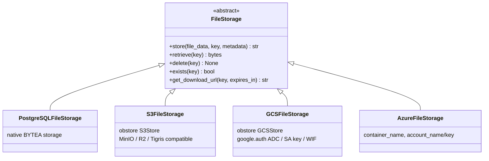

<details>
<summary>Relevant source files</summary>
The following files were used as context for generating this wiki page:
- [hindsight-api-slim/hindsight_api/alembic/_dialect.py](hindsight-api-slim/hindsight_api/alembic/_dialect.py)
- [hindsight-api-slim/hindsight_api/alembic/versions/o1a2b3c4d5e6_oracle_baseline.py](hindsight-api-slim/hindsight_api/alembic/versions/o1a2b3c4d5e6_oracle_baseline.py)
- [hindsight-api-slim/hindsight_api/alembic/versions/z1u2v3w4x5y6_add_observation_tags_to_memory_units.py](hindsight-api-slim/hindsight_api/alembic/versions/z1u2v3w4x5y6_add_observation_tags_to_memory_units.py)
- [hindsight-api-slim/hindsight_api/engine/storage/base.py](hindsight-api-slim/hindsight_api/engine/storage/base.py)
- [hindsight-api-slim/hindsight_api/engine/storage/s3.py](hindsight-api-slim/hindsight_api/engine/storage/s3.py)
- [hindsight-api-slim/hindsight_api/engine/storage/gcs.py](hindsight-api-slim/hindsight_api/engine/storage/gcs.py)
- [hindsight-api-slim/hindsight_api/engine/storage/__init__.py](hindsight-api-slim/hindsight_api/engine/storage/__init__.py)
- [hindsight-api-slim/hindsight_api/config.py](hindsight-api-slim/hindsight_api/config.py)
- [hindsight-api-slim/tests/test_migration_shape.py](hindsight-api-slim/tests/test_migration_shape.py)
- [hindsight-api-slim/tests/llm_judge.py](hindsight-api-slim/tests/llm_judge.py)
- [hindsight-api-slim/hindsight_api/engine/providers/mock_llm.py](hindsight-api-slim/hindsight_api/engine/providers/mock_llm.py)
- [scripts/benchmarks/run-perf-test.sh](scripts/benchmarks/run-perf-test.sh)
- [hindsight-dev/benchmarks/perf/system_perf.py](hindsight-dev/benchmarks/perf/system_perf.py)
- [.claude/skills/code-review/SKILL.md](.claude/skills/code-review/SKILL.md)
- [.github/workflows/test.yml](.github/workflows/test.yml)
</details>

# Operational Boundaries, Extension Points & What to Inspect Next

This page closes out the architectural tour of Hindsight by focusing on the seams a contributor actually touches when extending the system: how schema changes stay valid across two database dialects, how uploaded-file storage is abstracted behind a swappable backend, how performance is measured, and how the test suite separates deterministic checks from real-LLM judgment calls. None of this is provider- or vendor-specific — the patterns described here (dialect dispatch, a storage `ABC`, marker-gated pytest suites) are plain Python/SQL mechanisms, not hosted-service dependencies, so they remain portable regardless of which LLM, cloud, or catalog backs a given deployment.

No `STRATEGY.md` or `docs/solutions/` directory exists in this repository, so this page is grounded entirely in the current source tree rather than prior strategy notes or solved-problem logs.

## Dual-Dialect Migration Discipline

Hindsight runs one Alembic revision tree against both PostgreSQL and Oracle 23ai. Every migration must route through a shared dispatcher, `run_for_dialect`, which inspects the live connection's dialect name and calls the matching `_pg_*` / `_oracle_*` function — or no-ops if a slot is intentionally omitted:

```python
# hindsight-api-slim/hindsight_api/alembic/_dialect.py
def run_for_dialect(*, pg: DialectFn | None = None, oracle: DialectFn | None = None) -> None:
    name = op.get_bind().dialect.name
    if name not in _SUPPORTED:
        raise RuntimeError(f"Unsupported dialect for migration dispatch: {name!r}...")
    fn = {"postgresql": pg, "oracle": oracle}[name]
    if fn is not None:
        fn()
```
Sources: [hindsight-api-slim/hindsight_api/alembic/_dialect.py:23-42]()

A single revision, `o1a2b3c4d5e6_oracle_baseline.py`, brought Oracle up to parity with the ~59 prior PostgreSQL-only revisions in one step; every migration created *after* that baseline must fill at least one dialect slot. The type-mapping table in that migration's docstring (`UUID → RAW(16)`, `JSONB → CLOB with IS JSON CHECK`, `vector(384) → VECTOR(384, FLOAT32)`, etc.) is the reference for anyone writing Oracle-side DDL by hand. Sources: [hindsight-api-slim/hindsight_api/alembic/versions/o1a2b3c4d5e6_oracle_baseline.py:1-23]()

This discipline is enforced, not just documented. `tests/test_migration_shape.py` parses every file under `alembic/versions/` with `ast` and fails the build if:
- `upgrade()`/`downgrade()` don't call `run_for_dialect(...)`
- neither `_pg_upgrade` nor `_oracle_upgrade` is defined
- `op.execute("COMMIT")` is used to escape the transaction (breaks on psycopg/SQLAlchemy 2.1) instead of `op.get_context().autocommit_block()`
- `CREATE/DROP INDEX CONCURRENTLY` DDL runs outside an `autocommit_block()`

Sources: [hindsight-api-slim/tests/test_migration_shape.py:22-52]()[hindsight-api-slim/tests/test_migration_shape.py:96-116]()

A representative recent migration shows the minimal shape a PG-only change takes when the Oracle slot is deliberately absent:

```python
# z1u2v3w4x5y6_add_observation_tags_to_memory_units.py
def _pg_upgrade() -> None:
    op.execute(f"ALTER TABLE {schema}memory_units ADD COLUMN IF NOT EXISTS observation_scopes JSONB")

def upgrade() -> None:
    run_for_dialect(pg=_pg_upgrade)   # oracle slot intentionally absent → no-op
```
Sources: [hindsight-api-slim/hindsight_api/alembic/versions/z1u2v3w4x5y6_add_observation_tags_to_memory_units.py:29-42]()

```text
run_for_dialect(pg=_pg_upgrade, oracle=_oracle_upgrade)
        │
        ▼
  bind.dialect.name ──"postgresql"──▶ _pg_upgrade()   (or no-op if pg=None)
        │
        └──────"oracle"───────────▶ _oracle_upgrade() (or no-op if oracle=None)
        │
   anything else ──▶ raise RuntimeError
```

Oracle validation itself is opt-in in CI: `test-api-oracle` only runs when a PR carries the `oracle-tests` label, against a live `ORACLE_TEST_DSN` and `HINDSIGHT_API_DATABASE_BACKEND: oracle`. Sources: [.github/workflows/test.yml:1793-1810]()

## Storage Backend Abstraction

Uploaded-file storage is behind a single abstract base, `FileStorage`, with five async methods (`store`, `retrieve`, `delete`, `exists`, `get_download_url`). All four concrete backends implement the same contract, so callers never branch on backend type. Sources: [hindsight-api-slim/hindsight_api/engine/storage/base.py:6-84]()



The factory `create_file_storage()` is the single place that selects and constructs a backend from a `storage_type` string plus config, keeping provider-specific imports (`obstore`, `google.auth`, etc.) lazy so unused SDKs are never imported unless selected:

```python
# hindsight-api-slim/hindsight_api/engine/storage/__init__.py
if storage_type == "native": ...
elif storage_type == "s3": ...
elif storage_type == "gcs": ...
elif storage_type == "azure": ...
else:
    raise ValueError(f"Unknown storage type: {storage_type}. Supported: 'native', 's3', 'gcs', 'azure'.")
```
Sources: [hindsight-api-slim/hindsight_api/engine/storage/__init__.py:10-79]()

S3 and GCS both use `obstore` (Rust-backed async object store), which is why the surface for each is compact — `store`/`retrieve`/`delete`/`exists` are a few lines each, and `get_download_url` delegates straight to `obs.sign_async` for pre-signed URLs. Sources: [hindsight-api-slim/hindsight_api/engine/storage/s3.py:46-72]()

| Backend | `storage_type` | Config source | Notes |
|---|---|---|---|
| PostgreSQL (default) | `native` | `pool_getter`, `schema`/`schema_getter` | BYTEA in-DB storage, no external dependency |
| S3-compatible | `s3` | `HINDSIGHT_API_FILE_STORAGE_S3_*` | Works with AWS S3, MinIO, R2, Tigris via `endpoint` override |
| GCS | `gcs` | `HINDSIGHT_API_FILE_STORAGE_GCS_*` | ADC by default; service-account JSON optional |
| Azure Blob | `azure` | `HINDSIGHT_API_FILE_STORAGE_AZURE_*` | Container + account name/key |

Sources: [hindsight-api-slim/hindsight_api/config.py:506-516](), [hindsight-api-slim/hindsight_api/config.py:1825-1835]()

Because the choice is driven entirely by an env-configured string plus per-backend credentials, adding a fifth backend (e.g. a different object store) means: implement `FileStorage`, add an `elif` branch in `create_file_storage`, and add the matching `ENV_FILE_STORAGE_*` / `DEFAULT_*` / dataclass fields in `config.py` — no changes to callers.

## Benchmark Tooling

`scripts/benchmarks/run-perf-test.sh` is a thin `cd`-and-`exec` wrapper that runs the `perf-test` console script from `hindsight-dev`: Sources: [scripts/benchmarks/run-perf-test.sh:12-17]()

```bash
cd "$PROJECT_ROOT/hindsight-dev"
exec uv run perf-test "$@"
```

The actual orchestrator, `hindsight-dev/benchmarks/perf/system_perf.py`, runs independent suites — `retain`, `recall`, `graph-maintenance`, `stats` — each owning its own engine, bank, and cleanup, against a mock LLM and an embedded `pg0` Postgres so results reflect engine/DB performance rather than external LLM latency. Sources: [hindsight-dev/benchmarks/perf/system_perf.py:4-26]()

| Scale | Approx. duration | Purpose |
|---|---|---|
| `tiny` | ~10s | CI smoke test |
| `small` (default) | ~30s | Local dev sanity check |
| `medium` | ~2min | Broader regression signal |
| `large` | ~10min | Deeper load |
| `huge` (stats suite only) | prod-simulation | ~500k units / ~18M links, bulk-loaded via `COPY` |

Sources: [hindsight-dev/benchmarks/perf/system_perf.py:19-26](), [hindsight-dev/benchmarks/perf/system_perf.py:108-114]()

Accuracy benchmarks (`run-longmemeval.sh`, `run-locomo.sh`) are separate from this perf harness and exercise retrieval quality rather than throughput — a contributor changing retrieval or fusion logic should run those, not `run-perf-test.sh`, to judge correctness impact.

## Testing Conventions: MockLLM vs. LLM-Judge

The test suite (283 files under `hindsight-api-slim/tests/`) splits along a hard line: deterministic logic gets `MockLLM` and direct asserts; anything that depends on *how a model interprets a prompt* gets a real LLM call graded by an independent judge model.

`MockLLM` implements `LLMInterface` and records calls instead of hitting a real provider, so prompt-assembly and branching logic can be asserted directly and fast: Sources: [hindsight-api-slim/hindsight_api/engine/providers/mock_llm.py:18-33]()

For model-following behavior (fact/observation classification, speaker attribution, instruction-following), CLAUDE.md and the code-review skill mandate `tests.llm_judge.assert_meets_criteria` instead of string/enum matching — hard-asserting `fact_type == "world"` is explicitly called out as flaky across providers/runs. The judge is deliberately a *different* model/provider than the one under test: Sources: [.claude/skills/code-review/SKILL.md:143-146]()

```python
# hindsight-api-slim/tests/llm_judge.py
# Judge model configuration — always uses Gemini by default since GEMINI_API_KEY
# is available in all CI jobs. The judge must be independent of the test provider
# (hs_llm_mat tests run across openai, groq, bedrock, etc.).
_JUDGE_PROVIDER = os.getenv("HINDSIGHT_TEST_JUDGE_PROVIDER", "gemini")
```
Sources: [hindsight-api-slim/tests/llm_judge.py:26-31]()

The judge also hardens against single-call flakiness: a failing first verdict triggers additional higher-temperature "second opinions," and only a majority-confirmed failure fails the test. Sources: [hindsight-api-slim/tests/llm_judge.py:34-41]()

| Marker | Meaning | CI job | Providers |
|---|---|---|---|
| *(unmarked)* | Deterministic, MockLLM/pure-function tests | `test-api` (sharded, `-m "not hs_llm_mat and not hs_llm_core"`) | none |
| `hs_llm_core` | Real pipeline, single provider, prompt/classification behavior | `test-api-llm-core` | one (env-configured) |
| `hs_llm_mat` | LLM minimum-acceptance matrix | `test-api-llm-acceptance` | many (openai, groq, bedrock, litellmrouter, …) |

Sources: [.github/workflows/test.yml:1621-1621](), [.github/workflows/test.yml:1685-1685](), [.github/workflows/test.yml:1790-1790]()

## What to Inspect Next: Extension-Point Checklist

The `.claude/skills/code-review/SKILL.md` review steps double as a map of every place the codebase enforces cross-cutting invariants — these are the files a new contributor should check *before* assuming a change is complete:

- **API/engine boundary** — HTTP handlers in `hindsight-api-slim/hindsight_api/api/` must never touch the DB directly (no `acquire_with_retry`, raw SQL, `fq_table(...)`); all persistence and tenant authentication (`_authenticate_tenant` / `get_bank_profile`) live in `MemoryEngine`. Sources: [.claude/skills/code-review/SKILL.md:77-78]()
- **New PostgreSQL tables** must be added to `BACKUP_TABLES` in `hindsight-api-slim/hindsight_api/admin/cli.py`, parents before FK children, or a restore silently drops the data (`test_backup_tables_covers_entire_schema` guards this). Oracle-only tables are excluded since admin backup/restore is PostgreSQL-only. Sources: [.claude/skills/code-review/SKILL.md:188-193]()
- **New config flags** need `.env.example` updated *and* re-copied to `hindsight-embed/hindsight_embed/env.example` (a sync test enforces byte-identity). Sources: [.claude/skills/code-review/SKILL.md:196-205]()
- **New MCP tools** require four synchronized registration points (`_ALL_TOOLS`, `tools_to_register`, `_SINGLE_BANK_TOOLS`, `MCP_TOOL_GROUPS`, plus a tool-count test). Sources: [.claude/skills/code-review/SKILL.md:179-186]()
- **New integrations** need tests that exercise the external framework, a CI job in `.github/workflows/test.yml`, and an entry in `scripts/release-integration.sh`'s `VALID_INTEGRATIONS`. Sources: [.claude/skills/code-review/SKILL.md:170-177]()

These checklists exist because the corresponding tests (`test_migration_shape.py`, `test_backup_tables_covers_entire_schema`, `test_bundled_template_matches_repo_root`, MCP tool-count assertions) fail the build on drift — reading the failing test first is usually faster than reading the whole subsystem.

## Summary

Hindsight's operational boundaries are enforced by a small set of self-checking mechanisms rather than convention alone: the Alembic dialect dispatcher plus its AST-based lint test keep PostgreSQL and Oracle from drifting apart, the `FileStorage` ABC plus a single factory function keep four object-storage backends interchangeable, marker-gated pytest suites (`hs_llm_core`/`hs_llm_mat`) separate deterministic MockLLM tests from real-LLM judged ones, and the perf harness isolates throughput measurement from accuracy benchmarking. For a new contributor, the fastest way into any of these systems is the enforcing test (`test_migration_shape.py`, `test_backup_tables_covers_entire_schema`) or factory function (`create_file_storage`) rather than the feature code itself, since that is where the invariant is actually defined and checked.

## Related pages

- page-deployment-and-config
- page-consolidation-maintenance
- page-extensions-tenancy


## Source files

- `hindsight-api-slim/hindsight_api/alembic/versions`
- `hindsight-api-slim/hindsight_api/engine/storage/base.py`
- `hindsight-api-slim/hindsight_api/engine/storage/s3.py`
- `scripts/benchmarks/run-perf-test.sh`
- `hindsight-api-slim/tests`
- `.claude/skills/code-review/SKILL.md`
