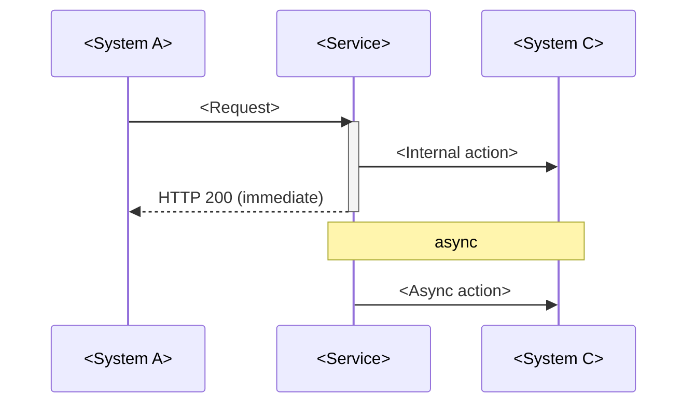

# HLD Template

Replace `<ServiceName>` throughout. Remove all guidance comments before publishing.

---

```markdown
---
name: <ServiceName> — HLD
code: <service-name>-hld
version: 0.1
status: draft
last_updated: YYYY-MM-DD
---

# <ServiceName> — High Level Design

## Overview

<!-- 2–3 paragraphs:
     1. What this service is and its role in the platform
     2. What architectural pattern it uses and why (e.g. Channel Adapter, plugin registry)
     3. Brief inbound/outbound summary -->

## Architecture Diagram

<!-- ASCII or Mermaid diagram showing major components and data flow.
     Show external systems (Slack, Gmail, Temporal) as boxes outside the service boundary.
     Show internal components as boxes inside. Show data flow with arrows. -->

```
┌─── <ServiceName> (K8s Pod) ───────────────────────┐
│                                                     │
│  ┌────────────┐      ┌────────────────────────┐   │
│  │ HTTP :8080  │─────▶│  <Core Component>      │   │
│  └────────────┘      └────────────────────────┘   │
│                                  │                  │
│                       ┌──────────▼──────────────┐  │
│                       │  Temporal Dispatcher     │  │
│                       └─────────────────────────┘  │
└─────────────────────────────────────────────────────┘
         │                            │
         ▼                            ▼
   Temporal Frontend             External API
   (shared namespace)
```

## Deployment Model

| Property | Value |
|----------|-------|
| Type | K8s Deployment, `de-v2-platform` namespace |
| Language | TypeScript (Node 22+) or Go (Nexus-first clusters) |
| HTTP framework | Fastify v4 |
| Replicas | 2 (min) – N (max) |
| Scaling trigger | KEDA — <metric> |
| Resources | Request: 256Mi / 200m CPU. Limit: 512Mi / 500m CPU |
| Webhook port | 8080 (ALB Ingress, external) |
| Worker port | 9090 (ClusterIP, internal) |
| Metrics port | 8081 (Prometheus scrape) |
| Liveness / Readiness | `GET /health` on :8080 |

## <Core Interface / Adapter Interface>

<!-- Define the primary extensibility contract as an annotated TypeScript interface.
     Comments explain the semantics, not the syntax.
     Full implementation types (with file paths) go in TRD. -->

```typescript
interface <AdapterName> {
  readonly <id>: "<type-a>" | "<type-b>";

  /**
   * <What this method does and why it exists.>
   */
  <methodName>(args: <Type>): Promise<<ReturnType>>;
}
```

## <Primary Schema> Schema

<!-- Fully annotated schema definition. This is the primary documentation for each field.
     TRD contains bare TypeScript types without these annotations.
     Use inline comments to document: format, source, semantics, constraints. -->

```typescript
interface <SchemaName> {
  // ── <Group> ──────────────────────────────────────────────────────
  <field>: <type>;   // <Source>. <Semantics>. <Format if non-obvious>.
  <field>?: <type>;  // Optional: <when present vs absent>.
}
```

<!-- Repeat for each canonical schema (e.g. AgentMessage, InteractionEvent, etc.) -->

## Component Breakdown

### <Component A>

<!-- Prose description of this component's role. -->
<!-- Field mapping table if this component normalizes data: -->

| Output field | Source |
|-------------|--------|
| `<field>` | `<source expression>` |

### <Component B>

<!-- Repeat for each major component -->

## Key Flows

### <Happy Path Flow>



<!-- Add flows for: main happy path, error path, deduplication, interaction (if applicable) -->

## Storage

### <Redis / PostgreSQL / Vault>

| Key pattern / Table | Purpose | TTL / Notes |
|---------------------|---------|-------------|
| `<prefix>:<key>` | <What it caches or stores> | <TTL if applicable> |

<!-- Document what is read vs. written, and ownership:
     "Comms Gateway 1 does not own any PostgreSQL tables." is a valid entry. -->

## Dependencies

| Dependency | How used |
|------------|---------|
| Temporal Frontend (`temporal-frontend:7233`) | <Specific operations> |
| <External API> | <Inbound/Outbound operations> |
| Redis | <Caching / idempotency> |
| Vault | <Secrets retrieved at startup> |

## Design Principles

<!-- 5–8 principles. Each explains the WHY, not just the rule.
     These inform every technical decision in the TRD. -->

1. **<Principle name>.** <Why it matters and how it shapes decisions.>
2. **<Principle name>.** <Why it matters and how it shapes decisions.>

## Design Decisions Log

<!-- ALL decisions must be resolved. Pending items go in Open Questions below.
     This is the institutional memory of the design. -->

| Question | Resolution |
|----------|-----------|
| <Design question that was debated> | <Final decision and brief rationale> |

## Open Questions / TRD Scope

<!-- Questions deferred to TRD or a future design session.
     Remove items from here as they are resolved into the Design Decisions Log. -->

- <Question that needs a TRD decision>
```
