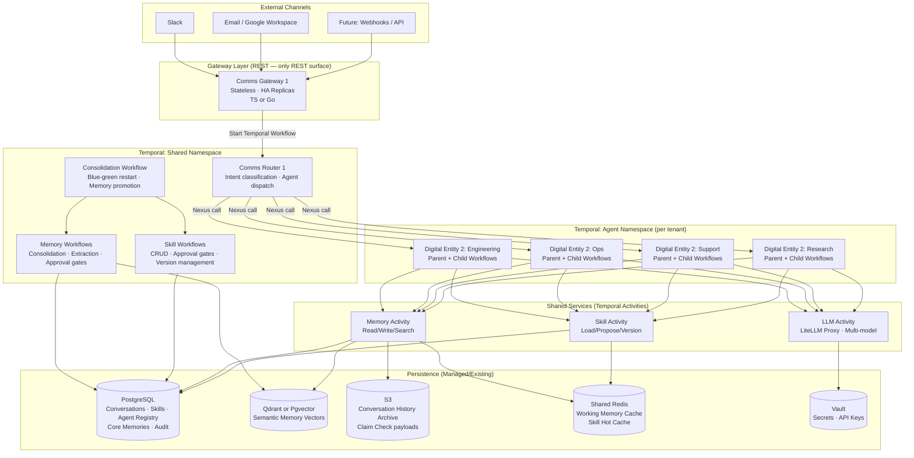
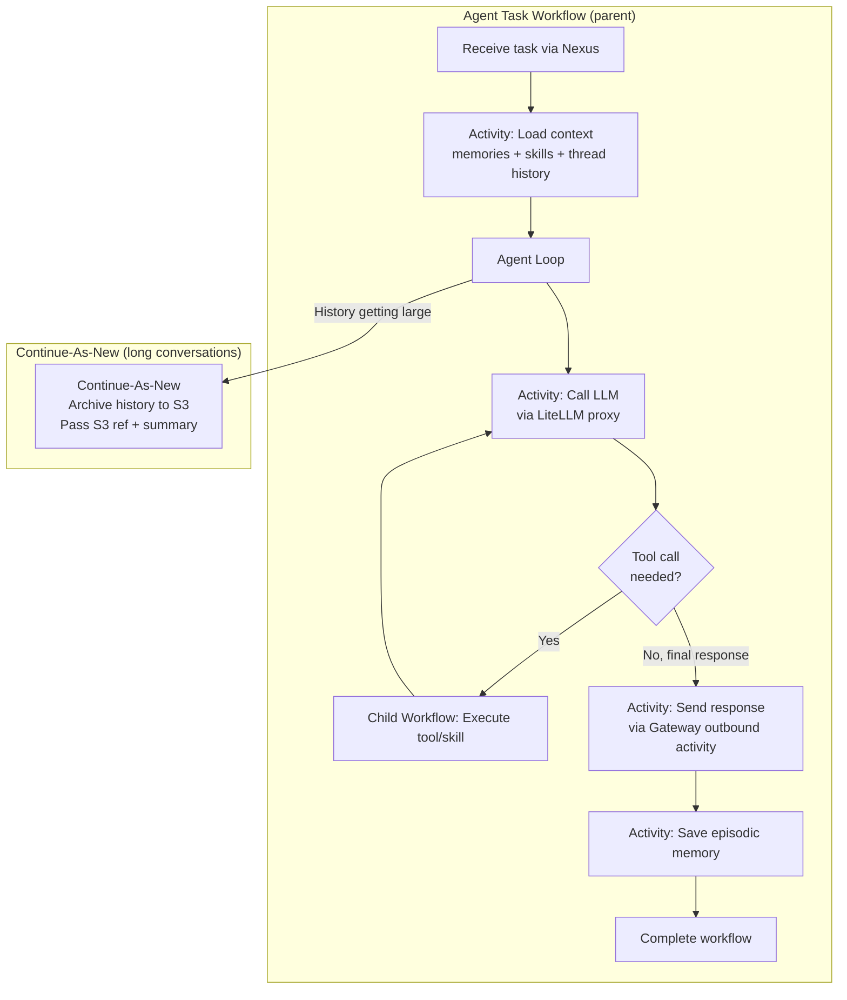
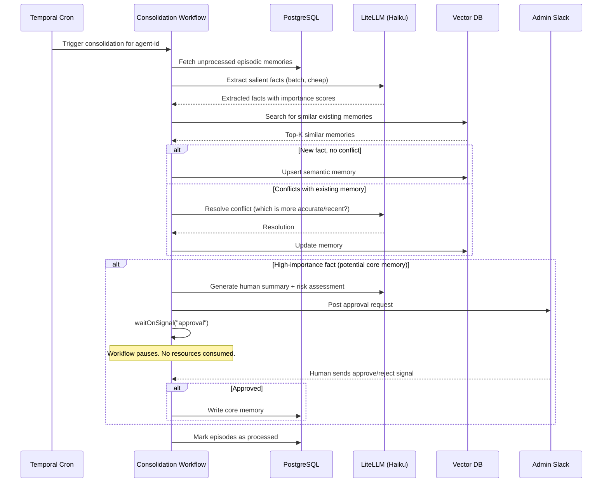
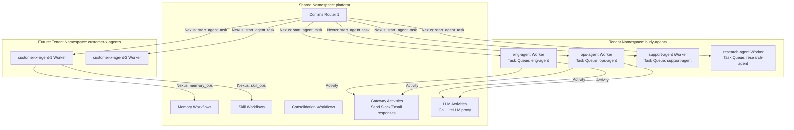
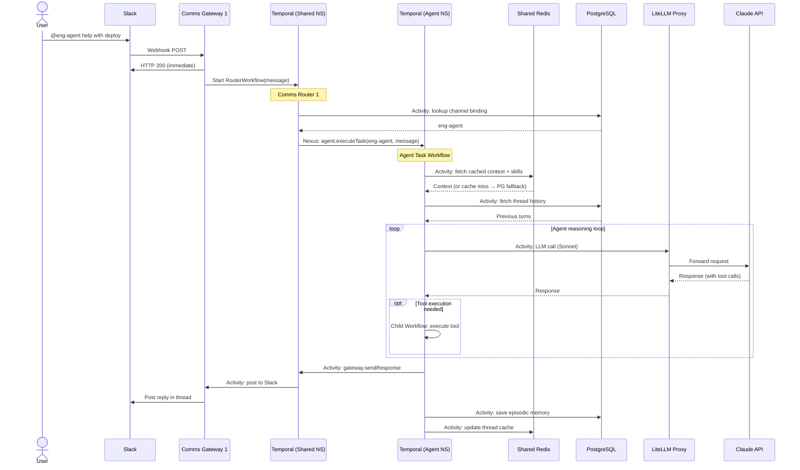

# Autonomous Multi-Agent Microservices Architecture

## Design Document — v0.2 (April 2026)

**Goal:** Build an always-on, skill-based autonomous multi-agent system for internal production use. No app UI — agents communicate via Slack and Email (Google Workspace). Supports 4–6 specialized agents on Kubernetes with multi-LLM routing. Designed for multi-tenancy from day one (single tenant initially).

**Core Principle:** Temporal is the backbone. All inter-service orchestration runs through Temporal workflows, not REST APIs between microservices. The only REST surface is the Comms Gateway 1 (receiving external webhooks). Everything else is Temporal workers, activities, child workflows, and Nexus operations.

---

## 1. Constraints & Existing Infrastructure

These are hard constraints that shape every decision.

| Constraint | Detail |
|-----------|--------|
| **Languages** | TypeScript or Go. No Python in production services. Python allowed only for agent scripts/skills (LLMs code better in Python, humans read it easily). |
| **Orchestration** | Temporal + Nexus everywhere. No Kafka for new services (existing cluster stays for legacy API routing). No custom REST APIs between internal services. |
| **State** | Agents are stateless. No PVCs, no StatefulSets. Pods can die and restart at any time. All durable state lives in PostgreSQL, shared Redis, S3, or Temporal workflow history. |
| **Kubernetes** | AWS EKS. Existing stack: Vault, Prometheus, Istio, Karpenter, KEDA, PostgreSQL, shared Redis. |
| **Identity** | K8s ServiceAccount + IRSA where needed for AWS services. No baked-in secrets — Vault operator injects via env. |
| **Multi-tenancy** | Design for it now, implement single tenant first. Tenant isolation via K8s namespaces + Temporal namespaces. Nexus bridges shared services to tenant-specific agents. |

---

## 2. High-Level Architecture



---

## 3. Microservices Breakdown

### 3.1 Comms Gateway 1 (Microservice #1)

**Language:** Go (high-throughput, low-latency webhook handling) or TypeScript (if team prefers consistency).

**What it does:** The only REST-facing service. Receives webhooks from Slack and Gmail, normalizes them, and starts a Temporal workflow.

### Key behavior:

- Receives Slack Events API webhook → immediately returns HTTP 200 (Slack's 3-second timeout means you cannot do anything synchronous) → starts a Comms Router 1 in Temporal with the normalized message payload.
- Receives Gmail Pub/Sub push notification → same pattern.
- Normalizes all channels into a common envelope:

Q: IS there a standard package/sytem we can use for this so as to not wire and maintain everything from scratch ?

```typescript
interface AgentMessage {
  channel: "slack" | "email" | "webhook";
  tenant_id: string;
  sender_id: string;
  thread_id: string;       // Slack thread_ts or email thread ID
  content: string;
  attachments?: Attachment[];
  metadata: Record<string, string>; // channel-specific extras
  timestamp: string;
}
```

- Handles outbound: exposes a Temporal activity that posts responses back to the correct channel/thread. Agent workers call this activity when they have a response.

**Deployment:** K8s Deployment, 2+ replicas, behind an Ingress/ALB. Stateless. Horizontal scaling via KEDA based on request rate.

**What this is NOT:** It does not route messages to agents. It does not store anything. It starts a Temporal workflow and gets out of the way.

### 3.2 Comms Router 1 (runs in Shared Temporal Namespace)

**Language:** TypeScript (Temporal SDK).

**What it does:** Receives an `AgentMessage` from the Gateway and decides which agent handles it. This is a Temporal workflow, not a microservice with its own API.

### Routing strategy (layered, most-specific-first):

1. **Explicit binding lookup** (Activity) — Query PostgreSQL: is this Slack channel or email address explicitly bound to an agent? If yes, route there. Example: `#ops-alerts` → Ops Agent.
2. **Thread continuity** (Activity) — Query PostgreSQL: does this `thread_id` already have an active agent assignment? If yes, route to that agent (same agent continues the conversation).
3. **Intent classification** (Activity) — Call LLM Router 1 (Haiku-class model, sub-second) with the message content + list of available agents and their capability descriptions. LLM picks the best agent.
4. **Fallback** — Route to a default general-purpose agent, or send a "I don't know who should handle this" response back to the channel.

**After routing:** The workflow makes a **Nexus call** from the shared namespace into the tenant's agent namespace, starting the agent's task workflow on the correct task queue.

**Why Temporal and not a separate microservice:** The routing decision is a short-lived workflow (seconds). It benefits from Temporal's durability (if the worker crashes mid-routing, it replays and completes), and it avoids building a REST API + client + retry logic + circuit breakers between services.

### 3.3 Digital Entity 2 (Microservice #2 — one Deployment, one task queue per agent identity)

**Language:** TypeScript (Temporal SDK + Claude Agent SDK adapter).

**This is the core of the system.** Each agent is a Temporal worker that polls a specific task queue. The worker serves both workflows and activities.

### Deployment model:

```yaml
Deployment: eng-agent
  replicas: 1  (scale later)
  env:
    TEMPORAL_NAMESPACE: "tenant-budy-agents"
    TEMPORAL_TASK_QUEUE: "eng-agent"
    AGENT_ID: "eng-agent"
    AGENT_REGISTRY_ENDPOINT: ""  # or loaded from ConfigMap
  serviceAccount: eng-agent-sa   # K8s SA, IRSA if needed
  secrets: via Vault operator → env
```

**No StatefulSet. No PVC.** The pod is a stateless Temporal worker. If it dies, Temporal replays the workflow on a new pod. Multiple replicas on the same task queue = horizontal scaling (Temporal distributes tasks across workers).

### Identity comes from:

- Temporal namespace + task queue name (not pod name)
- K8s ServiceAccount (for IRSA / cloud identity)
- Environment variables (agent ID, config)
- Agent Registry in PostgreSQL (persona, system prompt, skills list, permissions)

### Bootstrap sequence (on pod startup, before polling Temporal):

1. Read `AGENT_ID` from env.
2. Fetch agent config from Agent Registry (PostgreSQL query — this is an init-time read, not a Temporal activity).
3. Fetch assigned skills from Skill Service (PostgreSQL query). Cache skill content in shared Redis with agent-prefixed keys.
4. Fetch core memories from Memory Service (PostgreSQL + vector DB query). Cache in shared Redis.
5. Register workflows and activities with the Temporal worker.
6. Start polling the task queue.

### Agent execution model (Temporal workflow):



### Handling the 2MB Temporal payload limit:

- Conversation history is the main thing that grows. After N turns (configurable), the workflow archives the full history to S3 and passes a lightweight reference + summary through Temporal (Claim Check pattern).
- Skill content is never passed through Temporal. It's fetched from Redis/PostgreSQL in activities.
- LLM responses are typically <100KB. Not a concern.

### Continue-As-New for long-running conversations:

- When `workflowInfo().continueAsNewSuggested()` returns true, the workflow archives state to S3, creates a summary of the conversation so far, and continues-as-new with the summary + S3 reference.
- The agent maintains conversational continuity because the summary + retrievable full history gives it enough context.

### 3.4 Memory Service (Microservice #3 — Temporal Worker)

**Language:** TypeScript.

**Not a REST API.** It's a Temporal worker in the shared namespace that exposes activities and workflows for memory operations.

### Activities (called by agent workers or other workflows):

- `memory.store(agentId, tenantId, episode)` — Store an episodic memory in PostgreSQL.
- `memory.search(agentId, tenantId, query, topK)` — Semantic search over vector DB. Returns relevant memories.
- `memory.getCore(agentId)` — Fetch core memories from PostgreSQL.
- `memory.getSessionContext(threadId)` — Fetch recent thread history from PostgreSQL.

### Workflows:

- **Consolidation Workflow** — Runs on a schedule (cron in Temporal) or triggered by the blue-green restart coordinator. Processes the episodic log for an agent, extracts salient facts, deduplicates against existing semantic memories, and upserts into the vector DB. Uses a Haiku-class LLM call for extraction and scoring (cheap, batch-mode).
- **Core Memory Update Workflow** — When consolidation identifies a high-importance memory that should become "core" (part of the agent's persistent identity/knowledge), it creates an approval request. The workflow pauses via `workflow.waitOnSignal()`. A notification is sent (Slack message to the admin channel with a summary of what the memory is, why it matters, and what risks there are — generated by a lightweight LLM call). The human approves or rejects via a Temporal signal. On approval, the memory is written to PostgreSQL as a core memory and will be loaded on next bootstrap.

### Storage backends:

- PostgreSQL: episodic memories (append-only log), core memories (versioned), session context.
- Qdrant or pgvector: semantic memory vectors.
- Shared Redis: hot cache for frequently-accessed memories (recent conversations, core memories).
- S3: archived conversation histories (Claim Check).

### Init container / sidecar pattern for bootstrap:

The Memory Service and Digital Entity 2 can share code. The agent's bootstrap step calls the same functions that the Memory Service's activities use, just running locally at init time. This keeps the handshake clean — one codebase, two execution modes (init-time direct call vs. Temporal activity at runtime).

### 3.5 Skill Service (Microservice #4 — Temporal Worker)

**Language:** TypeScript.

**Stores skills in PostgreSQL, not Git.** Skills are versioned rows in a PostgreSQL table. This gives you: version history, rollback, access control, and query-ability without building Git tooling.

### Skill table schema (conceptual):

```sql
skills (
  id UUID PRIMARY KEY,
  tenant_id TEXT NOT NULL,
  name TEXT NOT NULL,
  version INT NOT NULL,
  status TEXT NOT NULL,  -- 'draft', 'pending_approval', 'approved', 'deprecated'
  content TEXT NOT NULL,  -- The SKILL.md content
  resources JSONB,        -- References to S3 objects for templates/scripts
  created_by TEXT,        -- 'human' or agent_id
  approved_by TEXT,
  created_at TIMESTAMPTZ,
  approved_at TIMESTAMPTZ,
  metadata JSONB           -- tags, category, required_permissions
);

agent_skills (
  agent_id TEXT,
  skill_id UUID,
  tenant_id TEXT,
  PRIMARY KEY (agent_id, skill_id)
);
```

### Activities:

- `skill.getForAgent(agentId, tenantId)` — Returns all approved skills assigned to this agent.
- `skill.get(skillId, version?)` — Returns a specific skill's content and resources.
- `skill.propose(agentId, content, metadata)` — Agent proposes a new skill. Creates a `draft` row.

### Workflows:

- **Skill Approval Workflow** — When an agent proposes a skill (or a consolidation workflow detects a repeatable pattern):
  1. Skill is saved as `pending_approval`.
  2. A lightweight LLM call generates a human-readable summary: what the skill does, what risks it introduces, how it differs from existing skills.
  3. Notification sent to admin Slack channel with the summary.
  4. Workflow pauses (`waitOnSignal`).
  5. Human approves/rejects via signal.
  6. On approval: status → `approved`, available to agents on next bootstrap or hot-reload.

### Why PostgreSQL over Git:

Git gives you versioning and PRs for free, but: you'd need to build a service to manage Git operations, handle merge conflicts, parse PR state, and integrate with Temporal. PostgreSQL gives you the same versioning (explicit version column), the same approval workflow (Temporal signal-based), and integrates cleanly with your existing infra. The approval UX can be as good as a PR — a Slack message with a diff and approve/reject buttons that send Temporal signals.

**Where I'd push back on "only PostgreSQL":** If skills include large resources (scripts, templates, binary files), S3 is a better backing store for those. Keep the skill metadata and SKILL.md content in PostgreSQL, but reference S3 objects for anything bulky. This also plays well with the Claim Check pattern.

### 3.6 LLM Router 1 (Microservice #5 — LiteLLM Proxy)

**Language:** Python (LiteLLM is Python-native — this is the one exception to the no-Python rule, and it's an off-the-shelf proxy, not custom code).

**Deployment:** LiteLLM Proxy as a K8s Deployment, 2+ replicas. Agent workers call it via HTTP (the only internal HTTP call, and it's to a proxy, not a custom API).

**Why LiteLLM:** It's mature enough. Production-grade budget controls (per-key, per-team, daily/monthly limits), 100+ provider support, OpenTelemetry integration for tracing into your Prometheus stack. The alternative is building this yourself, which is not worth it.

### Configuration:

```yaml
model_list:
  - model_name: "agent-reasoning"
    litellm_params:
      model: "anthropic/claude-opus-4-6"
      api_key: "os.environ/ANTHROPIC_API_KEY"
  - model_name: "agent-coding"
    litellm_params:
      model: "anthropic/claude-sonnet-4-6"
      api_key: "os.environ/ANTHROPIC_API_KEY"
  - model_name: "agent-fast"
    litellm_params:
      model: "anthropic/claude-haiku-4-5-20251001"
      api_key: "os.environ/ANTHROPIC_API_KEY"
  - model_name: "agent-fast"  # fallback
    litellm_params:
      model: "openai/gpt-4o-mini"
      api_key: "os.environ/OPENAI_API_KEY"

general_settings:
  master_key: "os.environ/LITELLM_MASTER_KEY"

litellm_settings:
  max_budget: 2000          # Monthly per-team cap (USD)
  budget_duration: "30d"
  success_callback: ["prometheus"]
  failure_callback: ["prometheus"]
```

**Budget controls per agent:** Each agent gets a LiteLLM API key with its own budget. Engineering agent might get $2,000/month (heavy coding tasks), Support agent $500/month (lighter, more repetitive). The LLM Router 1 enforces this — if an agent burns through its budget, calls are rejected and an alert fires.

**Model selection:** The digital entity 2 decides which model tier to use based on the task. The LiteLLM proxy just routes to the correct provider. Model selection logic lives in the agent code, not the proxy.

### 3.7 Agent Registry (not a separate microservice)

### Simplified to: a PostgreSQL table + a shared library.

```sql
agent_registry (
  agent_id TEXT PRIMARY KEY,
  tenant_id TEXT NOT NULL,
  display_name TEXT,
  persona TEXT,               -- System prompt / persona description
  capabilities TEXT,          -- Human-readable description (used by Router for intent classification)
  llm_preferences JSONB,      -- Model tier preferences per task type
  channel_bindings JSONB,      -- {"slack": ["#ops-alerts"], "email": ["support@company.com"]}
  permissions JSONB,           -- JWT-style permission sets
  schedule JSONB,              -- Operating hours, consolidation windows
  status TEXT,                 -- 'active', 'paused', 'consolidating'
  created_at TIMESTAMPTZ,
  updated_at TIMESTAMPTZ
);
```

The digital entity 2 reads this at bootstrap. The Comms Router 1 reads it to know available agents and their capabilities. No separate service needed — it's a shared data access pattern over PostgreSQL.

### Permission model (your "growing up" analogy):

```jsonc
{
  "permissions": {
    // What the agent can do
    "actions": ["read_slack", "send_slack", "read_email"],
    // What it CANNOT do yet (must be explicitly granted through human approval)
    "escalation_required": ["send_email", "execute_code", "modify_infrastructure"],
    // Daily action limits
    "limits": {
      "slack_messages_per_day": 100,
      "emails_per_day": 10,
      "llm_calls_per_hour": 200
    }
  }
}
```

Permissions are updated through the same Temporal signal-based approval workflow used for skills and core memories. Agent demonstrates responsibility → admin grants new permissions → updated in PostgreSQL → agent picks up on next bootstrap or via a "reload config" signal.

---

## 4. The Consolidation Cycle — Blue-Green Restart

Instead of a hard "sleep" window, the system performs rolling consolidation with optional blue-green restarts.

### 4.1 Continuous Background Consolidation

The Memory Service's Consolidation Workflow runs on a Temporal cron schedule (e.g., every 4 hours during active periods, every hour during off-hours). It does not require the agent to be offline.



### 4.2 Blue-Green Restart (Scheduled or On-Demand)

For memory hygiene, leak prevention, and picking up approved skills/memories, agents periodically restart via blue-green deployment.

This can start as a **CronJob** (simplest) and evolve into a dedicated Temporal workflow later.

### CronJob approach:

1. CronJob runs at 2am (or configurable schedule).
2. For each agent Deployment, the job:
   - Triggers the consolidation workflow and waits for completion.
   - Does a `kubectl rollout restart deployment/eng-agent` — K8s creates a new pod, waits for readiness, then terminates the old pod. Zero downtime because Temporal handles task redistribution.
3. The new pod bootstraps with fresh state: latest approved skills from PostgreSQL, latest core memories, clean Redis cache.

**Why this works without StatefulSets/PVCs:** The agent is stateless. All its important state is in PostgreSQL, vector DB, and S3. A fresh pod bootstrapping from those sources is identical to the old pod. Temporal ensures no in-flight work is lost — if the old pod dies mid-task, the workflow replays on the new pod.

---

## 5. Temporal Namespace & Multi-Tenancy Design



### Nexus operations exposed by the shared namespace:

- `start_agent_task(tenantId, agentId, message)` — Called by Router to dispatch work to a tenant's agent namespace.
- `memory.search(tenantId, agentId, query)` — Memory operations from shared service.
- `memory.store(tenantId, agentId, episode)` — Store episodic memory.
- `skill.getForAgent(tenantId, agentId)` — Fetch skills.
- `gateway.sendResponse(channel, threadId, content)` — Post response back to channel.

### Nexus operations exposed by tenant namespaces:

- `agent.executeTask(agentId, taskPayload)` — The Router calls this to hand off work.

### Adding a new tenant:

1. Create a new Temporal namespace: `customer-x-agents`.
2. Create agent entries in the Agent Registry (PostgreSQL) with the new `tenant_id`.
3. Deploy digital entity 2 pods in the tenant's K8s namespace, configured to poll the tenant's Temporal namespace.
4. Set up Nexus routes between the shared namespace and the tenant namespace.
5. Shared services (memory, skills, LLM) serve all tenants — data isolation is via `tenant_id` column in PostgreSQL and namespace-prefixed keys in Redis.

---

## 6. Claude Agent SDK Integration

### 6.1 Current State

The Claude Agent SDK (TypeScript, v0.2.71 on npm) is production-quality — it powers Claude Code, which handles millions of tasks. It provides: tool execution, MCP integration, sandboxed execution, and the agent loop (prompt → LLM → tool calls → loop).

**However:** It does not have native Temporal support. OpenAI's Agents SDK does (via `activity_as_tool()` helper, GA March 2026). Claude's SDK is designed as a standalone session manager.

### 6.2 Integration Strategy

Rather than wrapping the entire Claude Agent SDK in a Temporal activity (which would fight against both systems' state management), use it as a **library for tool execution and LLM interaction** inside Temporal activities.

```text
Temporal Workflow (orchestration, durability, state) 
  └── Activity: agent_think(context, skills, memories)
        └── Claude Agent SDK (LLM call, tool execution, MCP)
              └── Returns: response + tool results + new memories
```

The Temporal workflow owns the loop, state, and recovery. The Claude Agent SDK handles the "single turn" of thinking — receive context, call LLM, execute any tools, return results. This way:

- Temporal handles crash recovery, timeouts, retries, and long-running state.
- Claude Agent SDK handles LLM interaction, tool definitions, and MCP integration.
- No conflict between state management systems.

**If the SDK is too opinionated for this pattern:** Fork the tool execution and MCP client pieces. The LLM call itself is just an HTTP request to the LiteLLM proxy — you don't strictly need the SDK for that. The SDK's value is in its pre-built tool implementations and MCP integration.

### 6.3 Where I'd Challenge

**Is the Claude Agent SDK worth it for your use case?** You're building a Temporal-native system where orchestration is already handled. The SDK's biggest value-add — managing the agent loop — is exactly what your Temporal workflow does. What you actually need from it is: tool definitions (file ops, shell, web search) and MCP client integration. Consider whether pulling in just `@anthropic-ai/sdk` (the base API client) + a lightweight MCP client library gives you the same capability with less friction.

That said, if you want to leverage Claude Code's battle-tested tool implementations (which are genuinely good), the fork/adapter approach is the pragmatic path.

---

## 7. Sidecar / Init Container Strategy

Your instinct about sidecars for memory/skill bootstrapping is good. Here's how I'd structure it to keep code shared and communication clean.

### 7.1 Shared Code, Different Execution Modes

The Memory Service and Skill Service are TypeScript packages that export both:

- **Temporal activities** (for runtime use by agent workers and other workflows)
- **Direct functions** (for init-time bootstrap)

```text
packages/
  memory-service/
    src/
      activities.ts     # Temporal activity definitions
      functions.ts      # Core logic (shared between activities and direct calls)
      worker.ts         # Temporal worker entry point
      bootstrap.ts      # Direct-call entry point for init containers
  skill-service/
    src/
      activities.ts
      functions.ts
      worker.ts
      bootstrap.ts
  digital-entity-2/
    src/
      workflows.ts      # Agent task workflow, child workflows
      activities.ts     # Agent-specific activities
      worker.ts         # Temporal worker entry point
      init.ts           # Calls memory-service/bootstrap + skill-service/bootstrap
```

### 7.2 Init Container Pattern

```yaml
# Agent Deployment
initContainers:
  - name: bootstrap
    image: digital-entity-2:latest  # Same image, different entrypoint
    command: ["node", "dist/init.js"]
    env:
      - name: AGENT_ID
        value: "eng-agent"
      - name: REDIS_URL
        valueFrom:
          configMapKeyRef: ...
      - name: DATABASE_URL
        valueFrom:
          secretKeyRef: ...  # via Vault operator
    # Writes skill content + core memories to shared Redis
    # Also writes to an emptyDir volume for any large files

containers:
  - name: agent
    image: digital-entity-2:latest
    command: ["node", "dist/worker.js"]
    env: ...  # same env vars
    volumeMounts:
      - name: scratch
        mountPath: /tmp/agent-data  # For any large skill resources

volumes:
  - name: scratch
    emptyDir:
      sizeLimit: 1Gi  # Ephemeral. Dies with the pod. No PVC.
```

**EmptyDir (not PVC)** is the right pattern here. It exists for the pod's lifetime, provides fast local disk for skill scripts and templates, and needs no persistent storage management. If the pod dies, the data is gone — but that's fine because the init container rebuilds it from PostgreSQL/S3 on next startup.

---

## 8. Redis Strategy

**Skip the Redis sidecar.** Use the existing shared Redis cluster with agent-prefixed keys.

```text
Key pattern:
  agent:{tenant_id}:{agent_id}:skills         → Cached skill metadata
  agent:{tenant_id}:{agent_id}:core_memories   → Cached core memories
  agent:{tenant_id}:{agent_id}:thread:{id}     → Active conversation context
  agent:{tenant_id}:{agent_id}:config          → Cached agent config
```

### TTLs:

- Skill cache: 1 hour (re-fetched from PostgreSQL on miss)
- Core memories: 1 hour
- Thread context: 24 hours (or until thread is resolved)
- Config: 15 minutes

**The agent handles cache misses gracefully.** If Redis doesn't have the data, the agent fetches from PostgreSQL. This is the stateless design — Redis is a performance optimization, not a requirement.

**Temporal's own state handles the rest.** In-flight workflow state (current conversation turn, tool call results) lives in Temporal's event history, not Redis.

---

## 9. End-to-End Message Flow



---

## 10. Approval Tiering

| Change Type | Approval Process | Implementation |
|-------------|-----------------|----------------|
| **Skill creation/modification** | Full human review. Slack notification with LLM-generated summary of what the skill does, how it differs from existing skills, and risk assessment. Temporal signal for approve/reject. | Skill Approval Workflow |
| **Core memory updates** | Human review with auto-approve option. If confidence > threshold and no conflicts, can batch for weekly review. | Core Memory Approval Workflow |
| **Permission escalation** | Always human review. High-stakes. | Permission Approval Workflow |
| **Semantic memory** (consolidated from episodic) | Automated. Quality checks: dedup, consistency, vector similarity threshold. No human in loop. | Consolidation Workflow |
| **Episodic memory** | Automated. Append-only log. No approval. | Direct write in agent activity |
| **Agent config changes** | Human review. | Registry update + approval signal |

---

## 11. Phased Rollout

### Phase 1: Foundation (Weeks 1–3)

- Comms Gateway 1 (Slack only, Go or TS)
- Comms Router 1 (explicit bindings only — no intent classification yet)
- One digital entity 2 (general-purpose, TS)
- LiteLLM Proxy deployment with Claude Sonnet + Haiku
- PostgreSQL schema: agent_registry, skills, episodic_memories, thread_context
- Shared Redis key structure
- Basic Temporal setup: shared namespace, one agent namespace

**Milestone:** Send a Slack message, get a response from the agent.

### Phase 2: Memory & Multi-Agent (Weeks 4–6)

- Memory Service (Temporal worker with activities + consolidation workflow)
- Vector DB (Qdrant or pgvector) for semantic memory
- Second and third agent workers (specialized)
- Intent-based routing in Comms Router 1 (Haiku classifier)
- Skill Service (PostgreSQL-backed, basic CRUD)
- Init container bootstrap pattern

**Milestone:** Multiple agents responding to different channels. Memories persisting across conversations.

### Phase 3: Consolidation & Learning (Weeks 7–10)

- Consolidation Workflow (cron-scheduled)
- Skill Approval Workflow (Temporal signals + Slack notifications)
- Core Memory Approval Workflow
- Blue-green restart CronJob
- Email channel in Gateway (Gmail Pub/Sub)
- Budget controls in LiteLLM (per-agent keys)
- Agent permission model

**Milestone:** Agents learning from interactions. Humans reviewing and approving skill proposals.

### Phase 4: Multi-Tenancy & Scale (Weeks 11+)

- Nexus setup for cross-namespace communication
- Second tenant namespace
- KEDA autoscaling for agent workers based on Temporal task queue depth
- Observability dashboard (Prometheus + Grafana, LLM cost tracking)
- A2A protocol exploration for external agent interop
- Advanced routing (multi-agent fan-out, delegation between agents)

**Milestone:** Multiple tenants running isolated agents with shared infrastructure.

---

## 12. Technology Summary

| Component | Choice | Notes |
|-----------|--------|-------|
| **Agent Runtime** | Temporal Worker (TS) + Claude Agent SDK (adapter/fork) | Temporal owns orchestration. SDK provides tool execution + MCP. |
| **LLM Proxy** | LiteLLM | Python, but off-the-shelf. Budget controls, multi-provider, OpenTelemetry. |
| **Orchestration** | Temporal + Nexus | All inter-service communication. No custom REST APIs. |
| **Message Queue** | Temporal task queues | Replaces Kafka/NATS/Redis Streams for new services. |
| **Skill Storage** | PostgreSQL + S3 (for large resources) | Versioned, queryable, approval workflow via Temporal signals. |
| **Memory (Semantic)** | Qdrant or pgvector | pgvector is simpler (stay in PostgreSQL). Qdrant scales better. Start with pgvector. |
| **Memory (Episodic)** | PostgreSQL (append-only) | Structured log with agent_id, tenant_id, timestamps. |
| **Memory (Working)** | Shared Redis (existing) | Agent-prefixed keys. TTL-based expiry. Cache, not source of truth. |
| **Memory (Core)** | PostgreSQL (versioned, approval-gated) | Human-approved. Loaded at bootstrap. |
| **Conversation Archive** | S3 (Claim Check pattern) | For Temporal's 2MB limit. Referenced by URL in workflow state. |
| **Secrets** | Vault + Vault Operator → env | No secrets in images. No K8s Secrets for sensitive values. |
| **Identity** | K8s ServiceAccount + IRSA | Workload identity for AWS services. |
| **Observability** | Prometheus + Grafana (existing) + LiteLLM metrics | OpenTelemetry from LiteLLM → Prometheus. |
| **Skill Format** | SKILL.md standard | Industry standard. Human-readable. Agent-readable. |
| **Tool Protocol** | MCP | For any skills that expose tools. |
| **Infra** | EKS, Karpenter, KEDA, Istio | Existing stack. KEDA for digital entity 2 autoscaling on Temporal queue depth. |

---

## 13. Open Questions

1. **pgvector vs Qdrant?** pgvector keeps you in PostgreSQL (one less system to manage). Qdrant is purpose-built and faster for large-scale vector search. At 4-6 agents, pgvector is likely sufficient. Revisit when you have thousands of memories per agent.

1. **Claude Agent SDK: use, fork, or skip?** The tool implementations are valuable. The session management fights with Temporal. Recommendation: start by calling the Anthropic API directly via LiteLLM, build your own tool execution in Temporal activities, and pull in the Agent SDK's MCP client library. You can always adopt more of the SDK later.

1. **Temporal Cloud vs self-hosted?** Self-hosted gives you more control and no vendor dependency. Temporal Cloud gives you less ops burden and multi-region replication. For internal use starting at your scale, self-hosted on EKS is fine.

1. **How should agents delegate to each other?** Agent A encounters a task better suited for Agent B. Options: (a) Agent A's workflow makes a Nexus call to start a task on Agent B's queue. (b) Agent A sends the task back to the Router for re-routing. Option (b) is simpler and keeps agents decoupled.

1. **Skill execution sandboxing?** If agents run Python scripts as part of skills, those scripts need sandboxing. Options: run in a separate container (sidecar or job), use a WASM sandbox, or use the Claude Agent SDK's built-in sandbox. This becomes critical when agents gain code execution permissions.

---

## Appendix A: Key References

### Temporal + Agents:

- [Temporal for AI](https://temporal.io/solutions/ai)
- [Orchestrating Ambient Agents with Temporal](https://temporal.io/blog/orchestrating-ambient-agents-with-temporal)
- [Durable Multi-Agent Architecture with Temporal](https://temporal.io/blog/using-multi-agent-architectures-with-temporal)
- [Building Production-Ready Agentic Systems](https://temporal.io/blog/building-an-agentic-system-thats-actually-production-ready)
- [Temporal Nexus GA](https://temporal.io/blog/temporal-nexus-now-available)
- [Claim Check Pattern](https://docs.temporal.io/ai-cookbook/claim-check-pattern-python)
- [Human-in-the-Loop with Temporal](https://docs.temporal.io/ai-cookbook/human-in-the-loop-python)
- [Continue-As-New for Long-Running Workflows](https://temporal.io/blog/very-long-running-workflows)

### Agent Standards:

- [MCP Specification](https://modelcontextprotocol.io/specification/2025-11-25)
- [A2A Protocol (Google)](https://developers.googleblog.com/en/a2a-a-new-era-of-agent-interoperability/)
- [SKILL.md Standard](https://www.mintlify.com/blog/skill-md)
- [Claude Agent SDK](https://code.claude.com/docs/en/agent-sdk/overview)

### Memory & Learning:

- [Mem0 Research Paper](https://arxiv.org/abs/2504.19413)
- [Redis Agent Memory](https://redis.io/blog/ai-agent-memory-stateful-systems/)
- [GitAgent — Git-Based Agent Behavior Versioning](https://www.lyzr.ai/blog/gitagent)

### LLM Infrastructure:

- [LiteLLM Budget Controls](https://docs.litellm.ai/docs/proxy/users)
- [LiteLLM OpenTelemetry](https://docs.litellm.ai/docs/observability/opentelemetry_integration)

### Kubernetes Patterns:

- [Kagent — K8s-Native Agent Framework](https://github.com/kagent-dev/kagent)
- [KEDA Autoscaling for Temporal Workers](https://keda.sh/)
