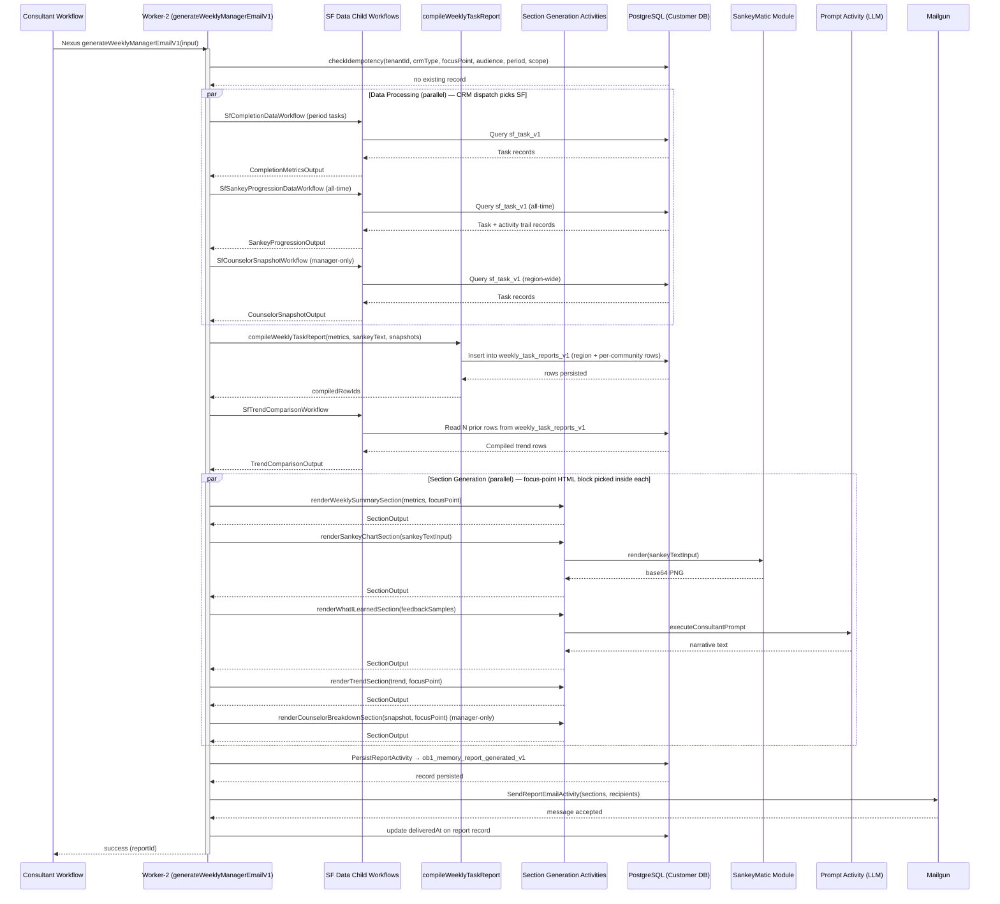
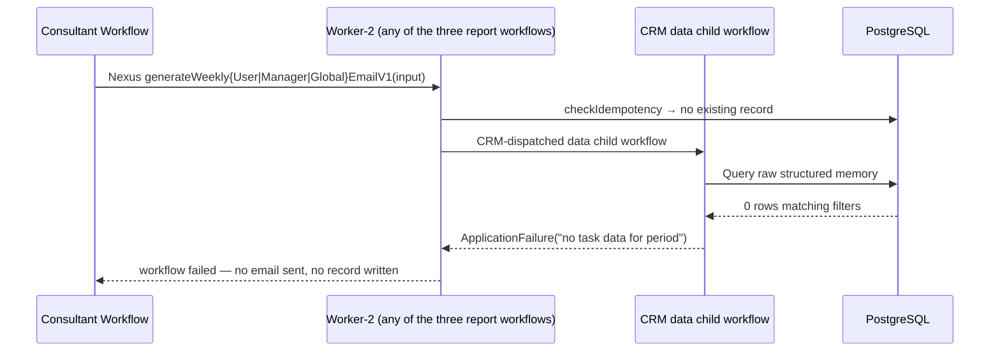
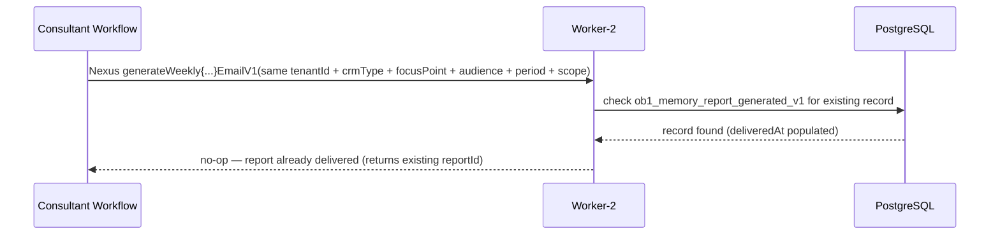

# Customer Reporting — High Level Design

## Overview

Customer Reporting is implemented as a set of Temporal workflows and activities hosted on **Shared Consultant Worker-2**, a new Temporal worker service deployed alongside the existing Worker-1. Worker-1 handles general-purpose prompt and memory operations for consultant-authored workflows; Worker-2 is dedicated to structured, multi-step reporting generation where the output is a rendered, deliverable artifact rather than a conversational response.

The service exposes **five versioned Nexus operations** — two for CRM data ingestion and three for report generation — that consultants compose from their own parent workflows. Ingestion operations (`ingestSFCrmDataV1`, `ingestWMCrmDataV1`) pull raw task and activity records from a CRM into CRM-specific structured memory tables. Report operations (`generateWeeklyUserEmailV1`, `generateWeeklyManagerEmailV1`, `generateWeeklyGlobalEmailV1`) compile that raw data into a CRM-agnostic weekly metrics table and produce audience-targeted HTML email reports. Each report operation owns its own orchestration; the consultant's caller chooses which operation to invoke based on the audience and does not supply audience as an input parameter.

The service is built around a **three-concern separation**:

1. **Ingestion** populates CRM-specific raw tables. HLD and TRD for ingestion workflows are **TBD** — they will be filled in as part of a follow-on design pass. The raw tables they write into, however, are fixed and consumed by the reporting workflows.
2. **Compilation** reads raw CRM records and produces rows in the CRM-agnostic `ob1_memory_weekly_task_reports_v1` table, which has columns for user, community, region, and global aggregation levels and a pre-formatted Sankey text blob. This layer also performs trend comparisons by reading prior compiled rows — the raw CRM table is only touched for the current reporting period.
3. **Rendering** consumes the compiled metric shapes plus CRM-agnostic helpers (LLM narrative, Sankey PNG from the pre-formatted blob) to produce HTML section fragments and deliver them by email.

Within each of the three report generation workflows, the same internal dispatch pattern applies: **CRM type** (`salesforce` / `welcomehome`) selects which data-processing child workflows run against which raw table, and **focus point** (`completion` / `speed`) selects which HTML block variant the section activities render. The audience is fixed per workflow — user workflows scope to a single counselor, manager workflows to a region with per-counselor breakdown, and global workflows to the whole org with performance rankings — so it is not an input axis at the Nexus layer.

The Consultant Workflow (caller) initiates one of the three report operations via a Nexus call into Worker-2, passing the tenant, CRM type, focus point, reporting period, recipients, and **client-specific configuration** including the memory instance to query, the Sankey stage mapping, and the agent user IDs used to distinguish initial task assignments from follow-up activities. Worker-2 runs the selected parent workflow, which orchestrates the compilation and rendering concerns, stores the result, and dispatches delivery via a Mailgun activity before completing.

## Mark 1 Scope

### Supported Nexus Workflows

Mark 1 exposes five Nexus operations. The audience dimension is expressed by **choice of workflow** (user / manager / global), and each workflow dispatches internally on **CRM type** and **focus point** at runtime.


| Nexus Workflow                 | Audience          | Scope                                                    | Supported CRM types        |
| ------------------------------ | ----------------- | -------------------------------------------------------- | -------------------------- |
| `ingestSFCrmDataV1`            | — (ingestion)     | Raw SF task + activity trail rows into structured memory | Salesforce                 |
| `ingestWMCrmDataV1`            | — (ingestion)     | Raw WH task rows into structured memory                  | WelcomeHome ¹              |
| `generateWeeklyUserEmailV1`    | Sales counselor   | Single counselor, one week                               | Salesforce / WelcomeHome ¹ |
| `generateWeeklyManagerEmailV1` | Regional manager  | Region, one week, with per-counselor breakdown           | Salesforce / WelcomeHome ¹ |
| `generateWeeklyGlobalEmailV1`  | Senior leadership | Org-wide, one week, with ranked best/worst performers    | Salesforce / WelcomeHome ¹ |


¹ WelcomeHome is contingent on the WH structured task table being available before UAT. Workflows accept WH as a valid `crmType` at the contract level; the internal CRM dispatch will fail fast with a clear error until the WH data-processing child workflows are implemented.

Each of the three report workflows accepts a `focusPoint` of `completion` or `speed`; the section activities pick the HTML block variant for that focus point when rendering the weekly summary, trend, and (where applicable) counselor breakdown sections.

### Report Sections — Numbered Slot Model

Sections are identified by **ordinal position** (`section1`, `section2`, …), not by name. The parent workflow assigns each section activity's output to a numbered slot. This decouples section content from section order — reordering sections in a future template version requires only changing which slot each activity writes to, with no schema or downstream changes.

The report record stores each slot's HTML and raw data under numbered columns (`section_1_html`, `section_1_data`, …), alongside a `**templateVersion`** string that records which template layout was used. When a stored report is retrieved or re-rendered, the template version determines which HTML wrapper and slot ordering to apply.

**Mark 1 slot assignments (template version `v1`):**


| Slot       | Content             | Workflows               | Description                                                                                            |
| ---------- | ------------------- | ----------------------- | ------------------------------------------------------------------------------------------------------ |
| `section1` | Weekly Summary      | user / manager / global | Key metrics for the reporting week, specific to the report's focus point                               |
| `section2` | Sankey Chart        | user / manager / global | Visual depiction of all-time prospect stage progression, delivered as an embedded base64 PNG image     |
| `section3` | What I Learned      | user / manager / global | LLM-generated narrative synthesizing counselor feedback from the reporting period                      |
| `section4` | 3-Week Trend        | user / manager / global | Current week's focus-point metric compared against the prior 3-week average (read from compiled table) |
| `section5` | Counselor Breakdown | manager only            | Per-counselor metric rows plus community aggregate                                                     |
| `section6` | Performance Ranking | global only             | Ranked best and worst performers across regions, communities, and individual users                     |

### New Platform Components


| Component                           | Type                              | Description                                                                                                       |
| ----------------------------------- | --------------------------------- | ----------------------------------------------------------------------------------------------------------------- |
| Shared Consultant Worker-2          | New Temporal worker               | Hosts all reporting and ingestion workflows and activities; separate from Worker-1                                |
| `ob1_memory_structured_sf_task_v1`  | database-services-l1 migration ¹  | Raw Salesforce task and activity trail records, per tenant. Written by ingestion, read by compilation             |
| WelcomeHome task structured memory  | database-services-l1 migration ¹  | Raw WelcomeHome task records, per tenant. Written by ingestion, read by compilation                               |
| `ob1_memory_weekly_task_reports_v1` | New TypeORM entity (this service) | Compiled weekly metrics with user, community, region, and global columns; includes Sankey text blob; CRM-agnostic |
| `ob1_memory_report_generated_v1`    | New TypeORM entity (this service) | Dedicated storage for generated reports (HTML + raw data per section)                                             |
| Mailgun delivery activity           | New Temporal activity             | Assembles section HTML into an inline HTML email and calls the Mailgun Messages API                               |
| SankeyMatic Node module             | New internal library              | Pure Node.js rendering of Sankey charts; outputs base64 PNG                                                       |
| `region` column on SF task table    | Schema migration                  | New column on `ob1_memory_structured_sf_task_v1` for regional scoping                                             |


¹ The raw CRM structured memory tables are owned by the database-services-l1 platform track. Their columns and indexes are treated as fixed contracts here; their migrations are tracked in that repo. Customer Reporting reads these tables read-only during compilation.

### Ingestion Workflows — TBD

Ingestion workflow internals — connection handling, query config shape, incremental-write semantics, retry/backoff policies, and CRM client abstractions — are **deferred** to a follow-on HLD pass and a corresponding TRD section. The ingestion layer is in scope for Mark 1 as a Nexus contract surface (both operations and their input shapes are listed in the PRD), but the component-level design is intentionally not specified in this revision.

What is fixed now:

- Two ingestion Nexus operations exist: `ingestSFCrmDataV1` and `ingestWMCrmDataV1`.
- Ingestion runs on the same Worker-2 task queue as report generation.
- Ingestion writes only to the CRM-specific raw structured memory tables and never to the compiled metrics table or the generated report table.
- Ingestion accepts a caller-supplied connection config (which org to poll) and query config (which task and activity types to fetch).
- Ingestion does not aggregate or compile. Compilation is performed during report generation, not ingestion.

Report generation workflows do not call ingestion. The consultant's parent workflow schedules ingestion and report generation independently.

## Architecture Diagram

```
Consultant Workflow (caller)
        │
        │ Picks ONE of the five Nexus operations:
        │   ingestSFCrmDataV1 / ingestWMCrmDataV1          (ingestion — TBD internals)
        │   generateWeeklyUserEmailV1                       (per-counselor report)
        │   generateWeeklyManagerEmailV1                    (regional report)
        │   generateWeeklyGlobalEmailV1                     (org-wide report)
        ▼
┌─── Shared Consultant Worker-2 ──────────────────────────────────────────────────────────┐
│                                                                                           │
│  ┌── Ingestion (TBD) ─────────────────────────────────────────────────────────────────┐  │
│  │  ingestSFCrmDataV1 / ingestWMCrmDataV1                                              │  │
│  │  Writes raw rows into ob1_memory_structured_sf_task_v1 / WH equivalent              │  │
│  └────────────────────────────────────────────────────────────────────────────────────┘  │
│                                                                                           │
│  ┌── Report generation — one of three parent workflows per call ──────────────────────┐  │
│  │  (UserEmail / ManagerEmail / GlobalEmail — same shape, audience-specific scope)     │  │
│  │                                                                                     │  │
│  │  1) Idempotency check on ob1_memory_report_generated_v1                             │  │
│  │                                                                                     │  │
│  │  2) CRM dispatch on crmType                                                         │  │
│  │     ├── salesforce → SF data child workflows                                        │  │
│  │     │     SfCompletionData | SfSpeedData | SfSankeyProgression                      │  │
│  │     │     SfTrendComparison (reads compiled table, not raw)                         │  │
│  │     │     + SfCounselorSnapshot (manager) / SfGlobalRanking (global)                │  │
│  │     └── welcomehome → WH data child workflows (TBD, same shape)                     │  │
│  │                                                                                     │  │
│  │  3) Compile → ob1_memory_weekly_task_reports_v1                                     │  │
│  │     (writes user / community / region / global columns and Sankey text blob)        │  │
│  │                                                                                     │  │
│  │  4) Section generation (activities, parallel)                                       │  │
│  │     WeeklySummary │ SankeyChart │ WhatILearned │ Trend                              │  │
│  │     + CounselorBreakdown (manager) / PerformanceRanking (global)                    │  │
│  │     Each section picks its focusPoint HTML block variant                            │  │
│  │                                                                                     │  │
│  │  5) PersistReport → ob1_memory_report_generated_v1                                  │  │
│  │                                                                                     │  │
│  │  6) SendReportEmail → Mailgun                                                       │  │
│  └────────────────────────────────────────────────────────────────────────────────────┘  │
└───────────────────────────────────────────────────────────────────────────────────────────┘
        │                    │                         │
        ▼                    ▼                         ▼
 PostgreSQL             SankeyMatic               Mailgun API
 (customer DB)         (Node module,              (email delivery)
                        runs in-process)
```

The three report workflows share the same six-step orchestration shape. What differs is (a) which CRM-specific data child workflows are run, (b) which compiled-metrics aggregation level is written and read, and (c) which audience-only section (counselor breakdown vs performance ranking) is included. No audience parameter flows through the contract — the audience is implicit in the choice of workflow.

## Core Interfaces

### Report Generation Workflow Inputs

Each of the three report workflows takes a distinct input shape. All three extend a common base. The audience is implicit in the choice of Nexus operation and is never part of the input.

```typescript
// ── Common base for all three report workflows ───────────────────
interface WeeklyReportInputBase {
  tenantId: string;                // Scopes all data reads and the stored report record.
  crmType: 'salesforce' | 'welcomehome'; // Drives CRM dispatch inside the workflow. WH paths
                                          // return a clear error until WH child workflows land.
  focusPoint: 'completion' | 'speed';    // Drives HTML-block selection in the section activities.
  reportingPeriod: {
    startDate: string;             // ISO 8601 date (inclusive). Monday of the reporting week.
    endDate: string;               // ISO 8601 date (inclusive). Sunday of the reporting week.
  };
  recipients: string[];            // Email addresses. Mark 1: caller-supplied. Mark 2: config-driven.

  // ── Client-Specific Configuration ────────────────────────────────
  memoryInstanceId: string;        // Memory instance ID for the structured CRM task table to query.
  agentUserIds: string[];          // User IDs representing the agent/system. Used to distinguish
                                   // agent-created initial tasks from human follow-up activities.

  // ── Sankey Configuration ─────────────────────────────────────────
  sankeyConfig: SankeyStageConfig; // Client-specific stage mapping rules for Sankey progression chart.

  // ── Trend Configuration ──────────────────────────────────────────
  trailingWeeks: number;           // Number of historical compiled rows to pull for trend. Default: 4.
  normalizationCeiling?: number;   // Per-counselor task cap for completion rate normalization.
                                   // When set, per-counselor assigned counts are capped at this value
                                   // before summing, preventing one counselor from dominating the rate.
}

// ── generateWeeklyUserEmailV1 ───────────────────────────────────
interface WeeklyUserEmailInput extends WeeklyReportInputBase {
  counselorId: string;             // REQUIRED. Scopes compilation to a single user row.
  region?: string;                 // Optional context used to enrich the report header.
}

// ── generateWeeklyManagerEmailV1 ────────────────────────────────
interface WeeklyManagerEmailInput extends WeeklyReportInputBase {
  region: string;                  // REQUIRED. Scopes compilation and per-counselor snapshot.
  communityIds?: string[];         // Optional narrowing to specific communities within the region.
}

// ── generateWeeklyGlobalEmailV1 ─────────────────────────────────
interface WeeklyGlobalEmailInput extends WeeklyReportInputBase {
  rankingDepth?: number;           // Top-N and bottom-N performers to include in the ranking
                                   // section, applied at region / community / user levels. Default: 5.
}
```

### Sankey Stage Configuration

The Sankey stage configuration defines the rules for classifying task activity trail records into progression stages. These rules are client-specific and passed as input, allowing the same processing engine to support different CRM configurations.

```typescript
interface SankeyStageConfig {
  // ── Stage Names ──────────────────────────────────────────────────
  rootNodeName: string;                    // e.g. "Disa Picked Accounts"
  pendingNodeName: string;                 // e.g. "LCC Task still pending"
  completedNodeName: string;               // e.g. "LCC Completed task"
  notConnectedNoFollowName: string;        // e.g. "Not Connected / No Follow-up task Scheduled"
  notConnectedFollowOnName: string;        // e.g. "Not Connected But Follow On task Scheduled"
  connectedNodeName: string;               // e.g. "Connected with Prospect"
  inProgressNodeName: string;              // e.g. "In-Progress"

  // ── Channel Detection ────────────────────────────────────────────
  channels: Array<{
    name: string;                          // Stage name, e.g. "Email Responded"
    wrapUpValues: string[];                // activityOutcome values that map to this channel.
                                           // e.g. ["email to/from prospect", "email to/from non-prospect"]
    subjectKeywords: string[];             // Keywords in taskSubject that map to this channel.
                                           // e.g. ["email"]
  }>;

  // ── Final Stage Mapping ──────────────────────────────────────────
  // Topic/Appt finals have precedence over result-only finals when both are present.
  topicFinals: Array<{
    stageName: string;                     // e.g. "Tour", "Move-in / USC", "Information"
    topicValues: string[];                 // Topic__c values that map here. e.g. ["tour"]
    requiresAttendance?: boolean;          // If true, only qualifies when Appt_Wrap_Up = "attended".
                                           // Used for "Event Attended" stage.
  }>;
  resultOnlyFinals: Array<{
    stageName: string;                     // e.g. "Offered Unit", "Confirmed Appointment"
    resultKeywords: string[];              // Substrings matched against Result__c. e.g. ["offered unit"]
  }>;

  // ── Completion Override ──────────────────────────────────────────
  openTaskActivityOverrideMinRows: number; // Min valid activity trail rows to override an open task
                                           // to completed status. Default: 2.
}
```

### Salesforce Task Data Model

All Salesforce task data — both initial agent-created assignments and human follow-up activities — is stored in a single table: `ob1_memory_structured_sf_task_v1`. The table is **owned by the database-services-l1 track** and **written by `ingestSFCrmDataV1`**. The reporting workflows only read it, during the compilation step. The WelcomeHome equivalent follows the same pattern: owned by database-services-l1, written by `ingestWMCrmDataV1`, read by the WH data child workflows (TBD).

### Record categories in the table:

| Category                 | Description                                                                                                                     | How identified                                                                                                                    |
| ------------------------ | ------------------------------------------------------------------------------------------------------------------------------- | --------------------------------------------------------------------------------------------------------------------------------- |
| **Agent-created task**   | The initial task assigned by the digital teammate to a counselor for a specific account.                                        | `sfTaskCreatedById` ∈ `agentUserIds` from the input config                                                                        |
| **Activity trail entry** | A subsequent task or activity created by a human counselor (or system) for the same account, representing follow-up engagement. | `sfTaskCreatedById` ∉ `agentUserIds`, with `sfAccountId` matching an agent-created task, and `taskCreatedAt` after the agent task |

### Activity trail field mapping:

Salesforce custom fields on follow-up activity records are stored across multiple columns:

| SF Custom Field   | DB Column                          | Semantic Role                                                                                                                          |
| ----------------- | ---------------------------------- | -------------------------------------------------------------------------------------------------------------------------------------- |
| `Task_WrapUp__c`  | `activityOutcome`                  | Channel of engagement (email, phone, face-to-face). Used for stage-2 channel detection when value matches known wrapup sets.           |
| `Result__c`       | `activityOutcomeDetail`            | Explicit outcome marker (Offered Unit, Confirmed Appointment). Used for result-only final stage classification.                        |
| `Topic__c`        | `sfCustomAttribute.topic`          | Engagement topic (Tour, Information, Unit Selection). Used for topic/appt final stage classification. Has precedence over result-only. |
| `Appt_Wrap_Up__c` | `sfCustomAttribute.apptWrapUp`     | Appointment attendance status (Attended, No Show). Combined with Topic for Event Attended classification.                              |
| `activitySource`  | `sfCustomAttribute.activitySource` | Source system of the activity (Event, Task). Used for face-to-face detection.                                                          |

> **Design note:** `Task_WrapUp__c` and `Result__c` map to first-class columns (`activityOutcome`, `activityOutcomeDetail`) because they are the most commonly queried fields for stage classification. `Topic__c` and `Appt_Wrap_Up__c` are stored in the `sfCustomAttribute` JSONB column because they appear only on a subset of records and their value domains are disjoint from the wrapup/result domains, making them unambiguous in JSONB. The Sankey processing logic reads from both column types.

### New column: `region`

A `region` column (type `text`, nullable) will be added to `ob1_memory_structured_sf_task_v1` via migration. This enables efficient SQL-level filtering for regional reports without scanning JSONB.

### Data Processing Outputs

Each CRM data processing child workflow produces a specific output shape consumed by one or more section generation activities.

#### Completion Metrics Output

```typescript
interface CompletionMetricsOutput {
  // ── Period metrics ───────────────────────────────────────────────
  totalAssigned: number;              // Tasks created in the reporting period.
  totalCompleted: number;             // Tasks completed (isClosed) in the reporting period.
  totalOpen: number;                  // totalAssigned - totalCompleted.
  completionRate: number;             // Ratio 0–1. totalCompleted / effectiveAssigned.
  effectiveAssigned: number;          // Assigned after normalization ceiling is applied.
  extraAssigned: number;              // Count above the ceiling (for display).

  // ── Feedback ─────────────────────────────────────────────────────
  feedbackSamples: string[];          // Non-null counselorFeedbackToAgent values from the period.
}
```

#### Speed Metrics Output

```typescript
interface SpeedMetricsOutput {
  totalAssigned: number;
  totalCompleted: number;
  sameDayCount: number;               // Completed within 24 hours of creation.
  nextDayCount: number;               // Completed between 24-48 hours of creation.
  sameDayRate: number;                 // Ratio 0–1.
  nextDayRate: number;                 // Ratio 0–1.
  feedbackSamples: string[];
}
```

#### Sankey Progression Output

```typescript
interface SankeyProgressionOutput {
  stageTransitions: Array<{           // One entry per (from, to) pair with non-zero count.
    from: string;
    to: string;
    count: number;
  }>;
  sankeyTextInput: string;            // Pre-formatted SankeyMatic text input.
  accountTotals: {
    picked: number;
    pending: number;
    completed: number;
    completedByOverride: number;      // Open tasks promoted to completed via activity trail.
  };
  debugCounts: Record<string, number>; // Full stage-level counts for audit.
}
```

#### Trend Comparison Output

Sourced from previously compiled rows in `ob1_memory_weekly_task_reports_v1` — never from the raw CRM task table. Each row in the compiled table already represents one week at the appropriate aggregation level (user / community / region / global), so trend is a simple lookup of the trailing N rows.

```typescript
interface TrendComparisonOutput {
  weeklyBuckets: Array<{
    label: string;                    // e.g. "Week of Apr 7"
    assigned: number;
    completed: number;
    open: number;
    effectiveAssigned: number;
    extraAssigned: number;
    focusPointRate: number;           // completionRate or sameDayRate depending on focus.
    displayCounts: string;            // Formatted display string.
  }>;
  previousWindowAvg: number;          // Mean focus-point rate over the previous overlapping window.
  currentWindowAvg: number;           // Mean focus-point rate over the current overlapping window.
  deltaPp: number;                    // Delta in percentage points (current - previous).
  trendDirection: 'up' | 'down' | 'flat' | 'insufficient'; // Based on ±0.5pp threshold.
}
```

#### Counselor Snapshot Output

Produced by the manager workflow to build the per-counselor breakdown section. The community aggregate row is appended to the counselors list so the section renderer can display it inline.

```typescript
interface CounselorSnapshotOutput {
  counselors: Array<{
    counselorName: string;
    counselorId: string;
    weekAssigned: number;             // Tasks created in reporting week.
    weekCompleted: number;            // Tasks completed in reporting week.
    weekOpen: number;                 // weekAssigned - weekCompleted.
    allTimeOpen: number;              // Total open tasks across all time.
    focusPointRate?: number;          // Same-day rate or completion rate, depending on focus.
  }>;
  communityAggregates: Array<{        // One row per community in the region.
    communityId: string;
    communityName: string;
    weekAssigned: number;
    weekCompleted: number;
    focusPointRate: number;
  }>;
}
```

#### Global Ranking Output

Produced by the global workflow to build the performance ranking section. Ranks across region, community, and user levels read from `ob1_memory_weekly_task_reports_v1` for the reporting period.

```typescript
interface RankedRow {
  scopeId: string;                    // Region / community / user ID.
  scopeName: string;
  focusPointRate: number;
  weekAssigned: number;
  weekCompleted: number;
}

interface GlobalRankingOutput {
  period: { startDate: string; endDate: string };
  bestRegions: RankedRow[];           // Top-N by focus-point rate (default N = rankingDepth).
  worstRegions: RankedRow[];          // Bottom-N by focus-point rate.
  bestCommunities: RankedRow[];
  worstCommunities: RankedRow[];
  bestUsers: RankedRow[];
  worstUsers: RankedRow[];
  orgWide: {                          // Single org-wide summary row.
    weekAssigned: number;
    weekCompleted: number;
    focusPointRate: number;
  };
}
```

### Section Output

```typescript
interface SectionOutput {
  sectionNumber: number;   // Ordinal position: 1, 2, 3, … Maps to section_N_html in the report record.
  html: string;            // Rendered HTML fragment, ready for injection into the email template.
  rawData: unknown;        // The normalized input used to produce this section. Stored for audit/diff.
}
```

## Compiled Metrics Table Schema (`ob1_memory_weekly_task_reports_v1`)

One row per (tenant, CRM, focus point, reporting period, aggregation level, scope) tuple. This table is **CRM-agnostic** — all CRM-specific record shapes are normalized into these columns during compilation. It is the single source for trend-comparison lookups and for the ranking aggregation that feeds the global workflow's performance section.

```typescript
interface WeeklyTaskReportRecord {
  id: string;                 // Prefixed ID. Format: ob1_gen_prefixed_id_v2('wtr').
  tenantId: string;
  crmType: string;            // salesforce | welcomehome.
  focusPoint: string;         // completion | speed.

  // ── Reporting window ─────────────────────────────────────────────
  reportingPeriodStart: Date; // Monday (inclusive).
  reportingPeriodEnd: Date;   // Sunday (inclusive).

  // ── Aggregation level + scope keys ───────────────────────────────
  aggregationLevel: 'user' | 'community' | 'region' | 'global';
  userId?: string;            // Populated for aggregationLevel='user'.
  communityId?: string;       // Populated for aggregationLevel='community'. Also populated
                              // for 'user' rows when the user maps to a single community.
  region?: string;            // Populated for aggregationLevel='region'. Also populated on
                              // community/user rows for efficient regional filtering.

  // ── Metric values ────────────────────────────────────────────────
  totalAssigned: number;
  totalCompleted: number;
  totalOpen: number;
  effectiveAssigned: number;  // After normalization ceiling (applied at compile time).
  extraAssigned: number;
  completionRate?: number;    // Present when focusPoint='completion'.
  sameDayRate?: number;       // Present when focusPoint='speed'.
  nextDayRate?: number;       // Present when focusPoint='speed'.

  // ── Sankey text blob ─────────────────────────────────────────────
  sankeyTextInput?: string;   // Pre-formatted SankeyMatic text. Populated for all-time
                              // compiled rows so the renderer does not re-query raw CRM.

  // ── Narrative source ─────────────────────────────────────────────
  feedbackSamples?: string[]; // Copied from raw CRM at compile time so narrative generation
                              // can run without re-querying.

  compiledAt: Date;
}
```

**Uniqueness:** `(tenantId, crmType, focusPoint, reportingPeriodStart, reportingPeriodEnd, aggregationLevel, coalesce(userId, communityId, region, 'global'))`.

Compilation is idempotent on that key: re-running a report that has an existing compiled row reads the existing row instead of recomputing. Ingestion-triggered recompile of a period (after late-arriving raw data) is **deferred to Mark 2**.

## Report Record Schema (`ob1_memory_report_generated_v1`)

```typescript
// One row per generated report. Fields are annotated below; bare TypeScript types in TRD.
interface ReportGeneratedRecord {
  id: string;               // Prefixed ID. Format: ob1_gen_prefixed_id_v2('rpt').
  tenantId: string;         // Scopes the record to a client tenant.
  crmType: string;          // salesforce | welcomehome.
  focusPoint: string;       // completion | speed.
  audience: string;         // user | manager | global — derived from the Nexus op that ran.
  reportingPeriodStart: Date;
  reportingPeriodEnd: Date;
  generatedAt: Date;        // Timestamp when the record was written (before delivery).
  deliveredAt?: Date;       // Timestamp when Mailgun confirmed acceptance. Null until delivered.

  // ── Template ─────────────────────────────────────────────────────
  templateVersion: string;  // e.g. "v1". Determines which HTML wrapper and slot ordering to use
                            // when the report is retrieved or re-rendered.

  // ── Scope ────────────────────────────────────────────────────────
  // Populated according to audience:
  //   user    → counselorId set; region optional context
  //   manager → region set; counselorId null
  //   global  → both null
  region?: string;
  counselorId?: string;

  // ── Numbered section storage ─────────────────────────────────────
  // Each section occupies a numbered slot. Unused slots are null.
  // The templateVersion determines which content occupies which slot.
  section1Html?: string;     section1Data?: Record<string, any>;  // JSONB
  section2Html?: string;     section2Data?: Record<string, any>;
  section3Html?: string;     section3Data?: Record<string, any>;
  section4Html?: string;     section4Data?: Record<string, any>;
  section5Html?: string;     section5Data?: Record<string, any>;
  section6Html?: string;     section6Data?: Record<string, any>;  // Reserved for future sections
  section7Html?: string;     section7Data?: Record<string, any>;
  section8Html?: string;     section8Data?: Record<string, any>;
}
```

## Component Breakdown

### Report Parent Workflows

The three report parent workflows — `generateWeeklyUserEmailV1`, `generateWeeklyManagerEmailV1`, `generateWeeklyGlobalEmailV1` — share the same six-step orchestration shape. The only differences are the input shape, the aggregation level written to `ob1_memory_weekly_task_reports_v1`, and the audience-specific section(s) appended.

Common steps:

1. **Idempotency check** against `ob1_memory_report_generated_v1` on (tenantId, crmType, focusPoint, audience, reportingPeriod, scope). Returns the existing report ID when a delivered report is found.
2. **CRM dispatch.** The parent workflow reads `crmType` and invokes the matching CRM-specific data-processing child workflows. For `salesforce`, the SF child workflows listed below run. For `welcomehome`, the corresponding WH child workflows (TBD) run. An unrecognized `crmType` or a CRM that has no child workflows yet fails the parent with a clear `UNSUPPORTED_CRM` error before any DB writes.
3. **Compile.** A `compileWeeklyTaskReport` activity writes the normalized metrics, Sankey blob, and feedback samples into `ob1_memory_weekly_task_reports_v1` at the appropriate aggregation level (user / community / region / global). Trend comparison reads are then satisfied by a small, indexed SELECT from this table.
4. **Section generation.** Section activities run in parallel. Each one picks its HTML block variant based on `focusPoint`. The manager workflow additionally runs `renderCounselorBreakdownSection`; the global workflow additionally runs `renderPerformanceRankingSection`.
5. **Persist** the `ob1_memory_report_generated_v1` row.
6. **Send email** via Mailgun; update `deliveredAt`.

### CRM Data Processing Child Workflows (Salesforce)

Each child workflow queries `ob1_memory_structured_sf_task_v1` directly (via an activity), computes its specific metrics, and returns a typed output. Each is independently retryable and testable. All queries are tenant-scoped and filter by `memoryInstanceId`.

#### `SfCompletionDataWorkflow`

Computes weekly task completion metrics for the reporting period. Used when `focusPoint = 'completion'`.

### Activities called:

1. `querySfTaskCompletionMetrics` — Queries tasks where `taskCreatedAt` falls within the reporting period, filtered by region or counselor. Computes assigned, completed, open counts and completion rate. Applies normalization ceiling when configured. Also collects `counselorFeedbackToAgent` values for the narrative section.

| Output field      | Source                                                                              |
| ----------------- | ----------------------------------------------------------------------------------- |
| `totalAssigned`   | COUNT rows WHERE `taskCreatedAt` in period AND `sfTaskCreatedById` ∈ `agentUserIds` |
| `totalCompleted`  | COUNT rows WHERE `taskStatus` = completed equivalent AND same filters               |
| `completionRate`  | `totalCompleted / effectiveAssigned` (with ceiling normalization)                   |
| `feedbackSamples` | `counselorFeedbackToAgent` WHERE non-null, from all tasks in period                 |

#### `SfSpeedDataWorkflow`

Computes same-day and next-day completion speed metrics. Used when `focusPoint = 'speed'`.

### Activities called:

1. `querySfTaskSpeedMetrics` — Same base query as completion, but additionally computes time delta between `taskCreatedAt` and `taskLastModifiedAt` (or a completion timestamp) to classify same-day (< 24h) and next-day (24–48h) completions.

| Output field   | Source                                                                    |
| -------------- | ------------------------------------------------------------------------- |
| `sameDayCount` | COUNT WHERE `taskLastModifiedAt - taskCreatedAt < 24 hours` AND completed |
| `sameDayRate`  | `sameDayCount / totalAssigned`                                            |
| `nextDayCount` | COUNT WHERE delta ≥ 24h AND < 48h AND completed                           |

#### `SfSankeyProgressionDataWorkflow`

Computes all-time prospect stage progression for the Sankey chart. This is the most complex data workflow.

### Activities called:

1. `querySfSankeyProgression` — Queries ALL records for the memory instance (no date filter), partitions them into agent-created tasks and activity trail entries by `sfTaskCreatedById`, groups by `sfAccountId`, and applies the stage classification algorithm:

### Stage classification algorithm (summary — full detail in TRD):

1. **Account-level deduplication**: For each account, identify the latest agent-created task (by `taskCreatedAt`). This is the "initial task."
2. **Pending vs. completed**: If `taskStatus` indicates closed → completed. If open but activity trail has ≥ N valid rows (configurable) → override to completed.
3. **Activity trail processing** (for completed accounts): Iterate chronologically through follow-up records for the account.

- **Channel detection (stage 2)**: First non-scheduled activity determines channel — Face-to-Face (if topic/appt present, or subject contains appointment/event), Email (if wrapup matches email set), or Phone (if wrapup matches phone set).
- **Not connected**: If no channel detected → Not Connected (with or without follow-on scheduled).

4. **Final stage determination** (for connected accounts): Scan all activity trail rows for topic/appt and result-only signals. Topic/appt finals take precedence over result-only finals based on chronological sequence index. Connected accounts with a final stage flow through "In-Progress" to their final stage.

| Output field       | Source                                                           |
| ------------------ | ---------------------------------------------------------------- |
| `stageTransitions` | Aggregated (from, to, count) edges from the stage classification |
| `sankeyTextInput`  | Formatted as `"Source [count] Target"` lines for SankeyMatic     |
| `accountTotals`    | Picked/pending/completed/override counts                         |

#### `SfTrendComparisonWorkflow`

Computes trailing N-week trend comparison. Reads from `ob1_memory_weekly_task_reports_v1`, not raw CRM records.

### Activities called:

1. `queryCompiledTrend` — Fetches the trailing N compiled rows for the same (tenantId, crmType, focusPoint, aggregationLevel, scope) and anchored at the reporting period end. Computes overlapping previous/current window averages using the trailing window algorithm:
  - If N ≥ 4: previous = weeks[-4:-1], current = weeks[-3:]
  - If N = 3: previous = weeks[0:2], current = weeks[1:3]
  - Delta in percentage points triggers trend direction (up/down/flat at ±0.5pp threshold).
  This activity is CRM-agnostic because it reads the compiled table, so the same implementation serves SF and WH report workflows.

#### `SfCounselorSnapshotWorkflow`

Computes per-counselor metrics plus per-community aggregates for the breakdown section. Only invoked by the manager workflow.

### Activities called:

1. `querySfCounselorSnapshot` — Queries all agent-created tasks grouped by `sfSalesCounselorId`. For each counselor, computes week-specific and all-time metrics. When the focus point is same-day, includes the trailing same-day rate. Additionally groups by `sfCommunityId` to produce the per-community aggregate rows.

#### `SfGlobalRankingWorkflow`

Computes ranked best/worst performers across regions, communities, and individual users for the reporting period. Only invoked by the global workflow. Reads from `ob1_memory_weekly_task_reports_v1` once compilation has written the current-period rows at all aggregation levels — it performs no raw CRM queries.

**Activities called:**

1. `queryGlobalRanking` — Reads compiled rows for the current reporting period across aggregation levels, sorts by `focusPointRate` per level, takes top-N and bottom-N (where N = `rankingDepth`, default 5), and returns the `GlobalRankingOutput` shape. Also returns the single `global`-level aggregate row for the org-wide summary.

### Compilation Activity

`compileWeeklyTaskReport` — A CRM-agnostic activity that takes the outputs from the CRM data processing child workflows plus the reporting-period metadata and writes one row into `ob1_memory_weekly_task_reports_v1` at the aggregation level implied by the workflow (`user` for user email, `region` for manager email, `global` for global email; manager and global additionally write the per-community rows produced by the snapshot / ranking inputs). Compilation is idempotent on the table's uniqueness key — re-runs within the same workflow do not duplicate rows.

### Section Generation Activities

Each activity is CRM-agnostic. It accepts fields from the data processing outputs (now routed through the compiled table for trend) and returns a `SectionOutput` containing rendered HTML and the raw data used. Each activity contains multiple HTML block variants — one per `focusPoint` — and selects the correct variant at render time.


| Activity                          | Input                                                           | Default Slot (v1) | Included in                       | Output                                                          |
| --------------------------------- | --------------------------------------------------------------- | ----------------- | --------------------------------- | --------------------------------------------------------------- |
| `renderWeeklySummarySection`      | `CompletionMetricsOutput` or `SpeedMetricsOutput`, `focusPoint` | `section1`        | all 3                             | HTML summary card with key metrics for the focus point          |
| `renderSankeyChartSection`        | `sankeyTextInput` from the compiled row                         | `section3`        | all 3                             | HTML `` with base64 PNG via SankeyMatic module             |
| `renderWhatILearnedSection`       | `feedbackSamples` → prompt activity                             | `section4`        | all 3                             | HTML narrative block                                            |
| `renderTrendSection`              | `TrendComparisonOutput` (sourced from compiled table)           | `section5`        | all 3                             | HTML trend comparison block with bar chart and arrow indicator  |
| `renderCounselorBreakdownSection` | `CounselorSnapshotOutput`                                       | `section6`        | manager only                      | HTML table with per-counselor rows and per-community aggregates |
| `renderPerformanceRankingSection` | `GlobalRankingOutput`                                           | `section2`        | Counselor/Manager(for speed type) | HTML ranked Section for Speed of completion trend               |


Each section activity receives its assigned `sectionNumber` from the parent workflow and returns a `SectionOutput` with that number. The HTML template embedded in each activity contains the section's layout with placeholder tokens (e.g. `{{completionRate}}`, `{{trendArrow}}`) that are replaced with computed values. Focus-point-specific templates live side-by-side in the activity source and the activity picks between them based on `focusPoint`. The template is **not** externally referenced.

### Sankey Chart Rendering

`renderSankeyChartSection` uses a pure Node.js module derived from SankeyMatic's rendering logic. The module:

1. **Parses** the `sankeyTextInput` (SankeyMatic text format: `"Source [count] Target"` per line) into nodes and flows
2. **Computes layout** using the d3-sankey algorithm — node positions, flow paths, widths proportional to count
3. **Renders** to a PNG buffer via node-canvas (off-screen canvas)
4. **Encodes** as base64 and wraps in an `` tag

No headless browser is required. The module runs in-process within the Temporal activity.

### "What I Learned" Generation

`renderWhatILearnedSection` passes `feedbackSamples` to the existing `executeConsultantPrompt` activity (inherited from Worker-1 patterns) with a dedicated reporting prompt version. The prompt is authored separately and stored in the prompt management system. The activity returns the LLM-generated narrative as an HTML paragraph block.

When `feedbackSamples` is empty, the activity returns a placeholder section indicating no feedback was recorded for the period.

### Email Delivery (`SendReportEmailActivity`)

Accepts the assembled array of `SectionOutput` objects (ordered by `sectionNumber`) and the recipient list. The service owns the full HTML email wrapper — a base template embedded in the activity code with numbered section slots (`{{section1}}`, `{{section2}}`, …). Each `SectionOutput.html` fragment is injected into its corresponding numbered slot. The assembled HTML is sent via the Mailgun Messages API as an inline HTML email (not a Mailgun-hosted template).

This approach gives the reporting service full control over the HTML structure, avoids dependency on Mailgun template versioning, and makes section reordering a code-only change. The Mailgun API call specifies: from address, subject line (formatted with focus point + audience + reporting period), reply-to, and the assembled HTML body.

## Key Flows

### Happy Path — Manager Report (Salesforce, completion)

Illustrates the six-step orchestration for `generateWeeklyManagerEmailV1`. The user and global workflows follow the same shape, differing only in the aggregation level compiled and the audience-only section(s) appended.




The user workflow omits the `SfCounselorSnapshotWorkflow` and the counselor breakdown section, and compiles at `aggregationLevel='user'`. The global workflow swaps the snapshot child for `SfGlobalRankingWorkflow` and renders `renderPerformanceRankingSection` in `section6`, and compiles at `aggregationLevel='global'` plus rolling `region` and `community` rows so rankings can be derived.

### Failure Path — No Task Data



### Idempotency Check



## Storage

### PostgreSQL


| Table                               | Read / Written by                                                                                 | Notes                                                                             |
| ----------------------------------- | ------------------------------------------------------------------------------------------------- | --------------------------------------------------------------------------------- |
| `ob1_memory_structured_sf_task_v1`  | Written by `ingestSFCrmDataV1`; read by SF data child workflows                                   | Owned by database-services-l1. `region` column added via migration in this scope. |
| WelcomeHome structured task table   | Written by `ingestWMCrmDataV1`; read by WH data child workflows (TBD)                             | Owned by database-services-l1. Shape TBD.                                         |
| `ob1_memory_weekly_task_reports_v1` | Written by `compileWeeklyTaskReport`; read by trend, global ranking, and future retrieval queries | New table, owned by Customer Reporting                                            |
| `ob1_memory_report_generated_v1`    | Written by PersistReportActivity; read by idempotency check and retrieval queries                 | New table, owned by Customer Reporting                                            |

### External Services


| Dependency  | How used                                                               |
| ----------- | ---------------------------------------------------------------------- |
| Mailgun API | Transactional email delivery via SendReportEmailActivity               |
| Temporal    | Workflow orchestration, activity retry, child workflow execution       |
| PostgreSQL  | Raw CRM reads (during compilation); compiled + report writes           |
| Vault       | Mailgun API key at worker startup                                      |
| CRM APIs    | (Ingestion, TBD) Salesforce / WelcomeHome APIs via ingestion workflows |

## Design Principles

1. **Three concerns, three layers.** Ingestion populates raw CRM tables, compilation normalizes raw rows into the CRM-agnostic compiled metrics table, and rendering produces HTML from compiled rows (plus LLM narrative and Sankey PNG). A new CRM type adds ingestion + data-processing child workflows only. A new report section only touches compilation/rendering. A new audience adds one workflow and optionally one audience-only section.
2. **One Nexus operation per audience.** Audience is expressed by the choice of `generateWeekly{User|Manager|Global}EmailV1`, not as an input axis. This keeps each contract's input shape minimal and unambiguous, and lets consultants schedule the three cadences independently.
3. **CRM dispatch and focus-point dispatch happen inside each workflow.** The parent workflow reads `crmType` and picks which CRM data child workflows to run; section activities read `focusPoint` and pick which HTML block variant to render. No audience-level, CRM-level, or focus-point-level branching leaks into the Nexus contract.
4. **Fragment data processing into composable child workflows.** Each data concern (completion, speed, sankey, trend, counselor snapshot, global ranking) is its own child workflow. Independently retryable and testable; avoids large payload handoffs between activities.
5. **Persist before deliver.** The report record is written to the database before any delivery attempt. If Mailgun fails, the generated content is not lost and delivery can be retried without regenerating sections.
6. **Idempotency on (tenantId, crmType, focusPoint, audience, reportingPeriod, scope).** The workflow checks for an existing delivered record before processing. Scope is counselorId for user, region for manager, and the constant literal `global` for global. Duplicate triggers do not produce duplicate emails.
7. **Section activities are stateless and independently retryable.** Each section activity receives all inputs it needs in its arguments and writes nothing to shared state. Temporal can retry a failed activity without side effects on other sections.
8. **No headless browser dependency.** The Sankey chart is rendered via a pure Node.js canvas module running in-process. This avoids introducing a browser sidecar or Sandbox Service dependency for what is a deterministic, data-driven render.
9. **Worker-2 is separate from Worker-1.** Reporting workflows are long-running (multiple LLM calls, DB queries, external API calls) and produce a fixed output artifact. General-purpose consultant workflows on Worker-1 are interactive and conversational. Mixing them on one task queue would create head-of-line blocking and complicate scaling policies.
10. **Client configuration is caller-supplied, not hard-coded.** The Sankey stage mapping, agent user IDs, normalization ceiling, and other client-specific parameters are part of the workflow input. This allows the same reporting service to serve multiple clients with different CRM configurations without code changes.
11. **Sections are numbered, not named, in storage and delivery.** Section content is stored in ordinal slots (`section_1`, `section_2`, …) and injected into numbered placeholders in the email template. Reordering sections in a future template version requires only changing which slot each activity writes to — the schema, delivery activity, and downstream consumers remain unchanged. A `templateVersion` column on the report record tracks which layout was used so that stored reports can be re-rendered correctly.
12. **Trend reads from compiled rows, not raw CRM.** The compiled table is the single source for historical comparison. This keeps trend computation CRM-agnostic and cheap, and also enables ranking and future retrieval surfaces without re-processing raw records.

## Design Decisions Log


| Question                                                                  | Resolution                                                                                                                                                                                                                                                                                                                                                                                                                                                              |
| ------------------------------------------------------------------------- | ----------------------------------------------------------------------------------------------------------------------------------------------------------------------------------------------------------------------------------------------------------------------------------------------------------------------------------------------------------------------------------------------------------------------------------------------------------------------- |
| Sankey rendering: headless browser vs. pure Node                          | Pure Node.js (d3-sankey + node-canvas). Avoids browser sidecar complexity; SankeyMatic rendering logic is extractable as a standalone module.                                                                                                                                                                                                                                                                                                                           |
| Report storage: flex memory vs. dedicated entity                          | Dedicated TypeORM entity (`ob1_memory_report_generated_v1`). The fixed per-section column structure enables direct SQL diffs and is incompatible with flex memory's dynamic key model.                                                                                                                                                                                                                                                                                  |
| Worker placement: extend Worker-1 vs. new Worker-2                        | New Worker-2 on a dedicated task queue. Reporting workloads are artifact-producing and long-running; mixing with Worker-1's interactive workloads creates scaling and prioritization conflicts.                                                                                                                                                                                                                                                                         |
| CRM data / section generation: monolithic workflow vs. separated concerns | Separated child workflows + shared activities. Enables CRM types and template variants to evolve independently.                                                                                                                                                                                                                                                                                                                                                         |
| Email delivery: Channel Gateway vs. dedicated Mailgun activity            | Dedicated Mailgun activity in Worker-2. Channel Gateway is for inbound webhook ingress and interactive agent responses; report delivery is an outbound batch artifact and does not fit that model.                                                                                                                                                                                                                                                                      |
| Data processing: single monolithic child vs. per-concern child workflows  | Per-concern child workflows (completion, speed, sankey, trend, snapshot). Each is independently testable and retryable; avoids passing large payloads between activities. Multiple DB queries are acceptable for the small data volumes involved.                                                                                                                                                                                                                       |
| SF custom field storage: dedicated columns vs. JSONB                      | Hybrid — `activityOutcome` and `activityOutcomeDetail` hold the most commonly queried fields (Task_WrapUp, Result), while `sfCustomAttribute` JSONB holds Topic and Appt_Wrap_Up. Preserves full fidelity when a single SF record has all four fields.                                                                                                                                                                                                                  |
| Mailgun template: Mailgun-hosted vs. service-owned (OQ-3)                 | Service-owned. The HTML template is embedded in the delivery activity with numbered section slots (`{{section1}}`, `{{section2}}`, …). Avoids Mailgun template versioning dependency and gives full control over layout.                                                                                                                                                                                                                                                |
| Prior 3-week average source (OQ-4, revised in v0.4)                       | **Compiled rows.** Trend reads from `ob1_memory_weekly_task_reports_v1` prior rows, not raw CRM. Rationale: keeps trend CRM-agnostic; the compiled table already exists for ranking and future retrieval; removes repeated all-time scans of the raw table. First report for a new tenant has only one compiled row and degrades gracefully to `trendDirection='insufficient'`.                                                                                         |
| Sankey node mapping (OQ-2)                                                | Configurable via `SankeyStageConfig` passed as input. The Consultant Workflow supplies client-specific stage names, channel detection rules, and final stage mappings. The Sankey processing engine is generic.                                                                                                                                                                                                                                                         |
| Section identification: named IDs vs. numbered slots                      | Numbered slots (`section1`–`section8`). Decouples section content from position — reordering is a code change in the parent workflow, not a schema change. `templateVersion` tracks which layout was used.                                                                                                                                                                                                                                                              |
| Audience expression: input axis vs. workflow-per-audience (new in v0.4)   | **Workflow per audience** — `generateWeeklyUserEmailV1` / `…ManagerEmailV1` / `…GlobalEmailV1`. Each audience has a different input shape, a different compiled aggregation level, and a different section composition; collapsing them into one Nexus op would require an audience discriminator plus a union-typed input that's harder to evolve independently. Consultants also schedule the three cadences independently, which maps naturally to three operations. |
| Ingestion scope: in this HLD vs. deferred                                 | **Deferred** to a follow-on pass. The Nexus contract for `ingestSFCrmDataV1` and `ingestWMCrmDataV1` is agreed at the PRD level, but internals (connection config shape, query config, retry/backoff, incremental write semantics) are not designed yet. Report generation does not block on ingestion design; it treats the raw tables as a fixed read-only contract.                                                                                                  |
| Compiled metrics table: per-audience tables vs. single level-tagged table | **Single table with `aggregationLevel` column.** Ranking and retrieval queries benefit from scanning one table with a composite index on (tenant, crm, focus, level, period). Per-audience tables would multiply migrations and complicate week-on-week reads that cross levels.                                                                                                                                                                                        |

## Open Questions / TRD Scope

- **OQ-1**: Recipient list storage — structured config record in memory, or passed as workflow input each time? (Deferred to Mark 2 design)
- **OQ-5**: Nexus contract versioning — input schema version strategy for `generateWeekly*EmailV1` operations when new focus points or audiences are added. The current answer is the `V1` suffix on the operation name, which allows parallel `V2` operations to coexist during migrations. To be formalized in `shared-consultant-worker-2/nexus-contracts.md`.
- **OQ-6**: WelcomeHome data processing — requires WH task table design (database-services-l1 concern) and a parallel set of WH-specific data child workflows. Structure and field mappings TBD pending table design.
- **OQ-7**: Report history API — how are previously stored reports surfaced to consultants or end users? Is there a retrieval workflow or just direct DB queries? Deferred to Mark 2.
- **OQ-8** (new): Recompile on late-arriving raw data — if ingestion writes CRM rows for a reporting period after that period's report has already compiled, should a subsequent report run detect the drift and recompile? Deferred to Mark 2; current behavior is compile-once per `(tenant, crm, focus, period, level, scope)`.
- **OQ-9** (new): Ingestion ↔ report coupling — today the consultant workflow schedules both and enforces ordering. If a consultant triggers a report before ingestion has completed for the period, the workflow will fail with `NO_DATA`. Whether ingestion should signal readiness via a workflow event or a DB marker row is an ingestion-HLD question.
- **OQ-10** (new): Community identity — `communityId` flows through compilation and ranking, but its source of truth is CRM-dependent (SF custom field vs. WH native). The query config supplied to ingestion is expected to name the field; the reporting workflows read the already-populated column. Exact mapping config shape is a joint ingestion-HLD / WH-HLD concern.

