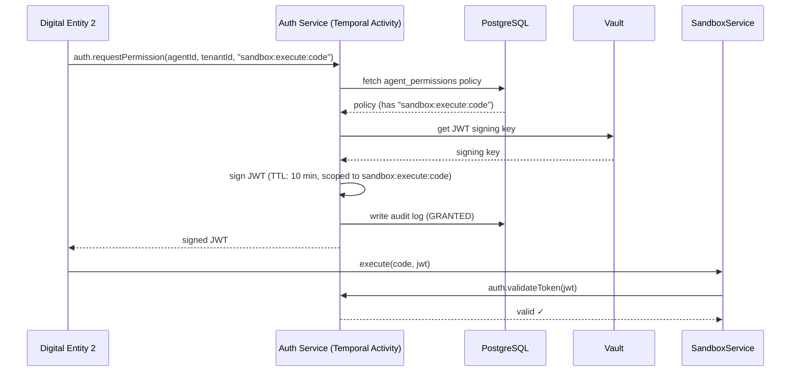
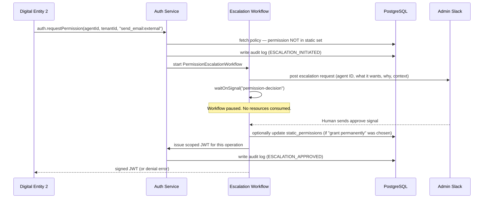

# Auth & Permissions Service — High Level Design

## Overview

The Auth Service is a Temporal worker in the shared namespace. It exposes Nexus operations for JWT issuance and validation. It does not have a REST API — the intentional design choice is that permission checks happen through Temporal activities, giving you durability, retries, and audit logging as first-class concerns rather than afterthoughts.

Two key concepts:

**On-demand scoped JWT**: An agent that wants to, say, execute code in the sandbox, calls `auth.requestPermission(agentId, tenantId, "sandbox:execute:code")`. The Auth Service checks the agent's policy, and if the permission is held, immediately returns a signed JWT with a 10-minute TTL scoped to that exact operation. The Sandbox Service 1 validates this JWT before accepting the execution request.

**Escalation JWT**: If the agent requests `send_email:external` and its policy doesn't include that, the Auth Service starts an escalation sub-workflow: saves the request, notifies the admin Slack channel with context, and `waitOnSignal`. If a human approves, a JWT is issued and the waiting agent receives it. If denied, the agent receives an error and the denial is logged.

## Deployment Model

- **Language**: TypeScript
- **Type**: Temporal worker in the `platform` shared namespace
- **K8s**: Deployment in `de-v2-platform` namespace, 1–2 replicas. Stateless worker.
- **Secrets**: Vault-managed JWT signing key injected via Vault Operator. Key rotation handled by Vault — Auth Service picks up new key on next secret refresh cycle.

## Component Breakdown

```text
auth-service/
  src/
    activities.ts       # requestPermission, validateToken, revokeToken, listPermissions
    workflows.ts        # PermissionEscalationWorkflow
    functions.ts        # Core policy evaluation logic (shared between activities and direct calls)
    worker.ts           # Temporal worker entry point
    policy-store.ts     # PostgreSQL read/write for permission policies
    jwt.ts              # JWT sign/verify using Vault key
    audit.ts            # Audit log writes to PostgreSQL
```

## Permission Policy Model

```typescript
// Stored in PostgreSQL: agent_permissions table
interface AgentPermissionPolicy {
  agent_id: string;
  tenant_id: string;
  static_permissions: string[];   // e.g., ["read_slack", "send_slack", "sandbox:execute:code"]
  denied_permissions: string[];   // Explicit denials (override any grant)
  escalation_history: EscalationRecord[];
  updated_at: string;
  updated_by: string;  // human operator ID or "system"
}

// JWT payload issued per operation
interface AgentOperationToken {
  sub: string;          // agent_id
  tenant: string;       // tenant_id
  permissions: string[]; // exactly what this token grants (single operation typically)
  scope: string;        // human-readable: "sandbox code execution"
  iat: number;
  exp: number;          // short TTL: 300–900 seconds
  jti: string;          // unique ID for revocation list lookup
  a2a_compatible: true; // always true — token format is A2A-ready
}
```

## Key Flows

### On-Demand Permission (within static policy)



### Permission Escalation (beyond static policy)



## Storage

| Store | What |
|-------|------|
| PostgreSQL `agent_permissions` | Permission policies per agent per tenant |
| PostgreSQL `auth_audit_log` | Immutable log: every permission request, grant, denial, escalation |
| PostgreSQL `token_revocations` | Revoked JTIs (checked on validateToken — only needed if TTL > 5 min) |
| Vault | JWT signing key (Vault Transit engine or KV v2 for key material) |
| Shared Redis | Optional: hot cache of permission policies (TTL 5 min) to avoid PG round-trip on every activity call |

## Dependencies

- Vault (signing key management)
- PostgreSQL (policy store, audit log)
- Shared Redis (optional hot cache)
- Slack (for escalation notifications — calls `gateway.sendResponse` or Slack API directly)
- Temporal (shared namespace, approval signal workflow)

## Key Design Decisions

**Temporal activity (not REST) for permission checks:** Permission checks happen inside Temporal activities. This means they're durable, retried on transient failure, and every check is automatically correlated with a workflow execution. The alternative (a REST endpoint) would require each service to manage HTTP clients, retries, and circuit breakers — and would give you no correlation with the Temporal execution context.

**A2A token format from day 1:** The JWT payload includes a `a2a_compatible: true` field and is structured to be compatible with A2A's AgentAuth bearer token format. When A2A is activated in Phase 4, Comms Gateway 1 will be able to issue these tokens for external agents without any Auth Service changes.

**Short TTLs over revocation lists:** Default TTL of 300 seconds (5 min) makes the revocation list largely unnecessary — by the time you'd want to revoke a token, it's likely already expired. The revocation list exists for emergency cases (compromised agent, urgent permission rollback).

**Escalation is async, agent waits:** When an escalation is needed, the requesting agent's Temporal workflow pauses at the `auth.requestPermission` activity (which has a long timeout set — e.g., 24h). The escalation workflow runs independently. When the human approves, the activity completes and the agent continues. This avoids polling and gives clean error handling if the request is denied or times out.

## Open Questions / TRD Scope

1. Exact permission string taxonomy (the `permission_id` format — `resource:action:qualifier` is the working model)
2. Vault Transit vs KV v2 for key material — depends on rotation frequency needs
3. Whether `agent_permissions` lives here or stays in `agent_registry` (recommendation: migrate to Auth Service's own schema for cleaner separation)
4. Caching strategy for hot-path permission checks (Redis TTL vs. in-memory in worker process)
