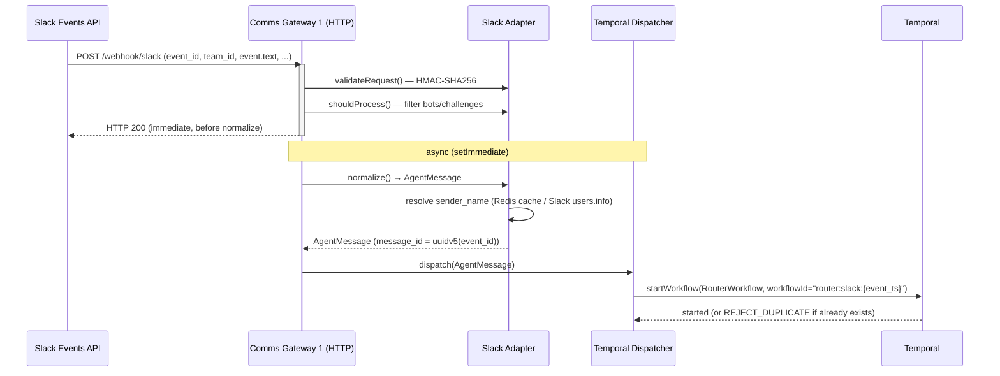
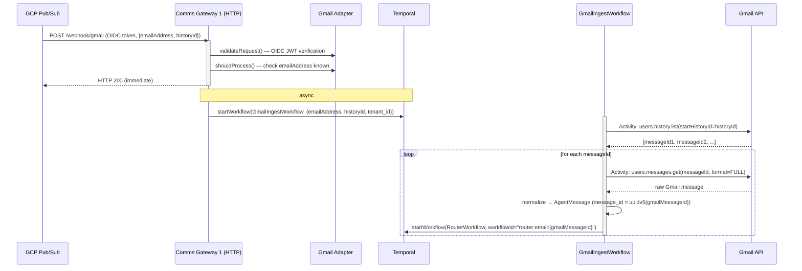
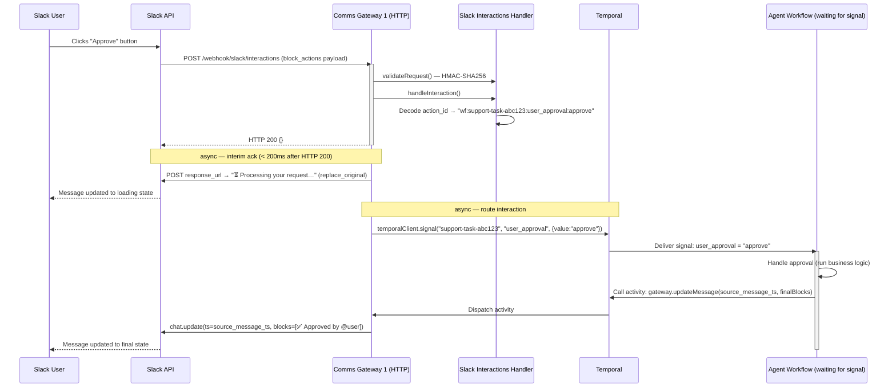
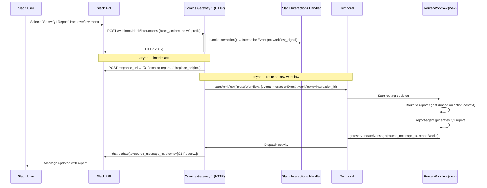
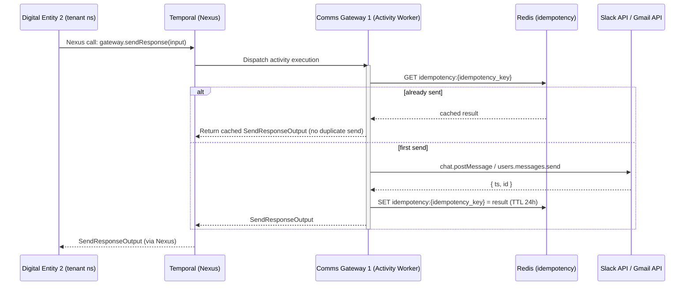

# Comms Gateway 1 — High Level Design

## Overview

Comms Gateway 1 is a stateless TypeScript/Fastify service that acts as the sole REST ingress for de-v2. It receives asynchronous event notifications from Slack (Events API webhook) and Gmail (GCP Pub/Sub push), immediately acknowledges each with HTTP 200, then dispatches a `RouterWorkflow` into Temporal using a deterministic `message_id` as the workflow ID — giving free deduplication via Temporal's conflict policy.

For outbound, it registers as a Temporal activity worker and exposes `gateway.sendResponse`, the only path through which agents post replies back to users. All Slack and Gmail API credentials, rate limiting, and retry logic are centralized here.

The service is organized around a **Channel Adapter** pattern inspired by OpenClaw's production multi-channel architecture: each supported channel (Slack, Gmail) is encapsulated behind a typed `ChannelAdapter` interface. Adding a new channel requires only a new adapter implementation — no changes to the core ingestion or dispatch logic.

## Architecture Diagram

```text
┌──────────────────────────────────────────────────────────────────────┐
│                      Comms Gateway 1 (K8s Pod)                       │
│                                                                      │
│  ┌──────────────────┐   ┌──────────────────────────────────────┐   │
│  │   Fastify HTTP   │   │       Channel Adapter Registry       │   │
│  │   Server :8080   │──▶│  SlackAdapter  │  GmailAdapter       │   │
│  │                  │   │  (messages +   │  (inbound, 2-phase) │   │
│  │  /webhook/slack  │   │  interactions) │                     │   │
│  │  /webhook/slack/ │   └──────────────────────────────────────┘   │
│  │    interactions  │                    │                          │
│  │  /webhook/gmail  │                    │ normalize() /           │
│  └──────────────────┘                    │ handleInteraction()     │
│         │                                ▼                          │
│         │              ┌──────────────────────────────────────┐    │
│         │              │        Interaction Router             │    │
│         │              │  action_id prefix "wf:…" →           │    │
│         │              │    temporalClient.signal(…)           │    │
│         │              │  otherwise →                          │    │
│         │              │    startWorkflow(RouterWorkflow)      │    │
│         │              └──────────────────────────────────────┘    │
│         │                                │                          │
│         ▼                                ▼                          │
│  ┌──────────────────────────────────────────────────────────────┐  │
│  │                    Temporal Dispatcher                        │  │
│  │  startWorkflow("RouterWorkflow", workflowId=…, REJECT_DUP)  │  │
│  └──────────────────────────────────────────────────────────────┘  │
│                             │                                        │
│  ┌──────────────────────────▼─────────────────────────────────┐    │
│  │           Outbound Activity Worker (:9090)                  │    │
│  │   gateway.sendResponse   — new messages (Block Kit / email) │    │
│  │   gateway.updateMessage  — update original Block Kit msg    │    │
│  └────────────────────────────────────────────────────────────┘    │
└──────────────────────────────────────────────────────────────────────┘
          │                                      │
          ▼                                      ▼
   Temporal Frontend                  Slack API / Gmail API
   (shared namespace)                 (external)
```

## Deployment Model

| Property | Value |
|----------|-------|
| Type | K8s Deployment, `de-v2-platform` namespace |
| Language | TypeScript (Node 22+) |
| HTTP framework | Fastify v4 |
| Replicas | 2 (min) – 8 (max) |
| Scaling trigger | KEDA — HTTP request rate, threshold 800 req/s per pod |
| Resources | Request: 256Mi / 200m CPU. Limit: 512Mi / 500m CPU |
| Webhook ingress port | 8080 (via ALB Ingress, external) |
| Activity worker port | 9090 (ClusterIP, internal — Temporal connects back) |
| Metrics port | 8081 (Prometheus scrape) |
| Liveness / Readiness | `GET /health` on :8080 |

## Channel Adapter Interface

Every channel must implement `ChannelAdapter`. This is the contract that separates channel-specific wiring from core gateway logic.

```typescript
interface ChannelAdapter {
  readonly channelId: "slack" | "email";

  /**
   * Validates the authenticity of an inbound HTTP request.
   * Throws an error (HTTP 401) if validation fails.
   */
  validateRequest(req: FastifyRequest): Promise<void>;

  /**
   * Determines if this request contains a message event worth processing
   * (vs. a URL verification challenge, bot echo, or ignored event type).
   */
  shouldProcess(req: FastifyRequest): Promise<boolean>;

  /**
   * Normalizes the raw webhook payload into one or more AgentMessages.
   * Returns an array because a single Gmail Pub/Sub push may reference
   * multiple new messages in the mailbox history.
   */
  normalize(req: FastifyRequest, deps: AdapterDeps): Promise<AgentMessage[]>;

  /**
   * Handles an inbound interactive component event (button click, select menu, overflow action).
   * Only applicable to channels that support interactivity (Slack). For Gmail this is a no-op.
   * Returns an InteractionEvent array (typically one element; zero if the event should be ignored).
   */
  handleInteraction?(req: FastifyRequest, deps: AdapterDeps): Promise<InteractionEvent[]>;

  /**
   * Send a response back to the originating channel.
   * Called by the outbound activity worker.
   */
  sendResponse(input: SendResponseInput, deps: AdapterDeps): Promise<SendResponseOutput>;

  /**
   * Update an existing message in the channel (replace Block Kit blocks in-place).
   * Used after an interaction is handled to show the final result.
   * Only applicable to channels that support message editing (Slack).
   */
  updateMessage?(input: UpdateMessageInput, deps: AdapterDeps): Promise<UpdateMessageOutput>;
}
```

The `AdapterDeps` bundle contains the Slack WebClient, Gmail API client, Vault secret resolver, and structured logger — injected at startup to keep adapters testable.

## InteractionEvent Schema

Interactive component events (Slack button clicks, select menu changes, overflow actions) are normalized into an `InteractionEvent`. This is a separate type from `AgentMessage` because interactions are responses to agent-generated messages, not user-originated messages — they require different routing (signal vs. new workflow) and different outbound handling (`updateMessage` vs. `sendResponse`).

```typescript
interface InteractionEvent {
  // ── Envelope ──────────────────────────────────────────────────────
  schema: "budy.interaction_event.v1";
  interaction_id: string;        // UUIDv4, gateway-assigned. Used as Temporal workflowId if
                                 // routing as a new RouterWorkflow.

  // ── Channel identity ──────────────────────────────────────────────
  channel: "slack";              // Only Slack supports interactive components in Phase 1.
  channel_account_id: string;    // Slack team_id (T…)

  // ── Source message (the Block Kit message the user interacted with) ─
  source_message_ts: string;     // Slack ts of the message that contained the component.
  source_channel_id: string;     // Slack channel ID where the source message lives.
  conversation_id: string;       // Normalized — same format as AgentMessage.conversation_id.
  session_key: string;           // Normalized — same format as AgentMessage.session_key.
  thread_id?: string;            // Thread root if the source message was in a thread.

  // ── Actor ─────────────────────────────────────────────────────────
  actor_id: string;              // Slack user_id of the user who clicked/selected.
  actor_name?: string;           // Display name (cached from users.info).

  // ── Interaction payload ───────────────────────────────────────────
  action_type: "button" | "static_select" | "multi_static_select" | "overflow";
  action_id: string;             // Slack action_id from the Block Kit element.
  block_id: string;              // Slack block_id containing the interacted element.
  value?: string;                // For buttons: the button's value field.
                                 // For selects: the selected option value.

  // ── Routing hint (decoded from action_id) ─────────────────────────
  //  If action_id starts with "wf:<workflow_id>:<signal_name>[:<value>]",
  //  the gateway routes this as a Temporal signal (direct-signal mode).
  //  Otherwise: gateway starts a new RouterWorkflow (stateless mode).
  workflow_signal?: {
    workflow_id: string;         // Temporal workflow_id to signal.
    signal_name: string;         // Signal name (e.g. "user_approval").
    signal_value?: string;       // Optional value encoded in action_id (e.g. "approve").
  };

  // ── Response URL (for interim ack) ────────────────────────────────
  response_url: string;          // Slack-provided URL. Gateway calls this immediately
                                 // with a "Processing…" state before dispatching to Temporal.
                                 // Expires after 5 uses or 30 minutes.
  response_url_expires_at: string; // ISO8601 estimated expiry.

  // ── Tenant hints ──────────────────────────────────────────────────
  tenant_hints: TenantHints;
  // tenant_id is not set at gateway time for Slack interactions; Router resolves.

  // ── Timestamps ────────────────────────────────────────────────────
  interacted_at: string;         // ISO8601 — when the user clicked/selected.
  received_at: string;           // ISO8601 — when gateway received the interaction.
}
```

### action_id Encoding Convention

Agents embed routing information into `action_id` fields when building Block Kit messages, using a structured prefix scheme:

| `action_id` prefix | Routing mode | Gateway action |
|---|---|---|
| `wf:<workflow_id>:<signal_name>` | Direct signal | `temporalClient.signal(workflow_id, signal_name, payload)` |
| `wf:<workflow_id>:<signal_name>:<value>` | Direct signal with value | Same, with `value` in payload |
| _(no prefix)_ | Stateless / new event | `startWorkflow(RouterWorkflow, { event: InteractionEvent })` |

### Example — approval button in an agent workflow:

```typescript
// Agent sends this Block Kit message while waiting for user_approval signal
blocks: [
  {
    type: "section",
    text: { type: "mrkdwn", text: "Approve John Smith's onboarding?" }
  },
  {
    type: "actions",
    elements: [
      {
        type: "button",
        text: { type: "plain_text", text: "Approve" },
        style: "primary",
        // action_id encodes: signal workflow `support-task-abc123`, signal name `user_approval`, value `approve`
        action_id: "wf:support-task-abc123:user_approval:approve",
        value: "approve"
      },
      {
        type: "button",
        text: { type: "plain_text", text: "Reject" },
        style: "danger",
        action_id: "wf:support-task-abc123:user_approval:reject",
        value: "reject"
      }
    ]
  }
]
```

### Outbound Update Types

```typescript
interface UpdateMessageInput {
  channel: "slack";
  channel_account_id: string;    // Slack team_id — determines which bot token to use.
  channel_id: string;            // Slack channel ID where the message lives.
  message_ts: string;            // Slack ts of the message to update (from InteractionEvent.source_message_ts).
  content: string;               // New plain-text fallback.
  blocks: SlackBlock[];          // New Block Kit blocks to replace the original.
  idempotency_key: string;
  tenant_id: string;
}

interface UpdateMessageOutput {
  message_ts: string;            // ts of the updated message (same as input message_ts).
  updated_at: string;            // ISO8601.
}
```

---

## AgentMessage Schema

This is the canonical envelope that flows from Comms Gateway 1 into the Comms Router 1. It is the only message format that downstream services (Router, Agent Workers, Memory Service) ever see.

```typescript
const AGENT_MESSAGE_SCHEMA = "budy.agent_message.v1" as const;

interface AgentMessage {
  // ── Envelope ──────────────────────────────────────────────────────
  schema: typeof AGENT_MESSAGE_SCHEMA;  // Always "budy.agent_message.v1"
  message_id: string;            // UUIDv4, gateway-assigned. Also used as
                                 // Temporal workflowId — enables idempotent dispatch.

  // ── Channel identity ──────────────────────────────────────────────
  channel: "slack" | "email";
  channel_account_id: string;    // Slack: workspace team_id (T…)
                                 // Email: receiving Gmail address (e.g. ops@acme.com)
  channel_message_id: string;    // Slack: event_ts  Email: Gmail message ID

  // ── Conversation / session hierarchy ─────────────────────────────
  //
  //  conversation_id — stable identifier for the channel conversation
  //    (channel, DM, or email thread), independent of threading.
  //    Format: "<channel>/<channel_account_id>/<chat_type>/<native_id>"
  //    Examples:
  //      Slack DM:      "slack/T01TEAM/direct/D01DM"
  //      Slack channel: "slack/T01TEAM/channel/C01CHAN"
  //      Gmail thread:  "email/ops@acme.com/email/threadABC"
  //
  //  session_key — the memory / routing granularity unit.
  //    Equals conversation_id unless the message is inside a Slack thread,
  //    in which case it appends "/thread/<thread_ts>".
  //    Examples:
  //      Slack top-level:  "slack/T01TEAM/channel/C01CHAN"
  //      Slack in-thread:  "slack/T01TEAM/channel/C01CHAN/thread/1700000000.000100"
  //      Gmail:            "email/ops@acme.com/email/threadABC"
  //
  chat_type: "direct" | "channel" | "group" | "email";
  conversation_id: string;
  session_key: string;
  thread_id?: string;            // Platform-native thread root ID.
                                 // Slack: thread_ts of parent message.
                                 // Email: Gmail threadId.

  // ── Sender ────────────────────────────────────────────────────────
  sender_id: string;             // Slack: user_id (U…)  Email: sender address
  sender_name?: string;          // Slack: display_name  Email: From header display name

  // ── Content ───────────────────────────────────────────────────────
  content: string;               // Normalized plain text.
                                 // Slack: Slack markup stripped (user IDs → display names).
                                 // Email: text/plain body part; HTML stripped.

  // ── Thread context ────────────────────────────────────────────────
  reply_to_message_id?: string;  // channel_message_id of the parent msg (threaded reply context)
  thread_starter?: {
    content: string;             // Text of the thread root message
    sender_id: string;
    sender_name?: string;
  };

  // ── Attachments ───────────────────────────────────────────────────
  attachments: Attachment[];     // Empty array if none. CDN URLs are short-lived;
                                 // agents must fetch promptly.

  // ── Tenant resolution ─────────────────────────────────────────────
  tenant_hints: TenantHints;
  tenant_id?: string;            // Set by gateway for email (1 account = 1 tenant).
                                 // Left unset for Slack; Router resolves from team_id.

  // ── Timestamps ────────────────────────────────────────────────────
  sent_at: string;               // ISO8601 — original platform message timestamp
  received_at: string;           // ISO8601 — when gateway received the webhook
}

interface TenantHints {
  channel_account_id: string;    // Primary key for tenant resolution.
                                 // Slack: team_id.  Email: receiving Gmail address.
  channel_id?: string;           // Slack: channel or DM ID.  Email: recipient address.
  email_domain?: string;         // Email only: domain of the receiving Gmail account.
  email_subject?: string;        // Email only: Subject header (for thread context).
}

interface Attachment {
  type: "file" | "image" | "audio" | "video";
  name: string;                  // Original filename
  mime_type: string;
  size_bytes?: number;
  source_url: string;            // Slack CDN URL or Gmail API download URL.
                                 // Short-lived. Agents must download before expiry.
  expires_at?: string;           // ISO8601 estimated URL expiry (best-effort).
}
```

## Component Breakdown

### Inbound Handler (Fastify)

Exposes three routes:

| Method | Path | Description |
|--------|------|-------------|
| POST | `/webhook/slack` | Slack Events API endpoint |
| POST | `/webhook/gmail` | Gmail Pub/Sub push endpoint |
| GET | `/health` | Liveness and readiness probe |

The handler pipeline for every inbound route follows this pattern:

1. Delegate `validateRequest()` to the channel adapter → HTTP 401/400 on failure
2. Delegate `shouldProcess()` → HTTP 200 (no-op) if the event is not processable (challenge, bot echo, etc.)
3. **Return HTTP 200 immediately** (at this point the external system considers the event delivered)
4. Asynchronously: delegate `normalize()` → `AgentMessage[]` → dispatch each to Temporal

Steps 3 and 4 are decoupled via `setImmediate` (no `await` blocks the response). If normalization or Temporal dispatch fails, the error is logged with `message_id` and `event_id` for manual replay; Slack and GCP will retry from their side.

### Slack Adapter

**`validateRequest`:** Verifies `X-Slack-Signature` HMAC-SHA256 using `SLACK_SIGNING_SECRET`. Rejects if timestamp skew > 5 minutes (replay protection).

**`shouldProcess`:** Returns `false` for URL verification challenges and for messages posted by bots (including the gateway's own bot user). Processes `message`, `app_mention`, and `message.channels` / `message.groups` / `message.im` subtypes.

**`normalize`:** Extracts fields from the Slack Events API payload:

| AgentMessage field | Source |
|-------------------|--------|
| `channel` | `"slack"` |
| `channel_account_id` | `event.team_id` |
| `channel_message_id` | `event.event.ts` |
| `chat_type` | Inferred from `event.event.channel_type` (`im` → `direct`, `channel` → `channel`, `group` → `group`) |
| `conversation_id` | `"slack/<team_id>/<chat_type>/<channel_id>"` |
| `session_key` | `conversation_id` + `"/thread/<thread_ts>"` if `thread_ts` differs from `ts` |
| `thread_id` | `event.event.thread_ts` (present only when message is inside a thread) |
| `sender_id` | `event.event.user` |
| `sender_name` | Fetched from Slack `users.info` API (cached in Redis, TTL 1h) |
| `content` | `event.event.text` with `<@U…>` mention tokens replaced by display names |
| `reply_to_message_id` | `event.event.thread_ts` if this is a threaded reply (same as `thread_id`) |
| `attachments` | `event.event.files[]` mapped to `Attachment` with `source_url` from Slack CDN |
| `tenant_id` | Not set (router resolves from `team_id`) |
| `sent_at` | `new Date(parseFloat(event.event.ts) * 1000).toISOString()` |

**`message_id` construction:** `uuidv5(event.event_id, NAMESPACE_OID)` — deterministic from Slack's globally unique event ID. Same event_id always produces the same UUID.

### Slack Interactions Handler

Handles `POST /webhook/slack/interactions`. Slack sends all interactive component payloads (button clicks, static select changes, overflow menu selections) to this endpoint as a URL-encoded `payload` field containing a JSON string.

**`validateRequest`:** Same HMAC-SHA256 signature validation as the message webhook.

**`shouldProcess`:** Returns `false` for unsupported interaction types (e.g. `view_submission`, `shortcut`). Phase 1 processes `block_actions` only.

### `handleInteraction` pipeline:

1. Verify signature
2. Parse and validate the `block_actions` payload
3. Decode `action_id` — if prefixed with `wf:`, extract `workflow_id` and `signal_name`; populate `InteractionEvent.workflow_signal`
4. Resolve `actor_name` from Redis cache (same cache as message sender names)
5. Build `InteractionEvent`
6. **Return HTTP 200** (body: empty `{}` — tells Slack the app accepted the event)
7. Async — **Interim ack** via `response_url`:
   - POST to `response_url` with a "Processing…" Block Kit message that replaces the original message's interactive elements with a disabled/loading state
   - This fires within ~200ms of receiving the interaction, well within Slack's expected UX window
8. Async — **Route the interaction**:
   - If `workflow_signal` is set: `temporalClient.signal(workflow_id, signal_name, { interactionId, value, actorId })`
   - Otherwise: `temporalClient.start(RouterWorkflow, { event: interactionEvent }, workflowId=interaction_id, REJECT_DUPLICATE)`

**Interim ack body:** `replace_original: true`, single mrkdwn section block with `:hourglass_flowing_sand: Processing your request…`. Exact Block Kit JSON is specified in the TRD.

The agent then calls `gateway.updateMessage` to replace this with the final result.

### Gmail Adapter (Two-Phase Ingest)

Gmail Pub/Sub push notifications do not carry the message body — they carry only `{ emailAddress, historyId }` indicating that new messages arrived in that Gmail account since the last known history ID.

Processing is therefore split into two phases:

### Phase 1 — HTTP handler (synchronous, < 100ms):

1. Verify the GCP OIDC JWT token in the `Authorization` header
2. Decode the base64 `message.data` to extract `{ emailAddress, historyId }`
3. Look up the `tenant_id` for this `emailAddress` from in-process config (Vault-loaded at startup)
4. If `emailAddress` is unrecognized: HTTP 200 (acknowledge) + log warning
5. Start `GmailIngestWorkflow(emailAddress, historyId, tenant_id)` in Temporal
6. Return HTTP 200

### Phase 2 — GmailIngestWorkflow (Temporal, durable):

```text
GmailIngestWorkflow
  └─ Activity: listNewMessages(emailAddress, historyId)
       └─ Gmail API: users.history.list(startHistoryId=historyId, historyTypes=[messageAdded])
       └─ Returns: [{ messageId }]
  └─ For each messageId:
       └─ Activity: fetchAndNormalizeMessage(emailAddress, messageId)
            └─ Gmail API: users.messages.get(id=messageId, format=FULL)
            └─ Normalize to AgentMessage (see mapping below)
            └─ Returns: AgentMessage
       └─ startWorkflow("RouterWorkflow", { message: AgentMessage }, workflowId=message_id)
```

| AgentMessage field | Source |
|-------------------|--------|
| `channel` | `"email"` |
| `channel_account_id` | `emailAddress` (the receiving Gmail account) |
| `channel_message_id` | Gmail `message.id` |
| `chat_type` | `"email"` |
| `conversation_id` | `"email/<emailAddress>/email/<threadId>"` |
| `session_key` | Same as `conversation_id` (email has no sub-threads) |
| `thread_id` | Gmail `message.threadId` |
| `sender_id` | `From` header (email address portion) |
| `sender_name` | `From` header (display name portion) |
| `content` | `text/plain` MIME part; HTML body stripped if no plain-text part |
| `reply_to_message_id` | `In-Reply-To` header value |
| `thread_starter` | Not populated in Phase 1 (requires additional history fetch; deferred) |
| `attachments` | MIME attachments with `source_url` = Gmail attachment download URL |
| `tenant_id` | Set at gateway time from Vault config (deterministic for email) |
| `sent_at` | `Date` header parsed to ISO8601 |

### Temporal Dispatcher

After normalization, each `AgentMessage` is dispatched as a `RouterWorkflow`:

```typescript
await temporalClient.start(RouterWorkflow, {
  taskQueue: "router.default",
  workflowId: `router:${message.channel}:${message.channel_message_id}`,
  args: [{ message }],
  // Temporal silently ignores the second start if this workflowId already ran.
  // This is the deduplication mechanism — no Redis, no in-memory state.
  workflowIdConflictPolicy: WorkflowIdConflictPolicy.REJECT_DUPLICATE,
});
```

If `REJECT_DUPLICATE` fires (same event delivered twice by Slack or GCP), the duplicate is silently dropped. No action needed.

### Outbound Activity Worker

Runs in the same process as the HTTP server but registers on a separate Temporal task queue (`gateway.activities`). Agent Workers in tenant namespaces call `gateway.sendResponse` via Nexus; Temporal routes it to this worker.

### Slack outbound — `sendResponse`:

- Calls Slack `chat.postMessage` with `channel`, `thread_ts` (if threaded reply), and `blocks` array
- Block Kit is the primary format; `text` field is always set as fallback (required by Slack for notifications)
- Handles Slack 429 rate limiting with exponential backoff (max 5 retries, max delay 30s)
- Detects duplicate sends via `idempotency_key` stored in Redis with TTL 24h

### Slack outbound — `updateMessage`:

- Calls Slack `chat.update` with the target message `ts`, new `blocks`, and updated `text` fallback
- Used exclusively for replacing the interim "Processing…" state with the agent's final result after an interaction
- Handles rate limiting identically to `sendResponse`
- Idempotency via Redis using `idempotency_key` (TTL 24h)

### Gmail outbound path:

- Constructs an RFC 2822 message with `In-Reply-To` and `References` headers for thread continuity
- Sends via Gmail API `users.messages.send` under the `channel_account_id` Gmail account
- Plain text for Phase 1; HTML body deferred to a future iteration

## Key Flows

### Slack Inbound



### Gmail Inbound (Two-Phase)



### Slack Interaction — Direct Signal Mode (approval / wizard flow)

Used when the agent is a running workflow waiting for a user decision.



### Slack Interaction — Stateless Mode (lookup, navigation)

Used for self-contained button actions that don't need an existing running workflow.



### Outbound Response (Agent → User)



## Storage

### Redis (shared cluster)

| Key pattern | Purpose | TTL |
|-------------|---------|-----|
| `cgw:sender:{team_id}:{user_id}` | Slack display name cache (avoids `users.info` on every message) | 1h |
| `cgw:idem:{idempotency_key}` | Outbound dedup cache for `sendResponse` and `updateMessage` | 24h |
| `cgw:interaction:{interaction_id}` | Dedup cache for interaction events (Slack may deliver twice on network issues) | 10m |

### PostgreSQL

Comms Gateway 1 does not own any PostgreSQL tables. It reads none directly. All durable state lives in Temporal history or downstream services.

### Vault

| Secret path | Usage |
|-------------|-------|
| `secret/de-v2/slack/{team_id}/bot-token` | Slack Web API token (per workspace) |
| `secret/de-v2/slack/{team_id}/signing-secret` | Webhook signature verification (per workspace) |
| `secret/de-v2/gmail/{email}/oauth-token` | Gmail OAuth2 refresh token (per Gmail account) |
| `secret/de-v2/temporal/client-cert` | mTLS cert for Temporal frontend connection |

Multiple Slack workspaces and Gmail accounts are supported by loading all known secrets at startup and keying them by `channel_account_id`. A Vault-watcher sidecar refreshes tokens before expiry.

## Dependencies

| Dependency | How used |
|------------|---------|
| Temporal Frontend (`temporal-frontend:7233`) | Start RouterWorkflow, GmailIngestWorkflow; register activity worker |
| Slack Web API (`api.slack.com`) | Outbound: `chat.postMessage`, `chat.update`; Inbound: `users.info` (name resolution) |
| Gmail API (`gmail.googleapis.com`) | Inbound: `users.history.list`, `users.messages.get`; Outbound: `users.messages.send` |
| GCP OIDC (Google token verification) | Gmail push endpoint auth |
| Redis (shared cluster) | Sender name cache, outbound idempotency |
| Vault | API tokens, signing secrets, Gmail OAuth tokens |
| Prometheus (`:8081`) | Metrics scrape |

## Design Principles

These principles inform every technical decision in this document and the TRD:

1. **Acknowledge fast, process durably.** HTTP handlers return HTTP 200 immediately; all processing happens in Temporal. External systems (Slack, GCP) see instant acknowledgment regardless of Temporal or downstream latency.
2. **Normalize at the boundary.** Nothing inside the platform ever sees a Slack event payload or Gmail API response. `AgentMessage` is the only format the rest of the system speaks.
3. **Tenant resolution as early as possible.** Resolve `tenant_id` at gateway time when the mapping is deterministic (Gmail: Vault config, 1 account = 1 tenant). Defer only when a DB lookup is required (Slack: Router resolves via `agent_bindings`).
4. **Deduplication is structural, not advisory.** Using Temporal's `REJECT_DUPLICATE` workflow ID conflict policy means the dedup guarantee comes from the orchestration layer, not a fragile in-memory cache or Redis TTL.
5. **Channel adapters are pluggable.** The `ChannelAdapter` interface lets new channels be added without touching core gateway logic. Slack and Gmail are two implementations of the same contract.
6. **Outbound goes through the gateway.** Agents never call Slack or Gmail APIs directly. All credentials, retry logic, rate limit handling, and audit logging are centralized in `gateway.sendResponse` and `gateway.updateMessage`.

## Design Decisions Log

Decisions made during design. All items below are resolved — nothing here is pending.

| Question | Resolution |
|----------|-----------|
| Slack webhook signature validation | HMAC-SHA256 using `SLACK_SIGNING_SECRET`; timestamp skew > 5 min rejected (replay protection) |
| Gmail Pub/Sub authentication | OIDC JWT verification — Google issues a signed token on every Pub/Sub push; gateway verifies against Google's public JWKS |
| Slack file attachments | CDN URLs passed directly in `AgentMessage.attachments[].source_url`; agents responsible for fetching before URL expiry. Gateway never downloads content. |
| Outbound format support | Plain text, mrkdwn, and Slack Block Kit from Phase 1. `content` plain-text field required on all calls as notification fallback. |
| Rate limiting scope | Per `channel_account_id` (Slack: `team_id`; email: Gmail address). Not per `tenant_id` — tenant is not known at Slack ingest time. |
| `sendResponse` receives invalid `conversation_id` | Activity throws `TargetNotFoundError` (non-retryable); calling workflow handles or surfaces the error to the user |
| Slack event duplicate delivery (same `event_id`) | Temporal idempotent start: `workflowId = "router:slack:{event_id}"` with `REJECT_DUPLICATE`. Duplicate silently dropped; no Redis needed. |
| Multiple Gmail messages per Pub/Sub push | `GmailIngestWorkflow` calls `users.history.list`, gets all `messageId`s, starts one `RouterWorkflow` per message |
| Slack interactive components Phase 1 scope | `block_actions` only: button clicks, static select menus, overflow menus. Slash commands and modals deferred — `trigger_id` 3 s TTL is incompatible with async Temporal dispatch. |
| Interaction routing mode selection | If `action_id` starts with `wf:<workflow_id>:<signal_name>` → direct Temporal signal. Otherwise → new `RouterWorkflow` with `InteractionEvent`. |
| Immediate user feedback on button click | Gateway POSTs `response_url` with "Processing…" Block Kit state synchronously inside the async block (~200 ms after HTTP 200), before Temporal dispatch. Agent calls `gateway.updateMessage` with the final result. |

## Key Design Decisions

### 1. Temporal workflowId as deduplication primitive

Slack retries webhook delivery if HTTP 200 is not received fast enough. Gmail Pub/Sub has at-least-once delivery semantics. Rather than introducing a Redis TTL set or in-memory deduplicated event store, we use `workflowId = "router:{channel}:{event_id}"` with `REJECT_DUPLICATE` conflict policy. Temporal's storage is the source of truth — if the workflow ran, the event was processed; if not, it runs now.

### 2. Two-phase Gmail ingest

The Gmail Pub/Sub push carries only a `historyId`, not message content. Fetching the message body from Gmail API takes 200–500ms and can fail transiently. Doing this synchronously inside the HTTP handler would risk missing the Pub/Sub ack deadline and causing redelivery storms. By acking Pub/Sub immediately and delegating the Gmail API fetch to a `GmailIngestWorkflow` Temporal activity, we get durability, retries, and no ack deadline pressure.

### 3. Tenant resolution at gateway for email, deferred for Slack

Per-tenant Gmail accounts map 1:1 to a `tenant_id` via Vault config. The gateway resolves this at startup and sets `tenant_id` in AgentMessage for every email, sparing the Comms Router 1 an extra DB round-trip. Slack `team_id` has no static config mapping (a workspace could host multiple logical tenants), so resolution stays in the Router's `agent_bindings` lookup.

### 4. Block Kit as primary Slack outbound format

Slack Block Kit is the current recommended and production-grade format for Slack message composition. All `sendResponse` calls targeting Slack must provide a `blocks` array. The `content` (plain text) field remains required as a fallback for notifications and accessibility, but Block Kit blocks are rendered by the Slack client. This enables support-agent and report-agent to send structured output (sections, fields, dividers) without any gateway changes.

### 5. Channel Adapter pattern for extensibility

Even though Phase 1 has only two channels, the `ChannelAdapter` interface is defined from day one. This avoids a refactor when a third channel (Teams, WhatsApp) is added. The adapter registry is a simple `Map<string, ChannelAdapter>` populated at startup.

### 6. Stateless deployment

Comms Gateway 1 holds no durable state. Redis is used only for short-lived caches (sender names) and idempotency records (24h TTL). If all gateway pods restart simultaneously, the only effect is a brief period of elevated Slack `users.info` calls and potential re-sends caught by the idempotency check. Temporal provides the durability guarantee.

## Open Questions / TRD Scope

- Rate limiting: should the gateway enforce per-`channel_account_id` rate limits at the HTTP layer (e.g., using a Redis sliding window), or rely on Temporal's workflow concurrency limits? TRD to decide.
- Slack modals (`views.open` via `trigger_id`): `trigger_id` has a 3-second TTL. Opening a modal requires an immediate synchronous call to `views.open` — incompatible with the async Temporal dispatch pattern. Phase 2: gateway opens a loading modal synchronously, then updates it with agent output via `views.update`. Requires its own design thread.
- Email HTML outbound: Phase 1 is plain text. When HTML email body support is added, the adapter's `sendResponse` should handle `text/html` + `text/plain` multipart MIME. Defer to Phase 2.
- Token refresh strategy: Vault dynamic secrets vs. static OAuth tokens with a refresh loop. TRD to specify.
