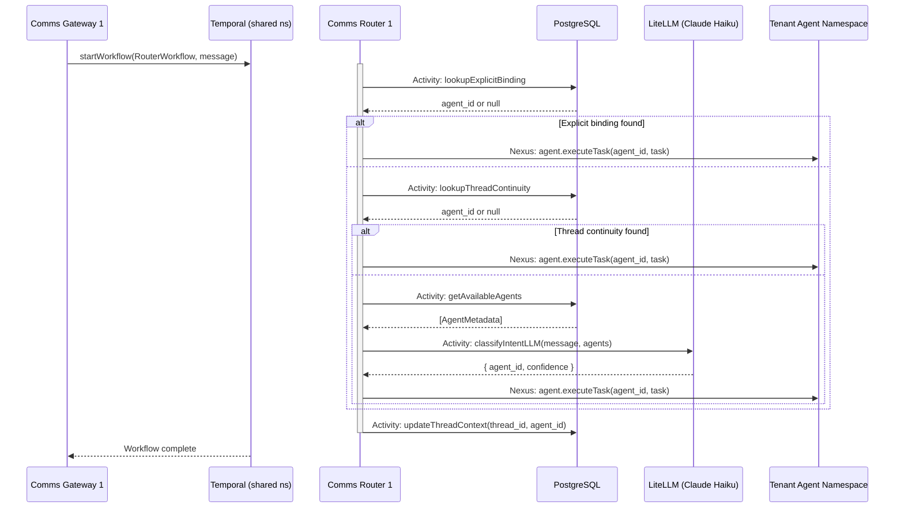
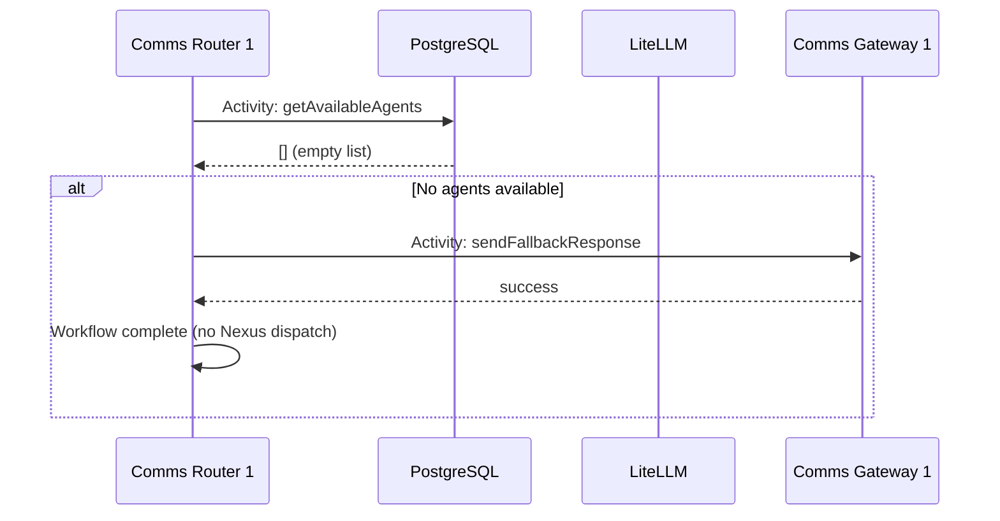

# Comms Router 1 — High Level Design

## Overview

The Comms Router 1 is a long-running Temporal workflow deployed as a worker in the shared `de-v2-platform` namespace. It receives `AgentMessage` payloads from Comms Gateway 1 and applies a three-layer routing strategy to select the appropriate agent:

1. **Explicit Binding** — Check if this channel/email is bound to a specific agent (stored in PostgreSQL)
2. **Thread Continuity** — Check if this thread has an active agent assignment
3. **Intent Classification** — Call Claude Haiku to classify intent and select best-fit agent from available agents
4. **Fallback** — If all else fails, send a polite error response or route to a default agent

Once routed, the workflow makes a Nexus call into the tenant's agent namespace to dispatch the task.

## Deployment Model

- **Type**: Temporal Workflow (not a K8s Deployment)
- **Execution**: Runs in the shared `de-v2-platform` Temporal namespace
- **Worker**: Deployed as a K8s Deployment (`comms-router-1-worker`) with 1–2 replicas
- **Task queue**: `router.default` (in shared namespace)
- **Scaling**: Horizontal scaling via increasing replicas (workflow instances scale with Temporal itself)
- **Resources**: 256Mi memory, 200m CPU per pod

## Component Breakdown

### Workflow Definition

Orchestrates the routing decision:

```typescript
interface RouterWorkflowInput {
  message: AgentMessage;
}

async function RouterWorkflow(input: RouterWorkflowInput): Promise<void> {
  // Step 1: Explicit binding lookup
  // Step 2: Thread continuity check
  // Step 3: Intent classification
  // Step 4: Nexus dispatch
  // Step 5: Error handling
}
```

### Activities

### `lookupExplicitBinding(tenantId, channel, channelIdentifier)`

- Query PostgreSQL: SELECT agent_id FROM agent_bindings WHERE tenant_id = ? AND channel = ? AND channel_id = ?
- Return: agent_id if found, null otherwise
- Timeout: 2s (short, DB should be fast)

### `lookupThreadContinuity(threadId, tenantId)`

- Query PostgreSQL: SELECT agent_id FROM thread_context WHERE thread_id = ? AND tenant_id = ? AND last_active_at > NOW() - INTERVAL 7 days
- Return: agent_id if found and recently active, null otherwise
- Timeout: 2s

### `classifyIntentLLM(message, agentCatalog)`

- Call Claude Haiku via LiteLLM with prompt:
  - Instruction: "Given this user message and list of available agents, select the best agent. Return agent ID."
  - Includes agent descriptions from agent_registry
- Returns: { agent_id: string, confidence: number }
- Timeout: 5s (LLM call + network latency)
- Fallback model: GPT-4o-mini if Claude unavailable

### `getAvailableAgents(tenantId)`

- Query PostgreSQL: SELECT id, name, description FROM agent_registry WHERE tenant_id = ? AND status = 'active'
- Return: list of agent metadata
- Cache in memory for 1h (TTL)
- Timeout: 2s

### `dispatchToAgent(tenantId, agentId, taskPayload)` → Nexus call

- Make a Nexus call from shared namespace into tenant namespace
- Call: `agent.executeTask(agentId, taskPayload)`
- Timeout: 30s (waiting for agent to receive and start processing)
- Return: void (fire-and-forget style; task result comes back asynchronously)

### `sendFallbackResponse(tenantId, channel, threadId, reason)`

- Call `gateway.sendResponse` activity to send a fallback message
- Message template: "I'm sorry, I don't have an agent available to help with that right now. Please try again later."
- Timeout: 3s

### Supporting Structures

### Agent Catalog (cached in memory):

```typescript
interface AgentMetadata {
  id: string;
  name: string;
  description: string;
  tensor_id: string;  // Temporal namespace for this agent
  tenant_id: string;
}
```

### Binding Registry (PostgreSQL):

```sql
CREATE TABLE agent_bindings (
  id UUID PRIMARY KEY,
  tenant_id TEXT NOT NULL,
  channel TEXT NOT NULL,  -- 'slack' | 'email'
  channel_id TEXT NOT NULL,  -- Slack channel ID or email address
  agent_id TEXT NOT NULL,
  created_at TIMESTAMPTZ,
  updated_at TIMESTAMPTZ
);
CREATE UNIQUE INDEX idx_binding_channel ON agent_bindings(tenant_id, channel, channel_id);
```

### Thread Context (PostgreSQL):

```sql
CREATE TABLE thread_context (
  thread_id TEXT PRIMARY KEY,
  tenant_id TEXT NOT NULL,
  agent_id TEXT,
  last_active_at TIMESTAMPTZ DEFAULT NOW(),
  message_count INT DEFAULT 0
);
CREATE INDEX idx_thread_active ON thread_context(last_active_at);
```

## Key Flows

### Full Routing Flow



### Fallback Path



## Storage

### Reads

- **PostgreSQL**:
  - `agent_bindings` table → explicit channel-to-agent mappings
  - `thread_context` table → recent agent assignments per thread
  - `agent_registry` table → active agents + descriptions
- **Redis (optional cache)**:
  - Agent catalog (5m TTL)
  - Agent descriptions (1h TTL)

### Writes

- **PostgreSQL**:
  - `thread_context` → upsert agent_id + last_active_at after successful routing

## Dependencies

- **PostgreSQL**: `agent_bindings`, `thread_context`, `agent_registry` tables
- **LiteLLM Proxy**: HTTP call for intent classification (model: Claude Haiku)
- **Temporal Frontend**: Shared namespace
- **Comms Gateway 1**: `gateway.sendResponse` activity (for fallback responses)
- **Tenant Agent Namespaces**: Nexus ingress to `agent.executeTask` operation

## Key Design Decisions

1. **Layered routing**: Most-specific routing (explicit binding) tried first, falling back to increasingly generic heuristics. Reduces LLM inference load for high-confidence decisions.
2. **Thread continuity**: Respects multi-turn conversations — same agent continues on follow-ups unless explicitly reassigned. Improves user experience and agent context awareness.
3. **Intent classification**: Uses Haiku-class model (cheap, < 100ms) to balance cost and accuracy. Not using expensive models (Opus) for every message.
4. **Nexus for dispatch**: Router calls into tenant namespaces via Nexus, not REST. Maintains Temporal-first architecture and ensures durability.
5. **Fallback gracefully**: If routing fails completely, sends a user-facing message instead of silently dropping. Better UX.
6. **Workflow-based durability**: Router is a Temporal workflow, not a stateless HTTP service. If it crashes mid-routing, Temporal replays from last decision point. Guarantees no message is silently lost.

## Open Questions / TRD Scope

- Should Router cache agent catalogs in memory or Redis? Trade-off: in-memory is fast but requires process restart to update; Redis is slightly slower but live-updateable. (TRD decision)
- What is the fallback message template? Should it be customizable per tenant?
- How should Router handle the case where an explicit binding points to a non-existent or deleted agent?
- Should Router emit events for analytics (routing decision, agent selection, latency)? If yes, which events and to which sink (Temporal signal, Kafka, etc.)?
- Should Router support weighted agent selection for A/B testing or gradual rollouts?
