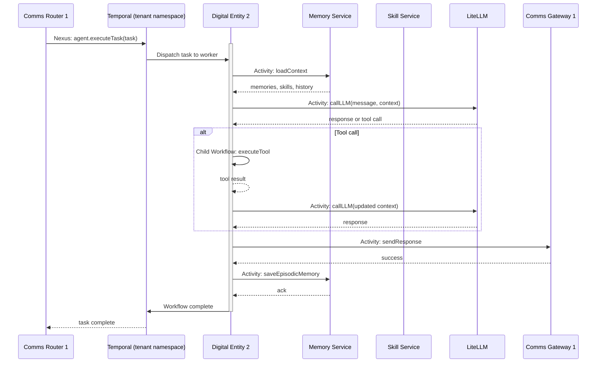
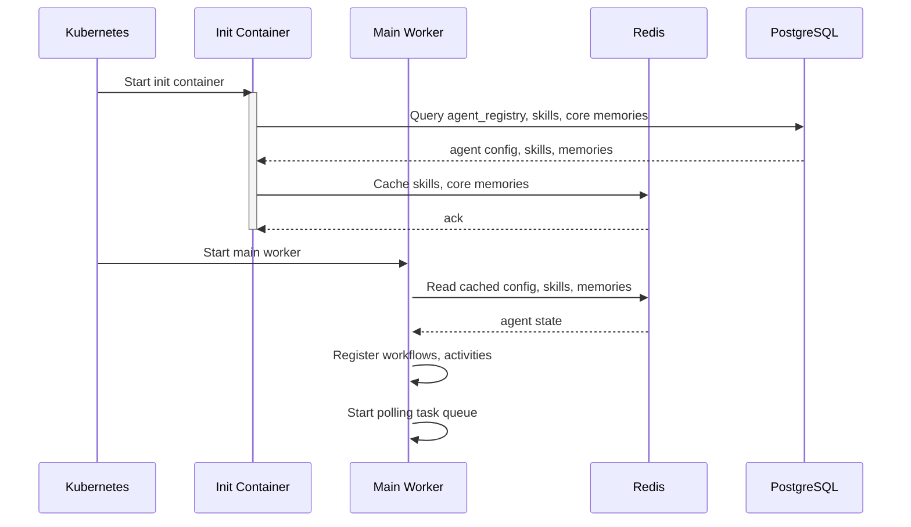

# Digital Entity 2 — High Level Design

## Overview

Digital Entity 2 is a stateless, horizontally scalable Temporal worker that executes the core reasoning loop for a specific agent. Each agent has its own K8s Deployment that polls a Temporal task queue in a tenant namespace. The worker handles task dispatch, context loading (memories + skills), LLM-driven reasoning with tool execution, and response posting.

The design prioritizes:

- Statelessness: all state in PostgreSQL, Redis, S3, or Temporal history
- Horizontal scalability: multiple replicas on the same task queue
- Durability: Temporal ensures task completion even if worker crashes
- Isolation: agent workers live in tenant namespaces, not shared namespace

## Deployment Model

- **Type**: K8s Deployment in tenant namespace (one per agent)
- **Namespace**: `tenant-{tenant_id}` (isolated Temporal namespace)
- **Replicas**: 1–N (based on demand; KEDA scales on task queue depth)
- **Image**: Single container (TypeScript or Go)
- **Init container**: Same image with different entrypoint (`node dist/init.js`) — populates Redis with agent config, skills, and core memories. Runs once per pod, writes to emptyDir and Redis. No PVC.
- **emptyDir volume**: 1Gi scratch space for skill execution (dies with pod, rebuilt at init)
- **Resource limits**: 512Mi memory, 300m CPU requests; 1Gi/1000m limits
- **Service**: ClusterIP (no external service; only internal Temporal communication)
- **Liveness/Readiness**: `/health` endpoint + Temporal task queue depth probe

## Component Breakdown

### Initialization (Init Container)

Runs once per pod before main worker starts:

```typescript
async function initContainer() {
  // 1. Read AGENT_ID from env
  // 2. Fetch agent config from PostgreSQL agent_registry
  // 3. Fetch assigned skills from Skill Service (PostgreSQL query)
  // 4. Cache skills in Redis with prefix `agent:{agent_id}:skills`
  // 5. Fetch core memories from Memory Service
  // 6. Cache core memories in Redis with prefix `agent:{agent_id}:memories:core`
  // 7. Write minimal metadata to emptyDir volume (for main process to read)
  // 8. Exit
}
```

### Main Worker Process

Long-running process that registers workflows/activities and polls task queue:

```typescript
async function main() {
  // 1. Read agent config from Redis (written by init container)
  // 2. Establish Temporal worker connection
  // 3. Register workflows and activities
  // 4. Start polling task queue (e.g., `agent.{agent_id}`)
  // 5. On task dispatch: execute AgentTaskWorkflow
}
```

### AgentTaskWorkflow

Temporal workflow that orchestrates a single user task:

```typescript
interface AgentTaskWorkflow {
  input: AgentTaskInput;
  execute(): Promise<void>;
}

interface AgentTaskInput {
  tenant_id: string;
  message: AgentMessage;
  thread_id: string;
  sender_id: string;
  channel: "slack" | "email" | "webhook";
}
```

### Workflow steps:

1. Activity: Load context (memories, skills, thread history)
2. Loop:
   - Activity: Call Claude via LiteLLM with context and message
   - If tool call: Child Workflow: execute tool (skill invocation) → get result → continue loop
   - If final response: Break loop
3. Activity: Send response via `gateway.sendResponse`
4. Activity: Save episodic memory
5. Activity: Update thread_context (last_active_at)
6. Complete workflow

### Activities

### `loadContext(agentId, tenantId, threadId, sender_id)`

- Fetch core memories from Redis (cache, 1h TTL)
- Fetch episodic memories from Memory Service (via Nexus call to memory.search)
- Fetch thread history from Redis or PostgreSQL (last N messages, < 50KB)
- Fetch assigned skills from Redis (cache, 1h TTL)
- Return: consolidated context object
- Timeout: 5s

### `callLLM(model, messages, tools, context)`

- Call LiteLLM proxy with agent's assigned model tier (reasoning, coding, fast)
- Include system prompt, context, and available tools
- Return: LLM response (text or tool call)
- Timeout: 30s (Claude inference + network)
- Retry: 1x on transient failure (429, 500, 503)

### `executeTool(skillId, input)`

- Child Workflow that executes a single skill
- Load skill content from Skill Service or local Redis cache
- Execute skill (could be a subprocess, script, or nested workflow)
- Return: result or error
- Timeout: 60s (depends on skill complexity)

### `sendResponse(channel, threadId, content, tenantId)`

- Call `gateway.sendResponse` Nexus operation (crossing namespace boundary)
- Timeout: 3s

### `saveEpisodicMemory(agentId, tenantId, episode)`

- Call Memory Service `memory.store` Nexus operation
- Episode includes: message content, agent response, tools used, outcome
- Timeout: 2s

### `updateThreadContext(threadId, tenantId, agentId)`

- Update PostgreSQL thread_context (last_active_at, message_count)
- Timeout: 1s

### Continue-As-New

When conversation history approaches 2MB or task count exceeds threshold:

1. Archive full history to S3 (Claim Check pattern)
2. Summarize conversation in a compact form (via Haiku)
3. Pass S3 reference + summary through continue-as-new
4. Continue polling on same task queue

## Key Flows

### Agent Task Execution Flow



### Bot inalization and Cache Loading



## Storage

### Reads

- **Redis (cache, TTL 1h)**:
  - `agent:{agent_id}:config` → agent metadata
  - `agent:{agent_id}:skills` → assigned skills
  - `agent:{agent_id}:memories:core` → core memories
  - `thread:{thread_id}:history` → recent thread history (24h TTL)
- **PostgreSQL**:
  - `agent_registry` → agent config (at init time)
  - `thread_context` → thread metadata (on task start)
- **Memory Service** (via Nexus):
  - `memory.search(agentId, query)` → semantic memory search
  - `memory.getCore(agentId)` → approved core memories
- **S3** (for archived conversation histories via Claim Check)

### Writes

- **PostgreSQL**:
  - `thread_context` → upsert last_active_at, message_count after each task
- **Memory Service** (via Nexus):
  - `memory.store(episode)` → save episodic memory after task completion
- **S3**:
  - Archive full conversation history when continue-as-new triggered

## Dependencies

- **Temporal Frontend**: `temporal-frontend:7233` (in tenant namespace)
- **Memory Service**: Nexus calls for memory search and storage
- **Skill Service**: Nexus calls for skill details and execution
- **Comms Gateway 1**: Nexus calls for sending responses
- **LiteLLM Proxy**: HTTP calls for LLM inference
- **PostgreSQL**: agent_registry, thread_context queries
- **Redis**: Caching (skills, core memories, thread history)
- **S3**: Archive storage for long conversations (Claim Check)

## Key Design Decisions

1. **Statelessness**: Agent pods are fully stateless. All state persists in PostgreSQL, Redis, or S3. Pods can be killed and restarted without losing context.
2. **Init container pattern**: Separate init container populates Redis caches before main worker starts. Avoids cache misses on cold start. Caches are rebuilt on every pod restart (respecting TTLs).
3. **emptyDir for scratch**: Skill execution may need temporary disk space. emptyDir (not PVC) provides this; it dies with the pod. No persistent local storage.
4. **Continue-as-new**: Long conversations archived to S3; conversation history replaced with reference + summary. Avoids hitting Temporal event history size limits.
5. **Horizontal scaling via KEDA**: Replicas scale based on task queue depth, not CPU/memory. More tasks → more pods.
6. **Tenant namespace isolation**: Agent workers live in tenant-specific namespaces (`tenant-{tenant_id}`), providing strong isolation from other tenants and from the shared platform namespace.

## Open Questions / TRD Scope

- How should agents handle skill errors? Retry, report to user, or escalate to human?
- What is the maximum conversation history size before continue-as-new is triggered?
- Should context loading prioritize recency or semantic relevance when choosing which memories to include?
- How should agents handle concurrent tasks for the same user/thread? Serial or parallel?
- What observability metrics are most critical? (task latency, tool execution latency, memory recall accuracy)
