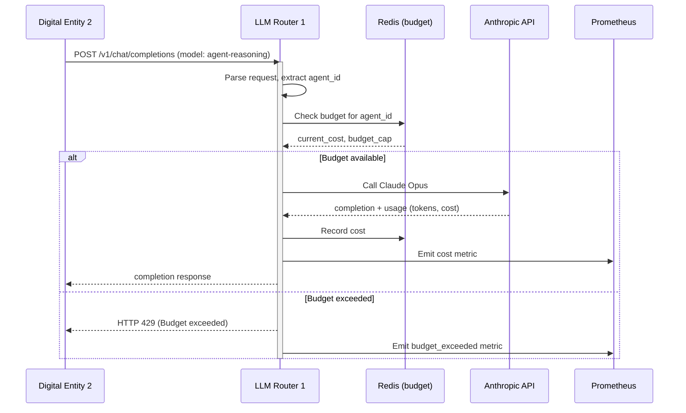
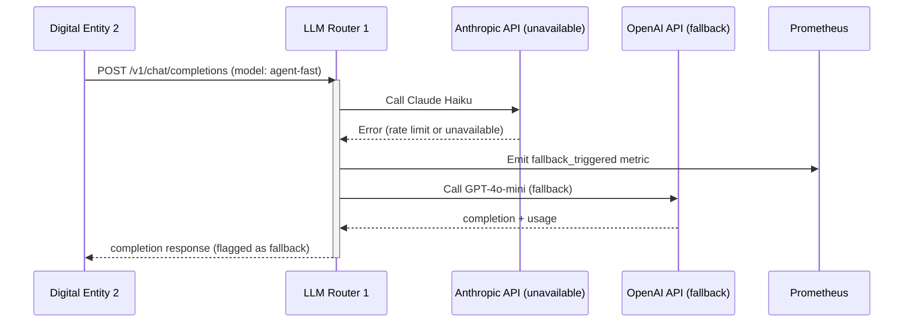

# LLM Router 1 — High Level Design

## Overview

LLM Router 1 is LiteLLM Proxy — an open-source Python reverse proxy for LLM APIs — deployed on Kubernetes without custom code modifications. It sits as the sole HTTP gateway between agents and LLM providers (Anthropic, OpenAI, etc.). It abstracts provider-specific APIs, handles credential management, enforces budget caps, and emits observability metrics.

The design prioritizes:

- Transparent routing: Calling services use simple, semantic model names; router handles provider selection
- Budget enforcement: Per-agent monthly caps prevent runaway costs
- Graceful degradation: Fallback routing when primary provider fails
- Observability: Detailed metrics for cost attribution and performance monitoring
- Security: Credential isolation, no API keys in logs

## Deployment Model

- **Type**: LiteLLM Proxy (Python service, unchanged open-source deployment)
- **Container image**: litellm:latest or custom image with config bundled
- **K8s Deployment**: 2+ replicas in `de-v2-platform` namespace
- **Resource limits**: 512Mi memory, 200m CPU requests; 1Gi/500m limits
- **Scaling**: Horizontal scaling via Deployment replicas (stateless)
- **Service**: ClusterIP `llm-router-1:8000` (internal only, not exposed externally)
- **Port**: 8000 (standard LiteLLM proxy port)
- **Liveness/Readiness**: `/health` endpoint + health checks to Anthropic API

## Component Breakdown

### LiteLLM Proxy Configuration

LiteLLM is configured via environment variables and a config file. Key configuration sections:

### Model routing:

```yaml
model_list:
  - model_name: "agent-reasoning"
    litellm_params:
      model: "claude-3-5-opus-20241022"
      api_key: "${ANTHROPIC_API_KEY}"
  
  - model_name: "agent-coding"
    litellm_params:
      model: "claude-3-5-sonnet-20241022"
      api_key: "${ANTHROPIC_API_KEY}"
  
  - model_name: "agent-fast"
    litellm_params:
      model: "claude-3-5-haiku-20241022"
      api_key: "${ANTHROPIC_API_KEY}"
    fallback:
      - model_name: "gpt-4o-mini"
        litellm_params:
          model: "gpt-4o-mini"
          api_key: "${OPENAI_API_KEY}"
```

### Budget management (via custom Redis-backed budgets):

```python
# Custom LiteLLM middleware to enforce per-agent monthly budgets
# Tracks: {agent_id}: {month: YYYY-MM, cost_cents: int}
# On each request: check agent's monthly cost against cap
# If exceeded: return 429 with "Budget exceeded" error
```

### OpenTelemetry exporting:

```yaml
otel_exporter_otlp_endpoint: "http://prometheus:4317"
otel_enabled: true
```

### HTTP API

LiteLLM exposes standard OpenAI-compatible endpoints:

**`POST /v1/chat/completions`** (streaming and non-streaming)

- Standard OpenAI chat completion format
- Optional header: `X-Agent-ID: {agent_id}` (for budget tracking)
- Response: Standard OpenAI completion format

**`POST /v1/embeddings`** (optional, for vector embeddings)

- Vector embedding generation
- Currently not used but available for future memory service needs

### `GET /health`

- Health check endpoint
- Returns: `{ status: "healthy" }`

### `GET /models`

- List available models (agent-reasoning, agent-coding, agent-fast)
- Returns: `{ data: [{ id: "agent-reasoning", ... }, ...] }`

### Budget Enforcement Middleware

Custom Python middleware (built into LiteLLM config):

```python
def check_budget(agent_id: str, estimated_cost: float) -> bool:
    """Check if agent has remaining budget for this month"""
    month_key = f"budget:{agent_id}:{YYYY-MM}"
    current_cost = redis.get(month_key) or 0
    budget_cap = agent_budget_map[agent_id]  # e.g., 2000 cents = $20/month
    
    if current_cost + estimated_cost > budget_cap:
        log_budget_exceeded(agent_id, current_cost, budget_cap)
        metrics.record_budget_exceeded(agent_id)
        return False
    return True

def record_cost(agent_id: str, actual_cost: float):
    """Record actual cost post-call"""
    month_key = f"budget:{agent_id}:{YYYY-MM}"
    redis.incr(month_key, actual_cost)
    redis.expire(month_key, 30 * 24 * 60 * 60)  # 30-day TTL
```

### Observability

### OpenTelemetry metrics exported to Prometheus:

- `litellm_requests_total` — Counter: requests by model, status
- `litellm_request_duration_seconds` — Histogram: latency by model
- `litellm_tokens_used_total` — Counter: input/output tokens by model
- `litellm_cost_total` — Counter: total cost by agent, model
- `litellm_budget_exceeded_total` — Counter: budget overages by agent
- `litellm_fallback_total` — Counter: fallback routing events

### Structured logging (JSON):

- `timestamp`, `level`, `message`
- `agent_id`, `model`, `status_code`
- `input_tokens`, `output_tokens`, `cost_cents`
- `latency_ms`, `error` (if applicable)

All logs PII-safe: no request/response bodies logged, only metadata.

## Key Flows

### Normal Request Flow



### Fallback Routing Flow



## Storage

### Reads

- **Redis**:
  - Per-agent monthly budget tracking: `budget:{agent_id}:{YYYY-MM}`
  - API key cache (if used): `api_key:{provider}`
- **Vault** (via LiteLLM):
  - API keys for Anthropic and OpenAI (loaded at startup)

### Writes

- **Redis**:
  - Update monthly cost: `budget:{agent_id}:{YYYY-MM}` increment
- **Structured logs**:
  - All requests/responses logged to stdout (JSON format)

## Dependencies

- **Anthropic API**: Primary LLM provider (Claude models)
- **OpenAI API**: Fallback provider (GPT models)
- **Vault**: Secure credential storage and rotation
- **Redis**: Budget tracking and cost accumulation
- **Prometheus**: Metrics collection
- **Kubernetes**: Container orchestration and networking

## Key Design Decisions

1. **Open-source LiteLLM**: Use existing mature proxy rather than building custom solution. Reduces maintenance burden and leverages community improvements.
2. **No custom code**: Configure LiteLLM via YAML and environment variables only. Easier to update and audit.
3. **Semantic model tiers**: Expose high-level model names (agent-reasoning, agent-coding, agent-fast) that abstract provider and version changes. Calling services don't need to know specific model names.
4. **Per-agent budget enforcement**: Monthly cap per agent prevents runaway costs without affecting other agents. Simple model: current month + cost incremented real-time.
5. **Fallback routing**: Automatic fallback to secondary provider (e.g., GPT-4o-mini) when primary provider fails. Improves reliability.
6. **OpenTelemetry export**: Standard observability format allows integration with any metrics backend (Prometheus, Datadog, etc.).
7. **PII-safe logging**: No request/response bodies logged; only metadata. Protects user privacy and reduces log size.

## Open Questions / TRD Scope

- What are the exact monthly budget caps per agent? (Addressed in TRD / deployment config)
- Should budget overages trigger alerts? To whom (Slack, PagerDuty)?
- What is the fallback model for each tier? (Defined in config)
- How should we handle streaming responses? (Proxy handles transparently, but cost calculation differs)
- Should we implement request batching or caching for common prompts? (Future optimization)
