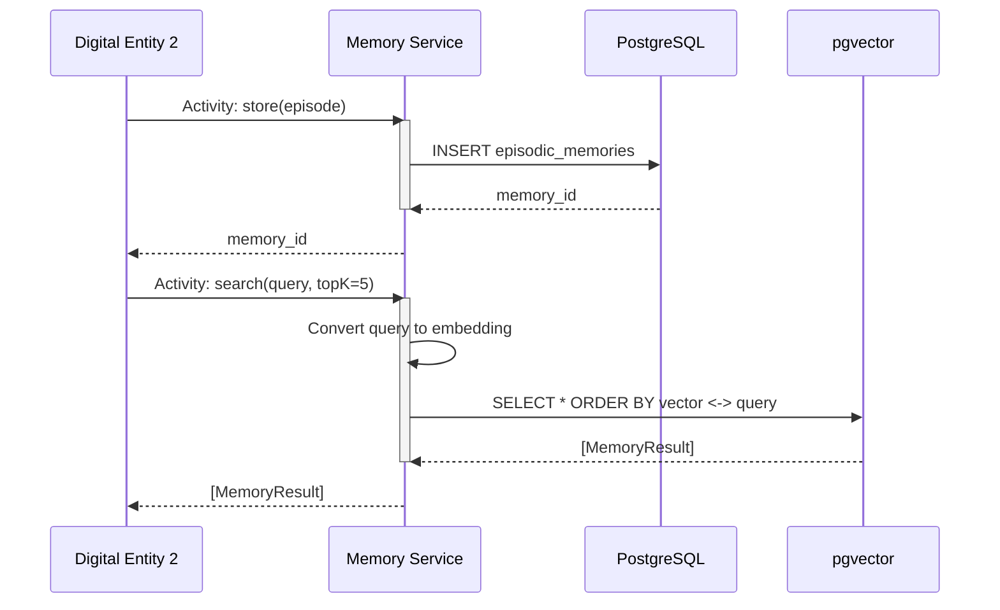
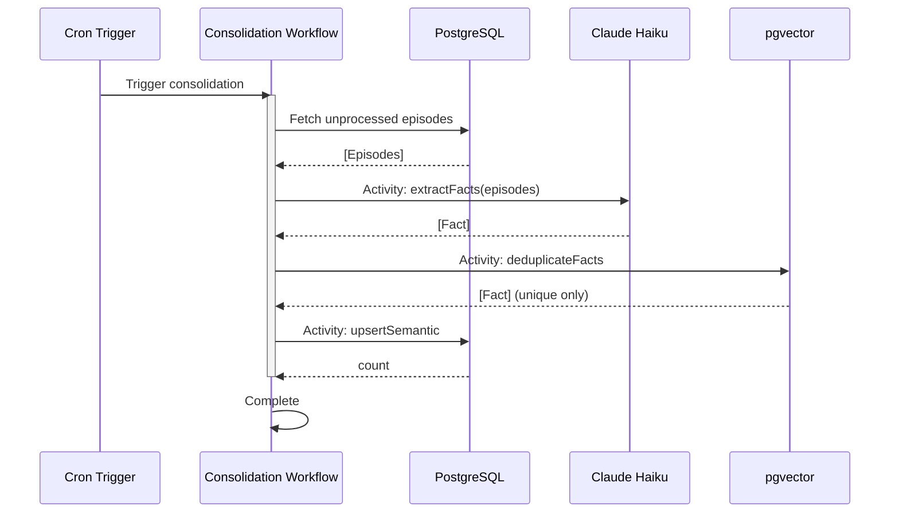
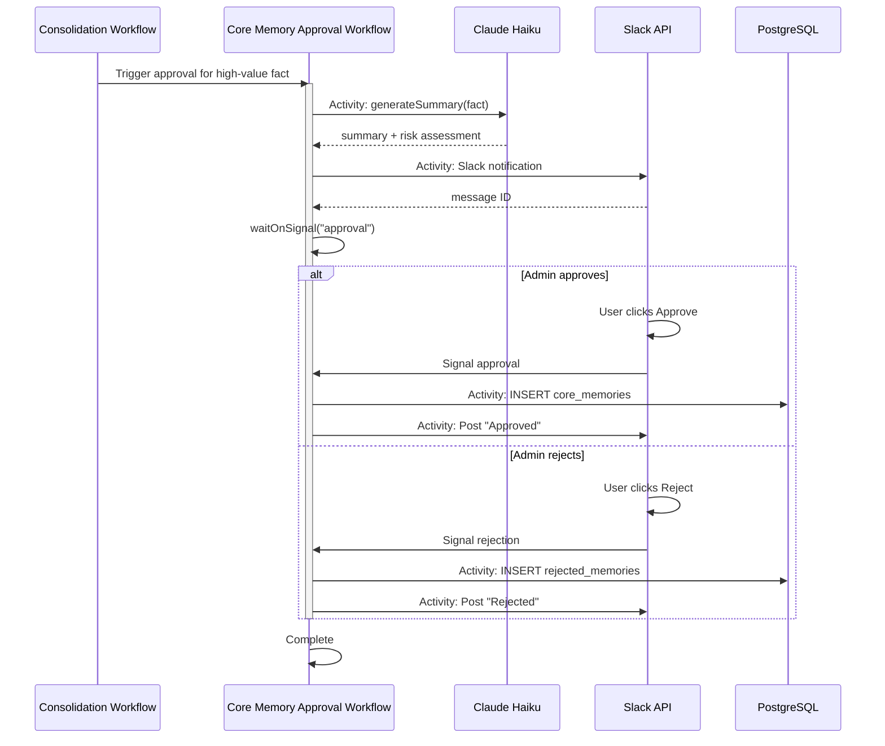

# Memory Service — High Level Design

## Overview

Memory Service is a Temporal worker in the shared `de-v2-platform` namespace that provides memory operations for all agents and tenants. It maintains three tiers of memory:

1. **Episodic memories** — Append-only log of every conversation turn, stored in PostgreSQL
2. **Semantic memories** — Deduplicated facts extracted and vectorized, stored in pgvector
3. **Core memories** — Human-approved long-term facts, stored in PostgreSQL + cached in Redis

The service runs two background workflows:

- **Consolidation Workflow** (cron-scheduled): Extract salient facts from episodic log, upsert to semantic store
- **Core Memory Approval Workflow** (triggered): Notify admins of high-value facts, await approval, persist

All memory operations are exposed as Nexus operations, not REST APIs.

## Deployment Model

- **Type**: Temporal Worker in shared `de-v2-platform` namespace
- **Worker**: K8s Deployment, 1–2 replicas (stateless)
- **Task queue**: `memory.default` (in shared namespace)
- **Resource limits**: 512Mi memory, 300m CPU requests; 1Gi/1000m limits
- **Scaling**: Horizontal scaling via replicas (one-to-many relationship; consolidation is single-threaded within tenant)

## Component Breakdown

### Activities

### `store(agentId, tenantId, episode)`

- Insert episode into PostgreSQL `episodic_memories` table
- Mark as `processed=false` (for consolidation workflow to pick up)
- Return: memory_id
- Timeout: 2s

### `search(agentId, tenantId, query, topK=5)`

- Convert query to vector embedding (via Haiku + API)
- Query pgvector for top-K similar semantic memories
- Return: [MemoryResult] with content and similarity score
- Timeout: 3s

### `getCore(agentId, tenantId)`

- Fetch approved core memories from PostgreSQL
- Return: [CoreMemory]
- Timeout: 1s

### `getSessionContext(threadId, tenantId)`

- Fetch recent messages from thread_context + episodic_memories (last 10 messages or 50KB)
- Return: conversation history as formatted string
- Timeout: 2s

### `extractFactsLLM(episodes)`

- Call Claude Haiku with batch of episodic memories
- Prompt: "Extract 3–5 key facts from this conversation. Output as JSON."
- Return: [Fact] with content and importance score
- Timeout: 5s

### `deduplicateFacts(facts, existingMemories)`

- For each new fact, compute vector similarity against existing semantic memories
- Filter out duplicates (similarity > 0.8)
- Return: [Fact] (unique only)
- Timeout: 3s

### `upsertSemantic(facts, tenantId, agentId)`

- Insert or update semantic_memories table with fact vectors
- Update pgvector index
- Mark source episodes as processed=true
- Return: count of memories upserted
- Timeout: 2s

### Workflows

### Consolidation Workflow

Cron-scheduled (every 4h during business hours, every 1h off-hours):

1. Activity: Fetch all unprocessed episodic memories for this tenant/agent
2. If none found: return early
3. Batch episodes (100 at a time)
4. Activity: Extract facts from batch (LLM)
5. Activity: Deduplicate facts against existing semantic memories
6. Activity: Upsert unique facts to semantic store
7. Repeat for all batches
8. Complete workflow

### Core Memory Approval Workflow

Triggered when Consolidation Workflow identifies a high-importance fact:

1. Activity: LLM generates human-readable summary + risk assessment
2. Activity: Slack notification to admin channel with summary + approve/reject buttons
3. Workflow: `waitOnSignal("approval")` → signal carries { approved: boolean, note?: string }
4. If approved:
   - Activity: Insert into PostgreSQL `core_memories` table
   - Activity: Slack response "Memory approved"
5. If rejected:
   - Activity: Insert into PostgreSQL `rejected_memories` table
   - Activity: Slack response "Memory rejected" + optional note
6. Complete workflow

### Supporting Data Structures

### PostgreSQL tables:

```sql
CREATE TABLE episodic_memories (
  id UUID PRIMARY KEY DEFAULT gen_random_uuid(),
  agent_id TEXT NOT NULL,
  tenant_id TEXT NOT NULL,
  thread_id TEXT,
  message TEXT NOT NULL,
  response TEXT NOT NULL,
  tools_used TEXT[],  -- ARRAY of tool names
  outcome TEXT,  -- 'success' | 'partial' | 'failed'
  processed BOOLEAN DEFAULT FALSE,
  created_at TIMESTAMPTZ DEFAULT NOW()
);

CREATE INDEX idx_episodic_tenant_agent ON episodic_memories(tenant_id, agent_id);
CREATE INDEX idx_episodic_processed ON episodic_memories(processed);
```

```sql
CREATE TABLE semantic_memories (
  id UUID PRIMARY KEY DEFAULT gen_random_uuid(),
  agent_id TEXT NOT NULL,
  tenant_id TEXT NOT NULL,
  fact TEXT NOT NULL,
  importance_score FLOAT,
  vector VECTOR(1536),  -- pgvector embedding
  source_episode_id UUID REFERENCES episodic_memories(id),
  created_at TIMESTAMPTZ DEFAULT NOW()
);

CREATE INDEX idx_semantic_tenant_agent ON semantic_memories(tenant_id, agent_id);
CREATE INDEX idx_semantic_vector ON semantic_memories USING ivfflat (vector vector_cosine_ops);
```

```sql
CREATE TABLE core_memories (
  id UUID PRIMARY KEY DEFAULT gen_random_uuid(),
  agent_id TEXT NOT NULL,
  tenant_id TEXT NOT NULL,
  fact TEXT NOT NULL,
  approved_by TEXT NOT NULL,  -- admin user ID
  approved_at TIMESTAMPTZ DEFAULT NOW(),
  expires_at TIMESTAMPTZ,  -- Optional: expiration date
  created_at TIMESTAMPTZ DEFAULT NOW()
);

CREATE INDEX idx_core_tenant_agent ON core_memories(tenant_id, agent_id);
```

### Redis caching:

- `agent:{agent_id}:memories:core` → [CoreMemory] (TTL 1h)
- `agent:{agent_id}:memories:semantic:recent` → recent semantic memories (TTL 24h)

## Key Flows

### Episodic Storage and Search



### Consolidation Workflow



### Core Memory Approval Workflow



## Storage

### Reads

- **PostgreSQL**:
  - `episodic_memories` → for consolidation and session context
  - `semantic_memories` → for search (via pgvector)
  - `core_memories` → for bootstrap context loading
- **Redis**:
  - `agent:{agent_id}:memories:core` → hot cache for core memories
  - `agent:{agent_id}:memories:semantic:recent` → hot cache for recent semantic memories
- **pgvector**:
  - Vector similarity search over semantic_memories

### Writes

- **PostgreSQL**:
  - `episodic_memories` → append on every agent task completion
  - `semantic_memories` → upsert during consolidation
  - `core_memories` → insert on core memory approval
- **Redis**:
  - Invalidate `agent:{agent_id}:memories:core` on new approval (TTL refresh)

## Dependencies

- **PostgreSQL**: episodic, semantic, and core memory tables
- **pgvector extension**: Vector similarity search
- **LiteLLM Proxy**: Haiku calls for fact extraction and embeddings
- **Redis**: Hot caching
- **Slack API**: Admin notifications for core memory approval
- **Temporal Frontend**: Shared namespace for workflow execution

## Key Design Decisions

1. **Three-tier memory**: Episodic (complete log) → Semantic (extracted facts) → Core (approved long-term). Progression from raw to curated.
2. **Append-only episodic**: All conversation turns stored immutably for audit and future analysis. No data loss.
3. **Consolidation as background workflow**: Extraction and deduplication happen asynchronously. Doesn't block agent operations. Can run on schedule outside peak hours.
4. **Approval gate for core memory**: Prevents noisy or erroneous facts from contaminating core knowledge. Admins have control.
5. **Vector embeddings for semantic search**: Allows similarity-based recall (not just keyword search). Improves context relevance.
6. **Hot cache for core memories**: Core memories loaded at agent bootstrap from Redis (fast); refreshed on approval.

## Open Questions / TRD Scope

- What is the importance threshold for triggering core memory approval? Measured how? (TRD decision)
- Should semantic_memories have TTL/expiration? Or are they permanent?
- How should Memory Service handle extremely large episodic logs? (Archival policy, retention period)
- Should consolidation run per-agent or globally? Trade-offs: per-agent is more fine-grained but higher operational load.
- What are the vector embedding dimensions and model? (Currently assumed 1536 for Anthropic embeddings)
