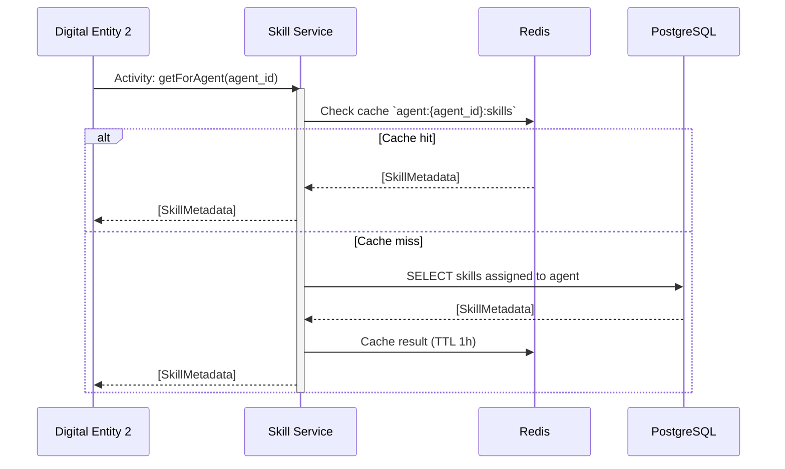
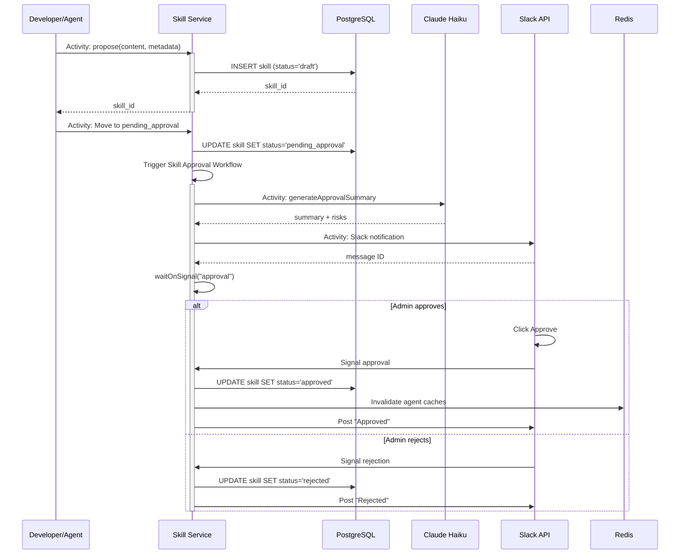

# Skill Service — High Level Design

## Overview

Skill Service is a Temporal worker in the shared `de-v2-platform` namespace that manages the lifecycle of agent skills. Skills are SKILL.md format documents stored in PostgreSQL, versioned and status-tracked (draft, pending_approval, approved, deprecated).

The service provides two main workflows:

1. **Skill Storage and Retrieval** — Activities for CRUD operations
2. **Skill Approval Workflow** — Temporal workflow for admin approval with Slack notifications

All operations are exposed as Nexus operations, not REST APIs.

## Deployment Model

- **Type**: Temporal Worker in shared `de-v2-platform` namespace
- **Worker**: K8s Deployment, 1–2 replicas (stateless)
- **Task queue**: `skill.default` (in shared namespace)
- **Resource limits**: 256Mi memory, 200m CPU requests; 512Mi/500m limits
- **Scaling**: Horizontal scaling via replicas (mostly read-heavy; approval workflow is single-threaded per skill)

## Component Breakdown

### Activities

### `getForAgent(agentId, tenantId, version='latest')`

- Query PostgreSQL: skills assigned to agent with status='approved'
- Return: [SkillMetadata] with content
- Cache in Redis with key `agent:{agent_id}:skills` (TTL 1h)
- Timeout: 2s

### `get(skillId, version=null)`

- Query PostgreSQL: fetch skill by ID and optional version
- Return: SkillMetadata with content
- Timeout: 1s

### `propose(agentId, tenantId, content, metadata)`

- Insert new skill into PostgreSQL with status='draft'
- Return: skill_id
- Timeout: 1s

### `approve(skillId, approvedBy)`

- Update skill status from 'pending_approval' to 'approved'
- Invalidate Redis cache for all agents assigned to this skill
- Return: skill_id
- Timeout: 1s

### `reject(skillId, rejectedBy, note)`

- Update skill status from 'pending_approval' to 'rejected'
- Store rejection reason
- Return: skill_id
- Timeout: 1s

### `assignToAgent(skillId, agentId, tenantId)`

- Insert row into agent_skills table
- Timeout: 1s

### `generateApprovalSummary(skillId)`

- Call LLM to generate human-readable summary of skill
- Includes: what it does, required permissions, diff from previous version (if any)
- Return: summary_text
- Timeout: 5s

### Workflows

### Skill Approval Workflow

Triggered when a skill moves to 'pending_approval':

1. Activity: Fetch skill content and metadata
2. Activity: LLM generate approval summary (what it does, permissions, risks)
3. Activity: Slack notification to admin channel with summary + approve/reject buttons
4. Workflow: `waitOnSignal("approval")` → signal carries { approved: boolean, note?: string }
5. If approved:
   - Activity: Update skill status to 'approved'
   - Activity: Invalidate agent skill caches in Redis
   - Activity: Slack response "Skill approved, agents can now use it"
6. If rejected:
   - Activity: Update skill status to 'rejected'
   - Activity: Slack response "Skill rejected" + optional note
7. Complete workflow

### Supporting Data Structures

### PostgreSQL tables:

```sql
CREATE TABLE skills (
  id UUID PRIMARY KEY DEFAULT gen_random_uuid(),
  tenant_id TEXT NOT NULL,
  name TEXT NOT NULL,
  version INT NOT NULL DEFAULT 1,
  status TEXT NOT NULL DEFAULT 'draft',  -- 'draft', 'pending_approval', 'approved', 'rejected', 'deprecated'
  content TEXT NOT NULL,  -- SKILL.md format
  resources JSONB,  -- S3 object references for large files
  created_by TEXT,  -- 'human' or agent_id
  approved_by TEXT,
  approved_at TIMESTAMPTZ,
  rejected_by TEXT,
  rejected_at TIMESTAMPTZ,
  rejection_note TEXT,
  created_at TIMESTAMPTZ DEFAULT NOW(),
  updated_at TIMESTAMPTZ DEFAULT NOW(),
  UNIQUE (tenant_id, name, version)
);

CREATE INDEX idx_skill_status ON skills(status);
CREATE INDEX idx_skill_tenant ON skills(tenant_id);
```

```sql
CREATE TABLE agent_skills (
  agent_id TEXT NOT NULL,
  skill_id UUID NOT NULL REFERENCES skills(id),
  tenant_id TEXT NOT NULL,
  assigned_at TIMESTAMPTZ DEFAULT NOW(),
  PRIMARY KEY (agent_id, skill_id)
);

CREATE INDEX idx_agent_skills_agent ON agent_skills(agent_id);
```

### Redis caching:

- `agent:{agent_id}:skills` → [SkillMetadata] for this agent (TTL 1h)
- Invalidated on skill approval or assignment change

## Key Flows

### Skill Retrieval (Read Path)



### Skill Proposal and Approval (Write Path)



## Storage

### Reads

- **Redis (cache, TTL 1h)**:
  - `agent:{agent_id}:skills` → assigned skills
- **PostgreSQL**:
  - `skills` → skill content and metadata
  - `agent_skills` → skill-to-agent mappings
- **S3** (via S3 URLs in skill metadata):
  - Large skill resources (scripts, templates)

### Writes

- **PostgreSQL**:
  - `skills` → insert (propose), update (approve/reject)
  - `agent_skills` → insert (assign), delete (unassign)
- **Redis**:
  - Invalidate agent skill caches on approval or assignment change

## Dependencies

- **PostgreSQL**: skills and agent_skills tables
- **Redis**: Hot caching of agent skill lists
- **S3**: Storage for large skill resources (optional)
- **LiteLLM Proxy**: Haiku calls for approval summary generation
- **Slack API**: Admin notifications for skill approval
- **Temporal Frontend**: Shared namespace for workflow execution

## Key Design Decisions

1. **PostgreSQL, not Git**: Skills stored as versioned records in PostgreSQL, not Git repos. Simpler lifecycle management, clear approval status, easier access control.
2. **Approval workflow**: All skill changes (new, modified, deprecated) go through Slack-notified admin workflow. Prevents unsafe or low-quality skills from reaching agents.
3. **LLM-generated summaries**: Before approval, LLM generates human-readable summary. Helps admins understand skill purpose and risks quickly.
4. **Redis cache**: Agent skill lists cached in Redis for fast retrieval at agent bootstrap. Invalidated on approval or assignment change.
5. **S3 for large resources**: Skill metadata includes optional S3 references for large files (scripts, templates). Keeps PostgreSQL lightweight.
6. **Versioning**: Skills versioned; agents can be pinned to specific versions or auto-update to latest approved.

## Open Questions / TRD Scope

- Should skill versioning be semantic (1.0, 1.1, 2.0) or simple integers (v1, v2, v3)?
- Should skill approval require multiple admins (dual approval) or single admin?
- How should we track which agents are using which skill version? For deprecation planning.
- Should there be automated skill testing before approval? (e.g., unit tests, integration tests)
- What's the policy for updating approved skills? (New version, or in-place modification?)
