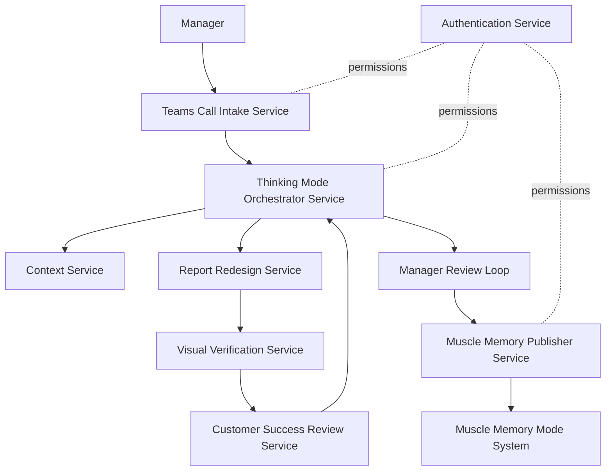

# Mark 2 Overall — High Level Design

## Overview

Mark 2 introduces Thinking Mode as the system that replaces the standard consultant-driven report customization workflow.

The overall architecture should show how manager intake, reasoning, draft generation, Customer Success review, manager approval, and Muscle Memory Mode publishing work together across services.

## Relationship To PRD

This HLD follows the Mark 2 overall PRD and should stay focused on technical architecture, subsystem boundaries, and cross-service workflow design.

## System Naming

The Mark 1 Design System becomes the Thinking Mode System, and the Mark 1 Execution System becomes the Muscle Memory Mode System.

## Architecture Principles

Mark 2 should keep the manager experience simple while keeping internal service boundaries explicit, reviewable, and safe.

## Subsystems

### Thinking Mode System

Owns manager interaction, reasoning, draft generation, clarification, review coordination, and report redesign.

### Muscle Memory Mode System

Owns approved, stable, repeatable execution of report workflows after Thinking Mode publishes a change.

### Customer Success Review Layer

Provides human review for every Mark 2 change request until the DT confidence and evaluation framework exists.

### Shared Platform Services

Provides identity, permissions, context, audit history, observability, and platform-level orchestration needed by both modes.

## Candidate Services Affected

| Service | Type | One-line responsibility |
|---------|------|-------------------------|
| Teams Call Intake Service | New | Captures manager report-change calls, screen-share interactions, clarifications, and follow-up scheduling. |
| Thinking Mode Orchestrator Service | New | Coordinates the end-to-end Thinking Mode workflow from intake through review and publishing. |
| Report Redesign Service | New | Converts manager intent and report context into draft report changes. |
| Visual Verification Service | New | Renders and checks report drafts before they are sent for review. |
| Customer Success Review Service | New | Creates and tracks Jira Service Desk or email-style review requests. |
| Muscle Memory Publisher Service | New or upgraded | Publishes approved report changes into the Muscle Memory Mode System. |
| Context Service | Existing upgrade | Stores and retrieves Thinking Mode interaction context, summaries, decisions, and review history. |
| Authentication Service | Existing upgrade | Enforces manager, Customer Success, and DT permissions across the Mark 2 workflow. |

## High-Level Technical Workflow

1. Manager books or joins a Teams call with the DT.
2. Teams Call Intake Service captures the manager request, clarification answers, and visual confirmation events.
3. Thinking Mode Orchestrator Service creates a Mark 2 change request and coordinates downstream work.
4. Report Redesign Service generates a revised report draft from the manager request and existing report context.
5. Visual Verification Service renders and checks the draft output.
6. Customer Success Review Service raises a review request and records feedback or approval.
7. DT sends the manager a pre-read and runs the review loop.
8. Muscle Memory Publisher Service publishes the approved change into Muscle Memory Mode.
9. Muscle Memory Mode runs the updated report in the next eligible reporting cycle.

## Architecture Diagram

## Deployment Model

Mark 2 will likely ship as multiple service-level releases rather than one large deployment.

| Area | Initial direction |
|------|-------------------|
| Runtime | TypeScript services on the Budy platform standard runtime. |
| Orchestration | Temporal-first workflow orchestration for long-running Mark 2 flows. |
| Release model | Multiple RCs per week, grouped by affected service. |
| Rollout | Service-by-service rollout with Customer Success review kept mandatory in the first build. |
| Safety | Thinking Mode can design and publish through approved paths, while Muscle Memory Mode performs repeatable execution. |

## Cross-Service Contracts

Each affected service should define its Nexus or internal activity contracts in its service folder once the PRD workflow is stable.

## Data And Storage

This section will define where call transcripts, intake summaries, draft reports, visual verification results, review decisions, and publish records are stored.

## Permissions And Safety

This section will define manager authorization, Customer Success review authority, DT publish permissions, and the boundary between Thinking Mode and Muscle Memory Mode.

## Observability

This section will define metrics, logs, audit events, and workflow state visibility across the Mark 2 lifecycle.

## Release Strategy

Mark 2 should be broken into service-sized releases that can ship independently across an 8-10 week build window.

## Design Decisions Log

| Question | Resolution |
|----------|------------|
| Is Mark 2 one release or many? | Many service-level releases, with multiple RCs per week where practical. |
| Does Mark 2 speed up consultants or replace their standard workflow? | Mark 2 replaces the standard consultant workflow with Thinking Mode. |
| Does Customer Success review remain mandatory? | Yes, every change request goes through Customer Success review in the current Mark 2 build. |
| What does the old Design System become? | Thinking Mode System. |
| What does the old Execution System become? | Muscle Memory Mode System. |

## Open Questions / TRD Scope

- Which of the candidate services should be new services versus upgrades to existing services?
- What exact service owns Teams calendar booking, meeting attendance, and screen sharing?
- What is the canonical change-request object passed between services?
- What is the minimum contract needed to publish approved changes into Muscle Memory Mode?
- What release sequence lets the team ship useful RCs each week?
