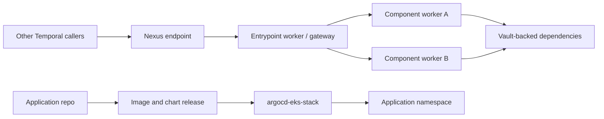

# Scaffolding an Application Repository

|                  |                                                                                                                         |
| ---------------- | ----------------------------------------------------------------------------------------------------------------------- |
| **Document**     | Application Repository Scaffolding                                                                                     |
| **Version**      | 0.3                                                                                                                     |
| **Status**       | Draft — confirmed platform recipe; remaining owner decisions are linked                                                |
| **Audience**     | Engineers creating a new product/application repository and the platform reviewers who provision its dependencies      |
| **Purpose**      | Define the intended repository, Temporal, GitOps, Vault/VSO, and Kubernetes-security work for a self-contained app.   |
| **Last Updated** | July 2026                                                                                                               |

This guide complements [Adding a New Operator](adding-a-new-operator.md). That guide is for installing shared infrastructure. This guide is for a product application cluster: source code and application deployment resources owned together, usually a Go multi-module monorepo containing several Temporal workers.

It is a proposed platform recipe, grounded in the local **Context Cluster** and **LLM Router** implementations. Those references use an umbrella chart, separately deployable workers, Temporal worker versioning, and a stable Nexus contract.

## 1. Default architecture

Use one self-contained repository and one Kubernetes namespace for a bounded application domain. The normal shape is:



- The entrypoint worker owns the only externally visible Nexus service, request validation, authorization boundary, and routing. It should stay thin: no component-specific business logic or persistent state. Other workers and sub-applications are internal to the cluster and are not independently accessible from outside it.
- Each worker component owns a task queue, workflow/activity registrations, its own image, and its own dependency permissions. Internal routing is normally child workflows on the component task queues; use another Nexus endpoint only where the boundary crosses an independently owned service or Temporal namespace.
- Keep a stable, typed/versioned external contract. Additive operations are preferred; breaking input/output changes require a new operation or version.
- A simpler app with one worker does not need a gateway split. It still needs a named task queue, a service account, a deployment contract, secret access, and the GitOps/security work below.

This is a design convention, not a requirement to create microservices. Split a worker only for an independently deployed capability, different scaling/failure characteristics, materially different secret/RBAC needs, or a clear contract boundary.

## 2. Choose the ownership and names before creating files

Record these values in the app README and deployment values. Do not use one generic name for every component.

| Concern | Recommended value | Example |
| --- | --- | --- |
| Application slug | lowercase, hyphenated domain name | `context-cluster-1` |
| Kubernetes namespace | `ob1-tf-eks-<app>-ns-1` | `ob1-tf-eks-context-cluster-1-ns-1` |
| Helm release | `<app>-1` | `context-cluster-1` |
| Temporal namespace | one per application domain by default | `context-cluster-1` |
| Entrypoint task queue | `<app>-gateway-tq` or a deliberate equivalent | `context-gateway-tq` |
| Component task queue | one queue per component | `context-file-tq` |
| Service account | distinct per workload and privilege set | `<app>-gateway-sa-1` |
| Vault role/policy | bound to the VSO service account and namespace | **confirm exact naming** |

At design time, list each worker's inbound contract, task queue, dependencies, data stores, Vault paths, Kubernetes API access, and expected network peers. This becomes the source for the Vault policy, VSO resources, RBAC, and network policy.

## 3. Create the application repository

Create the GitHub repository in `github-infra/v1/stacks/repos/repos-applications/<group>/v1`. Select `thinking-mode`, `muscle-memory-mode`, or `shared-apps`. Add a standard repository to `standard-repos-declare.tf`; use a repo-specific `<name>-repo.tf` only when its settings differ. Import a legacy UI-created repository before apply. Reuse existing modules/direct resources; introduce a custom module only once there are at least three present or planned uses, migrating existing direct resources with `moved` blocks before the fourth use.

There is no canonical application source template yet. Start a new repository from scratch and select the GitHub `Go` `.gitignore` template for new application repositories. Do not copy Context Cluster history or application-specific configuration; use its layout and the common modules as a reference instead.

For the usual multi-worker app, start with this repository shape:

```text
<app>/
  README.md                         # owners, architecture, local run, operational links
  docs/
    design/                         # HLD, ADRs, contracts, data/security decisions
    runbooks/                       # deploy, rollback, incident and secret-rotation notes
  shared/                           # contract/bootstrapping module only; no component business logic
  gateway/                          # Nexus entrypoint worker
  components/
    <component-a>/                   # independent Temporal worker
    <component-b>/                   # independent Temporal worker
  charts/
    <app>/                          # umbrella chart: shared Temporal/config resources
    gateway/
    <component-a>/
  configs/                          # non-secret ConfigMaps/capability manifests
  .github/workflows/                # CI, image/chart release, GitOps update
  Makefile
```

The Context Cluster reference is a Go multi-module monorepo (`go.work`, `shared`, `gateway`, and `components/*`) with an umbrella chart and independent subcharts. New applications should normally follow this Go shape and consume `github.com/Budybot/ob1_tf_gh_budy-common-modules-1_repo_1/go/runtimeconfig` and `/go/worker` at explicit versions. The local reference clone is under `aa-budy-OB1-micro-services/shared-ref-packages/ob1_tf_gh_budy-common-modules-1_repo_1`.

Minimum repository deliverables:

1. An architecture README identifying the entrypoint, each worker, contracts, task queues, Temporal namespace, and data dependencies.
2. Versioned contract definitions and compatibility tests for every Nexus-facing interface.
3. Dockerfiles and Helm templates/values for every deployed component; no plaintext credentials or build tokens in the repo, image layers, cache, or chart values. Retrieve private modules using the organization GitHub App token passed as a BuildKit secret.
4. CI that runs unit/workflow tests, static analysis, image build, and `helm lint`/`helm template`.
5. Release automation that follows the [Application Cluster CI/CD Standard](application-cicd-standard.md): immutable image/module/chart versions, required approvals, and the controlled GitOps version update.

Follow [Application Cluster CI/CD Standard](application-cicd-standard.md) for the required PR validation, component matrix, Changesets, approvals, image/module/chart tags, chart publication, and GitOps handoff.

### Current application CI variable contract

Use the Context Cluster workflows as the current reference:

| Name | Type | Purpose |
| --- | --- | --- |
| `GLOBAL_REFPACKAGE_APP_1_ID` | GitHub variable | GitHub App client ID used to create a short-lived private-module token |
| `GLOBAL_REFPACKAGE_APP_1_PEM` | GitHub secret | Private key for the reference-package GitHub App |
| `GLOBAL_GITOPS_APP_1_ID` | GitHub variable | GitHub App client ID used for the application GitOps version-bump PR |
| `GLOBAL_GITOPS_APP_1_PEM` | GitHub secret | Private key for the GitOps GitHub App |
| `AWS_ECR_1` | GitHub variable | Central ECR account ID |
| `AWS_REGION_MAIN` | GitHub variable | ECR/AWS region |
| `GLOBAL_VAR_AWS_ECR_IMAGE_BUILDER_2_ROLE_1_ARN` | GitHub variable | OIDC role used to publish images/charts |
| `GLOBAL_ECR_HELM_REPO_V1` | GitHub variable | Helm OCI root/prefix; the workflow appends the parent chart name to address the cluster's Helm ECR repository |

Generate the private-module token with `actions/create-github-app-token`, map it to BuildKit secret `github_token`, and consume it only in `RUN --mount=type=secret,id=github_token`. Do not persist the token in an `ARG`, `ENV`, `.netrc`, `.gitconfig`, image layer, or exported build cache.

### Artifact layout

- Provision one container image ECR repository per application cluster.
- Publish all component images into that repository with tags `<component>-<version>-<short-sha>`.
- Provision exactly one Helm ECR repository per application cluster.
- Publish only the parent/umbrella chart to that repository. Bundle subcharts as local dependencies; do not publish a Helm repository per subcomponent.
- The release workflow uses `GLOBAL_ECR_HELM_REPO_V1` as the root/prefix and appends the parent `Chart.yaml` name to reach the application's Helm repository path.

## 4. Design the Temporal deployment first

Before creating the cluster resources, decide and document:

- Which worker is the Nexus entrypoint and the exact service/operation names it owns.
- Whether components are reached by child workflow (default inside the application Temporal namespace) or by Nexus (cross-service/cross-namespace contract).
- One task queue and one deployment/versioning unit per independently released worker.
- Workflow IDs/idempotency keys, retry/timeout policy, and activity idempotency. All network/database/Kubernetes I/O belongs in activities, not workflow code.
- A rollout and rollback policy. The reference applications use Temporal Worker Deployment Versioning with pinned executions so in-flight workflows finish on their starting build.

### Worker Deployment Versioning contract

For a Kubernetes-deployed Temporal worker, render a `temporal.io/v1alpha1` `WorkerDeployment` with its connection reference, Temporal namespace, task queue/workload template, and rollout policy. The application supplies the deployment spec and its image/build input; the WorkerDeployment controller injects the authoritative runtime values.

Worker code must enable versioning only when `TEMPORAL_WORKER_BUILD_ID` is present, and use these controller-injected values directly:

- `TEMPORAL_WORKER_BUILD_ID` as the Temporal Build ID;
- `TEMPORAL_DEPLOYMENT_NAME` as the Temporal deployment name.

Do not substitute a chart-local `BUILD_ID`, derive a deployment name from the component name, or invent a second identity. A chart may use its image tag or `appVersion` as the WorkerDeployment build input, but the process must consume the controller-injected values at runtime. This keeps local development versioning-off when no controller injects `TEMPORAL_WORKER_BUILD_ID`, while ensuring deployed workers register with the exact controller/Temporal identity.

The application chart should own application-level Temporal CRs (for example, Temporal namespace, connection, Nexus endpoint, and WorkerDeployment) only after confirming that the target cluster has the relevant CRDs and that the app's AppProject permits them. Do not create a second endpoint for each internal component without a consumer-driven contract need.

## 5. Provision the platform dependencies in dependency order

The following is the confirmed end-to-end ownership flow. Exact file names should still be located from the current repository before editing because stacks evolve.

| Order | Owner/repository | Change |
| --- | --- | --- |
| 1 | `github-infra` | Declare the application repository in the correct application-group stack; configure teams/protection/Actions settings and import any legacy UI resource before apply. |
| 2 | `budy-cloud-management` ECR stack | Add exactly one container image ECR repository and one Helm ECR repository for the application cluster. All component images share the image repo with prefixed immutable tags; only the parent/umbrella chart is published to the Helm repo. |
| 3 | `budy-cloud-management` Kubernetes stack | Create the application's dedicated Kubernetes namespace in `v2/stacks/shared-infra/k8s/v1/namespaces.tf`; add only required namespace labels. |
| 4 | Shared PostgreSQL control plane | When the application needs PostgreSQL, add idempotent database/bootstrap, role/grant, and Vault-admin role-grant ConfigMaps to the shared job; do not create an application CNPG/AWS database resource. |
| 5 | `vault-management-1` | Add services to the correct catalog and create narrow policies/Kubernetes-auth roles bound to exact service accounts and the application namespace. Add `pg.precreated_roles` so Vault database-engine users receive only the required DB group role. |
| 6 | `k8s-security` | Create RBAC, default-deny and positive network policy, Cilium policy, Istio PeerAuthentication, and other externally governed security policy. |
| 7 | Application repo | Define workloads, ConfigMaps, Services, umbrella/subcharts, application Temporal resources, and generic VaultAuth/VSO templates. Vault roles, mounts, paths, and destination configuration must be values-driven. |
| 8 | `argocd-critical-stack` | Reuse/extend the matching application AppProject under `projects/applications/` so its GitOps repo, ECR chart source, namespace, and application resource kinds are allowed while security kinds remain separated. |
| 9 | Group application GitOps repo | Add the ArgoCD `Application`, base/profile values, and pinned OCI chart revision to `de-v2`, `design-services`, `execution-services`, or `shared-services` as appropriate. |
| 10 | CI/CD and ArgoCD | Render/lint every profile, reconcile in dev, run Nexus/security/dependency smoke tests, then promote by PR through stage and prod. |

The namespace must exist before ArgoCD deploys anything into it. The AppProject must allow every application resource kind before ArgoCD can reconcile it. See [Repos & the App Model](repos-and-app-model.md) for the current layering and AppProject rules.

### Numbered PR handoff

A new application/installation normally spans multiple repositories. Open and review those changes as a numbered change set in dependency order rather than presenting reviewers with unrelated PRs. Prefix each PR title with `[app-onboard N/M]`, where `N` is its merge order and `M` is the number of required PRs (omit conditional entries such as PostgreSQL when they do not apply).

Use the table above as the default order: `1` GitHub repository, `2` ECR, `3` Kubernetes namespace, `4` PostgreSQL when needed, `5` Vault, `6` Kubernetes security, `7` application source, `8` AppProject when needed, and `9` application GitOps. The application-source PR may be prepared once its repository exists, but do not merge a dependent deployment PR ahead of the namespace, Vault/security, and published-chart prerequisites. The GitOps deployment PR is last because it pins an artifact that must already exist.

Every PR description must state:

- `Change set: N/M — <application>` and the intended environment(s).
- `Prerequisites: #<PR links>` and whether their Terraform, render, or release checks have passed.
- `Next approval: N+1/M — <repository> — <PR link or “not opened; create after <condition>”>`.
- `Reviewer action: approve now` or `wait for <named check/PR/artifact>`.
- `Rollback/hold point`: the last merged PR that can safely remain without deploying a workload.

Update the prior PR’s `Next approval` line with the real link once the next PR is opened. This creates a reviewer-visible queue: approve one PR, wait for its checks and reconciliation, then approve exactly the named next PR. Keep release automation PRs (`version-packages`, `chart-release`, and GitOps chart bump) in the same format; their next step is the protected environment approval or GitOps PR specified by the [CI/CD standard](application-cicd-standard.md).

## 6. Vault and VSO: model access per workload

Use VSO to materialize the minimum secret data a workload needs into a Kubernetes Secret. VSO authenticates to Vault through a `VaultAuth` resource; for Kubernetes auth the service account used by `VaultAuth` must be in the consuming namespace. [HashiCorp's VSO authentication documentation](https://developer.hashicorp.com/vault/docs/deploy/kubernetes/vso/sources/vault/auth) describes that namespace constraint, and its [VSO overview](https://developer.hashicorp.com/vault/docs/deploy/kubernetes/vso) describes the source-to-destination Secret reconciliation model.

Recommended access model:

1. Define a dedicated VSO/`VaultAuth` identity in the application chart for each approved privilege boundary. Do not let every application pod authenticate to Vault directly unless that is an explicit platform decision.
2. In Vault management, create a policy constrained to the exact KV paths or dynamic-credential roles required, and a Kubernetes auth role bound to that ServiceAccount **and** namespace. Never use a wildcard application namespace or broad KV mount policy as a shortcut.
3. Template `VaultAuth` and the required `VaultStaticSecret`/`VaultDynamicSecret` in the application chart. Keep templates generic. Supply role, auth mount, secret-engine mount/path, destination Secret, refresh/rotation, and environment-specific values from the group application GitOps repository.
4. Mount/reference only the destination Secret in the workload that needs it. Add exact destination Secret names to the Pod-template annotation `secret.reloader.stakater.com/reload`; add consumed ConfigMap names to `configmap.reloader.stakater.com/reload`. Reloader rolls the workload after VSO or configuration updates, preventing stale database credentials, environment values, and mounted content.
5. Give migration/one-shot Jobs a separate service account and Vault role when their credentials or permissions differ from the long-running worker. The Context Cluster file reference uses this separation for its database migration Job and worker.

Do not put secret values in Git, ConfigMaps, Helm values, workflow inputs, logs, or Temporal search attributes. Keep Vault paths, destination Secret names, consuming workloads, and rotation/reload behavior in the app's operations documentation.

For PostgreSQL specifically, use the Vault database engine and `VaultDynamicSecret`, not static application passwords. Dev/stage use the CNPG-hosted shared PostgreSQL service and prod uses RDS, so create the database and its three group roles through the shared PostgreSQL bootstrap/grant jobs rather than through an application CNPG or AWS database resource. See [PostgreSQL Database Provisioning](postgres-database-provisioning.md) for the exact cross-repository contract.

### VSO review checklist

- `VaultAuth` service account, Vault role, policy paths, and Kubernetes namespace exactly agree.
- Every `VaultStaticSecret`/`VaultDynamicSecret` has an explicit destination Secret and an owning workload.
- Every Deployment, StatefulSet, WorkerDeployment, and long-running Job that consumes a VSO Secret or non-hot-reloaded ConfigMap has the exact resource name in the appropriate Reloader Pod-template annotation.
- PostgreSQL credentials are issued through the Vault database engine and `VaultDynamicSecret`; do not replace them with a static KV application password.
- Pre-install/pre-upgrade Jobs that require generated credentials account for asynchronous VSO reconciliation (or are sequenced with an approved hook/readiness pattern).
- The AppProject permits `secrets.hashicorp.com` resources.

## 7. Kubernetes roles and security

Most Temporal workers do not need Kubernetes API access. Give them no Kubernetes RBAC by default. When a component genuinely needs it (for example, a Kubernetes-resource component), declare the exact resource, verb, namespace/cluster scope, and reason in its design doc.

- Prefer a namespaced `Role`/`RoleBinding` for one namespace. Use `ClusterRole`/`ClusterRoleBinding` only when the workload must access cluster-scoped resources or multiple namespaces.
- Put hand-scoped cluster RBAC in `k8s-security/v1/objects/rbac/cluster/manifests/<ns>/` and add it to the parent `kustomization.yaml`, as documented in [Repos & the App Model](repos-and-app-model.md#4-k8s-security--everything-that-governs-the-namespace-not-whats-deployed-in-it).
- Use a distinct ServiceAccount for each materially different privilege set. Do not reuse the VSO ServiceAccount as an application worker identity unless the platform explicitly approves it.
- Start with default-deny ingress, DNS, Istio control-plane/mTLS, and approved Temporal egress. Add database, OTEL, Kubernetes API, external, and cross-namespace paths only for a documented need. Add `STRICT` PeerAuthentication for every new application namespace according to [Network Policy & mTLS](network-policy-and-mtls.md). Every deployed pod needs the dedicated `budybot.io/netpol` label used by those policies.
- Set a distinct, stable `budybot.io/netpol: <component>` label on every component Pod template, including worker deployments and Jobs with their own traffic policy. Standard `app.kubernetes.io/*` labels and the legacy plain `app` label do not replace this selector. Use the exact same value in the matching `NetworkPolicy` and Cilium `k8s:budybot.io/netpol` selector. Add the namespace's deny-mode `BudyNetpolIdentity` allow-list constraint in `k8s-security` before onboarding the namespace; it is the admission control for this standard.
- If a Kubernetes API caller or other non-mesh client must reach an app webhook, add only the required port-level mTLS exception and test it.

## 8. Deploy through ArgoCD

Add the ArgoCD `Application` to the correct group GitOps repository: `de-v2`, `design-services`, `execution-services`, or `shared-services` for an application used by multiple groups. `shared-services` has the same application/profile Kustomize and human-approved promotion shape as the group release repositories. Application charts are published as OCI artifacts in the shared `ecr-1` account. `argocd-eks-stack` remains the workload/configuration repo for shared infrastructure applications, not the canonical home for product application releases.

The `app.yaml` should:

- use the application-tier AppProject (extend/reuse it rather than creating a broad new project);
- target the Terraform-created namespace;
- pin the application chart/image release—never `latest`;
- layer `base.values.yaml` then `{{profile}}.values.yaml`, using environment overlays only for real per-environment differences;
- enable automated reconcile only under the existing policy; and
- include all non-secret configuration references required for the app to start.

The application AppProject must whitelist the application GitOps/chart source, destination namespace, and application-owned namespaced resource kinds such as Temporal and VSO CRDs. Allow cluster-scoped kinds only by explicit name; deny all other cluster-scoped resources. RBAC, network, Cilium, Istio, OPA, and other externally governed security policy reconcile through the security GitOps path and are denied from the application project. Render the final chart before opening the GitOps PR, then test ArgoCD health plus a Nexus call and each dependency path after reconcile.

## 9. Definition of done

An application is scaffolded when all of the following are true:

- Repository, ownership, protections, CI, release automation, and runbooks exist.
- The entrypoint/worker boundaries, task queues, Temporal namespace, and Nexus contract are documented and tested.
- Namespace, AppProject, ArgoCD app, and profile values reconcile cleanly from Git.
- Vault policy/role, VSO resources, and destination Secret consumers are least-privilege and tested without plaintext secrets in Git.
- Kubernetes RBAC is absent unless justified, then least-privilege; netpol/mTLS rules permit only required paths.
- Image/chart versions and Temporal worker build/version rollout are observable and have a tested rollback path.
- Dev smoke tests include one external Nexus request (where applicable), worker/task-queue readiness, Secret/VSO readiness, and each protected dependency.
- Apps listed in the GitOps repo's `.github/kargo-managed-apps` are promoted dev → stage → prod by their own Kargo release train with bake checks; any app not yet listed still uses bulk human approval. Enabling an app's train also needs its Project in the `kargo.akuity.io/github-token-scopes` annotation of `kargo-github-app.vss.yaml` (`v1/objects/scrt/vso-secrets/infra-1/manifests/kargo-shared-resources-ns-1/` in `ob1_mn_github_k8s-security_gitops_repo_1`).

## Related documents

- [Repos & the App Model](repos-and-app-model.md)
- [Adding a New Operator](adding-a-new-operator.md)
- [Network Policy & mTLS](network-policy-and-mtls.md)
- [Application Cluster CI/CD Standard](application-cicd-standard.md)
- [PostgreSQL Database Provisioning](postgres-database-provisioning.md)
