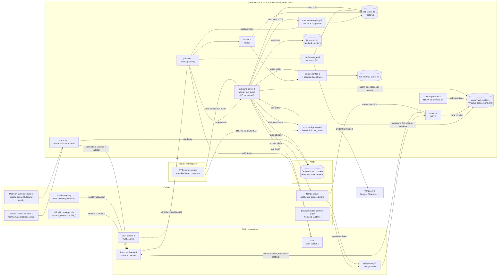
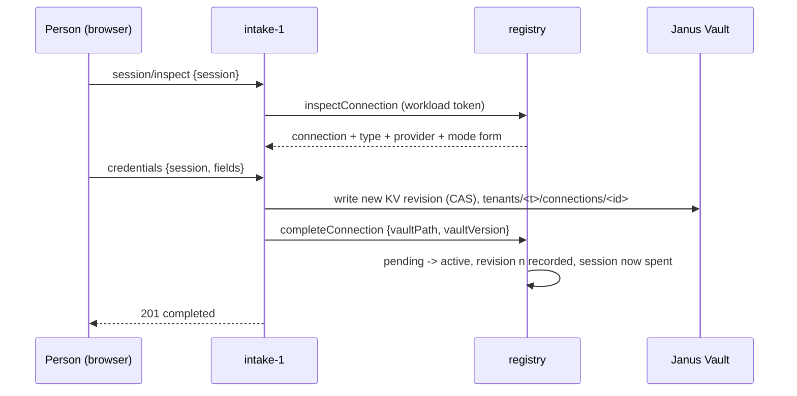
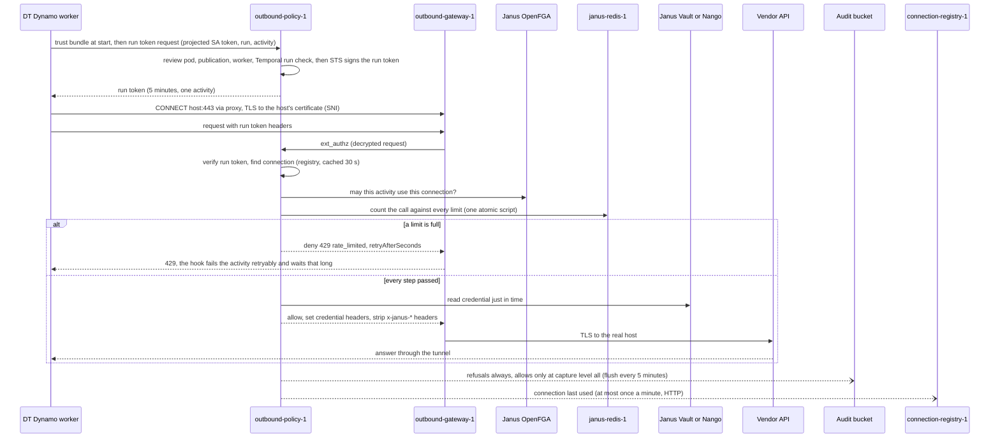

# Janus Cluster — High Level Design

> This describes `Budybot/janus-cluster-1_repo-1` and the platform repositories around it. **Outbound enforcement is live**: every outbound HTTPS call of a DT Dynamo worker goes through `outbound-gateway-1` and is decided by `outbound-policy-1`. The one piece not yet built is **request-content rules**: checking the content of an outbound call (path, method, body) against rules from the publish (D25, D30, D31). It is on the roadmap and its inputs (the rules' compiled form and the publish schema) are designed. Claims that could not be checked from the repositories are listed at the end. Repository-level detail (every capability, every configuration variable) lives in the repository's `docs/content/`; this document keeps the architecture and the reasons.

## Overview

Janus is the platform's **connection manager**. A *connection* is a tenant's authorised link to an external system (Google Calendar through Nango, or any service reached with an API key, basic auth or a bearer token). Janus stores the secret in a Vault of its own, records who made the connection and why, decides who may use it, and shows what exists. It is the only place in the platform that holds connection secrets, and it replaces the retired `connections-1` credential intake in the auth cluster (D47).

It is a Go, Temporal-first **Nexus cluster**, built the way the other application clusters are: one Temporal namespace (`ob1-temporal-janus-cluster-1-ns-1`), a Nexus endpoint (`ob1-nexus-janus-cluster-1-endpoint-1`) that exposes one service, `ConnectionServiceV1`, and a set of components that each own a task queue (`janus-cluster-1-<component>-tq`). Callers never talk to a component directly. They call `Execute` on the endpoint with a component name, a capability name and a payload; `gateway-1` verifies the caller's STS token, validates the payload against the capability's schema, fixes the tenant and user from the token, and starts a child workflow on the component's queue. Two components are HTTP services instead of workers (`intake-1`, `oauth-provider-1`) because a browser or a third party calls them.

The shape follows one idea: **separate the secret from everything that describes it.** Metadata (types, providers, connections, who, why, when) is in Postgres and is visible to people and DTs. The secret value is in the Janus Vault and is written by exactly one component (`intake-1`, or `oauth-provider-1` for refresh tokens) and destroyed by exactly one (`vault-manager-1`). No capability, log line or audit row carries a secret.

Janus also **brokers** the secret to the call that needs it, and is the only way a DT Dynamo worker reaches the internet. A worker's outbound HTTPS goes to `outbound-gateway-1` (an Envoy), which asks `outbound-policy-1` to decide each call: is there a valid run token, is the activity granted this connection, is the call within the connection type's rate limits. If so, the credential is read just in time from the Janus Vault (or from Nango) and set on the request by the gateway; the worker never holds it. Every refusal is audited to a bucket, and a connection's last use is reported to the registry. `outbound-policy-1` is also the gateway's control plane: it issues the gateway's certificates from a PKI in the Janus Vault, feeds Envoy over xDS, and serves the worker-facing API (trust bundle, run tokens).

## Architecture Diagram



External boxes are outside the service boundary. The dotted lines are secret delivery by VSO and `oauth-provider-1`, which is built but has no provider enabled. The two lines between `DYN`, `OGW` and `OPA` are the outbound path (flow 7).

## Deployment Model

All components deploy from one umbrella chart, `janus-cluster-1-repo-1`, as one Argo CD Application (`janus-cluster-1-app`, project `apps-janus-cluster-1-acd-proj-1`) into `ob1-tf-eks-de-v2-janus-1-ns-1` from the de-v2 GitOps repository. Images are built per component and tagged `<component>-<version>-<sha>`; versions come from changesets.

| Component | Kind | Replicas | Ports | Notes |
|---|---|---|---|---|
| `gateway-1` | Temporal worker (Nexus handler + workflow) | 2 | health 3000 | Stateless. Capability manifests are rendered from `charts/gateway-1/files/capabilities/*.yaml`. |
| `connection-registry-1` | Temporal worker + usage API | 1 | health 3000, usage 8081 | The system of record for types, providers, connections, revisions, metadata, rate limits and audit. Serves the connection-usage API on its own port (plain HTTP, only `outbound-policy-1`'s mesh identity admitted). Runs a pre-upgrade migration Job (Argo PreSync hook). |
| `publish-1` | Temporal worker | 1 | health 3000 | Janus's slice of a Mission publish; writes OpenFGA tuples. |
| `vault-manager-1` | Temporal worker | 1 | health 3000 | Only writer of Janus Vault configuration; carries out the destroy queue. |
| `outbound-policy-1` | Temporal worker + gRPC ext_authz + xDS server + worker API | 1 (chart default) | health 3000, ext_authz 9001, xDS 9002, worker API 8090, metrics 9464 | The decision point and control plane of the outbound path. No Nexus callback listener (the audit no longer goes through Temporal, D77). |
| `intake-1` | HTTP | 1 | 8080 (Service 80), health, callback 3001 | Behind `api-gateway-1`; own callback Service `janus-intake-1-callback`. |
| `oauth-provider-1` | HTTP + worker | 1 | 8080 (Service 80) | Internal OAuth providers; none enabled, answers `provider_disabled`. |
| `console-1` | Node web app (console-kit) | 1 (Recreate) | 3000, callback 3001 | Its own host under `orangebox.ai`; own callback Service `console-1-callback`. Reads the outbound audit bucket with its own read-only IAM role (D76). |
| `openfga-bootstrap-1` | Job (Sync hook) + hourly CronJob | n/a | n/a | Creates the store and writes the model; the CronJob never creates a store. |
| `janus-openfga-1`, `janus-vault-cluster-1` | third-party charts via de-v2 (D7) | per chart | per chart | Own namespaces for the Vault (`...-janus-vault-1-ns-1`) and OpenFGA. |
| `outbound-gateway-1` | Envoy 1.34 (de-v2 app, outside the chart) | 1 | proxy 3128, health 8081 | The only path from DT Dynamo workers to the internet (D22, D49). Deployed apart from the chart so the egress path can be rolled back on its own. TLS and routes come from `outbound-policy-1` over xDS. |
| `janus-redis-1` | Redis (Bitnami chart, de-v2 app) | 1 standalone pod | 6379 | Rate-limit counters (D79). No persistence, no replicas, no Sentinel. `maxmemory` is a chart value. Images through the ECR Docker Hub cache. |

Every worker and service runs with request 50m CPU / 64Mi (console 128Mi) and limits 1 CPU / 256Mi (console 500m / 512Mi) by chart default. The two components that wait for Nexus results (`console-1`, `intake-1`) are **single replica by design** (see "The Nexus async pattern"). Postgres is `ob1-janus-db-1` for the registry, publish-1 and vault-manager-1, and read only for `outbound-policy-1` (D73); OpenFGA has its own `ob1-openfga-janus-db-1` (D45). The outbound audit bucket is its own bucket per AWS account.

## Core Interfaces

### The Nexus call every capability uses

```ts
// Request to ConnectionServiceV1.Execute (Temporal Nexus HTTP API: POST .../endpoints/<id>/services/ConnectionServiceV1/Execute?callback=<url>)
interface ExecuteRequest {
  component: "connection-registry-1" | "publish-1" | "vault-manager-1" | "outbound-policy-1";
  capability: string;                // a name from that component's manifest
  payload: object;                   // validated by gateway-1 against the capability's JSON schema (additionalProperties: false)
  idempotencyKey?: string;           // becomes the gateway's workflow id; without one the id is derived from the request
  auth: { token: string };           // the caller's STS token; tenant and user are taken from it, never from the payload
}

// What a component receives (set by gateway-1, not by the caller)
interface ComponentRequest {
  scopeType: "tenant" | "platform";
  tenantId: string;                  // empty for platform scope
  user: string;                      // the token's sub
  sessionBoundary: "viewer" | "editor" | "admin";   // STS session boundary
}

// Answer, delivered to the callback (HTTP 201 first: {"token": ...})
type ExecuteAnswer = { ok: true; data: unknown } | { ok: false; error: { code: "UNAUTHORIZED" | "PERMISSION_DENIED" | "NOT_FOUND" | "INVALID_ARGUMENT" | "FAILED_PRECONDITION" | "UNAVAILABLE"; message: string } };
```

Authorization decisions that belong to a capability (platform scope only, editor boundary, internal callers only) are made **in the component**, which sees the `ComponentRequest`; the gateway only authenticates and validates.

### The provider split

```ts
// A connection type is what callers think in; a provider is what holds and refreshes the credential.
interface ConnectionType {   // e.g. "google-calendar", "generic-api-key"
  code: string; name: string; description: string; category: string;
  credentialKind: "oauth2" | "api_key" | "basic" | "bearer";
  placement: { in: "header" | "query" | "context"; name?: string; format?: string };  // where the credential goes on a call
  host?: string; pathPrefix?: string;   // fixed for a service type; empty for the generic types (the connection carries them)
  outbound?: OutboundSpec;              // how the gateway puts the credential on a call; absent: `placement` applies
  rateLimits: RateLimit[];              // the vendor's limits, set below the vendor's own (D79); empty means none
  defaultScopes: string[]; state: "active" | "retired";
}
// type x provider: which provider serves the type; exactly one is active (new connections use it).
interface TypeProviderLink { state: "active" | "available" | "deprecated" | "retired"; settings: { integrationKey?: string } }
```

## Schema Definitions

### Connection (metadata only)

```ts
interface Connection {
  id: string;                  // conn_<26 chars>. Immutable.
  tenant: string;              // asserted from the token at the gateway, never a request field.
  name: string;                // Made by the registry: the type's name, then "<name> 2", "<name> 3" (never reused).
                               //   Generic types: "<Type> – <host><path>", e.g. "API key – welcomehome.com". Unique per tenant+type (index).
  typeCode: string; providerCode: string;
  host?: string; pathPrefix?: string;     // set for generic types at request time
  state: "pending" | "active" | "needs-reauth" | "revoked";
  currentRevision: number;     // 0 until a secret is stored; each stored secret is a new immutable revision.
  createdBy: string;           // the user (or later a DT) who made it: the "creator" right (D42).
  reason: string;              // why it was requested, 1..500 chars, required. Also in the audit row.
  metadata?: Record<string,string>;  // display-only (D63). Keys ^[a-z][a-z0-9_.-]{0,63}$, values 1..500 chars, max 20. Never a secret and
                                     //   never an input to an allow/deny decision. First intended use: account_label.
  lastUsedAt?: string;         // when outbound-policy-1 last placed this connection's credential on an allowed call; reported at most once a minute (D77).
  rateLimitOverrides?: RateLimitOverride[];  // lower this connection's connection-scoped limits of its type; never raise (D79).
  createdAt: string; updatedAt: string;
}
```

### Outbound credential spec and rate limits

```ts
// What a type says about how its credential is used on an outbound call (compiled once and cached by outbound-policy-1).
interface OutboundSpec {
  mode: "inject" | "context";        // inject: the gateway sets the credential. context: refused today (the call is denied, never sent without a credential).
  credential: { in: "header" | "query"; name: string; value: string }[];  // 1..5, in order; value uses the credential kind's placeholders
  staticHeaders?: Record<string,string>;   // non-secret headers set on every call of the type
  stripHeaders?: string[];                 // client-sent headers removed first, so a worker cannot smuggle its own credential
}

// One limit of a type: at most `limit` calls in any `window`, counted per connection or for the whole type.
interface RateLimit {
  name: string;                       // 1..32 of a-z 0-9 -; names the limit in a refusal and in an override
  scope: "connection" | "type";       // connection: one counter per connection. type: one counter shared by every connection (a quota that is ours, such as our own OAuth client's project quota)
  limit: number;                      // 1 .. 1,000,000,000
  window: string;                     // a whole number and one unit s, m, h or d; 1s to 1d
}
interface RateLimitOverride { name: string; limit: number }  // only a connection-scoped limit, only lower, same window
```

The catalog editor's form edits a type's rate limits but not its `outbound` spec yet: an edit carries the stored spec through unchanged, and the spec is set through the `systemUpsertConnectionType` capability.

A type holds at most 8 limits. Stating both a short window (per second or minute) and a long one (hourly, daily) lets a type mirror a vendor that has both.

### requestConnection

```ts
interface RequestConnectionRequest { typeCode: string; reason: string; idempotencyKey?: string; host?: string; pathPrefix?: string; forceNew?: boolean | "true" | "false" }
interface RequestConnectionResponse {
  connection: Connection;
  link: { url: string; message: string; expiresAt: string };  // url has the one-time session in its #fragment; lives 60 minutes
  reused: boolean;             // an earlier pending request of the same user, type, host and path was still inside the window
  reusedFromRequestedAt?: string;  // when reused, message starts by telling the reader this is the same pending connection
}
```

## Component Breakdown

### gateway-1

The front door of `ConnectionServiceV1`. It resolves the capability from the manifests, authenticates the STS token (issuer `https://auth.budy.internal/sts`, audience `urn:budy:nexus:ob1-nexus-janus-cluster-1-endpoint-1:ConnectionServiceV1`, Nexus access to `Execute` and `DescribeCapabilities`), validates the payload, sets `ComponentRequest`, and runs `GatewayExecuteWorkflow`, which runs a `ValidateSchema` activity and then a child workflow of the component (for the registry, `ConnectionRegistryWorkflowV1`). The workflow id is derived from tenant, user, capability, boundary and the idempotency key or a hash of the payload, so **two identical calls in flight at once collide** ("Workflow execution is already running"). Callers that can send the same call twice (reads, retries) must send a fresh `idempotencyKey` per try; console-1 and intake-1 do. gateway-1 itself is built from the platform's shared `go/capability` library.

### connection-registry-1

Owns the metadata in Postgres and every rule about it, including each type's outbound credential spec and rate limits and each connection's overrides. It offers 25 capabilities in five groups:

| Group | Capabilities | Who may call |
|---|---|---|
| Tenant reads (8) | `describeConnectionTypes`, `listConnectionTypes`, `getConnectionType`, `listConnections`, `getConnection`, `listConnectionRevisions`, `listConnectionAudit`, `listPublications` | tenant scope (tenant fixed from the token) |
| Tenant writes (3) | `requestConnection`, `revokeConnection`, `createConnection` | tenant scope (`requestConnection` checks only the tenant; the console asks for an `editor` boundary before it shows a working Connect, D59, and for an `admin` boundary before it shows Revoke). `createConnection` takes an explicit name and returns the raw intake session, so it is **not** published as a DT tool; `requestConnection` is the path callers use. |
| Internal (3) | `completeConnection`, `inspectConnection`, `setConnectionMetadata` | platform scope and the caller's user in `INTERNAL_CALLERS` (today only `janus-intake-1` calls them) |
| System reads (4) | `systemListConnectionTypes`, `systemListProviders`, `systemConnectionTypeUsage`, `systemListCatalogAudit` | platform scope, any boundary |
| System writes (7) | `systemUpsertConnectionType`, `systemSetConnectionTypeState`, `systemDeleteConnectionType`, `systemSetTypeProvider`, `systemRemoveTypeProvider`, `systemCheckTypeProvider`, `systemSetConnectionRateLimits` (a connection's overrides) | platform scope, `editor` or `admin` boundary (the check changes nothing but is an editor action) |

Invariants it enforces: one active provider per type; a retired type takes no new connections; a type with connections cannot be deleted; a connection can only move `pending` to `active` through `completeConnection`, and that call is idempotent; a link in use cannot be removed; every editor write is audited with before and after and is idempotent by its idempotency key (or workflow run id). **Providers are code, not data:** there is no capability to create or edit one (D60); a provider is added by a registry migration so that where it reads its keys and how it refreshes tokens is reviewed code.

Two things reach the registry from `outbound-policy-1` without a capability. **Last use**: the registry serves a small HTTP API on its own port and keeps the latest time per connection; only `outbound-policy-1`'s mesh identity may call it (D77). **Change notices**: after any change to what the outbound path reads (connections, revisions, types, credential kinds, links, publications) the database sends a `LISTEN/NOTIFY` message on the channel `janus_registry_changed`, so the outbound path drops its caches at once (D78). Revoking a connection of a Nango-backed type also deletes the connection in Nango, once, inline; a failure leaves a pending record and the revoke still succeeds (a repeated revoke retries it).

### intake-1

The browser-facing component. Five routes under `/v1/connections/`: `session/inspect`, `session/connect`, `session/status`, `credentials`, `webhooks/nango`. The capability is a **signed intake session** (HMAC, key shared with the registry and `oauth-provider-1`, single use, 60 minutes) that `requestConnection` put in the link's fragment, so no server log ever sees it. It calls the registry as its own workload identity (`janus-intake-1`) and writes secrets to the Janus Vault under a Kubernetes-auth role that can only write `janus-connections/tenants/*`. For the form kinds it stores the secret and calls `completeConnection`; for Nango it creates a connect session lazily when the user clicks, and later completes the connection from Nango's webhook. Per-address and per-connection rate limits, an allowed origin, and a fixed-word error for every refusal.

### console-1

The platform console (console-kit). Two scopes from one deployment. **Tenant scope**: the tenant's connections and types, with **Connect** (calls `requestConnection` with the signed-in user's own token, the same path the DT tool uses). **System scope**: types, providers (read-only), usage, audit, and the **catalog editor**. It holds no secret and no database or Vault credential; every call goes to `gateway-1` through Nexus with the user's token, so the gateway fixes tenant and user. The one exception is the system **Outbound activity** page, which reads the outbound audit bucket directly with a read-only IAM role of its own (D76): a read of immutable objects that hold no secret would otherwise cost a workflow per open tab. Beyond the catalog editor, the console shows: the **rate-limit editor** in the type editor (a type's limits), the system **Connection limits** page (a connection's overrides), a **Check current usage** button (tenant connection page and the Connection limits page: how much of each limit is used now, read on request and never polled), **Revoke** for a tenant admin, and last-used times. Sign in is by STS handoff from the platform portal; sign out and expiry send the browser back to the portal.

### publish-1

Janus's slice of a Mission publish (D38, D39). `registerPublication` (from the publishing service only) validates that every connection named belongs to the tenant and is active, records the publication and its grants, and writes tuples to `janus-openfga-1`; `retirePublication` removes them. A Janus publication is the registry's publication: one root workflow (its automation), the child workflows it calls, the activities with the connections each may use, the mission it is filed under, and the name of the DT Dynamo worker that runs it. Without a worker name the publication is stored but no run token is issued for it, so every outbound call of its activities is refused. A request that names a missing or inactive connection is recorded as refused and writes nothing. `outbound-policy-1` reads the stored publications directly (D73).

### vault-manager-1

The only writer of Janus Vault configuration (D6, D57): auth methods, mounts, policies and component roles, from desired state in Postgres, with drift detection. It also carries out the registry's `vault_destroy_request` queue: after a revoke it destroys the KV versions of that connection. And it keeps the **outbound PKI** (D69): a ten-year root and a 90-day issuing intermediate in two mounts of the Janus Vault, each generated inside the Vault and never exported, and the issuing role whose allowed domains are the registrable domains of the active host set. The intermediate carries excluded name constraints for the platform's own domains, so the outbound CA can never impersonate a platform service; it is rotated in its last 30 days. The root is never rotated automatically.

### oauth-provider-1

The internal OAuth provider surface (authorize, callback, code exchange, refresh tokens in the Janus Vault); it runs with no provider enabled and has no ingress. It is needed only for an internal Google provider.

### outbound-policy-1

The brain of the outbound path (D22). One worker, four jobs.

**1. Decide each call** (Envoy's ext_authz). A call is allowed only if every step passes, in this order, and each step fails closed:

1. **Run token.** The worker's activity carries a short-lived token (5 minutes) signed by STS, bound to one activity of one run of one publication. No or invalid token: refused.
2. **Connection.** The tenant's connection that serves the host and path is read from the registry. When the activity may use more than one connection for the same host and path, the call must name one with `x-janus-connection`; otherwise it is refused as ambiguous. A connection that is not `active` is refused.
3. **Grant.** Janus OpenFGA is asked whether this activity, in a run of this publication, may use this connection (the tuples publish-1 wrote).
4. **Rules.** Request-content rules (path, method, body, from the publish, D25, D30, D31) are the one piece not yet built; it is on the roadmap and its inputs are designed. A call that passed the grant is allowed at this step.
5. **Rate limits.** The connection type's limits are checked before the credential is read, so a refused call reads nothing from the Vault or Nango (D79).
6. **Credential.** Read just in time and handed to the gateway to set on the request (below). Every `x-janus-*` header is removed before the call leaves.

Every refusal has a fixed code (`no_run_token`, `invalid_run_token`, `no_connection`, `connection_not_active`, `not_granted`, `ambiguous_connection`, `rate_limited`, `credential_unavailable`, ...) that the caller sees in the `x-janus-decision` header and that appears in the audit.

**Credential injection.** A Vault-backed connection is read with a child token that can read only that connection's secret and lives at most 15 minutes, at exactly the version the registry recorded as current; a newer version the registry never recorded is never used. A Nango connection's access token is fetched from Nango with the component's own scoped key and cached no longer than its own expiry. The type's outbound spec says where it goes (header or query, with placeholders for the credential's fields), which non-secret headers to add and which client headers to strip first. A type with no spec uses its placement.

**2. Be the gateway's control plane.** It builds the gateway's TLS side from the registry's active host set and pushes it to Envoy over xDS, so a new host needs no restart and no file. Hosts are grouped by registrable domain (`www.googleapis.com` and `calendar.googleapis.com` share one certificate for `googleapis.com` and `*.googleapis.com`). Each certificate is signed by the Janus Vault PKI, verified as a worker would verify it before it is used, valid 72 hours and renewed in its last third. A wider certificate is not a wider allow-list: the gateway's routes list only the active exact hosts, and every call still needs the run token and the grant (D68, D70, D71).

**3. Serve the worker API** (plain HTTP inside the mesh). `GET /v1/trust-bundle` returns the root the certificates chain to. `POST /v1/run-tokens` issues a run token after four checks: the pod's projected service-account token is reviewed by the Kubernetes API; a live publication lists the activity, and the reported workflow is in that publication; the pod is the worker the publication names (the DT Dynamo worker resource in the caller's namespace that runs as that service account and names the publication's tenant, DT and worker); and Temporal confirms the run exists, is running, has the reported workflow type, and its root execution is the publication's root workflow. STS then signs the token for the root run, so child workflows share their publication's token (D72). A dependency that is down is a retryable `unavailable`, never a refusal.

**4. Offer three capabilities through the gateway.** `describePolicy` (reports whether ext_authz is serving and how many rule files are loaded), `getConnectionRateLimitUsage` (tenant scope: one of the tenant's own connections, its connection-scoped limits only) and `systemGetConnectionRateLimitUsage` (platform scope: any connection, every limit). Both usage reads count nothing.

**Audit (D77).** Decisions go to the audit bucket as gzipped NDJSON, never through Temporal or Postgres. A refusal or failure is always recorded; an allow only when the capture level is `all` (a debugging setting). Identical refusals in one flush collapse into one record with a count, so a flood cannot grow the data. Retention is the bucket's lifecycle rule per prefix, not code. A connection's last use is reported to the registry at most once a minute. Decision counts by code are also metrics, so volume is visible without storing allows. A pod crash loses at most one flush interval of records; the log line of each decision stays.

**Caching (D78).** Its reads of the registry, the grant checks, the Vault credentials, the Nango token and the Temporal run check are cached for 30 seconds per pod. A refusal is never cached, and neither is a run that is not running. When the registry changes what the outbound path reads, a change notice drops every cache at once; while the listener for those notices is down, caches are bypassed. So a revoke or a retire applies to the next call, and 30 seconds is only the worst case when a notice is lost.

**Rate limits (D79).** A type's limits are counted per connection or across the type. A connection can lower its type's connection-scoped limits, never raise them. A refused call answers HTTP 429 `rate_limited` naming the limit and when it next admits a call; the worker hooks turn that into a retryable Temporal failure that waits exactly that long. A vendor's own 429 passes through unchanged. Counters are in `janus-redis-1`; when Redis is unreachable each pod limits on its own share (fail open, see Failure Modes).

### outbound-gateway-1

A stock Envoy that is the only path from DT Dynamo workers to the internet. A worker's HTTPS proxy setting points at it; it takes the CONNECT tunnel, terminates TLS with the certificate of the requested host (chosen by SNI), runs ext_authz against `outbound-policy-1` on the decrypted request and, only if allowed, forwards it over TLS to the real host, whose certificate it verifies against the public roots. Everything else is refused: plain HTTP through the proxy, a host with no certificate (an inactive host), a Host header that is not the SNI's host, and any call while ext_authz is down or slow. Before the first xDS snapshot it has no TLS listener, so every tunnel fails closed. It is a de-v2 application rather than part of the chart so the egress path can be rolled back on its own (D49).

### janus-redis-1

Janus's own Redis, a de-v2 application beside the chart, used only for rate-limit counters (D79). One standalone pod: no replicas, no Sentinel and no persistence, because `outbound-policy-1` fails open and a restart only resets the windows. Every key carries a TTL and, at the memory limit, the keys closest to expiry are evicted first. The password comes from the platform Vault through VSO.

### DT Dynamo workers (outside the chart)

The outbound path only works because the worker side is fixed by platform defaults, not by each DT's template: the Dynamo operator adds the proxy setting, the worker API address and a projected service-account token (audience `janus-outbound-policy-1`) to every worker and refuses a template that sets them; worker images trust **only** the Janus roots (one baked-in file holds the Janus roots), so a handshake with anything but the Janus gateway fails; and the network policy for workers allows only DNS for in-cluster names, Temporal, the gateway and the worker API, with no direct internet. The worker hook adds the run-token headers and turns a rate-limit refusal into a retryable failure.

### Catalog tools and skills (`janus-catalog-1`)

Tools and skills for the DT context catalog, synced by the context operator: list tools (types, connections), `request_connection` (`typeCode`, `reason`, `forceNew`; the idempotency key is the runtime's tool-call key) and `revoke_connection`, plus skills that tell a DT when to ask, to give a concrete reason, to share the link unchanged, and to force a second connection only when the user explicitly asks. Tenant scope only: no `system*` capability and none of the internal ones can be published as a tool (the chart lint refuses them).

## Key Flows

### 1. Request a connection (DT tool or console Connect)

```mermaid
sequenceDiagram
    participant U as DT or tenant user
    participant GW as gateway-1
    participant R as connection-registry-1
    participant DB as Postgres
    U->>GW: Execute requestConnection {typeCode, reason, forceNew?} (callback)
    GW->>GW: verify STS token, validate schema, fix tenant + user
    GW->>R: child workflow
    R->>DB: type + provider binding; retired type refused
    alt pending request of same user, type, host, path inside 60 min and not forceNew
        R->>DB: reuse that connection (reused=true)
    else
        R->>DB: insert pending connection, generated name, reason (unique index on name)
    end
    R->>DB: audit link_minted (reason, reused, forced)
    R-->>U: {connection, link #s=<signed session>, expiresAt, reused}
    Note over U: the link is handed to the person; the DT never sees the secret
```

### 2. Collect the secret (form kinds) and complete



### 3. Google Calendar through Nango, and the webhook

```mermaid
sequenceDiagram
    participant P as Person
    participant I as intake-1
    participant N as Nango
    participant R as registry
    P->>I: session/connect
    I->>N: POST /connect/sessions (API key; tag connection_id)
    I-->>P: Nango connect link (new tab)
    P->>N: authorise at Google through Nango
    N->>I: webhook auth/creation (X-Nango-Hmac-Sha256, signing key)
    I->>I: verify HMAC of the raw body; connection id from the end-user tag
    I->>R: completeConnection {providerRef = Nango connection id}
    P->>I: session/status (poll) -> active
```

The secret stays in Nango; Janus keeps the reference (`providerRef`) and the integration key from the type's link settings.

### 4. Edit the catalog (console, system scope)

A staff user with an `editor` or `admin` boundary creates or edits a type in console-1; the console validates once (the same rules as the registry), sends `systemUpsertConnectionType` with the browser's idempotency key and `expectedUpdatedAt`; the gateway passes `sessionBoundary`; the registry refuses a viewer, writes the row and a `catalog_audit` row in one transaction, and answers the row as stored. A stale version is `FAILED_PRECONDITION` (HTTP 409 to the browser). Making a link `active` demotes the previous one in the same transaction and affects **new connections only** (D43). The console shows a warning and requires an acknowledgement first.

### 5. Publish (Mission to Janus)

`mission-registry-1` calls `publish-1.registerPublication` through Nexus with the publication id, tenant, DT, automation, workflows, activities and the connection ids each activity uses. publish-1 checks each connection (tenant, active), records the publication and grants, and writes tuples in the Janus OpenFGA store (found by name, `janus-cluster-1`). Idempotent per publication id.

### 6. Revoke

`revokeConnection` sets the connection `revoked`, writes an audit row and queues a `vault_destroy_request` (path and versions); `vault-manager-1` destroys those KV versions. For a Nango-backed connection the registry also deletes the connection in Nango, once, inline; the answer says `done`, `pending` (the deletion failed and a repeated revoke retries it) or `not_needed` (a form connection). The change notice (D78) makes `outbound-policy-1` drop its caches, so the next outbound call on that connection is refused. A sweeper that retries pending Nango deletions on its own is not built.

### 7. An outbound call from a DT Dynamo worker



For any other refusal the gateway returns the denial code to the worker and the audit records it. A worker that bypasses the proxy has no route to the internet at all (network policy), and one that reaches the gateway without a valid run token is refused before anything is read.

### 8. A host becomes reachable

When a connection type with a fixed host, or a generic connection with its own host, becomes active, `vault-manager-1` widens the issuing role's allowed domains from the active host set on its next pass (every minute), so the Vault itself refuses to sign any other name. On its next certificate sync (every 30 seconds) `outbound-policy-1` recomputes the registrable-domain groups, asks the Vault for any certificate that is new or changed, verifies it, and pushes the new TLS listener and certificate to the gateway over xDS. No step is needed when a type is created in the editor, and reaching a host is still not permission to call it (D70).

## The Nexus async pattern (architecture decision)

`ConnectionServiceV1.Execute` is a workflow-run operation. Temporal answers HTTP 201 with an operation token at once and later POSTs the result to the callback URL the caller put in `?callback=`. Consequences designed in (D58):

- **Every caller listens.** console-1 and intake-1 each run a callback listener on its own port (3001) and its own Service (`outbound-policy-1` has none: its audit goes to S3, D77, and it makes no Nexus call), with a per-call URL `/internal/nexus/callback/<id>.<signature>` signed by a key that lives only in that process.
- **One replica per listener**, because the key is in memory: a callback delivered to another replica would fail its signature. The console chart refuses `replicaCount > 1`. A restart between a call and its callback loses that answer; the caller times out and the person retries.
- **Allowlist.** Temporal only delivers to addresses in `component.callbacks.allowedAddresses` (the two callback Services are listed in the eks-stack Temporal values).
- **Network.** Cilium lets only Temporal's history service reach port 3001 of each listener; the callers have egress to the Temporal frontend (7243).
- **Mesh.** The namespace enforces STRICT mTLS. intake-1 also has an Istio `ALLOW` policy for the API gateway on 8080; because an allow policy denies everything it does not list, a second policy admits Temporal's service account on 3001 (console-1's policy lists Temporal's account for 3001 as well). Without the second policy Temporal's delivery is refused and the caller sees `handler error (UNAUTHORIZED)`.
- **Timeouts.** The caller's wait and the `Operation-Timeout` header are the same whole seconds; a timeout is "may still be running", not "failed".

## Identity and Authorization

| Concern | How it works |
|---|---|
| Who is calling | STS tokens. A user session carries `scope_type` (tenant or platform) and `session_boundary` (the standard STS claims, formerly `scopeType` and `sessionBoundary`); a workload (intake-1) exchanges its projected service-account token at the STS for a token of platform scope `janus-platform-1` (D55). |
| Who is calling from a worker | A run token signed by STS, issued by `outbound-policy-1` (its only attestor) after it has verified the pod, the publication, the worker and the live Temporal run (D72). It is identity, not permission: OpenFGA answers permission on every call. |
| Admission to the endpoint | The STS admits `tenant:*` and `platform:*` to `Execute` and `DescribeCapabilities` (D56). |
| Tenant isolation | The gateway sets the tenant from the token; no capability takes a tenant argument. A platform-scope read may span tenants (system scope, D51). |
| Staff rights | `session_boundary` from the platform portal's groups: `viewer` reads; `editor` and `admin` write the catalog (D59). |
| Internal capabilities | The registry accepts them only from platform scope **and** a `user` listed in `INTERNAL_CALLERS` (only `janus-intake-1` calls them). (Configuration lives in `registry.internalCallers`; a misplaced key once left the list empty and every internal call was refused.) |
| Rights on a connection | `janus_connection_1` in the Janus OpenFGA model (`components/publish-1/authz/janus.fga`): `creator`, `dt_user`, `dt_manager`, `user_activity`, `can_use`, `can_revoke` (D42). The model also holds the publication hierarchy (DT, mission, publication, workflow, activity). Nothing about a run is stored: `outbound-policy-1` supplies the run as contextual tuples from the verified run token for each check. |
| OpenFGA | A dedicated instance with its own database (D40, D45). `openfga-bootstrap-1` creates the store by name and writes the model; clients find the store by name; one preshared key per consumer (one shared value for now). |

## Storage

### Postgres `ob1-janus-db-1` (metadata only)

| Table | Purpose |
|---|---|
| `credential_kind`, `provider_credential_kind` | the four kinds (`oauth2`, `api_key`, `basic`, `bearer`) and which providers hold which (D50) |
| `connection_type`, `connection_provider`, `type_provider` | the catalog; one active provider per type (partial unique index). A type also carries its outbound credential spec and its rate limits |
| `connection` | id, tenant, creator, type and provider, state, current revision, host and path, generated name (unique per tenant+type, case-insensitive), `request_reason`, request key for idempotency, rate-limit overrides |
| `connection_usage` | when each connection's credential was last placed on an allowed call; written only from `outbound-policy-1`'s reports and never moved backwards (D77) |
| `connection_revision` | immutable (a trigger refuses update and delete): connection, revision, Vault path and version, who, when |
| `connection_metadata` | key, value, source per connection; cascades with the connection |
| `publication`, `publication_grant` | Janus's slice of each publish and its activity-to-connection grants |
| `audit`, `catalog_audit` | the registry's own connection events (including the reason) and editor writes with before and after. Per-call outbound decisions are **not** here: they are in the audit bucket (D77) |
| `vault_destroy_request`, `provider_delete_request` | work for vault-manager-1 (Vault versions to destroy) and for the registry (a Nango-side connection to delete after a revoke) |

Migrations run as an Argo PreSync Job with a Vault-issued migrator role. Migration `00008` deliberately deleted every connection while nothing was in use; it queued the stored Vault secrets for destruction first and runs once per database (D64). Triggers on the tables the outbound path reads send the `janus_registry_changed` notice (D78). `outbound-policy-1` reads the database with a read-only role; `console-1` has no database access.

### Janus Vault `janus-vault-cluster-1`

KV v2 mount `janus-connections`, path `tenants/<tenant>/connections/<connection_id>`, one key per credential field, immutable revisions. HA with Raft, auto-unsealed by `vault-cluster-2`'s Transit (D14); no human access (D5). Only intake-1 and oauth-provider-1 write; only vault-manager-1 destroys; the registry never sees a value. `outbound-policy-1` reads a value only just in time, for one call, through a short-lived child token limited to that connection (D69, D78).

The same Vault also holds the **outbound PKI** in two further mounts: a root (ten years) and an issuing intermediate (90 days), generated inside the Vault; the root key never leaves it (D69).

### Outbound audit bucket (S3)

Gzipped NDJSON objects, one per pod per flush (at most every 5 minutes and at shutdown), under `deny/` and `allow/` and then by date and hour. A refusal or failure always goes to `deny/`; an allow goes to `allow/` only at capture level `all`. Records hold ids, codes, host, method and path, never a credential, header value, token or query string. Retention is the bucket's lifecycle rule per class prefix, set where the bucket is declared (cloud-management), not in code.

Encryption is SSE-S3. `outbound-policy-1` has a write-only role (PutObject on the two prefixes); `console-1` has a read-only role (list and get on them). Nothing in Janus deletes objects.

### Redis `janus-redis-1` (rate-limit counters)

Per limit and window, counters keyed by connection or by type, each kept for two windows and carrying a TTL; sliding-window estimate from the previous and current bucket. Memory only, no persistence, evicts the keys closest to expiry first. Losing it resets the windows and nothing else.

### `vault-cluster-2` (platform Vault, read by VSO)

Holds the keys Janus components need at startup, in `app-kv-secrets-1` under `v1/de-v2/ob1-tf-eks-de-v2-janus-1-ns-1/`: the intake session HMAC key, each component's Nango key, intake's Nango webhook signing key, the console session secret, the OpenFGA keys, and the Redis password (`janus-redis-1/root-user`, key `password`, read by both Redis and `outbound-policy-1`).

## Secrets and keys

| Secret | Where | Used by |
|---|---|---|
| Connection secret values | Janus Vault KV | written by intake-1 and oauth-provider-1 |
| Intake session HMAC key | `vault-cluster-2`, shared | signed by the registry, verified by intake-1 and oauth-provider-1 |
| Nango **API key** | `vault-cluster-2` (`secretKey`), one per component | scopes by component, recommended: intake `environment:connect_sessions:write`; registry `environment:integrations:read_credentials` and, for the Nango deletion on revoke, `environment:connections:delete`; outbound-policy `environment:connections:read_credentials` (D66) |
| Nango **webhook signing key** | `vault-cluster-2` (`webhookSigningKey`) | intake-1 only, to verify `X-Nango-Hmac-Sha256` |
| OpenFGA preshared keys | `vault-cluster-2` | one per consumer |
| Redis password | `vault-cluster-2` (`janus-redis-1/root-user`) | `janus-redis-1` and `outbound-policy-1`, one Secret |
| Outbound PKI keys | inside the Janus Vault, never exported | root and intermediate; `outbound-policy-1` holds each leaf key in memory only |
| Run tokens | signed by STS, 5 minutes | issued by `outbound-policy-1` to the worker for one activity |

The Nango API key and the signing key are different secrets in Nango. Using one value for both would make every webhook fail verification. The scope names above come from Nango's public documentation and **must be confirmed in the dashboard** (see [Not verified](#not-verified)).

## Network and Mesh

- **Cilium** default-denies ingress and egress in the namespace; each component has a named allow policy. Intake accepts the API gateway on 8080 and Temporal history on 3001; it may reach the STS, the Temporal frontend, the Janus Vault, DNS and Nango (443). The console accepts the Istio ingress gateway on 3000 and Temporal history on 3001, and reaches the STS, the Temporal frontend and, for the Outbound activity page, S3 and the regional STS. `outbound-gateway-1` accepts DT Dynamo workers on 3128 only and reaches `outbound-policy-1` and the internet on 443. `outbound-policy-1` accepts the gateway (ext_authz, xDS) and workers (worker API) and reaches the registry database, the Janus Vault, OpenFGA, Redis, the registry's usage port, the Temporal frontend (the run check), the STS, Nango, S3 and the Kubernetes API (token review). DT Dynamo workers may reach only in-cluster DNS, Temporal, the gateway and the worker API; there is no direct internet.
- **Istio.** STRICT `PeerAuthentication` for the namespace. The namespace has a deny-all `AuthorizationPolicy` and each workload lists its callers by mesh identity and port: intake-1 (the API gateway on 8080, Temporal's service account on 3001), console-1 (the Istio ingress gateway on 3000, Temporal on 3001), `outbound-policy-1` (the gateway on 9001 and 9002, workers on 8090), the registry's usage port (only `outbound-policy-1`), Redis (only `outbound-policy-1`) and the gateway (workers only). Policies use ports and principals only, because L7 attributes (methods, paths) are not enforced without a waypoint. The Janus namespaces run in Istio **ambient** mode with sidecar injection disabled.
- **Public routes.** The connect page and the intake routes share an `app-1` host under `orangebox.ai`; `api-gateway-1` (generated from the backend-services contracts) routes `/v1/connections/*` to `intake-1` and leaves the connect page routes and the Nango webhook open without a bearer token, because intake authenticates them itself (session capability, webhook signature). The console has its own host under `orangebox.ai`, behind the portal.
- **Argo CD.** An application may only create resources in namespaces its AppProject lists. The backend-services app creates the gateway's `ReferenceGrant` in the Janus namespace, so `ob1-tf-eks-de-v2-janus-1-ns-1` must be listed in the `apps-de-v2-services-acd-proj-1` destinations; without it the sync fails and the intake route does not exist.

## Dependencies

| Dependency | How used |
|---|---|
| Temporal (frontend 7233 gRPC, 7243 Nexus HTTP) | workflows, Nexus endpoint and callbacks |
| STS (`auth-cluster-1`) | token issuer and keys; workload token exchange; console handoff redeem; signs run tokens for `outbound-policy-1` |
| Nango Cloud (`api.nango.dev`) | connect sessions, integration reads, webhooks, connection deletion on revoke, access tokens read just in time for outbound calls; Google OAuth for Google Calendar |
| `vault-cluster-2` + VSO | keys and secrets for components |
| `janus-vault-cluster-1` | connection secrets; the outbound PKI |
| `janus-openfga-1` | grants (publish-1 writes, `outbound-policy-1` checks) |
| `janus-redis-1` | rate-limit counters |
| Outbound audit bucket (S3) | refusals and, when enabled, allows; read by the console |
| Temporal tenant namespaces | `outbound-policy-1` reads a run's state (`DescribeWorkflowExecution`) to check a run is live |
| Kubernetes API | token review of a worker's projected token; the DT Dynamo worker resources that name each worker's identity |
| DT Dynamo operator and worker images (nainai, dynamo-worker-ts/-go) | inject the proxy, API address and token; trust only the Janus roots; add run headers and convert a rate-limit refusal |
| Vendor APIs | the destination of an allowed call |
| Postgres `ob1-janus-db-1`, `ob1-openfga-janus-db-1` | metadata (registry, publish-1, vault-manager-1; read only for `outbound-policy-1`); OpenFGA state |
| `api-gateway-1` (Istio) | public routes to intake-1 |
| Context operator and catalog | publishes the DT tools and skills |
| Mission registry (DT Consulting Services) | calls `registerPublication` and `retirePublication` |
| frontend-cluster-1 | the connect page `/connections/connect` and the portal route to the console |

## Observability

Every component honours a log level: console-1 `logLevel` (default `warn`), intake-1 and the registry `LOG_LEVEL` (chart `logLevel`, default `info`). **debug** is routine per-request events (session inspected, status polls, Nango webhook received, catalog write); **info** is startup and a connection's lifecycle (requested, completed, revoked, Vault destruction queued); **warn** is a refusal an operator may want to see (invalid or spent session, rate limit, bad webhook signature); **error** is a failed dependency, with a fixed-word `cause` (`gateway_timeout`, `no_callback`, `operation_failed`, `gateway_status_<code>` and so on). Lines carry ids, outcomes and fixed words, never a session, link, credential, Vault path or answer text. intake-1 takes the edge's `X-Request-Id` (or makes one), returns it, logs it as `request` and sends it to the gateway on each try, so a connect attempt can be followed across services; the registry logs the gateway's idempotency key or workflow run id as `request` (the capability request carries no caller request id). The durable trail for connections is the `audit` and `catalog_audit` tables; for outbound calls it is the audit bucket (every refusal, allows at capture level `all`). `outbound-policy-1` also exposes Prometheus metrics: decisions by kind, decision and code, audit writes and drops, cache hits, usage reports, and rate-limit checks, refusals, fallbacks and whether Redis is up. Allow and refusal counts are therefore visible without storing allows. The console's Outbound activity page searches the bucket by run or workflow id, code, tenant or text.

## Failure Modes

| Failure | Effect | Notes |
|---|---|---|
| Registry or its database down | Every capability answers `UNAVAILABLE`; the connect page shows "could not reach the service"; no connection can be requested or completed | Pending links stay valid for 60 minutes |
| Nexus callback lost (listener restart, mesh or network denial) | The caller times out; the work may still have run | Retrying is safe: reads are idempotent and `completeConnection` is idempotent; requests reuse a pending connection |
| Janus Vault down | A secret cannot be stored; the connection stays `pending` | Intake answers `unavailable` and logs `vault_write_failed` with a cause |
| Nango down or webhook refused | OAuth connection stays `pending` | The webhook is retried by Nango; a wrong signing key refuses every one |
| `INTERNAL_CALLERS` empty or wrong | Internal capabilities refused (`this capability is internal`) | Caused by a misplaced Helm key |
| Two identical gateway calls at once | Second fails "already running" | Callers send a fresh idempotency key per try |
| Type retired | New requests refused with `type_retired`; existing connections keep working | Hard delete only when no connection exists |
| Provider switched active | New connections use it; existing stay on theirs | No migration (D43) |
| Migration `00008` re-run | not possible: it runs once per database | Stored Vault secrets are queued for destruction when it runs |
| `outbound-policy-1` down or slow | The gateway refuses every call (no fail-open); workers' activities fail and Temporal retries them | Envoy keeps its last certificates and routes while the xDS server is away, so a restart of `outbound-policy-1` does not interrupt TLS |
| `outbound-gateway-1` down, or no xDS snapshot yet | Every tunnel fails closed | Workers have no other route to the internet |
| Registry database, OpenFGA, Vault or Nango unreachable from `outbound-policy-1` | The call is refused with a fixed code (`policy_error` or `credential_unavailable`); the run-token API answers a retryable `unavailable` | Never a silent allow. Cached reads (30 s) may still be served for a call that was allowed a moment ago |
| Redis unreachable | **Fail open**: calls are not refused for it; each `outbound-policy-1` pod limits in memory at its share of each limit, skips Redis for 5 seconds, and records a metric | A vendor's own 429 still reaches the caller. A restarted Redis comes back empty and the windows start again. The live usage reads answer limits without counts |
| Registry change listener disconnected | Caches are bypassed until it is back, so a missed notice cannot extend a stale allow | Costs more registry reads, not correctness |
| Audit bucket write fails | Retried with backoff, then dropped and counted; the ext_authz answer is never blocked or failed | A crash loses at most one flush interval; the structured log line of each decision stays |
| Nango deletion fails on revoke | The revoke succeeds; the deletion stays `pending` | A repeated revoke retries it |

## Design Principles

1. **The secret never travels with its description.** Metadata is in Postgres, secrets are in the Janus Vault, and the code paths that write each are separate components.
2. **The caller never chooses the tenant.** The gateway sets it from the token; a capability that needs a platform view says so by scope, and the component decides.
3. **Capabilities are the contract, schemas are strict.** `additionalProperties: false` everywhere, so an unknown field is refused instead of ignored.
4. **A bearer link is a one-time capability in a fragment.** The session that lets someone store a secret is signed, single use, 60 minutes, and never in a URL a server logs.
5. **Providers are reviewed code, types are data.** What a provider reads and where it keeps secrets is not editable in a UI; what a type is called and which provider serves it is.
6. **Display data is not decision data.** `metadata`, names and reasons help people; enforcement reads types, links and tuples.
7. **Every refusal and failure has a fixed word.** Operators can tell a bad key from a lost callback without a secret in the log.
8. **Idempotency is explicit.** Reads and retries carry their own key; writes dedupe by key; connection requests reuse a pending one unless forced.
9. **Quiet by default, loud on demand.** Info is lifecycle only; debug is a chart value.
10. **The worker never holds the secret.** The gateway sets the credential on the call, read just in time for that one call; a worker's TLS trusts only the Janus roots and its network reaches nothing else.
11. **Outbound fails closed, except where a refusal would harm without protecting.** Every step of a decision refuses on doubt. Rate limiting alone fails open, because an unreachable counter store is not a reason to stop a tenant's calls.
12. **Reaching a host is not permission to call it.** Certificates widen with the active host set; the run token and the grant decide each call.
13. **Control-plane engines stay off the call path.** Temporal and Nexus carry Janus's control plane (connect, catalog, publish, console reads); nothing that happens per outbound call or per run is a workflow.

## Design Decisions Log

Decisions D1 to D49 are in the repository's `handover.md`; D50 to D67 are in `build-spec.md`; D68 to D79 (outbound) are in `outbound-build.md`, with revision 2 of the outbound design in `outbound-revision-2.md`. The ones that shape this design:

| Question | Resolution |
|---|---|
| Where do connection secrets live? | In `janus-vault-cluster-1`, owned by Janus, no human access (D4, D5, D6); revisions are immutable (D50). |
| One type or one provider? | Separate. A type is the common name; several providers may serve it; exactly one is active (D35, D50). |
| What happens to existing connections when the active provider changes? | Nothing. New connections use the new one (D43). |
| How does a DT get a connection made? | The catalog tool `request_connection` returns a one-time link the person opens (D54). |
| Who names a connection? | The registry, from the type (and host for generic types); a reason is required (D62). |
| Can a connection carry extra details? | Yes, display-only metadata, set by internal callers, never an input to a decision (D63). |
| Who may change the catalog? | Platform staff with `editor` or `admin`; providers are code-only (D59, D60). |
| How do callers get results from Nexus workflow operations? | Callback listeners, one replica each, allowlisted and netpol-limited (D58). |
| How is OpenFGA run? | Dedicated instance and database, bootstrapped by a Job and drift CronJob (D40, D45, D61). |
| What are the Nango credentials? | Two secrets: a scoped API key per component and the webhook signing key (D66). |
| How loud are logs? | Quiet by default, `debug` on demand, ids and fixed words only (D65). |
| What did the reset migration do? | Deleted all connection data while nothing was in use (D64). |
| When is a request reused? | Same user, type, host and path pending within 60 minutes, unless `forceNew`; the answer says so. |
| Where does the Connect button check the boundary? | In the console (`editor`); the registry's `requestConnection` checks only the tenant, so a DT is not limited by it (D59). |
| How do a worker's outbound calls reach a vendor? | Only through `outbound-gateway-1`, which asks `outbound-policy-1` about every call and sets the credential itself, so the worker never holds it (D22, D49). |
| How does the gateway terminate TLS for hosts it has never seen? | One certificate per registrable domain, issued automatically from the active host set by a Janus CA that only DT Dynamo workers trust; never a catch-all (a bare `*` certificate is rejected by Node and Go, and a CA that signs any SNI could impersonate any host and leave ext_authz as the only control). Revision 2 moved from one certificate per host to one per registrable domain (D68, D70). |
| Where is the CA, and can it impersonate the platform? | Root and issuing intermediate in their own mounts of the Janus Vault, keys never exported; the intermediate carries excluded name constraints for the platform's own domains, so it cannot sign them. The root is never rotated automatically (D69). |
| How does the gateway learn its certificates and routes? | `outbound-policy-1` serves them over xDS, so a new, renewed or removed host needs no restart and no file (D71). |
| Which worker may get a run token? | One the publication names, proven by the pod's projected token, the worker resource that runs as that service account, and a live Temporal run whose root is the publication's root workflow; STS signs, with `outbound-policy-1` as its only attestor (D72). |
| Where does `outbound-policy-1` read connections from? | Directly from the registry database, read only, not through Nexus and not from a hand-kept file, so a revoke or a new revision applies to the next call (D73). |
| What do workers trust? | Only the Janus roots, baked into the worker image (one file with the Janus roots); the first design fetched the root at start (D74). The enforcement boundary is the network policy, not the trust store. |
| What decides a call? | The grant: a call with a valid run token whose activity is granted the connection is allowed. Request-content rules (path, method, body) from the publish are the one piece not yet built; they are on the roadmap and their inputs are designed (D75). |
| Why does the Outbound activity page read S3 instead of asking the registry? | A read through the registry costs a Nexus operation and a workflow per open tab, too heavy for immutable objects that hold no secret. It is the one read outside the gateway and has its own read-only role (D76). |
| Where do outbound decisions go? | To the audit S3 bucket as gzipped NDJSON: refusals always, allows only at capture level `all`. Retention is the bucket's lifecycle rule per class prefix, set where the bucket is declared, not in code. The registry keeps only each connection's last use, reported over plain HTTP at most once a minute. Nothing goes through Temporal or Postgres (D77). |
| How fresh are the outbound path's reads? | Cached 30 seconds per pod, dropped at once by a `LISTEN/NOTIFY` message on `janus_registry_changed`, and bypassed while the listener is down. Refusals are never cached (D78). |
| How are outbound rate limits defined and counted? | Per connection type: a name, a scope (per connection or per type), a limit and a window from 1 second to 1 day. A connection may only lower its type's connection-scoped limits. Counted as a sliding window in one atomic Redis script on the server's clock, all limits or none. A refusal is 429 `rate_limited` with the wait, which the worker hooks turn into a retry delay (D79). |
| Where does Redis live and what if it is down? | `janus-redis-1`, Janus's own: one standalone pod, no persistence, volatile-ttl eviction. If it is unreachable each `outbound-policy-1` pod limits in memory at its share of each limit (fail open). A second copy would buy little: counters are short-lived and the fallback covers the gap (D79). |
| Can a person see live usage? | On request only: the console's Check current usage button reads the counters through a read-only script; a tenant sees its own connection's connection-scoped limits, a platform session sees everything. Never polled (D79). |
| How does a type say where the credential goes? | An `outbound` spec on the type (header or query entries with placeholders, static headers, headers to strip), replacing the single placement for the gateway; a type without one keeps its placement. Mode `context` (hand the credential to the activity) is refused, not forwarded without a credential. |
| What if an activity may use two connections of one type? | The call names one with `x-janus-connection`; without it the call is refused as ambiguous. |

## Alternatives Considered

- **One shared Vault with the platform.** Rejected: connection secrets are the most sensitive data in the platform and a trust boundary of their own (D4).
- **Direct HTTP from callers to components.** Rejected: the gateway gives one authentication, validation and tenant-fixing point, as in every Nexus cluster.
- **A single value for Nango's API key and webhook signing key.** Tried first; it broke webhooks and over-privileges the component that only verifies them.
- **Provider records editable in the console.** Rejected: a provider decides where a secret is read from and how it is refreshed, which belongs in reviewed code (D60).
- **Letting a caller name a connection.** Rejected: names collided, said nothing for the generic types, and gave a DT a free-text field to maintain.
- **Reusing a pending request by name.** Replaced by reuse by user, type, host and path, with an explicit `forceNew`.
- **A catch-all or on-demand certificate for the gateway.** Rejected: Node and Go reject a bare `*` certificate, and a CA that mints a leaf for any SNI can impersonate any host.
- **One certificate per host.** Replaced by one per registrable domain: hundreds of hosts become tens of certificates, and the count grows with providers, not tenants.
- **cert-manager for the gateway certificates.** Not used: it would add an issuer and a controller, put leaf keys in etcd where today they exist only in memory, and still need a way to get Secrets into Envoy.
- **The outbound audit through Temporal and Postgres.** Replaced (D77): one workflow per call or batch is the wrong load for the control plane, and per-call rows do not belong in the registry.
- **A Redis with replicas and Sentinel.** Not used: a two-node Sentinel setup cannot form a majority once a node is lost, so it would not fail over, and the fail-open fallback already covers an outage.
- **Rate limits only in each pod's memory.** Not used: the limit would multiply with replicas and restarts. Memory is only the fallback.

## Open Questions / TRD Scope

Outbound enforcement is built except for request-content rules. What is open is below. Repository detail is in `docs/content/remaining-work.md` and `outbound-build.md` section 5.

### Outbound

- **Request-content rules.** Checking an outbound call's path, method and body against rules from the publish (D25, D30, D31) is the one piece not yet built; it is on the roadmap. The rules engine and its base exist, and the inputs (the rules' compiled form, the publish schema) are designed. The grant is the decision until then (D75).
- **Go workers.** Only the TypeScript worker hook adds the run headers and retries a rate-limit refusal for the run's connections today; Go workers have the Janus roots and the retry on a refusal but send no run headers (D33).
- **Credential `in: body` and mode `context`.** Injection into a request body and handing the credential to the activity (D34) are not built; a type in `context` mode is refused.
- **Wildcard type hosts** such as `*.my.salesforce.com` are refused by host validation; type hosts are exact names.
- **Clients with their own CA list or agent** are outside the trust guarantee; the network policy is the boundary, and such a client fails at the network.
- **Vendor quotas keyed by a user or account** that can hold several connections cannot be counted by one per-connection or per-type counter; such types have no default limit until a counter can be keyed by the vendor's user or account.
- **Seeded limits.** The default limits for seeded service types come from vendors' documentation and must be checked against each vendor's page before they are relied on.

### Connections and the catalog

- **Outbound spec editor:** the type form does not edit the `outbound` credential spec; it carries the stored spec through unchanged, and the spec is set through the capability.
- **Rename and metadata writers:** there is no rename capability, and nothing writes metadata yet; the account label from a provider is the first intended use.
- **Nango-side cleanup:** a pending Nango deletion (a revoke whose deletion failed) is retried only by a repeated revoke; no sweeper exists. Credential rotation and `needs-reauth` are not built.
- **Pending connections** nobody finishes are never expired or removed; they keep their numbered name and count in usage.
- **oauth-provider-1** has no registry client, no ingress and no provider; it is needed only for an internal Google provider.
- **Catalog tool details** (null and integer tool arguments, idempotency key placement, audience and tenant subscribers) are listed in the repository's `catalog.md`.

## Not verified

- Nango scope names and which endpoint needs which (from Nango's public documentation; confirm in the dashboard when creating each key).
- Vendor rate-limit figures seeded as defaults (from vendors' public documentation; see the open questions).
